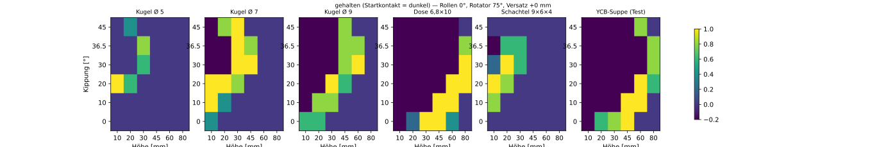

# Startpose „von oben“ — Suche (automatisch erzeugt)

Erzeugt von `isaac_lab/tools/auswertung_startpose_oben.py` aus `logs/startpose_oben/*.csv` (`tools/suche_startpose_oben.py`: Regel „alle schließen“, Rotator hält seine Startstellung, Tisch senkt sich wie gewohnt; je Kombination mehrere Wiederholungen mit Zufallsgröße/-masse/-lage). Höhe = tiefste Fingerspitze (auch Daumen) über dem Tisch; Versatz = Objektmitte ggü. Greifmitte längs der Finger (− = Richtung Fingerspitzen). „Sauber“ = kein Startkontakt Hand↔Objekt, kein Hand↔Tisch vor dem Schließen.

Objekte: Kugel Ø 5, Kugel Ø 7, Kugel Ø 9, Dose 6,8×10, Schachtel 9×6×4, YCB-Suppe (Test); Auswahl über Kugel Ø 5, Kugel Ø 7, Kugel Ø 9, Dose 6,8×10, Schachtel 9×6×4.

## Beste Posen (eine Pose für alle Objekte, Höhe je Objekt)

| Rang | Kippung | Rollen | Rotator | Versatz | Mittel gehalten | schwächstes | je Objekt: Höhe → gehalten / Tisch beim Schließen / Handfläche |
|---|---|---|---|---|---|---|---|
| 1 | 20° | 0° | 75° | +0 mm | 100 % | 100 % | Kugel Ø 5 10 mm → 100 %/0 %/0 %; Kugel Ø 7 10 mm → 100 %/0 %/0 %; Kugel Ø 9 30 mm → 100 %/0 %/0 %; Dose 6,8×10 60 mm → 100 %/0 %/0 %; Schachtel 9×6×4 10 mm → 100 %/0 %/0 % |
| 2 | 20° | 8° | 75° | +0 mm | 100 % | 100 % | Kugel Ø 5 10 mm → 100 %/100 %/0 %; Kugel Ø 7 20 mm → 100 %/0 %/0 %; Kugel Ø 9 45 mm → 100 %/0 %/0 %; Dose 6,8×10 60 mm → 100 %/0 %/0 %; Schachtel 9×6×4 20 mm → 100 %/0 %/0 % |
| 3 | 20° | 0° | 90° | +0 mm | 96 % | 80 % | Kugel Ø 5 10 mm → 80 %/0 %/0 %; Kugel Ø 7 10 mm → 100 %/0 %/0 %; Kugel Ø 9 30 mm → 100 %/0 %/0 %; Dose 6,8×10 60 mm → 100 %/0 %/0 %; Schachtel 9×6×4 10 mm → 100 %/0 %/0 % |
| 4 | 20° | 4° | 75° | +0 mm | 96 % | 80 % | Kugel Ø 5 10 mm → 100 %/0 %/0 %; Kugel Ø 7 10 mm → 100 %/0 %/0 %; Kugel Ø 9 45 mm → 80 %/0 %/0 %; Dose 6,8×10 60 mm → 100 %/0 %/0 %; Schachtel 9×6×4 10 mm → 100 %/0 %/0 % |
| 5 | 20° | 4° | 75° | +20 mm | 96 % | 80 % | Kugel Ø 5 10 mm → 80 %/0 %/0 %; Kugel Ø 7 10 mm → 100 %/0 %/0 %; Kugel Ø 9 45 mm → 100 %/0 %/0 %; Dose 6,8×10 60 mm → 100 %/0 %/0 %; Schachtel 9×6×4 20 mm → 100 %/0 %/0 % |
| 6 | 30° | 0° | 90° | +0 mm | 96 % | 80 % | Kugel Ø 5 20 mm → 100 %/0 %/0 %; Kugel Ø 7 30 mm → 100 %/0 %/0 %; Kugel Ø 9 45 mm → 100 %/0 %/0 %; Dose 6,8×10 80 mm → 80 %/0 %/0 %; Schachtel 9×6×4 20 mm → 100 %/0 %/0 % |
| 7 | 20° | 4° | 90° | +0 mm | 92 % | 80 % | Kugel Ø 5 10 mm → 80 %/0 %/0 %; Kugel Ø 7 10 mm → 100 %/0 %/0 %; Kugel Ø 9 30 mm → 100 %/0 %/0 %; Dose 6,8×10 60 mm → 80 %/0 %/0 %; Schachtel 9×6×4 10 mm → 100 %/0 %/0 % |
| 8 | 36.5° | 8° | 90° | +0 mm | 92 % | 80 % | Kugel Ø 5 30 mm → 80 %/0 %/0 %; Kugel Ø 7 30 mm → 100 %/0 %/0 %; Kugel Ø 9 45 mm → 100 %/0 %/0 %; Dose 6,8×10 80 mm → 100 %/0 %/0 %; Schachtel 9×6×4 30 mm → 80 %/0 %/0 % |
| 9 | 20° | 0° | 90° | +20 mm | 92 % | 60 % | Kugel Ø 5 10 mm → 60 %/0 %/0 %; Kugel Ø 7 10 mm → 100 %/0 %/0 %; Kugel Ø 9 30 mm → 100 %/0 %/0 %; Dose 6,8×10 45 mm → 100 %/0 %/0 %; Schachtel 9×6×4 10 mm → 100 %/0 %/0 % |
| 10 | 20° | 8° | 90° | +0 mm | 92 % | 60 % | Kugel Ø 5 10 mm → 100 %/0 %/0 %; Kugel Ø 7 10 mm → 100 %/0 %/0 %; Kugel Ø 9 45 mm → 60 %/0 %/0 %; Dose 6,8×10 60 mm → 100 %/0 %/0 %; Schachtel 9×6×4 10 mm → 100 %/0 %/0 % |
| 11 | 30° | 0° | 75° | +0 mm | 92 % | 60 % | Kugel Ø 5 30 mm → 60 %/0 %/0 %; Kugel Ø 7 30 mm → 100 %/0 %/0 %; Kugel Ø 9 60 mm → 100 %/0 %/0 %; Dose 6,8×10 80 mm → 100 %/0 %/0 %; Schachtel 9×6×4 20 mm → 100 %/100 %/0 % |
| 12 | 20° | 8° | 75° | +20 mm | 88 % | 80 % | Kugel Ø 5 20 mm → 80 %/0 %/0 %; Kugel Ø 7 20 mm → 100 %/0 %/0 %; Kugel Ø 9 45 mm → 80 %/0 %/0 %; Dose 6,8×10 80 mm → 80 %/0 %/0 %; Schachtel 9×6×4 10 mm → 100 %/100 %/0 % |

## Höhe je Objekt für die beste Pose

| Objekt | Objekthöhe | beste Höhe der tiefsten Spitze | gehalten | Tisch beim Schließen | Handfläche | Finger am Objekt | Objektweg |
|---|---|---|---|---|---|---|---|
| Kugel Ø 5 | 50 mm | 10 mm | 100 % | 0 % | 0 % | 3.4 | 14 mm |
| Kugel Ø 7 | 70 mm | 10 mm | 100 % | 0 % | 0 % | 3.2 | 24 mm |
| Kugel Ø 9 | 90 mm | 30 mm | 100 % | 0 % | 0 % | 4.0 | 29 mm |
| Dose 6,8×10 | 100 mm | 60 mm | 100 % | 0 % | 0 % | 3.7 | 20 mm |
| Schachtel 9×6×4 | 40 mm | 10 mm | 100 % | 0 % | 0 % | 3.7 | 37 mm |
| YCB-Suppe (Test) | 102 mm | 60 mm | 100 % | 0 % | 0 % | 3.8 | 21 mm |

Lineare Näherung über die Benchmark-Objekte: Höhe ≈ 0.73 · Objekthöhe -27 mm (nur Hinweis — das Raster ist grob, Höhen 10, 20, 30, 45, 60, 80 mm).

Gesamt je Objekt (alle Posen): Kugel Ø 5 gehalten 6 %, sauber 98 %; Kugel Ø 7 gehalten 22 %, sauber 81 %; Kugel Ø 9 gehalten 33 %, sauber 48 %; Dose 6,8×10 gehalten 41 %, sauber 29 %; Schachtel 9×6×4 gehalten 14 %, sauber 91 %; YCB-Suppe (Test) gehalten 37 %, sauber 34 %
