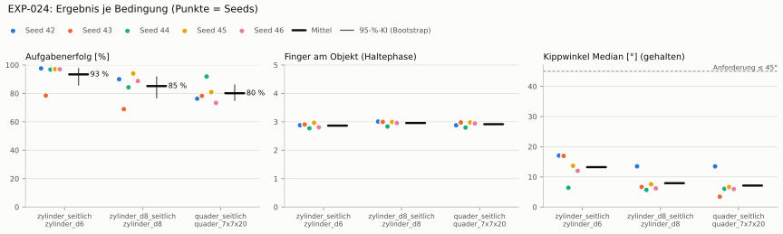
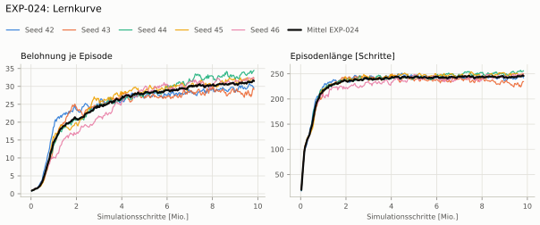
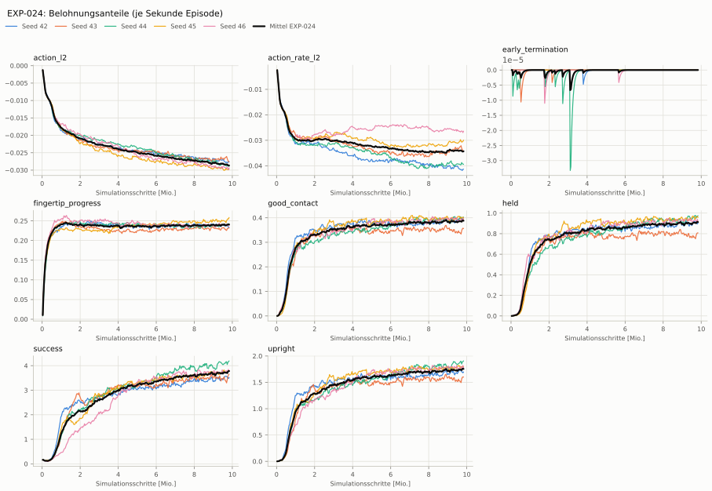
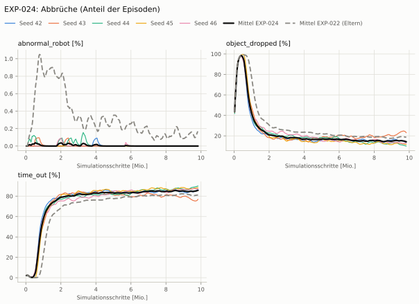
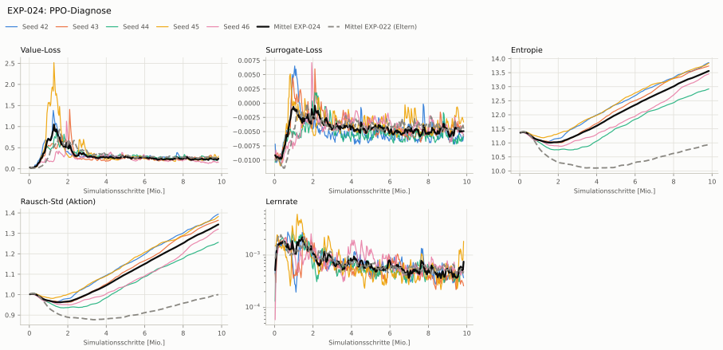

# EXP-024: EXP-022 mit geglätteter Aktion (gleitender Mittelwert α = 0,3)

**Leistung** 87 % [81–92 %] (erfolgreiche Seeds, IQM über die Objekte; je Objekt Ø 6 cm 97 % · Ø 8 cm 89 % · Quader 78 %) — ggü. EXP-022: P(besser) = 0.63 [0.43–0.83] → kein Unterschied

**Testobjekte** (nie trainiert, erfolgreiche Seeds, Median): Flasche 85 % · Saftpackung 87 % · Cracker (YCB) 85 % · Zucker (YCB) 98 % · Senf (YCB) 97 %

**Zuverlässigkeit** 5/5 Seeds erfolgreich [48–100 %] — EXP-022: 5/5, exakter Fisher-Test p = 1.00 → nicht unterscheidbar (für eine Aussage ≥ 10 Seeds je Experiment)

**Leitplanken** eingehalten

**Befund** Engpass Quader (78 %); Kippwinkel 13° (EXP-022: 20°); Unruhe wirksam 0.17 (EXP-022: 0.36)

**Urteilsvorschlag** (auswertung-v2): **kein Unterschied**

**Beste Videos** (Seed 44, 3 Episoden): [Ø 6 cm](beste_videos/EXP-024_zylinder_d6_s44.mp4) · [Ø 8 cm](beste_videos/EXP-024_zylinder_d8_s44.mp4) · [Quader](beste_videos/EXP-024_quader_7x7x20_s44.mp4)

Ergebnisse je Bedingung (eval-v2, Leitplanken, Fehlerarten, Fingernutzung)

#### Bedingung `zylinder_seitlich`

Bedingung `zylinder_seitlich` (Objekt `zylinder_d6`, Kippwinkel ≤ 45°), Protokoll eval-v2, 5 Seed(s); Spalte EXP-022 unter derselben Anforderung

| Metrik | Mittel | 95-%-KI | IQM | Fehlschlag-Seeds (< 50 %) | EXP-022 (Mittel / IQM) |
|---|---|---|---|---|---|
| aufgabenerfolg | 93.4 % | 85.9 % – 97.5 % | 97.0 % | 0.0 % | 88.6 % / 90.7 % |
| haltequote | 93.7 % | 86.0 % – 97.7 % | 97.3 % | 0.0 % | 90.0 % / 92.1 % |
| Kippwinkel Median [°] | 13.2 | | | | 19.7 |
| Unterarm Median [°] | 11.1 | | | | 25.1 |
| Griffkraft Mittel [N] | 77.6 | | | | 104 |
| Kraft > 15 N [Anteil] | 99.8 % | | | | 100.0 % |
| Stall-Anteil [Anteil] | 96.7 % | | | | 97.4 % |
| Absinken [mm] | 0.0191 | | | | 0.00968 |
| Unruhe | 2.98 | | | | 0.356 |
| Unruhe wirksam (Aktion auf ±1 begrenzt) | 0.175 | | | | 0.356 |
| Objektweg Tischebene Ende [mm] | 94.3 | | | | 112 |

Fehlerarten: startfehler 0.0 %, gefallen 6.3 %, instabil 0.0 %, anforderung_verletzt 0.3 %

**Urteilsvorschlag: kein messbarer Unterschied** (gegenüber EXP-022)
Unterschied Aufgabenerfolg +4.9 Prozentpunkte (95-%-KI -5.4 … +13.9)

Je Seed: 97.5 %, 78.5 %, 96.8 %, 97.1 %, 97.0 %

Fingernutzung (Haltephase): im Mittel 2.87 Finger am Objekt; Kontaktanteil je Seed (Daumen, Zeige, Mittel, Ring, klein): 100/91/98/0/0 · 95/96/0/99/0 · 100/91/0/0/86 · 100/0/100/97/0 · 100/82/0/99/0

#### Bedingung `zylinder_d8_seitlich`

Bedingung `zylinder_d8_seitlich` (Objekt `zylinder_d8`, Kippwinkel ≤ 45°), Protokoll eval-v2, 5 Seed(s); Spalte EXP-022 unter derselben Anforderung

| Metrik | Mittel | 95-%-KI | IQM | Fehlschlag-Seeds (< 50 %) | EXP-022 (Mittel / IQM) |
|---|---|---|---|---|---|
| aufgabenerfolg | 85.2 % | 76.9 % – 91.6 % | 87.8 % | 0.0 % | 84.5 % / 83.7 % |
| haltequote | 85.4 % | 76.8 % – 91.8 % | 88.1 % | 0.0 % | 85.7 % / 85.1 % |
| Kippwinkel Median [°] | 7.92 | | | | 14.9 |
| Unterarm Median [°] | 8.4 | | | | 18.8 |
| Griffkraft Mittel [N] | 80.7 | | | | 93.6 |
| Kraft > 15 N [Anteil] | 100.0 % | | | | 100.0 % |
| Stall-Anteil [Anteil] | 96.9 % | | | | 97.7 % |
| Absinken [mm] | 0.021 | | | | 0.00899 |
| Unruhe | 3.19 | | | | 0.227 |
| Unruhe wirksam (Aktion auf ±1 begrenzt) | 0.173 | | | | 0.227 |
| Objektweg Tischebene Ende [mm] | 95 | | | | – |

Fehlerarten: startfehler 0.0 %, gefallen 14.6 %, instabil 0.0 %, anforderung_verletzt 0.2 %

**Urteilsvorschlag: kein messbarer Unterschied** (gegenüber EXP-022)
Unterschied Aufgabenerfolg +0.8 Prozentpunkte (95-%-KI -8.1 … +8.6)

Je Seed: 90.0 %, 68.9 %, 84.3 %, 94.0 %, 88.7 %

Fingernutzung (Haltephase): im Mittel 2.96 Finger am Objekt; Kontaktanteil je Seed (Daumen, Zeige, Mittel, Ring, klein): 100/100/99/0/3 · 100/100/0/100/0 · 100/100/0/0/84 · 100/0/100/100/0 · 100/97/0/98/0

#### Bedingung `quader_seitlich`

Bedingung `quader_seitlich` (Objekt `quader_7x7x20`, Kippwinkel ≤ 45°), Protokoll eval-v2, 5 Seed(s); Spalte EXP-022 unter derselben Anforderung

| Metrik | Mittel | 95-%-KI | IQM | Fehlschlag-Seeds (< 50 %) | EXP-022 (Mittel / IQM) |
|---|---|---|---|---|---|
| aufgabenerfolg | 80.1 % | 75.1 % – 86.0 % | 78.5 % | 0.0 % | 78.9 % / 79.0 % |
| haltequote | 80.2 % | 75.3 % – 86.3 % | 78.5 % | 0.0 % | 79.3 % / 79.4 % |
| Kippwinkel Median [°] | 7.11 | | | | 14.8 |
| Unterarm Median [°] | 8.6 | | | | 17.2 |
| Griffkraft Mittel [N] | 78 | | | | 87.7 |
| Kraft > 15 N [Anteil] | 99.9 % | | | | 99.9 % |
| Stall-Anteil [Anteil] | 96.7 % | | | | 97.6 % |
| Absinken [mm] | 0.0187 | | | | 0 |
| Unruhe | 3.29 | | | | 0.675 |
| Unruhe wirksam (Aktion auf ±1 begrenzt) | 0.176 | | | | 0.675 |
| Objektweg Tischebene Ende [mm] | 93.8 | | | | – |

Fehlerarten: startfehler 0.0 %, gefallen 19.8 %, instabil 0.0 %, anforderung_verletzt 0.0 %

**Urteilsvorschlag: kein messbarer Unterschied** (gegenüber EXP-022)
Unterschied Aufgabenerfolg +1.2 Prozentpunkte (95-%-KI -2.6 … +5.5)

Je Seed: 76.3 %, 78.3 %, 91.9 %, 80.9 %, 73.3 %

Fingernutzung (Haltephase): im Mittel 2.92 Finger am Objekt; Kontaktanteil je Seed (Daumen, Zeige, Mittel, Ring, klein): 98/93/96/0/1 · 100/99/0/98/1 · 99/96/0/2/82 · 100/0/98/100/0 · 100/95/0/100/0

#### Bedingung `flasche_seitlich`

Bedingung `flasche_seitlich` (Objekt `flasche_d7x25`, Kippwinkel ≤ 45°), Protokoll eval-v2, 5 Seed(s); Spalte EXP-022 unter derselben Anforderung

| Metrik | Mittel | 95-%-KI | IQM | Fehlschlag-Seeds (< 50 %) | EXP-022 (Mittel / IQM) |
|---|---|---|---|---|---|
| aufgabenerfolg | 86.6 % | 82.4 % – 90.7 % | 86.9 % | 0.0 % | 86.4 % / 86.8 % |
| haltequote | 88.2 % | 83.4 % – 91.8 % | 89.6 % | 0.0 % | 89.0 % / 88.5 % |
| Kippwinkel Median [°] | 8.92 | | | | 16.6 |
| Unterarm Median [°] | 8.85 | | | | 21.3 |
| Griffkraft Mittel [N] | 81 | | | | 98.2 |
| Kraft > 15 N [Anteil] | 99.9 % | | | | 100.0 % |
| Stall-Anteil [Anteil] | 96.8 % | | | | 97.6 % |
| Absinken [mm] | 0.00678 | | | | 0.0016 |
| Unruhe | 3.25 | | | | 0.277 |
| Unruhe wirksam (Aktion auf ±1 begrenzt) | 0.181 | | | | 0.277 |
| Objektweg Tischebene Ende [mm] | 93.8 | | | | – |

Fehlerarten: startfehler 0.0 %, gefallen 11.8 %, instabil 0.0 %, anforderung_verletzt 1.7 %

**Urteilsvorschlag: kein messbarer Unterschied** (gegenüber EXP-022)
Unterschied Aufgabenerfolg +0.2 Prozentpunkte (95-%-KI -5.1 … +4.7)

Je Seed: 92.5 %, 79.0 %, 85.2 %, 90.7 %, 85.4 %

Fingernutzung (Haltephase): im Mittel 2.93 Finger am Objekt; Kontaktanteil je Seed (Daumen, Zeige, Mittel, Ring, klein): 100/100/97/0/0 · 100/100/0/99/0 · 100/100/0/0/80 · 100/0/100/100/0 · 99/96/0/97/0

#### Bedingung `saftpackung_seitlich`

Bedingung `saftpackung_seitlich` (Objekt `saftpackung_9x6x19`, Kippwinkel ≤ 45°), Protokoll eval-v2, 5 Seed(s); Spalte EXP-022 unter derselben Anforderung

| Metrik | Mittel | 95-%-KI | IQM | Fehlschlag-Seeds (< 50 %) | EXP-022 (Mittel / IQM) |
|---|---|---|---|---|---|
| aufgabenerfolg | 86.9 % | 83.6 % – 90.2 % | 86.5 % | 0.0 % | 84.8 % / 84.2 % |
| haltequote | 86.9 % | 83.6 % – 90.4 % | 86.6 % | 0.0 % | 85.0 % / 84.3 % |
| Kippwinkel Median [°] | 8.17 | | | | 16.2 |
| Unterarm Median [°] | 8.91 | | | | 18.6 |
| Griffkraft Mittel [N] | 73.8 | | | | 89.3 |
| Kraft > 15 N [Anteil] | 100.0 % | | | | 100.0 % |
| Stall-Anteil [Anteil] | 96.5 % | | | | 97.4 % |
| Absinken [mm] | 0.00647 | | | | 0.0138 |
| Unruhe | 3.31 | | | | 0.644 |
| Unruhe wirksam (Aktion auf ±1 begrenzt) | 0.188 | | | | 0.644 |
| Objektweg Tischebene Ende [mm] | 94.4 | | | | – |

Fehlerarten: startfehler 0.0 %, gefallen 13.1 %, instabil 0.0 %, anforderung_verletzt 0.0 %

**Urteilsvorschlag: kein messbarer Unterschied** (gegenüber EXP-022)
Unterschied Aufgabenerfolg +2.2 Prozentpunkte (95-%-KI -5.9 … +8.9)

Je Seed: 88.4 %, 92.9 %, 87.1 %, 83.9 %, 82.2 %

Fingernutzung (Haltephase): im Mittel 2.96 Finger am Objekt; Kontaktanteil je Seed (Daumen, Zeige, Mittel, Ring, klein): 97/92/96/0/0 · 100/100/0/100/0 · 99/100/0/0/95 · 100/0/100/100/0 · 100/100/0/100/0

#### Bedingung `ycb_cracker_seitlich`

Bedingung `ycb_cracker_seitlich` (Objekt `ycb_003_cracker`, Kippwinkel ≤ 45°), Protokoll eval-v2, 5 Seed(s); Spalte EXP-022 unter derselben Anforderung

| Metrik | Mittel | 95-%-KI | IQM | Fehlschlag-Seeds (< 50 %) | EXP-022 (Mittel / IQM) |
|---|---|---|---|---|---|
| aufgabenerfolg | 87.5 % | 83.7 % – 92.6 % | 86.0 % | 0.0 % | 84.3 % / 83.4 % |
| haltequote | 87.5 % | 83.5 % – 92.5 % | 86.0 % | 0.0 % | 84.4 % / 83.4 % |
| Kippwinkel Median [°] | 8.21 | | | | 12.4 |
| Unterarm Median [°] | 8.54 | | | | 15.6 |
| Griffkraft Mittel [N] | 81.1 | | | | 92.4 |
| Kraft > 15 N [Anteil] | 100.0 % | | | | 100.0 % |
| Stall-Anteil [Anteil] | 96.9 % | | | | 97.6 % |
| Absinken [mm] | 2.56 | | | | 1.33 |
| Unruhe | 2.53 | | | | 0.49 |
| Unruhe wirksam (Aktion auf ±1 begrenzt) | 0.134 | | | | 0.49 |
| Objektweg Tischebene Ende [mm] | 101 | | | | – |

Fehlerarten: startfehler 0.0 %, gefallen 12.5 %, instabil 0.0 %, anforderung_verletzt 0.1 %

**Urteilsvorschlag: kein messbarer Unterschied** (gegenüber EXP-022)
Unterschied Aufgabenerfolg +3.2 Prozentpunkte (95-%-KI -3.4 … +9.4)

Je Seed: 84.5 %, 82.3 %, 96.9 %, 84.9 %, 88.8 %

Fingernutzung (Haltephase): im Mittel 2.99 Finger am Objekt; Kontaktanteil je Seed (Daumen, Zeige, Mittel, Ring, klein): 100/98/99/0/0 · 100/100/0/100/0 · 99/99/0/3/95 · 100/0/100/100/0 · 100/100/0/100/0

#### Bedingung `ycb_zucker_seitlich`

Bedingung `ycb_zucker_seitlich` (Objekt `ycb_004_zucker`, Kippwinkel ≤ 45°), Protokoll eval-v2, 5 Seed(s); Spalte EXP-022 unter derselben Anforderung

| Metrik | Mittel | 95-%-KI | IQM | Fehlschlag-Seeds (< 50 %) | EXP-022 (Mittel / IQM) |
|---|---|---|---|---|---|
| aufgabenerfolg | 96.8 % | 93.8 % – 98.6 % | 97.9 % | 0.0 % | 88.6 % / 90.1 % |
| haltequote | 97.2 % | 94.8 % – 98.8 % | 98.0 % | 0.0 % | 90.5 % / 91.0 % |
| Kippwinkel Median [°] | 13.2 | | | | 20.8 |
| Unterarm Median [°] | 11.4 | | | | 24.1 |
| Griffkraft Mittel [N] | 70.5 | | | | 102 |
| Kraft > 15 N [Anteil] | 99.9 % | | | | 99.9 % |
| Stall-Anteil [Anteil] | 96.7 % | | | | 96.8 % |
| Absinken [mm] | 2.1 | | | | 2.15 |
| Unruhe | 2.66 | | | | 0.406 |
| Unruhe wirksam (Aktion auf ±1 begrenzt) | 0.133 | | | | 0.406 |
| Objektweg Tischebene Ende [mm] | 94.8 | | | | – |

Fehlerarten: startfehler 0.0 %, gefallen 2.8 %, instabil 0.0 %, anforderung_verletzt 0.4 %

**Urteilsvorschlag: besser** (gegenüber EXP-022)
Unterschied Aufgabenerfolg +8.3 Prozentpunkte (95-%-KI +0.9 … +15.6)

Je Seed: 98.4 %, 99.1 %, 97.8 %, 91.2 %, 97.6 %

Fingernutzung (Haltephase): im Mittel 2.97 Finger am Objekt; Kontaktanteil je Seed (Daumen, Zeige, Mittel, Ring, klein): 99/89/100/0/0 · 100/100/0/100/0 · 100/100/0/0/99 · 100/4/100/94/0 · 100/100/0/100/0

#### Bedingung `ycb_senf_seitlich`

Bedingung `ycb_senf_seitlich` (Objekt `ycb_006_senf`, Kippwinkel ≤ 45°), Protokoll eval-v2, 5 Seed(s); Spalte EXP-022 unter derselben Anforderung

| Metrik | Mittel | 95-%-KI | IQM | Fehlschlag-Seeds (< 50 %) | EXP-022 (Mittel / IQM) |
|---|---|---|---|---|---|
| aufgabenerfolg | 92.8 % | 84.6 % – 97.9 % | 95.9 % | 0.0 % | 81.6 % / 83.1 % |
| haltequote | 94.0 % | 87.4 % – 98.5 % | 96.3 % | 0.0 % | 84.8 % / 86.1 % |
| Kippwinkel Median [°] | 12.1 | | | | 22.7 |
| Unterarm Median [°] | 10.4 | | | | 19.9 |
| Griffkraft Mittel [N] | 76.5 | | | | 101 |
| Kraft > 15 N [Anteil] | 100.0 % | | | | 100.0 % |
| Stall-Anteil [Anteil] | 96.7 % | | | | 97.2 % |
| Absinken [mm] | 4.17 | | | | 4.91 |
| Unruhe | 2.69 | | | | 0.224 |
| Unruhe wirksam (Aktion auf ±1 begrenzt) | 0.137 | | | | 0.224 |
| Objektweg Tischebene Ende [mm] | 92 | | | | – |

Fehlerarten: startfehler 0.0 %, gefallen 6.0 %, instabil 0.0 %, anforderung_verletzt 1.2 %

**Urteilsvorschlag: besser** (gegenüber EXP-022)
Unterschied Aufgabenerfolg +11.4 Prozentpunkte (95-%-KI +0.5 … +21.5)

Je Seed: 97.1 %, 99.3 %, 96.8 %, 77.1 %, 93.6 %

Fingernutzung (Haltephase): im Mittel 2.98 Finger am Objekt; Kontaktanteil je Seed (Daumen, Zeige, Mittel, Ring, klein): 100/95/100/0/0 · 100/100/0/100/0 · 100/100/0/0/97 · 100/3/100/97/0 · 100/100/0/100/0

Trainingsverlauf

Seeds dünn, Mittel kräftig, Eltern gestrichelt (nur Abbrüche/PPO — Trainings-Belohnung ist zwischen Experimenten nicht vergleichbar); geglättet, x = Simulationsschritte. Endwerte = Mittel der letzten 10 Iterationen (Belohnungsanteile je Sekunde Episode).

| Größe | Seed 42 | Seed 43 | Seed 44 | Seed 45 | Seed 46 | Mittel |
|---|---|---|---|---|---|---|
| mean_reward | 30.2 | 28.6 | 34.3 | 32.1 | 32.3 | 31.5 |
| action_l2 | -0.0278 | -0.0271 | -0.0288 | -0.0298 | -0.0294 | -0.0286 |
| action_rate_l2 | -0.0416 | -0.0335 | -0.0394 | -0.0302 | -0.0266 | -0.0343 |
| early_termination | 0 | 0 | 0 | 0 | 0 | 0 |
| fingertip_progress | 0.236 | 0.23 | 0.241 | 0.253 | 0.24 | 0.24 |
| good_contact | 0.395 | 0.35 | 0.4 | 0.401 | 0.392 | 0.388 |
| held | 0.913 | 0.791 | 0.972 | 0.961 | 0.927 | 0.913 |
| success | 3.55 | 3.53 | 4.16 | 3.77 | 3.78 | 3.76 |
| upright | 1.71 | 1.57 | 1.89 | 1.8 | 1.78 | 1.75 |
| object_dropped | 14.3 % | 24.1 % | 10.4 % | 11.8 % | 12.7 % | 14.7 % |
| mean_noise_std | 1.39 | 1.36 | 1.25 | 1.38 | 1.32 | 1.34 |

Netz, Training und Konfiguration

Actor [256, 128, 64] (elu), 68808 Parameter, 105 Eingänge (Verlauf 5) · Critic [512, 256, 128] · PPO: Lernrate 0.001, Entropie 0.005, 5 Epochen × 4 Mini-Batches, 32 Schritte/Umgebung · 1024 Umgebungen × 300 Iterationen

Geplante Änderung: Aktion vor den Servos geglättet: a_f ← 0,3·a + 0,7·a_f (mdp.FilteredRelativeJointPositionAction, Env HeavyMultiProgressFilter, Agent Clip, Task HeavyMultiProgressClipFilter-v0); Bewertung mit --action_filter 0.3 (experiments.clip_args liest alpha aus env.yaml). Sonst wie EXP-022. reward_diag mit EXP-022 s42 (ohne Filter trainiert): 228/256 gehalten, Belohnungsanteile wie ohne Filter.

Konfiguration gegenüber EXP-022 (2 Unterschiede):

- `env.actions.servos.alpha: ∅ → 0.3`
- `env.actions.servos.class_type: isaaclab.envs.mdp.actions.joint_actions:RelativeJointPositionAction → pib_grasp.mdp:FilteredRelativeJointPositionAction`

