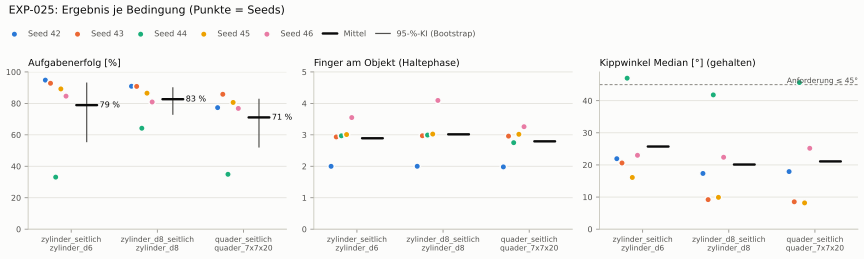
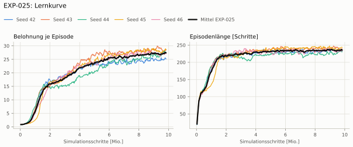
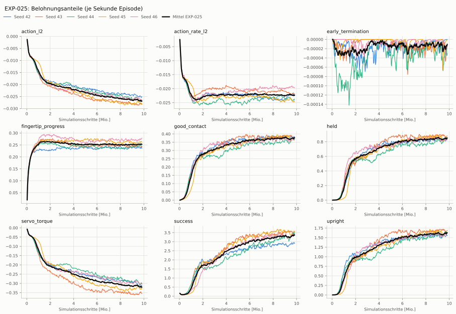
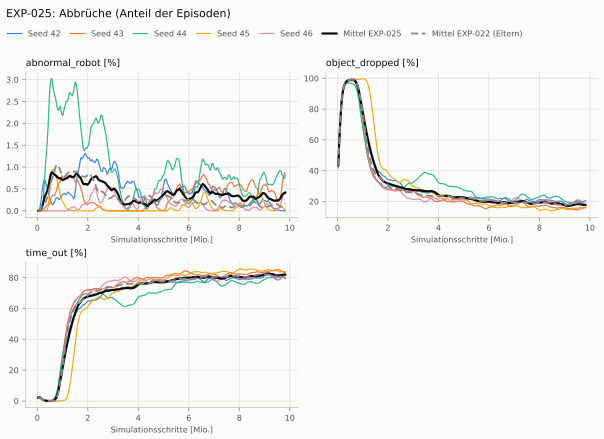
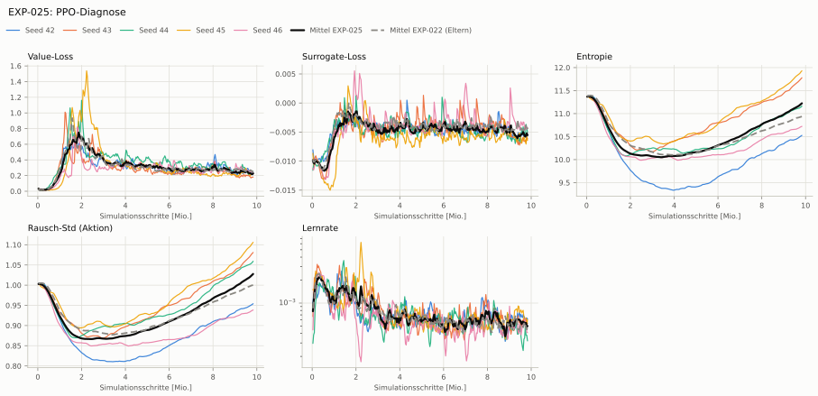

# EXP-025: EXP-022 mit Strafe auf das normierte Servo-Moment

**Leistung** 86 % [83–89 %] (erfolgreiche Seeds, IQM über die Objekte; je Objekt Ø 6 cm 91 % · Ø 8 cm 89 % · Quader 79 %) — ggü. EXP-022: P(besser) = 0.62 [0.38–0.83] → kein Unterschied

**Testobjekte** (nie trainiert, erfolgreiche Seeds, Median): Flasche 80 % · Saftpackung 88 % · Cracker (YCB) 83 % · Zucker (YCB) 84 % · Senf (YCB) 77 %

**Zuverlässigkeit** 4/5 Seeds erfolgreich [28–99 %] — EXP-022: 5/5, exakter Fisher-Test p = 1.00 → nicht unterscheidbar (für eine Aussage ≥ 10 Seeds je Experiment)

**Leitplanken** Kippwinkel Median [°]: 25.7 > 24.7 ✗

**Befund** ohne Erfolg: Seed 44 (hält, aber gekippt); Engpass Quader (79 %); Kippwinkel 26° (EXP-022: 20°)

**Urteilsvorschlag** (auswertung-v2): **kein Unterschied, Leitplanke verletzt**

**Beste Videos** (Seed 43, 3 Episoden): [Ø 6 cm](beste_videos/EXP-025_zylinder_d6_s43.mp4) · [Ø 8 cm](beste_videos/EXP-025_zylinder_d8_s43.mp4) · [Quader](beste_videos/EXP-025_quader_7x7x20_s43.mp4)

Ergebnisse je Bedingung (eval-v2, Leitplanken, Fehlerarten, Fingernutzung)

#### Bedingung `zylinder_seitlich`

Bedingung `zylinder_seitlich` (Objekt `zylinder_d6`, Kippwinkel ≤ 45°), Protokoll eval-v2, 5 Seed(s); Spalte EXP-022 unter derselben Anforderung

| Metrik | Mittel | 95-%-KI | IQM | Fehlschlag-Seeds (< 50 %) | EXP-022 (Mittel / IQM) |
|---|---|---|---|---|---|
| aufgabenerfolg | 78.9 % | 55.7 % – 92.9 % | 88.9 % | 20.0 % | 88.6 % / 90.7 % |
| haltequote | 91.3 % | 88.7 % – 93.8 % | 91.1 % | 0.0 % | 90.0 % / 92.1 % |
| Kippwinkel Median [°] | 25.7 | | | | 19.7 |
| Unterarm Median [°] | 23.4 | | | | 25.1 |
| Griffkraft Mittel [N] | 87.7 | | | | 104 |
| Kraft > 15 N [Anteil] | 100.0 % | | | | 100.0 % |
| Stall-Anteil [Anteil] | 96.5 % | | | | 97.4 % |
| Absinken [mm] | 0 | | | | 0.00968 |
| Unruhe | 0.395 | | | | 0.356 |
| Unruhe wirksam (Aktion auf ±1 begrenzt) | 0.395 | | | | 0.356 |
| Objektweg Tischebene Ende [mm] | 128 | | | | 112 |

Fehlerarten: startfehler 0.0 %, gefallen 8.4 %, instabil 0.3 %, anforderung_verletzt 12.4 %

**Urteilsvorschlag: kein messbarer Unterschied** (gegenüber EXP-022)
Unterschied Aufgabenerfolg -9.7 Prozentpunkte (95-%-KI -27.1 … +0.1)
- Leitplanke: Kippwinkel Median [°]: 25.7 > 24.7

Je Seed: 94.8 %, 92.8 %, 33.1 %, 89.2 %, 84.6 %

Fingernutzung (Haltephase): im Mittel 2.89 Finger am Objekt; Kontaktanteil je Seed (Daumen, Zeige, Mittel, Ring, klein): 100/83/17/0/0 · 100/95/0/98/1 · 100/99/0/0/98 · 98/98/98/5/3 · 100/79/53/26/97

#### Bedingung `zylinder_d8_seitlich`

Bedingung `zylinder_d8_seitlich` (Objekt `zylinder_d8`, Kippwinkel ≤ 45°), Protokoll eval-v2, 5 Seed(s); Spalte EXP-022 unter derselben Anforderung

| Metrik | Mittel | 95-%-KI | IQM | Fehlschlag-Seeds (< 50 %) | EXP-022 (Mittel / IQM) |
|---|---|---|---|---|---|
| aufgabenerfolg | 82.7 % | 73.1 % – 89.9 % | 86.1 % | 0.0 % | 84.5 % / 83.7 % |
| haltequote | 88.3 % | 85.2 % – 91.0 % | 89.1 % | 0.0 % | 85.7 % / 85.1 % |
| Kippwinkel Median [°] | 20.1 | | | | 14.9 |
| Unterarm Median [°] | 21.1 | | | | 18.8 |
| Griffkraft Mittel [N] | 87.8 | | | | 93.6 |
| Kraft > 15 N [Anteil] | 100.0 % | | | | 100.0 % |
| Stall-Anteil [Anteil] | 96.9 % | | | | 97.7 % |
| Absinken [mm] | 0.00427 | | | | 0.00899 |
| Unruhe | 0.368 | | | | 0.227 |
| Unruhe wirksam (Aktion auf ±1 begrenzt) | 0.368 | | | | 0.227 |
| Objektweg Tischebene Ende [mm] | 128 | | | | – |

Fehlerarten: startfehler 0.0 %, gefallen 11.6 %, instabil 0.2 %, anforderung_verletzt 5.6 %

**Urteilsvorschlag: kein messbarer Unterschied** (gegenüber EXP-022)
Unterschied Aufgabenerfolg -1.9 Prozentpunkte (95-%-KI -8.0 … +3.0)
- Leitplanke: Kippwinkel Median [°]: 20.1 > 19.9
- Leitplanke: Unruhe: 0.368 > 0.272
- Leitplanke: Unruhe wirksam (Aktion auf ±1 begrenzt): 0.368 > 0.272

Je Seed: 90.9 %, 90.8 %, 64.2 %, 86.5 %, 80.9 %

Fingernutzung (Haltephase): im Mittel 3.02 Finger am Objekt; Kontaktanteil je Seed (Daumen, Zeige, Mittel, Ring, klein): 100/92/8/0/0 · 100/100/0/97/0 · 100/100/0/0/99 · 100/99/100/3/1 · 100/98/79/35/98

#### Bedingung `quader_seitlich`

Bedingung `quader_seitlich` (Objekt `quader_7x7x20`, Kippwinkel ≤ 45°), Protokoll eval-v2, 5 Seed(s); Spalte EXP-022 unter derselben Anforderung

| Metrik | Mittel | 95-%-KI | IQM | Fehlschlag-Seeds (< 50 %) | EXP-022 (Mittel / IQM) |
|---|---|---|---|---|---|
| aufgabenerfolg | 71.1 % | 52.3 % – 82.6 % | 78.1 % | 20.0 % | 78.9 % / 79.0 % |
| haltequote | 79.0 % | 75.1 % – 83.0 % | 78.7 % | 0.0 % | 79.3 % / 79.4 % |
| Kippwinkel Median [°] | 21.1 | | | | 14.8 |
| Unterarm Median [°] | 20.4 | | | | 17.2 |
| Griffkraft Mittel [N] | 78.3 | | | | 87.7 |
| Kraft > 15 N [Anteil] | 99.8 % | | | | 99.9 % |
| Stall-Anteil [Anteil] | 96.9 % | | | | 97.6 % |
| Absinken [mm] | 0 | | | | 0 |
| Unruhe | 0.596 | | | | 0.675 |
| Unruhe wirksam (Aktion auf ±1 begrenzt) | 0.596 | | | | 0.675 |
| Objektweg Tischebene Ende [mm] | 134 | | | | – |

Fehlerarten: startfehler 0.0 %, gefallen 20.8 %, instabil 0.3 %, anforderung_verletzt 7.9 %

**Urteilsvorschlag: kein messbarer Unterschied** (gegenüber EXP-022)
Unterschied Aufgabenerfolg -7.9 Prozentpunkte (95-%-KI -28.4 … +5.4)
- Leitplanke: Kippwinkel Median [°]: 21.1 > 19.8

Je Seed: 77.3 %, 85.8 %, 34.8 %, 80.6 %, 76.8 %

Fingernutzung (Haltephase): im Mittel 2.79 Finger am Objekt; Kontaktanteil je Seed (Daumen, Zeige, Mittel, Ring, klein): 99/59/41/0/0 · 100/95/0/99/2 · 100/98/0/0/77 · 100/97/99/6/0 · 100/97/28/3/99

#### Bedingung `flasche_seitlich`

Bedingung `flasche_seitlich` (Objekt `flasche_d7x25`, Kippwinkel ≤ 45°), Protokoll eval-v2, 5 Seed(s); Spalte EXP-022 unter derselben Anforderung

| Metrik | Mittel | 95-%-KI | IQM | Fehlschlag-Seeds (< 50 %) | EXP-022 (Mittel / IQM) |
|---|---|---|---|---|---|
| aufgabenerfolg | 72.9 % | 56.3 % – 86.4 % | 76.2 % | 20.0 % | 86.4 % / 86.8 % |
| haltequote | 89.7 % | 86.3 % – 92.8 % | 89.8 % | 0.0 % | 89.0 % / 88.5 % |
| Kippwinkel Median [°] | 24 | | | | 16.6 |
| Unterarm Median [°] | 21.7 | | | | 21.3 |
| Griffkraft Mittel [N] | 86.2 | | | | 98.2 |
| Kraft > 15 N [Anteil] | 100.0 % | | | | 100.0 % |
| Stall-Anteil [Anteil] | 96.6 % | | | | 97.6 % |
| Absinken [mm] | 0.000999 | | | | 0.0016 |
| Unruhe | 0.451 | | | | 0.277 |
| Unruhe wirksam (Aktion auf ±1 begrenzt) | 0.451 | | | | 0.277 |
| Objektweg Tischebene Ende [mm] | 126 | | | | – |

Fehlerarten: startfehler 0.0 %, gefallen 10.3 %, instabil 0.1 %, anforderung_verletzt 16.8 %

**Urteilsvorschlag: schlechter** (gegenüber EXP-022)
Unterschied Aufgabenerfolg -13.7 Prozentpunkte (95-%-KI -29.8 … -0.8)
- Leitplanke: Kippwinkel Median [°]: 24 > 21.6
- Leitplanke: Unruhe: 0.451 > 0.333
- Leitplanke: Unruhe wirksam (Aktion auf ±1 begrenzt): 0.451 > 0.333

Je Seed: 69.1 %, 91.9 %, 42.6 %, 87.8 %, 72.9 %

Fingernutzung (Haltephase): im Mittel 2.85 Finger am Objekt; Kontaktanteil je Seed (Daumen, Zeige, Mittel, Ring, klein): 100/90/10/0/0 · 100/100/0/98/0 · 99/100/0/0/72 · 100/98/100/3/0 · 100/98/64/9/86

#### Bedingung `saftpackung_seitlich`

Bedingung `saftpackung_seitlich` (Objekt `saftpackung_9x6x19`, Kippwinkel ≤ 45°), Protokoll eval-v2, 5 Seed(s); Spalte EXP-022 unter derselben Anforderung

| Metrik | Mittel | 95-%-KI | IQM | Fehlschlag-Seeds (< 50 %) | EXP-022 (Mittel / IQM) |
|---|---|---|---|---|---|
| aufgabenerfolg | 74.4 % | 52.6 % – 88.3 % | 84.0 % | 20.0 % | 84.8 % / 84.2 % |
| haltequote | 87.3 % | 84.0 % – 89.7 % | 88.2 % | 0.0 % | 85.0 % / 84.3 % |
| Kippwinkel Median [°] | 22.8 | | | | 16.2 |
| Unterarm Median [°] | 21.9 | | | | 18.6 |
| Griffkraft Mittel [N] | 78.2 | | | | 89.3 |
| Kraft > 15 N [Anteil] | 100.0 % | | | | 100.0 % |
| Stall-Anteil [Anteil] | 96.6 % | | | | 97.4 % |
| Absinken [mm] | 0 | | | | 0.0138 |
| Unruhe | 0.507 | | | | 0.644 |
| Unruhe wirksam (Aktion auf ±1 begrenzt) | 0.507 | | | | 0.644 |
| Objektweg Tischebene Ende [mm] | 144 | | | | – |

Fehlerarten: startfehler 0.0 %, gefallen 12.4 %, instabil 0.3 %, anforderung_verletzt 12.9 %

**Urteilsvorschlag: kein messbarer Unterschied** (gegenüber EXP-022)
Unterschied Aufgabenerfolg -10.4 Prozentpunkte (95-%-KI -30.2 … +2.5)
- Leitplanke: Kippwinkel Median [°]: 22.8 > 21.2

Je Seed: 87.3 %, 88.2 %, 32.3 %, 88.6 %, 75.4 %

Fingernutzung (Haltephase): im Mittel 2.84 Finger am Objekt; Kontaktanteil je Seed (Daumen, Zeige, Mittel, Ring, klein): 99/60/40/0/0 · 100/100/0/100/0 · 100/100/0/0/90 · 100/100/100/1/0 · 100/100/36/5/92

#### Bedingung `ycb_cracker_seitlich`

Bedingung `ycb_cracker_seitlich` (Objekt `ycb_003_cracker`, Kippwinkel ≤ 45°), Protokoll eval-v2, 5 Seed(s); Spalte EXP-022 unter derselben Anforderung

| Metrik | Mittel | 95-%-KI | IQM | Fehlschlag-Seeds (< 50 %) | EXP-022 (Mittel / IQM) |
|---|---|---|---|---|---|
| aufgabenerfolg | 83.5 % | 81.1 % – 85.8 % | 83.7 % | 0.0 % | 84.3 % / 83.4 % |
| haltequote | 84.9 % | 81.5 % – 88.8 % | 84.0 % | 0.0 % | 84.4 % / 83.4 % |
| Kippwinkel Median [°] | 18.1 | | | | 12.4 |
| Unterarm Median [°] | 19.9 | | | | 15.6 |
| Griffkraft Mittel [N] | 80.3 | | | | 92.4 |
| Kraft > 15 N [Anteil] | 100.0 % | | | | 100.0 % |
| Stall-Anteil [Anteil] | 96.6 % | | | | 97.6 % |
| Absinken [mm] | 2.12 | | | | 1.33 |
| Unruhe | 0.225 | | | | 0.49 |
| Unruhe wirksam (Aktion auf ±1 begrenzt) | 0.225 | | | | 0.49 |
| Objektweg Tischebene Ende [mm] | 158 | | | | – |

Fehlerarten: startfehler 0.0 %, gefallen 14.9 %, instabil 0.2 %, anforderung_verletzt 1.4 %

**Urteilsvorschlag: kein messbarer Unterschied** (gegenüber EXP-022)
Unterschied Aufgabenerfolg -0.8 Prozentpunkte (95-%-KI -4.7 … +2.1)
- Leitplanke: Kippwinkel Median [°]: 18.1 > 17.4

Je Seed: 83.5 %, 86.2 %, 86.1 %, 80.0 %, 81.7 %

Fingernutzung (Haltephase): im Mittel 2.88 Finger am Objekt; Kontaktanteil je Seed (Daumen, Zeige, Mittel, Ring, klein): 100/78/23/0/0 · 100/100/0/100/0 · 100/99/0/0/98 · 100/100/100/1/1 · 100/99/36/5/99

#### Bedingung `ycb_zucker_seitlich`

Bedingung `ycb_zucker_seitlich` (Objekt `ycb_004_zucker`, Kippwinkel ≤ 45°), Protokoll eval-v2, 5 Seed(s); Spalte EXP-022 unter derselben Anforderung

| Metrik | Mittel | 95-%-KI | IQM | Fehlschlag-Seeds (< 50 %) | EXP-022 (Mittel / IQM) |
|---|---|---|---|---|---|
| aufgabenerfolg | 77.7 % | 65.5 % – 87.4 % | 80.8 % | 0.0 % | 88.6 % / 90.1 % |
| haltequote | 86.9 % | 80.1 % – 93.6 % | 87.0 % | 0.0 % | 90.5 % / 91.0 % |
| Kippwinkel Median [°] | 23 | | | | 20.8 |
| Unterarm Median [°] | 22.2 | | | | 24.1 |
| Griffkraft Mittel [N] | 79.2 | | | | 102 |
| Kraft > 15 N [Anteil] | 100.0 % | | | | 99.9 % |
| Stall-Anteil [Anteil] | 96.3 % | | | | 96.8 % |
| Absinken [mm] | 1.42 | | | | 2.15 |
| Unruhe | 0.232 | | | | 0.406 |
| Unruhe wirksam (Aktion auf ±1 begrenzt) | 0.232 | | | | 0.406 |
| Objektweg Tischebene Ende [mm] | 146 | | | | – |

Fehlerarten: startfehler 0.0 %, gefallen 13.0 %, instabil 0.1 %, anforderung_verletzt 9.3 %

**Urteilsvorschlag: schlechter** (gegenüber EXP-022)
Unterschied Aufgabenerfolg -10.9 Prozentpunkte (95-%-KI -20.0 … -3.6)

Je Seed: 85.1 %, 92.0 %, 54.4 %, 82.4 %, 74.3 %

Fingernutzung (Haltephase): im Mittel 2.82 Finger am Objekt; Kontaktanteil je Seed (Daumen, Zeige, Mittel, Ring, klein): 100/67/33/0/0 · 100/100/2/99/0 · 100/99/0/0/93 · 99/99/100/2/2 · 99/97/21/4/95

#### Bedingung `ycb_senf_seitlich`

Bedingung `ycb_senf_seitlich` (Objekt `ycb_006_senf`, Kippwinkel ≤ 45°), Protokoll eval-v2, 5 Seed(s); Spalte EXP-022 unter derselben Anforderung

| Metrik | Mittel | 95-%-KI | IQM | Fehlschlag-Seeds (< 50 %) | EXP-022 (Mittel / IQM) |
|---|---|---|---|---|---|
| aufgabenerfolg | 68.1 % | 50.3 % – 81.4 % | 73.8 % | 20.0 % | 81.6 % / 83.1 % |
| haltequote | 80.6 % | 76.9 % – 84.3 % | 80.8 % | 0.0 % | 84.8 % / 86.1 % |
| Kippwinkel Median [°] | 24.5 | | | | 22.7 |
| Unterarm Median [°] | 21.1 | | | | 19.9 |
| Griffkraft Mittel [N] | 79.6 | | | | 101 |
| Kraft > 15 N [Anteil] | 100.0 % | | | | 100.0 % |
| Stall-Anteil [Anteil] | 96.3 % | | | | 97.2 % |
| Absinken [mm] | 5.25 | | | | 4.91 |
| Unruhe | 0.144 | | | | 0.224 |
| Unruhe wirksam (Aktion auf ±1 begrenzt) | 0.144 | | | | 0.224 |
| Objektweg Tischebene Ende [mm] | 137 | | | | – |

Fehlerarten: startfehler 0.0 %, gefallen 19.4 %, instabil 0.0 %, anforderung_verletzt 12.6 %

**Urteilsvorschlag: kein messbarer Unterschied** (gegenüber EXP-022)
Unterschied Aufgabenerfolg -13.4 Prozentpunkte (95-%-KI -31.8 … +0.5)

Je Seed: 83.8 %, 84.6 %, 33.2 %, 70.8 %, 67.9 %

Fingernutzung (Haltephase): im Mittel 2.83 Finger am Objekt; Kontaktanteil je Seed (Daumen, Zeige, Mittel, Ring, klein): 100/95/5/0/0 · 100/99/0/96/1 · 100/99/0/0/96 · 100/95/98/4/5 · 100/89/41/10/80

Trainingsverlauf

Seeds dünn, Mittel kräftig, Eltern gestrichelt (nur Abbrüche/PPO — Trainings-Belohnung ist zwischen Experimenten nicht vergleichbar); geglättet, x = Simulationsschritte. Endwerte = Mittel der letzten 10 Iterationen (Belohnungsanteile je Sekunde Episode).

| Größe | Seed 42 | Seed 43 | Seed 44 | Seed 45 | Seed 46 | Mittel |
|---|---|---|---|---|---|---|
| mean_reward | 24.9 | 28.1 | 27.9 | 28.5 | 27.2 | 27.3 |
| action_l2 | -0.0251 | -0.028 | -0.027 | -0.0281 | -0.0264 | -0.0269 |
| action_rate_l2 | -0.022 | -0.0218 | -0.0241 | -0.0246 | -0.0195 | -0.0224 |
| early_termination | 0 | -2.51e-05 | -2.51e-05 | 0 | -1.49e-05 | -1.3e-05 |
| fingertip_progress | 0.236 | 0.242 | 0.246 | 0.262 | 0.276 | 0.253 |
| good_contact | 0.379 | 0.379 | 0.372 | 0.379 | 0.371 | 0.376 |
| held | 0.825 | 0.87 | 0.859 | 0.851 | 0.84 | 0.849 |
| servo_torque | -0.31 | -0.351 | -0.304 | -0.33 | -0.304 | -0.32 |
| success | 2.91 | 3.52 | 3.5 | 3.53 | 3.37 | 3.36 |
| upright | 1.55 | 1.67 | 1.66 | 1.63 | 1.61 | 1.62 |
| object_dropped | 19.8 % | 15.8 % | 18.1 % | 16.0 % | 19.3 % | 17.8 % |
| mean_noise_std | 0.951 | 1.08 | 1.06 | 1.1 | 0.936 | 1.02 |

Netz, Training und Konfiguration

Actor [256, 128, 64] (elu), 68808 Parameter, 105 Eingänge (Verlauf 5) · Critic [512, 256, 128] · PPO: Lernrate 0.001, Entropie 0.005, 5 Epochen × 4 Mini-Batches, 32 Schritte/Umgebung · 1024 Umgebungen × 300 Iterationen

Geplante Änderung: Belohnungsterm servo_torque = W · Σ(τ/τ_Stall)² über die 7 Servos außer Handgelenk (mdp.servo_torque_l2, wie die Leitplanke Stall-Anteil), ganze Episode; W = −0,1 (reward_diag mit EXP-022 s42: servo_torque −0,41/−0,47 je s vor dem Absenken/ in der Haltephase ggü. Gegengriff 0,39/0,49 — Dauer-Stall kostet etwa den Gegengriff; Env HeavyMultiProgressTorque, Agent Clip). Sonst wie EXP-022.

Konfiguration gegenüber EXP-022 (12 Unterschiede):

- `env.rewards.servo_torque.func: ∅ → pib_grasp.mdp:servo_torque_l2`
- `env.rewards.servo_torque.params.asset_cfg.body_ids: ∅ → object/apply:builtins.slice(None, None, None)`
- `env.rewards.servo_torque.params.asset_cfg.body_names: ∅ → None`
- `env.rewards.servo_torque.params.asset_cfg.fixed_tendon_ids: ∅ → object/apply:builtins.slice(None, None, None)`
- `env.rewards.servo_torque.params.asset_cfg.fixed_tendon_names: ∅ → None`
- `env.rewards.servo_torque.params.asset_cfg.joint_ids: ∅ → object/apply:builtins.slice(None, None, None)`
- `env.rewards.servo_torque.params.asset_cfg.joint_names: ∅ → ['forearm_left', 'thumb_left_rotator', 'thumb_left_proximal', 'index_left_proximal', 'middle_left_proximal', 'ring_left_proximal', 'pinky_left_proximal']`
- `env.rewards.servo_torque.params.asset_cfg.name: ∅ → robot`
- `env.rewards.servo_torque.params.asset_cfg.object_collection_ids: ∅ → object/apply:builtins.slice(None, None, None)`
- `env.rewards.servo_torque.params.asset_cfg.object_collection_names: ∅ → None`
- `env.rewards.servo_torque.params.asset_cfg.preserve_order: ∅ → True`
- `env.rewards.servo_torque.weight: ∅ → -0.1`

