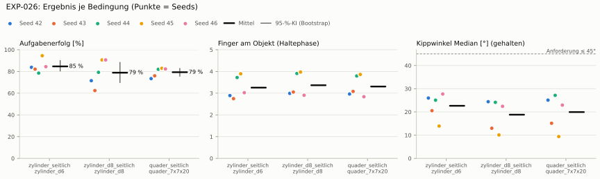
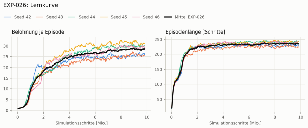
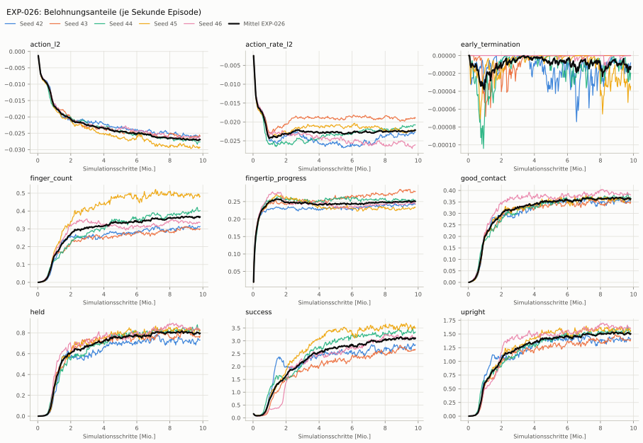
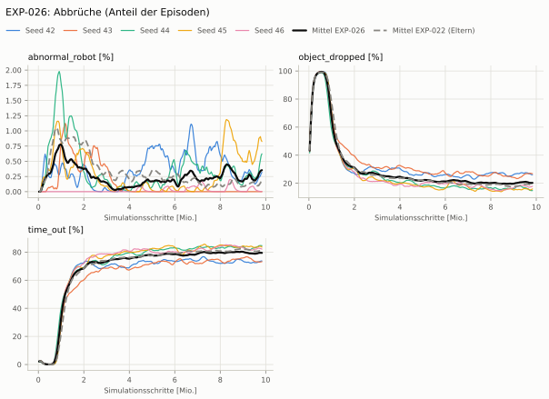
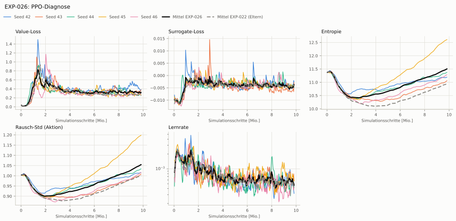

# EXP-026: EXP-022 mit Belohnung nach Zahl der Finger am Objekt

**Leistung** 81 % [78–85 %] (erfolgreiche Seeds, IQM über die Objekte; je Objekt Ø 6 cm 84 % · Ø 8 cm 79 % · Quader 82 %) — ggü. EXP-022: P(besser) = 0.42 [0.20–0.64] → kein Unterschied

**Testobjekte** (nie trainiert, erfolgreiche Seeds, Median): Flasche 78 % · Saftpackung 84 % · Cracker (YCB) 84 % · Zucker (YCB) 86 % · Senf (YCB) 81 %

**Zuverlässigkeit** 5/5 Seeds erfolgreich [48–100 %] — EXP-022: 5/5, exakter Fisher-Test p = 1.00 → nicht unterscheidbar (für eine Aussage ≥ 10 Seeds je Experiment)

**Leitplanken** Unruhe: 0.768 > 0.428; Unruhe wirksam (Aktion auf ±1 begrenzt): 0.768 > 0.428 ✗

**Befund** Engpass Ø 8 cm (79 %); Unruhe 0.77 (EXP-022: 0.36)

**Urteilsvorschlag** (auswertung-v2): **kein Unterschied, Leitplanke verletzt**

**Beste Videos** (Seed 45, 3 Episoden): [Ø 6 cm](beste_videos/EXP-026_zylinder_d6_s45.mp4) · [Ø 8 cm](beste_videos/EXP-026_zylinder_d8_s45.mp4) · [Quader](beste_videos/EXP-026_quader_7x7x20_s45.mp4)

Ergebnisse je Bedingung (eval-v2, Leitplanken, Fehlerarten, Fingernutzung)

#### Bedingung `zylinder_seitlich`

Bedingung `zylinder_seitlich` (Objekt `zylinder_d6`, Kippwinkel ≤ 45°), Protokoll eval-v2, 5 Seed(s); Spalte EXP-022 unter derselben Anforderung

| Metrik | Mittel | 95-%-KI | IQM | Fehlschlag-Seeds (< 50 %) | EXP-022 (Mittel / IQM) |
|---|---|---|---|---|---|
| aufgabenerfolg | 84.7 % | 80.5 % – 90.0 % | 83.5 % | 0.0 % | 88.6 % / 90.7 % |
| haltequote | 90.1 % | 85.6 % – 94.5 % | 90.3 % | 0.0 % | 90.0 % / 92.1 % |
| Kippwinkel Median [°] | 22.6 | | | | 19.7 |
| Unterarm Median [°] | 30.1 | | | | 25.1 |
| Griffkraft Mittel [N] | 106 | | | | 104 |
| Kraft > 15 N [Anteil] | 100.0 % | | | | 100.0 % |
| Stall-Anteil [Anteil] | 98.6 % | | | | 97.4 % |
| Absinken [mm] | 0.0328 | | | | 0.00968 |
| Unruhe | 0.768 | | | | 0.356 |
| Unruhe wirksam (Aktion auf ±1 begrenzt) | 0.768 | | | | 0.356 |
| Objektweg Tischebene Ende [mm] | 117 | | | | 112 |

Fehlerarten: startfehler 0.0 %, gefallen 9.8 %, instabil 0.1 %, anforderung_verletzt 5.4 %

**Urteilsvorschlag: kein messbarer Unterschied** (gegenüber EXP-022)
Unterschied Aufgabenerfolg -4.0 Prozentpunkte (95-%-KI -8.8 … +0.9)
- Leitplanke: Unruhe: 0.768 > 0.428
- Leitplanke: Unruhe wirksam (Aktion auf ±1 begrenzt): 0.768 > 0.428

Je Seed: 83.8 %, 82.1 %, 78.5 %, 94.5 %, 84.4 %

Fingernutzung (Haltephase): im Mittel 3.26 Finger am Objekt; Kontaktanteil je Seed (Daumen, Zeige, Mittel, Ring, klein): 99/91/99/0/0 · 97/10/0/100/68 · 91/95/0/98/88 · 96/98/100/94/1 · 100/90/83/21/8

#### Bedingung `zylinder_d8_seitlich`

Bedingung `zylinder_d8_seitlich` (Objekt `zylinder_d8`, Kippwinkel ≤ 45°), Protokoll eval-v2, 5 Seed(s); Spalte EXP-022 unter derselben Anforderung

| Metrik | Mittel | 95-%-KI | IQM | Fehlschlag-Seeds (< 50 %) | EXP-022 (Mittel / IQM) |
|---|---|---|---|---|---|
| aufgabenerfolg | 78.9 % | 69.8 % – 88.3 % | 80.3 % | 0.0 % | 84.5 % / 83.7 % |
| haltequote | 80.2 % | 70.8 % – 89.5 % | 81.3 % | 0.0 % | 85.7 % / 85.1 % |
| Kippwinkel Median [°] | 18.8 | | | | 14.9 |
| Unterarm Median [°] | 21.6 | | | | 18.8 |
| Griffkraft Mittel [N] | 102 | | | | 93.6 |
| Kraft > 15 N [Anteil] | 100.0 % | | | | 100.0 % |
| Stall-Anteil [Anteil] | 98.7 % | | | | 97.7 % |
| Absinken [mm] | 0.00135 | | | | 0.00899 |
| Unruhe | 1.27 | | | | 0.227 |
| Unruhe wirksam (Aktion auf ±1 begrenzt) | 1.27 | | | | 0.227 |
| Objektweg Tischebene Ende [mm] | 125 | | | | – |

Fehlerarten: startfehler 0.0 %, gefallen 19.6 %, instabil 0.2 %, anforderung_verletzt 1.3 %

**Urteilsvorschlag: kein messbarer Unterschied** (gegenüber EXP-022)
Unterschied Aufgabenerfolg -5.6 Prozentpunkte (95-%-KI -18.1 … +6.8)
- Leitplanke: Unruhe: 1.27 > 0.272
- Leitplanke: Unruhe wirksam (Aktion auf ±1 begrenzt): 1.27 > 0.272

Je Seed: 71.5 %, 62.4 %, 79.2 %, 90.6 %, 90.6 %

Fingernutzung (Haltephase): im Mittel 3.37 Finger am Objekt; Kontaktanteil je Seed (Daumen, Zeige, Mittel, Ring, klein): 100/99/100/0/0 · 100/28/0/100/78 · 99/98/12/98/83 · 100/100/100/98/0 · 100/97/91/3/0

#### Bedingung `quader_seitlich`

Bedingung `quader_seitlich` (Objekt `quader_7x7x20`, Kippwinkel ≤ 45°), Protokoll eval-v2, 5 Seed(s); Spalte EXP-022 unter derselben Anforderung

| Metrik | Mittel | 95-%-KI | IQM | Fehlschlag-Seeds (< 50 %) | EXP-022 (Mittel / IQM) |
|---|---|---|---|---|---|
| aufgabenerfolg | 79.3 % | 75.7 % – 82.7 % | 80.3 % | 0.0 % | 78.9 % / 79.0 % |
| haltequote | 79.8 % | 76.0 % – 83.5 % | 80.6 % | 0.0 % | 79.3 % / 79.4 % |
| Kippwinkel Median [°] | 19.9 | | | | 14.8 |
| Unterarm Median [°] | 22.9 | | | | 17.2 |
| Griffkraft Mittel [N] | 95.1 | | | | 87.7 |
| Kraft > 15 N [Anteil] | 100.0 % | | | | 99.9 % |
| Stall-Anteil [Anteil] | 98.5 % | | | | 97.6 % |
| Absinken [mm] | 0.00798 | | | | 0 |
| Unruhe | 1.33 | | | | 0.675 |
| Unruhe wirksam (Aktion auf ±1 begrenzt) | 1.33 | | | | 0.675 |
| Objektweg Tischebene Ende [mm] | 122 | | | | – |

Fehlerarten: startfehler 0.0 %, gefallen 19.9 %, instabil 0.3 %, anforderung_verletzt 0.5 %

**Urteilsvorschlag: kein messbarer Unterschied** (gegenüber EXP-022)
Unterschied Aufgabenerfolg +0.4 Prozentpunkte (95-%-KI -3.3 … +4.6)
- Leitplanke: Kippwinkel Median [°]: 19.9 > 19.8
- Leitplanke: Unruhe: 1.33 > 0.81
- Leitplanke: Unruhe wirksam (Aktion auf ±1 begrenzt): 1.33 > 0.81

Je Seed: 73.4 %, 76.0 %, 82.0 %, 82.9 %, 82.3 %

Fingernutzung (Haltephase): im Mittel 3.31 Finger am Objekt; Kontaktanteil je Seed (Daumen, Zeige, Mittel, Ring, klein): 98/98/99/0/0 · 99/19/0/100/90 · 96/96/5/97/86 · 99/93/97/97/0 · 99/96/85/4/0

#### Bedingung `flasche_seitlich`

Bedingung `flasche_seitlich` (Objekt `flasche_d7x25`, Kippwinkel ≤ 45°), Protokoll eval-v2, 5 Seed(s); Spalte EXP-022 unter derselben Anforderung

| Metrik | Mittel | 95-%-KI | IQM | Fehlschlag-Seeds (< 50 %) | EXP-022 (Mittel / IQM) |
|---|---|---|---|---|---|
| aufgabenerfolg | 79.5 % | 69.6 % – 89.5 % | 80.8 % | 0.0 % | 86.4 % / 86.8 % |
| haltequote | 85.4 % | 78.4 % – 92.5 % | 85.2 % | 0.0 % | 89.0 % / 88.5 % |
| Kippwinkel Median [°] | 20.9 | | | | 16.6 |
| Unterarm Median [°] | 26.7 | | | | 21.3 |
| Griffkraft Mittel [N] | 104 | | | | 98.2 |
| Kraft > 15 N [Anteil] | 100.0 % | | | | 100.0 % |
| Stall-Anteil [Anteil] | 98.6 % | | | | 97.6 % |
| Absinken [mm] | 0.0347 | | | | 0.0016 |
| Unruhe | 1.18 | | | | 0.277 |
| Unruhe wirksam (Aktion auf ±1 begrenzt) | 1.18 | | | | 0.277 |
| Objektweg Tischebene Ende [mm] | 119 | | | | – |

Fehlerarten: startfehler 0.0 %, gefallen 14.5 %, instabil 0.0 %, anforderung_verletzt 6.0 %

**Urteilsvorschlag: kein messbarer Unterschied** (gegenüber EXP-022)
Unterschied Aufgabenerfolg -6.9 Prozentpunkte (95-%-KI -19.2 … +5.3)
- Leitplanke: Unruhe: 1.18 > 0.333
- Leitplanke: Unruhe wirksam (Aktion auf ±1 begrenzt): 1.18 > 0.333

Je Seed: 77.0 %, 59.8 %, 77.5 %, 94.1 %, 89.0 %

Fingernutzung (Haltephase): im Mittel 3.29 Finger am Objekt; Kontaktanteil je Seed (Daumen, Zeige, Mittel, Ring, klein): 99/99/99/0/0 · 99/15/0/99/75 · 99/98/0/93/88 · 100/100/100/98/0 · 100/98/84/3/0

#### Bedingung `saftpackung_seitlich`

Bedingung `saftpackung_seitlich` (Objekt `saftpackung_9x6x19`, Kippwinkel ≤ 45°), Protokoll eval-v2, 5 Seed(s); Spalte EXP-022 unter derselben Anforderung

| Metrik | Mittel | 95-%-KI | IQM | Fehlschlag-Seeds (< 50 %) | EXP-022 (Mittel / IQM) |
|---|---|---|---|---|---|
| aufgabenerfolg | 85.1 % | 80.7 % – 89.6 % | 85.2 % | 0.0 % | 84.8 % / 84.2 % |
| haltequote | 86.1 % | 81.2 % – 91.3 % | 85.9 % | 0.0 % | 85.0 % / 84.3 % |
| Kippwinkel Median [°] | 21.5 | | | | 16.2 |
| Unterarm Median [°] | 27.2 | | | | 18.6 |
| Griffkraft Mittel [N] | 92.7 | | | | 89.3 |
| Kraft > 15 N [Anteil] | 100.0 % | | | | 100.0 % |
| Stall-Anteil [Anteil] | 98.5 % | | | | 97.4 % |
| Absinken [mm] | 0.006 | | | | 0.0138 |
| Unruhe | 1.14 | | | | 0.644 |
| Unruhe wirksam (Aktion auf ±1 begrenzt) | 1.14 | | | | 0.644 |
| Objektweg Tischebene Ende [mm] | 127 | | | | – |

Fehlerarten: startfehler 0.0 %, gefallen 13.7 %, instabil 0.2 %, anforderung_verletzt 1.0 %

**Urteilsvorschlag: kein messbarer Unterschied** (gegenüber EXP-022)
Unterschied Aufgabenerfolg +0.4 Prozentpunkte (95-%-KI -5.4 … +8.3)
- Leitplanke: Kippwinkel Median [°]: 21.5 > 21.2
- Leitplanke: Unruhe: 1.14 > 0.773
- Leitplanke: Unruhe wirksam (Aktion auf ±1 begrenzt): 1.14 > 0.773

Je Seed: 84.2 %, 78.4 %, 81.2 %, 90.7 %, 90.9 %

Fingernutzung (Haltephase): im Mittel 3.38 Finger am Objekt; Kontaktanteil je Seed (Daumen, Zeige, Mittel, Ring, klein): 100/100/100/0/0 · 99/17/0/100/92 · 97/100/2/97/85 · 100/100/97/97/0 · 99/100/90/17/0

#### Bedingung `ycb_cracker_seitlich`

Bedingung `ycb_cracker_seitlich` (Objekt `ycb_003_cracker`, Kippwinkel ≤ 45°), Protokoll eval-v2, 5 Seed(s); Spalte EXP-022 unter derselben Anforderung

| Metrik | Mittel | 95-%-KI | IQM | Fehlschlag-Seeds (< 50 %) | EXP-022 (Mittel / IQM) |
|---|---|---|---|---|---|
| aufgabenerfolg | 85.1 % | 80.5 % – 90.5 % | 84.7 % | 0.0 % | 84.3 % / 83.4 % |
| haltequote | 86.1 % | 81.4 % – 92.0 % | 84.7 % | 0.0 % | 84.4 % / 83.4 % |
| Kippwinkel Median [°] | 17.4 | | | | 12.4 |
| Unterarm Median [°] | 23.5 | | | | 15.6 |
| Griffkraft Mittel [N] | 96.7 | | | | 92.4 |
| Kraft > 15 N [Anteil] | 100.0 % | | | | 100.0 % |
| Stall-Anteil [Anteil] | 98.5 % | | | | 97.6 % |
| Absinken [mm] | 1.56 | | | | 1.33 |
| Unruhe | 1.14 | | | | 0.49 |
| Unruhe wirksam (Aktion auf ±1 begrenzt) | 1.14 | | | | 0.49 |
| Objektweg Tischebene Ende [mm] | 141 | | | | – |

Fehlerarten: startfehler 0.0 %, gefallen 13.9 %, instabil 0.1 %, anforderung_verletzt 0.9 %

**Urteilsvorschlag: kein messbarer Unterschied** (gegenüber EXP-022)
Unterschied Aufgabenerfolg +0.8 Prozentpunkte (95-%-KI -5.8 … +8.3)
- Leitplanke: Unruhe: 1.14 > 0.588
- Leitplanke: Unruhe wirksam (Aktion auf ±1 begrenzt): 1.14 > 0.588

Je Seed: 84.5 %, 77.1 %, 86.1 %, 94.5 %, 83.4 %

Fingernutzung (Haltephase): im Mittel 3.32 Finger am Objekt; Kontaktanteil je Seed (Daumen, Zeige, Mittel, Ring, klein): 99/100/100/0/0 · 100/17/0/100/96 · 99/99/0/99/87 · 100/100/91/93/1 · 100/99/72/6/0

#### Bedingung `ycb_zucker_seitlich`

Bedingung `ycb_zucker_seitlich` (Objekt `ycb_004_zucker`, Kippwinkel ≤ 45°), Protokoll eval-v2, 5 Seed(s); Spalte EXP-022 unter derselben Anforderung

| Metrik | Mittel | 95-%-KI | IQM | Fehlschlag-Seeds (< 50 %) | EXP-022 (Mittel / IQM) |
|---|---|---|---|---|---|
| aufgabenerfolg | 85.0 % | 77.7 % – 92.5 % | 85.2 % | 0.0 % | 88.6 % / 90.1 % |
| haltequote | 86.2 % | 79.7 % – 92.6 % | 86.6 % | 0.0 % | 90.5 % / 91.0 % |
| Kippwinkel Median [°] | 19.8 | | | | 20.8 |
| Unterarm Median [°] | 23 | | | | 24.1 |
| Griffkraft Mittel [N] | 101 | | | | 102 |
| Kraft > 15 N [Anteil] | 100.0 % | | | | 99.9 % |
| Stall-Anteil [Anteil] | 98.5 % | | | | 96.8 % |
| Absinken [mm] | 0.737 | | | | 2.15 |
| Unruhe | 0.588 | | | | 0.406 |
| Unruhe wirksam (Aktion auf ±1 begrenzt) | 0.588 | | | | 0.406 |
| Objektweg Tischebene Ende [mm] | 115 | | | | – |

Fehlerarten: startfehler 0.0 %, gefallen 13.7 %, instabil 0.1 %, anforderung_verletzt 1.2 %

**Urteilsvorschlag: kein messbarer Unterschied** (gegenüber EXP-022)
Unterschied Aufgabenerfolg -3.5 Prozentpunkte (95-%-KI -11.7 … +4.5)
- Leitplanke: Unruhe: 0.588 > 0.487
- Leitplanke: Unruhe wirksam (Aktion auf ±1 begrenzt): 0.588 > 0.487

Je Seed: 94.5 %, 75.5 %, 75.2 %, 93.6 %, 86.1 %

Fingernutzung (Haltephase): im Mittel 3.29 Finger am Objekt; Kontaktanteil je Seed (Daumen, Zeige, Mittel, Ring, klein): 100/100/100/0/0 · 99/17/0/91/68 · 96/100/0/72/52 · 99/100/99/95/1 · 100/99/94/63/0

#### Bedingung `ycb_senf_seitlich`

Bedingung `ycb_senf_seitlich` (Objekt `ycb_006_senf`, Kippwinkel ≤ 45°), Protokoll eval-v2, 5 Seed(s); Spalte EXP-022 unter derselben Anforderung

| Metrik | Mittel | 95-%-KI | IQM | Fehlschlag-Seeds (< 50 %) | EXP-022 (Mittel / IQM) |
|---|---|---|---|---|---|
| aufgabenerfolg | 79.2 % | 71.1 % – 87.3 % | 80.4 % | 0.0 % | 81.6 % / 83.1 % |
| haltequote | 83.4 % | 78.1 % – 88.7 % | 83.6 % | 0.0 % | 84.8 % / 86.1 % |
| Kippwinkel Median [°] | 24.1 | | | | 22.7 |
| Unterarm Median [°] | 23.4 | | | | 19.9 |
| Griffkraft Mittel [N] | 103 | | | | 101 |
| Kraft > 15 N [Anteil] | 100.0 % | | | | 100.0 % |
| Stall-Anteil [Anteil] | 98.5 % | | | | 97.2 % |
| Absinken [mm] | 2.89 | | | | 4.91 |
| Unruhe | 0.462 | | | | 0.224 |
| Unruhe wirksam (Aktion auf ±1 begrenzt) | 0.462 | | | | 0.224 |
| Objektweg Tischebene Ende [mm] | 116 | | | | – |

Fehlerarten: startfehler 0.0 %, gefallen 16.6 %, instabil 0.0 %, anforderung_verletzt 4.2 %

**Urteilsvorschlag: kein messbarer Unterschied** (gegenüber EXP-022)
Unterschied Aufgabenerfolg -2.2 Prozentpunkte (95-%-KI -14.5 … +10.3)
- Leitplanke: Unruhe: 0.462 > 0.269
- Leitplanke: Unruhe wirksam (Aktion auf ±1 begrenzt): 0.462 > 0.269

Je Seed: 87.9 %, 72.0 %, 65.2 %, 89.7 %, 81.1 %

Fingernutzung (Haltephase): im Mittel 3.26 Finger am Objekt; Kontaktanteil je Seed (Daumen, Zeige, Mittel, Ring, klein): 100/96/100/0/0 · 100/13/0/95/59 · 100/100/0/91/34 · 100/100/99/97/0 · 100/94/98/53/0

Trainingsverlauf

Seeds dünn, Mittel kräftig, Eltern gestrichelt (nur Abbrüche/PPO — Trainings-Belohnung ist zwischen Experimenten nicht vergleichbar); geglättet, x = Simulationsschritte. Endwerte = Mittel der letzten 10 Iterationen (Belohnungsanteile je Sekunde Episode).

| Größe | Seed 42 | Seed 43 | Seed 44 | Seed 45 | Seed 46 | Mittel |
|---|---|---|---|---|---|---|
| mean_reward | 26.4 | 25.6 | 30.2 | 31.2 | 29.7 | 28.6 |
| action_l2 | -0.0259 | -0.0258 | -0.0278 | -0.0293 | -0.0262 | -0.027 |
| action_rate_l2 | -0.0228 | -0.0189 | -0.0208 | -0.0223 | -0.0264 | -0.0223 |
| early_termination | -1.14e-05 | 0 | -2.33e-05 | -3.4e-05 | 0 | -1.37e-05 |
| finger_count | 0.311 | 0.299 | 0.407 | 0.486 | 0.334 | 0.367 |
| fingertip_progress | 0.243 | 0.276 | 0.255 | 0.233 | 0.245 | 0.25 |
| good_contact | 0.355 | 0.347 | 0.374 | 0.363 | 0.383 | 0.365 |
| held | 0.729 | 0.762 | 0.837 | 0.831 | 0.834 | 0.799 |
| success | 2.84 | 2.65 | 3.36 | 3.52 | 3.16 | 3.1 |
| upright | 1.42 | 1.39 | 1.57 | 1.58 | 1.62 | 1.51 |
| object_dropped | 26.5 % | 26.9 % | 15.1 % | 15.6 % | 17.5 % | 20.3 % |
| mean_noise_std | 1.01 | 1.01 | 1.03 | 1.2 | 1.01 | 1.05 |

Netz, Training und Konfiguration

Actor [256, 128, 64] (elu), 68808 Parameter, 105 Eingänge (Verlauf 5) · Critic [512, 256, 128] · PPO: Lernrate 0.001, Entropie 0.005, 5 Epochen × 4 Mini-Batches, 32 Schritte/Umgebung · 1024 Umgebungen × 300 Iterationen

Geplante Änderung: Belohnungsterm finger_count = 1 · (Finger mit Objektkontakt > 1 N)/4 · 𝟙[Daumen in Kontakt], ganze Episode (mdp.fingers_in_contact wie EXP-005; Env HeavyMultiProgressFingers, Agent Clip). Sonst wie EXP-022. reward_diag mit EXP-022 s42: finger_count 0,38/0,47 je s ggü. Gegengriff 0,39/0,49.

Konfiguration gegenüber EXP-022 (3 Unterschiede):

- `env.rewards.finger_count.func: ∅ → pib_grasp.mdp:fingers_in_contact`
- `env.rewards.finger_count.params.threshold: ∅ → 1.0`
- `env.rewards.finger_count.weight: ∅ → 1.0`

