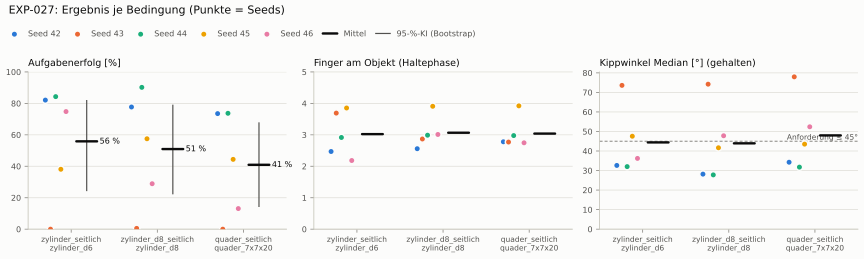
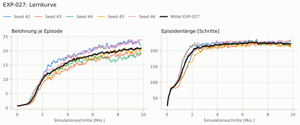
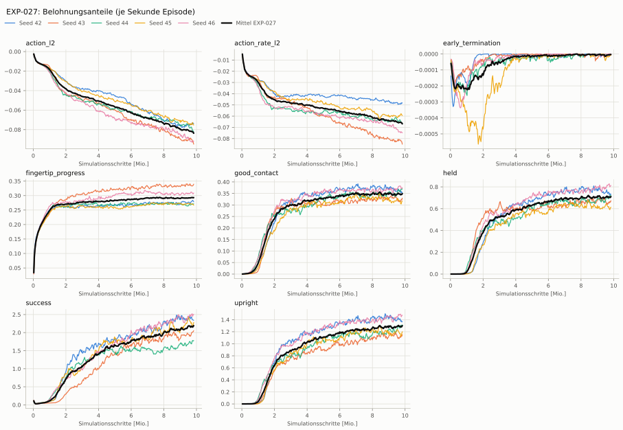
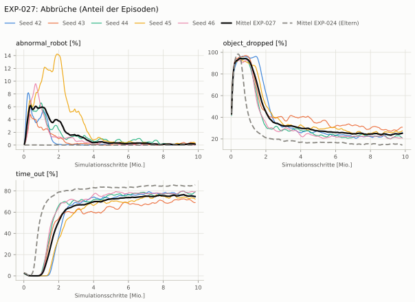
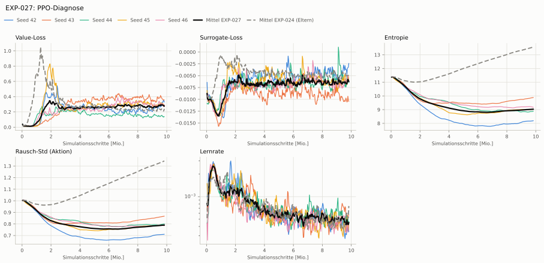

# EXP-027: Aktionsraum wie Dexsuite: Skala 0,1 für alle Servos, bounds_loss statt Begrenzung

**Leistung** 80 % [77–84 %] (erfolgreiche Seeds, IQM über die Objekte; je Objekt Ø 6 cm 83 % · Ø 8 cm 84 % · Quader 74 %) — ggü. EXP-024: P(besser) = 0.30 [0.07–0.53] → kein Unterschied

**Testobjekte** (nie trainiert, erfolgreiche Seeds, Median): Flasche 77 % · Saftpackung 76 % · Cracker (YCB) 78 % · Zucker (YCB) 94 % · Senf (YCB) 91 %

**Zuverlässigkeit** 2/5 Seeds erfolgreich [5–85 %] — EXP-024: 5/5, exakter Fisher-Test p = 0.17 → nicht unterscheidbar (für eine Aussage ≥ 10 Seeds je Experiment)

**Leitplanken** Kippwinkel Median [°]: 44.4 > 18.2; Unterarm Median [°]: 50.9 > 21.1; Griffkraft Mittel [N]: 96.5 > 93.1; Unruhe wirksam (Aktion auf ±1 begrenzt): 0.663 > 0.209 ✗

**Befund** ohne Erfolg: Seed 43 (hält, aber gekippt), Seed 45 (hält, aber gekippt), Seed 46 (hält, aber gekippt); Engpass Quader (74 %); Kippwinkel 44° (EXP-024: 13°); Unruhe 1.68 (EXP-024: 2.98)

**Urteilsvorschlag** (auswertung-v2): **kein Unterschied, Leitplanke verletzt**

**Beste Videos** (Seed 44, 3 Episoden): [Ø 6 cm](beste_videos/EXP-027_zylinder_d6_s44.mp4) · [Ø 8 cm](beste_videos/EXP-027_zylinder_d8_s44.mp4) · [Quader](beste_videos/EXP-027_quader_7x7x20_s44.mp4)

Ergebnisse je Bedingung (eval-v2, Leitplanken, Fehlerarten, Fingernutzung)

#### Bedingung `zylinder_seitlich`

Bedingung `zylinder_seitlich` (Objekt `zylinder_d6`, Kippwinkel ≤ 45°), Protokoll eval-v2, 5 Seed(s); Spalte EXP-024 unter derselben Anforderung

| Metrik | Mittel | 95-%-KI | IQM | Fehlschlag-Seeds (< 50 %) | EXP-024 (Mittel / IQM) |
|---|---|---|---|---|---|
| aufgabenerfolg | 55.9 % | 24.6 % – 81.8 % | 66.0 % | 40.0 % | 93.4 % / 97.0 % |
| haltequote | 94.5 % | 93.4 % – 95.5 % | 94.7 % | 0.0 % | 93.7 % / 97.3 % |
| Kippwinkel Median [°] | 44.4 | | | | 13.2 |
| Unterarm Median [°] | 50.9 | | | | 11.1 |
| Griffkraft Mittel [N] | 96.5 | | | | 77.6 |
| Kraft > 15 N [Anteil] | 99.9 % | | | | 99.8 % |
| Stall-Anteil [Anteil] | 99.8 % | | | | 96.7 % |
| Absinken [mm] | 0.00332 | | | | 0.0191 |
| Unruhe | 1.68 | | | | 2.98 |
| Unruhe wirksam (Aktion auf ±1 begrenzt) | 0.663 | | | | 0.175 |
| Objektweg Tischebene Ende [mm] | 99.7 | | | | 94.3 |

Fehlerarten: startfehler 0.0 %, gefallen 5.5 %, instabil 0.0 %, anforderung_verletzt 38.7 %

**Urteilsvorschlag: schlechter** (gegenüber EXP-024)
Unterschied Aufgabenerfolg -37.1 Prozentpunkte (95-%-KI -61.4 … -15.3)
- Leitplanke: Kippwinkel Median [°]: 44.4 > 18.2
- Leitplanke: Unterarm Median [°]: 50.9 > 21.1
- Leitplanke: Griffkraft Mittel [N]: 96.5 > 93.1
- Leitplanke: Unruhe wirksam (Aktion auf ±1 begrenzt): 0.663 > 0.209

Je Seed: 82.1 %, 0.0 %, 84.3 %, 38.1 %, 74.8 %

Fingernutzung (Haltephase): im Mittel 3.02 Finger am Objekt; Kontaktanteil je Seed (Daumen, Zeige, Mittel, Ring, klein): 100/61/86/0/0 · 100/50/77/50/93 · 95/99/0/93/5 · 93/90/99/98/4 · 100/14/0/9/95

#### Bedingung `zylinder_d8_seitlich`

Bedingung `zylinder_d8_seitlich` (Objekt `zylinder_d8`, Kippwinkel ≤ 45°), Protokoll eval-v2, 5 Seed(s); Spalte EXP-024 unter derselben Anforderung

| Metrik | Mittel | 95-%-KI | IQM | Fehlschlag-Seeds (< 50 %) | EXP-024 (Mittel / IQM) |
|---|---|---|---|---|---|
| aufgabenerfolg | 51.0 % | 22.6 % – 78.8 % | 55.0 % | 40.0 % | 85.2 % / 87.8 % |
| haltequote | 87.6 % | 84.7 % – 90.8 % | 87.0 % | 0.0 % | 85.4 % / 88.1 % |
| Kippwinkel Median [°] | 43.9 | | | | 7.92 |
| Unterarm Median [°] | 51.8 | | | | 8.4 |
| Griffkraft Mittel [N] | 90.2 | | | | 80.7 |
| Kraft > 15 N [Anteil] | 99.8 % | | | | 100.0 % |
| Stall-Anteil [Anteil] | 99.8 % | | | | 96.9 % |
| Absinken [mm] | 0 | | | | 0.021 |
| Unruhe | 1.91 | | | | 3.19 |
| Unruhe wirksam (Aktion auf ±1 begrenzt) | 0.81 | | | | 0.173 |
| Objektweg Tischebene Ende [mm] | 108 | | | | 95 |

Fehlerarten: startfehler 0.0 %, gefallen 12.3 %, instabil 0.0 %, anforderung_verletzt 36.7 %

**Urteilsvorschlag: schlechter** (gegenüber EXP-024)
Unterschied Aufgabenerfolg -34.1 Prozentpunkte (95-%-KI -58.1 … -9.2)
- Leitplanke: Kippwinkel Median [°]: 43.9 > 12.9
- Leitplanke: Unterarm Median [°]: 51.8 > 18.4
- Leitplanke: Unruhe wirksam (Aktion auf ±1 begrenzt): 0.81 > 0.207

Je Seed: 77.7 %, 0.5 %, 90.2 %, 57.5 %, 28.9 %

Fingernutzung (Haltephase): im Mittel 3.07 Finger am Objekt; Kontaktanteil je Seed (Daumen, Zeige, Mittel, Ring, klein): 100/99/57/0/0 · 98/21/68/2/98 · 100/100/0/99/0 · 99/93/100/99/0 · 99/49/23/35/95

#### Bedingung `quader_seitlich`

Bedingung `quader_seitlich` (Objekt `quader_7x7x20`, Kippwinkel ≤ 45°), Protokoll eval-v2, 5 Seed(s); Spalte EXP-024 unter derselben Anforderung

| Metrik | Mittel | 95-%-KI | IQM | Fehlschlag-Seeds (< 50 %) | EXP-024 (Mittel / IQM) |
|---|---|---|---|---|---|
| aufgabenerfolg | 40.9 % | 14.5 % – 67.6 % | 43.7 % | 60.0 % | 80.1 % / 78.5 % |
| haltequote | 76.1 % | 72.6 % – 78.9 % | 77.0 % | 0.0 % | 80.2 % / 78.5 % |
| Kippwinkel Median [°] | 48 | | | | 7.11 |
| Unterarm Median [°] | 53.5 | | | | 8.6 |
| Griffkraft Mittel [N] | 88.7 | | | | 78 |
| Kraft > 15 N [Anteil] | 99.9 % | | | | 99.9 % |
| Stall-Anteil [Anteil] | 99.8 % | | | | 96.7 % |
| Absinken [mm] | 0 | | | | 0.0187 |
| Unruhe | 1.59 | | | | 3.29 |
| Unruhe wirksam (Aktion auf ±1 begrenzt) | 0.651 | | | | 0.176 |
| Objektweg Tischebene Ende [mm] | 113 | | | | 93.8 |

Fehlerarten: startfehler 0.0 %, gefallen 23.9 %, instabil 0.0 %, anforderung_verletzt 35.2 %

**Urteilsvorschlag: schlechter** (gegenüber EXP-024)
Unterschied Aufgabenerfolg -39.0 Prozentpunkte (95-%-KI -62.6 … -15.8)
- Leitplanke: Kippwinkel Median [°]: 48 > 12.1
- Leitplanke: Unterarm Median [°]: 53.5 > 18.6
- Leitplanke: Unruhe wirksam (Aktion auf ±1 begrenzt): 0.651 > 0.212

Je Seed: 73.5 %, 0.0 %, 73.7 %, 44.4 %, 13.1 %

Fingernutzung (Haltephase): im Mittel 3.04 Finger am Objekt; Kontaktanteil je Seed (Daumen, Zeige, Mittel, Ring, klein): 100/92/86/0/0 · 100/2/75/1/100 · 99/99/0/99/0 · 100/93/100/99/0 · 100/59/4/17/95

#### Bedingung `flasche_seitlich`

Bedingung `flasche_seitlich` (Objekt `flasche_d7x25`, Kippwinkel ≤ 45°), Protokoll eval-v2, 5 Seed(s); Spalte EXP-024 unter derselben Anforderung

| Metrik | Mittel | 95-%-KI | IQM | Fehlschlag-Seeds (< 50 %) | EXP-024 (Mittel / IQM) |
|---|---|---|---|---|---|
| aufgabenerfolg | 50.1 % | 24.0 % – 75.2 % | 53.6 % | 40.0 % | 86.6 % / 86.9 % |
| haltequote | 88.2 % | 84.5 % – 92.5 % | 87.0 % | 0.0 % | 88.2 % / 89.6 % |
| Kippwinkel Median [°] | 44 | | | | 8.92 |
| Unterarm Median [°] | 52.2 | | | | 8.85 |
| Griffkraft Mittel [N] | 87.5 | | | | 81 |
| Kraft > 15 N [Anteil] | 99.9 % | | | | 99.9 % |
| Stall-Anteil [Anteil] | 99.9 % | | | | 96.8 % |
| Absinken [mm] | 0.0167 | | | | 0.00678 |
| Unruhe | 1.93 | | | | 3.25 |
| Unruhe wirksam (Aktion auf ±1 begrenzt) | 0.758 | | | | 0.181 |
| Objektweg Tischebene Ende [mm] | 104 | | | | 93.8 |

Fehlerarten: startfehler 0.0 %, gefallen 11.8 %, instabil 0.0 %, anforderung_verletzt 38.1 %

**Urteilsvorschlag: schlechter** (gegenüber EXP-024)
Unterschied Aufgabenerfolg -36.3 Prozentpunkte (95-%-KI -60.3 … -11.8)
- Leitplanke: Kippwinkel Median [°]: 44 > 13.9
- Leitplanke: Unterarm Median [°]: 52.2 > 18.8
- Leitplanke: Unruhe wirksam (Aktion auf ±1 begrenzt): 0.758 > 0.218

Je Seed: 63.7 %, 0.0 %, 90.3 %, 55.4 %, 41.0 %

Fingernutzung (Haltephase): im Mittel 2.95 Finger am Objekt; Kontaktanteil je Seed (Daumen, Zeige, Mittel, Ring, klein): 100/90/70/0/0 · 100/12/88/4/98 · 100/100/0/96/0 · 98/92/97/97/0 · 100/23/4/11/94

#### Bedingung `saftpackung_seitlich`

Bedingung `saftpackung_seitlich` (Objekt `saftpackung_9x6x19`, Kippwinkel ≤ 45°), Protokoll eval-v2, 5 Seed(s); Spalte EXP-024 unter derselben Anforderung

| Metrik | Mittel | 95-%-KI | IQM | Fehlschlag-Seeds (< 50 %) | EXP-024 (Mittel / IQM) |
|---|---|---|---|---|---|
| aufgabenerfolg | 45.9 % | 18.9 % – 72.6 % | 48.8 % | 40.0 % | 86.9 % / 86.5 % |
| haltequote | 83.4 % | 76.0 % – 88.6 % | 86.3 % | 0.0 % | 86.9 % / 86.6 % |
| Kippwinkel Median [°] | 47.3 | | | | 8.17 |
| Unterarm Median [°] | 55.5 | | | | 8.91 |
| Griffkraft Mittel [N] | 93.8 | | | | 73.8 |
| Kraft > 15 N [Anteil] | 99.9 % | | | | 100.0 % |
| Stall-Anteil [Anteil] | 99.8 % | | | | 96.5 % |
| Absinken [mm] | 0 | | | | 0.00647 |
| Unruhe | 1.57 | | | | 3.31 |
| Unruhe wirksam (Aktion auf ±1 begrenzt) | 0.632 | | | | 0.188 |
| Objektweg Tischebene Ende [mm] | 118 | | | | 94.4 |

Fehlerarten: startfehler 0.0 %, gefallen 16.6 %, instabil 0.0 %, anforderung_verletzt 37.5 %

**Urteilsvorschlag: schlechter** (gegenüber EXP-024)
Unterschied Aufgabenerfolg -40.9 Prozentpunkte (95-%-KI -68.8 … -14.3)
- Leitplanke: Kippwinkel Median [°]: 47.3 > 13.2
- Leitplanke: Unterarm Median [°]: 55.5 > 18.9
- Leitplanke: Griffkraft Mittel [N]: 93.8 > 88.6
- Leitplanke: Unruhe wirksam (Aktion auf ±1 begrenzt): 0.632 > 0.225
- Leitplanke: Objektweg Tischebene Ende [mm]: 118 > 114

Je Seed: 65.6 %, 0.0 %, 86.4 %, 58.4 %, 19.1 %

Fingernutzung (Haltephase): im Mittel 3.10 Finger am Objekt; Kontaktanteil je Seed (Daumen, Zeige, Mittel, Ring, klein): 100/100/92/0/0 · 100/4/76/6/98 · 98/100/0/96/0 · 100/90/100/99/0 · 100/74/0/30/91

#### Bedingung `ycb_cracker_seitlich`

Bedingung `ycb_cracker_seitlich` (Objekt `ycb_003_cracker`, Kippwinkel ≤ 45°), Protokoll eval-v2, 5 Seed(s); Spalte EXP-024 unter derselben Anforderung

| Metrik | Mittel | 95-%-KI | IQM | Fehlschlag-Seeds (< 50 %) | EXP-024 (Mittel / IQM) |
|---|---|---|---|---|---|
| aufgabenerfolg | 64.9 % | 37.4 % – 81.4 % | 77.3 % | 20.0 % | 87.5 % / 86.0 % |
| haltequote | 79.0 % | 75.3 % – 82.4 % | 79.9 % | 0.0 % | 87.5 % / 86.0 % |
| Kippwinkel Median [°] | 30 | | | | 8.21 |
| Unterarm Median [°] | 52.2 | | | | 8.54 |
| Griffkraft Mittel [N] | 87.6 | | | | 81.1 |
| Kraft > 15 N [Anteil] | 100.0 % | | | | 100.0 % |
| Stall-Anteil [Anteil] | 99.9 % | | | | 96.9 % |
| Absinken [mm] | 0 | | | | 2.56 |
| Unruhe | 1.47 | | | | 2.53 |
| Unruhe wirksam (Aktion auf ±1 begrenzt) | 0.575 | | | | 0.134 |
| Objektweg Tischebene Ende [mm] | 139 | | | | 101 |

Fehlerarten: startfehler 0.0 %, gefallen 21.0 %, instabil 0.0 %, anforderung_verletzt 14.1 %

**Urteilsvorschlag: schlechter** (gegenüber EXP-024)
Unterschied Aufgabenerfolg -22.3 Prozentpunkte (95-%-KI -47.7 … -7.9)
- Leitplanke: Kippwinkel Median [°]: 30 > 13.2
- Leitplanke: Unterarm Median [°]: 52.2 > 18.5
- Leitplanke: Unruhe wirksam (Aktion auf ±1 begrenzt): 0.575 > 0.161
- Leitplanke: Objektweg Tischebene Ende [mm]: 139 > 121

Je Seed: 72.2 %, 10.0 %, 82.9 %, 77.5 %, 82.1 %

Fingernutzung (Haltephase): im Mittel 2.90 Finger am Objekt; Kontaktanteil je Seed (Daumen, Zeige, Mittel, Ring, klein): 100/98/96/0/0 · 100/1/66/1/100 · 100/100/0/99/0 · 100/63/100/100/0 · 100/20/3/3/100

#### Bedingung `ycb_zucker_seitlich`

Bedingung `ycb_zucker_seitlich` (Objekt `ycb_004_zucker`, Kippwinkel ≤ 45°), Protokoll eval-v2, 5 Seed(s); Spalte EXP-024 unter derselben Anforderung

| Metrik | Mittel | 95-%-KI | IQM | Fehlschlag-Seeds (< 50 %) | EXP-024 (Mittel / IQM) |
|---|---|---|---|---|---|
| aufgabenerfolg | 75.0 % | 37.5 % – 95.5 % | 92.4 % | 20.0 % | 96.8 % / 97.9 % |
| haltequote | 95.7 % | 94.3 % – 97.0 % | 95.9 % | 0.0 % | 97.2 % / 98.0 % |
| Kippwinkel Median [°] | 29.9 | | | | 13.2 |
| Unterarm Median [°] | 57.2 | | | | 11.4 |
| Griffkraft Mittel [N] | 106 | | | | 70.5 |
| Kraft > 15 N [Anteil] | 100.0 % | | | | 99.9 % |
| Stall-Anteil [Anteil] | 99.7 % | | | | 96.7 % |
| Absinken [mm] | 0.00761 | | | | 2.1 |
| Unruhe | 1.33 | | | | 2.66 |
| Unruhe wirksam (Aktion auf ±1 begrenzt) | 0.602 | | | | 0.133 |
| Objektweg Tischebene Ende [mm] | 116 | | | | 94.8 |

Fehlerarten: startfehler 0.0 %, gefallen 4.3 %, instabil 0.0 %, anforderung_verletzt 20.7 %

**Urteilsvorschlag: kein messbarer Unterschied** (gegenüber EXP-024)
Unterschied Aufgabenerfolg -21.5 Prozentpunkte (95-%-KI -60.7 … +0.5)
- Leitplanke: Kippwinkel Median [°]: 29.9 > 18.2
- Leitplanke: Unterarm Median [°]: 57.2 > 21.4
- Leitplanke: Griffkraft Mittel [N]: 106 > 84.6
- Leitplanke: Unruhe wirksam (Aktion auf ±1 begrenzt): 0.602 > 0.16
- Leitplanke: Objektweg Tischebene Ende [mm]: 116 > 115

Je Seed: 91.4 %, 0.1 %, 97.2 %, 95.6 %, 90.6 %

Fingernutzung (Haltephase): im Mittel 3.02 Finger am Objekt; Kontaktanteil je Seed (Daumen, Zeige, Mittel, Ring, klein): 100/77/95/0/0 · 100/22/50/67/64 · 100/97/0/92/0 · 99/81/100/83/0 · 100/43/0/65/77

#### Bedingung `ycb_senf_seitlich`

Bedingung `ycb_senf_seitlich` (Objekt `ycb_006_senf`, Kippwinkel ≤ 45°), Protokoll eval-v2, 5 Seed(s); Spalte EXP-024 unter derselben Anforderung

| Metrik | Mittel | 95-%-KI | IQM | Fehlschlag-Seeds (< 50 %) | EXP-024 (Mittel / IQM) |
|---|---|---|---|---|---|
| aufgabenerfolg | 72.6 % | 36.9 % – 92.3 % | 89.1 % | 20.0 % | 92.8 % / 95.9 % |
| haltequote | 93.0 % | 91.0 % – 94.9 % | 93.2 % | 0.0 % | 94.0 % / 96.3 % |
| Kippwinkel Median [°] | 32.9 | | | | 12.1 |
| Unterarm Median [°] | 53.3 | | | | 10.4 |
| Griffkraft Mittel [N] | 102 | | | | 76.5 |
| Kraft > 15 N [Anteil] | 100.0 % | | | | 100.0 % |
| Stall-Anteil [Anteil] | 99.7 % | | | | 96.7 % |
| Absinken [mm] | 0.0113 | | | | 4.17 |
| Unruhe | 1.4 | | | | 2.69 |
| Unruhe wirksam (Aktion auf ±1 begrenzt) | 0.596 | | | | 0.137 |
| Objektweg Tischebene Ende [mm] | 111 | | | | 92 |

Fehlerarten: startfehler 0.0 %, gefallen 7.0 %, instabil 0.0 %, anforderung_verletzt 20.4 %

**Urteilsvorschlag: kein messbarer Unterschied** (gegenüber EXP-024)
Unterschied Aufgabenerfolg -19.8 Prozentpunkte (95-%-KI -59.4 … +4.8)
- Leitplanke: Kippwinkel Median [°]: 32.9 > 17.1
- Leitplanke: Unterarm Median [°]: 53.3 > 20.4
- Leitplanke: Griffkraft Mittel [N]: 102 > 91.8
- Leitplanke: Unruhe wirksam (Aktion auf ±1 begrenzt): 0.596 > 0.164

Je Seed: 87.3 %, 1.2 %, 94.7 %, 89.2 %, 90.8 %

Fingernutzung (Haltephase): im Mittel 3.17 Finger am Objekt; Kontaktanteil je Seed (Daumen, Zeige, Mittel, Ring, klein): 100/85/82/0/0 · 99/69/88/61/61 · 100/94/0/99/0 · 100/66/99/98/0 · 100/70/0/14/98

Trainingsverlauf

Seeds dünn, Mittel kräftig, Eltern gestrichelt (nur Abbrüche/PPO — Trainings-Belohnung ist zwischen Experimenten nicht vergleichbar); geglättet, x = Simulationsschritte. Endwerte = Mittel der letzten 10 Iterationen (Belohnungsanteile je Sekunde Episode).

| Größe | Seed 42 | Seed 43 | Seed 44 | Seed 45 | Seed 46 | Mittel |
|---|---|---|---|---|---|---|
| mean_reward | 22.4 | 18.7 | 19.1 | 20.1 | 23.9 | 20.9 |
| action_l2 | -0.0742 | -0.0919 | -0.0806 | -0.0746 | -0.0927 | -0.0828 |
| action_rate_l2 | -0.0489 | -0.0827 | -0.0656 | -0.0592 | -0.0746 | -0.0662 |
| early_termination | -4.24e-06 | -6.52e-06 | -2.5e-06 | -7.14e-06 | 0 | -4.08e-06 |
| fingertip_progress | 0.279 | 0.337 | 0.271 | 0.269 | 0.309 | 0.293 |
| good_contact | 0.359 | 0.32 | 0.369 | 0.315 | 0.379 | 0.348 |
| held | 0.74 | 0.655 | 0.718 | 0.612 | 0.819 | 0.709 |
| success | 2.38 | 2 | 1.76 | 2.24 | 2.49 | 2.17 |
| upright | 1.39 | 1.12 | 1.31 | 1.18 | 1.48 | 1.29 |
| object_dropped | 25.1 % | 30.4 % | 21.7 % | 26.7 % | 20.8 % | 24.9 % |
| mean_noise_std | 0.71 | 0.866 | 0.799 | 0.788 | 0.786 | 0.79 |

Netz, Training und Konfiguration

Actor [256, 128, 64] (elu), 68808 Parameter, 105 Eingänge (Verlauf 5) · Critic [512, 256, 128] · PPO: Lernrate 0.001, Entropie 0.005, 5 Epochen × 4 Mini-Batches, 32 Schritte/Umgebung · 1024 Umgebungen × 300 Iterationen

Geplante Änderung: Aktionsraum wie Dexsuite (eine Änderung „Vorbild als Ganzes“, ADR-022): Skala 0,1 rad für alle 8 Servos (dexsuite_action_space), Agent PibGraspPPORunnerCfg_Bounds (ActorCriticBounds, bounds_loss 1e-4, Grenze 1,1) statt clip_actions, kein Filter. Belohnungsrezept der Eltern (Task HeavyMultiProgressDex-v0). Bewertung mit --action_scale 0.1 (experiments.clip_args).

Konfiguration gegenüber EXP-024 (11 Unterschiede):

- `agent.clip_actions: 1.0 → None`
- `agent.policy.bounds_loss_coef: ∅ → 0.0001`
- `agent.policy.class_name: ActorCritic → ActorCriticBounds`
- `agent.policy.entropy_coef: ∅ → 0.005`
- `agent.policy.soft_bound: ∅ → 1.1`
- `env.actions.servos.alpha: 0.3 → ∅`
- `env.actions.servos.class_type: pib_grasp.mdp:FilteredRelativeJointPositionAction → isaaclab.envs.mdp.actions.joint_actions:RelativeJointPositionAction`
- `env.actions.servos.scale: ∅ → 0.1`
- `env.actions.servos.scale..*_left_(proximal|rotator): 0.1 → ∅`
- `env.actions.servos.scale.forearm_left: 0.03 → ∅`
- `env.actions.servos.scale.wrist_left: 0.03 → ∅`

