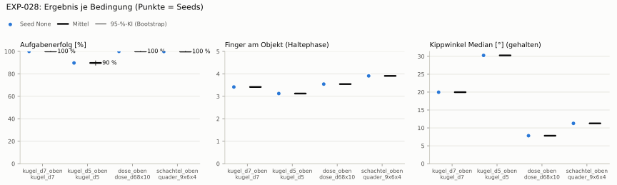

# EXP-028: Regel-Baseline von oben: alle Finger schließen (kein RL), gestreute Vorgreifpose

**Leistung** 100 % [100–100 %] (erfolgreiche Seeds, IQM über die Objekte; je Objekt Kugel Ø 7 100 % · Kugel Ø 5 90 % · Dose 100 % · Schachtel 100 %)

**Testobjekte** (nie trainiert, erfolgreiche Seeds, Median): Suppendose (YCB) 100 %

**Zuverlässigkeit** 1/1 Seeds erfolgreich [2–100 %]

**Leitplanken** – (keine Eltern)

**Befund** Engpass Kugel Ø 5 (90 %); Kippwinkel 20° (EXP-014: 16°); Finger am Objekt 3.4 (EXP-014: 4.9); Unruhe 0.01 (EXP-014: 0.01)

**Urteilsvorschlag** (auswertung-v2): **kein Vergleich (Eltern ohne Benchmark-Bewertung)**

**Beste Videos** (Seed 0, 3 Episoden): [Kugel Ø 7](beste_videos/EXP-028_kugel_d7_s0.mp4) · [Kugel Ø 5](beste_videos/EXP-028_kugel_d5_s0.mp4) · [Dose](beste_videos/EXP-028_dose_d68x10_s0.mp4) · [Schachtel](beste_videos/EXP-028_quader_9x6x4_s0.mp4)

Ergebnisse je Bedingung (eval-v2, Leitplanken, Fehlerarten, Fingernutzung)

#### Bedingung `kugel_d7_oben`

Bedingung `kugel_d7_oben` (Objekt `kugel_d7`, Kippwinkel ≤ None°), Protokoll eval-v2, 1 Seed(s); Spalte Eltern unter derselben Anforderung

| Metrik | Mittel | 95-%-KI | IQM | Fehlschlag-Seeds (< 50 %) | Eltern (Mittel / IQM) |
|---|---|---|---|---|---|
| aufgabenerfolg | 100.0 % | 100.0 % – 100.0 % | 100.0 % | 0.0 % | – |
| haltequote | 100.0 % | 100.0 % – 100.0 % | 100.0 % | 0.0 % | – |
| Kippwinkel Median [°] | 20 | | | | – |
| Unterarm Median [°] | 0.93 | | | | – |
| Griffkraft Mittel [N] | 89.7 | | | | – |
| Kraft > 15 N [Anteil] | 100.0 % | | | | – |
| Stall-Anteil [Anteil] | 0.0 % | | | | – |
| Absinken [mm] | 1.12 | | | | – |
| Unruhe | 0.00901 | | | | – |
| Unruhe wirksam (Aktion auf ±1 begrenzt) | 0.00901 | | | | – |
| Objektweg Tischebene Ende [mm] | 22.4 | | | | – |

Fehlerarten: startfehler 0.0 %, gefallen 0.0 %, instabil 0.0 %, anforderung_verletzt 0.0 %

**Urteilsvorschlag: kein Vergleich (keine Eltern-Bewertung mit gleichem Protokoll)**

Je Seed: 100.0 %

Fingernutzung (Haltephase): im Mittel 3.42 Finger am Objekt; Kontaktanteil je Seed (Daumen, Zeige, Mittel, Ring, klein): 99/100/100/42/0

#### Bedingung `kugel_d5_oben`

Bedingung `kugel_d5_oben` (Objekt `kugel_d5`, Kippwinkel ≤ None°), Protokoll eval-v2, 1 Seed(s); Spalte Referenz kugel_d7_oben unter derselben Anforderung

| Metrik | Mittel | 95-%-KI | IQM | Fehlschlag-Seeds (< 50 %) | Referenz kugel_d7_oben (Mittel / IQM) |
|---|---|---|---|---|---|
| aufgabenerfolg | 89.7 % | 87.8 % – 91.5 % | 89.7 % | 0.0 % | 100.0 % / 100.0 % |
| haltequote | 89.7 % | 87.7 % – 91.5 % | 89.7 % | 0.0 % | 100.0 % / 100.0 % |
| Kippwinkel Median [°] | 30.3 | | | | 20 |
| Unterarm Median [°] | 0.0517 | | | | 0.93 |
| Griffkraft Mittel [N] | 95.1 | | | | 89.7 |
| Kraft > 15 N [Anteil] | 100.0 % | | | | 100.0 % |
| Stall-Anteil [Anteil] | 0.0 % | | | | 0.0 % |
| Absinken [mm] | 0.443 | | | | 1.12 |
| Unruhe | 0.00821 | | | | 0.00901 |
| Unruhe wirksam (Aktion auf ±1 begrenzt) | 0.00821 | | | | 0.00901 |
| Objektweg Tischebene Ende [mm] | 17.4 | | | | 22.4 |

Fehlerarten: startfehler 0.0 %, gefallen 10.3 %, instabil 0.0 %, anforderung_verletzt 0.0 %

**Urteilsvorschlag: schlechter (vorläufig: < 3 Seeds)** (gegenüber Referenz kugel_d7_oben)
Unterschied Aufgabenerfolg -10.3 Prozentpunkte (95-%-KI -12.2 … -8.5)
- Leitplanke: Kippwinkel Median [°]: 30.3 > 25

Je Seed: 89.7 %

Fingernutzung (Haltephase): im Mittel 3.12 Finger am Objekt; Kontaktanteil je Seed (Daumen, Zeige, Mittel, Ring, klein): 100/96/95/22/0

#### Bedingung `dose_oben`

Bedingung `dose_oben` (Objekt `dose_d68x10`, Kippwinkel ≤ None°), Protokoll eval-v2, 1 Seed(s); Spalte Referenz kugel_d7_oben unter derselben Anforderung

| Metrik | Mittel | 95-%-KI | IQM | Fehlschlag-Seeds (< 50 %) | Referenz kugel_d7_oben (Mittel / IQM) |
|---|---|---|---|---|---|
| aufgabenerfolg | 100.0 % | 100.0 % – 100.0 % | 100.0 % | 0.0 % | 100.0 % / 100.0 % |
| haltequote | 100.0 % | 100.0 % – 100.0 % | 100.0 % | 0.0 % | 100.0 % / 100.0 % |
| Kippwinkel Median [°] | 7.81 | | | | 20 |
| Unterarm Median [°] | 0.642 | | | | 0.93 |
| Griffkraft Mittel [N] | 85.1 | | | | 89.7 |
| Kraft > 15 N [Anteil] | 99.9 % | | | | 100.0 % |
| Stall-Anteil [Anteil] | 0.0 % | | | | 0.0 % |
| Absinken [mm] | 2.3 | | | | 1.12 |
| Unruhe | 0.00909 | | | | 0.00901 |
| Unruhe wirksam (Aktion auf ±1 begrenzt) | 0.00909 | | | | 0.00901 |
| Objektweg Tischebene Ende [mm] | 14.5 | | | | 22.4 |

Fehlerarten: startfehler 0.0 %, gefallen 0.0 %, instabil 0.0 %, anforderung_verletzt 0.0 %

**Urteilsvorschlag: kein messbarer Unterschied (vorläufig: < 3 Seeds)** (gegenüber Referenz kugel_d7_oben)
Unterschied Aufgabenerfolg +0.0 Prozentpunkte (95-%-KI +0.0 … +0.0)

Je Seed: 100.0 %

Fingernutzung (Haltephase): im Mittel 3.54 Finger am Objekt; Kontaktanteil je Seed (Daumen, Zeige, Mittel, Ring, klein): 99/100/98/57/0

#### Bedingung `schachtel_oben`

Bedingung `schachtel_oben` (Objekt `quader_9x6x4`, Kippwinkel ≤ None°), Protokoll eval-v2, 1 Seed(s); Spalte Referenz kugel_d7_oben unter derselben Anforderung

| Metrik | Mittel | 95-%-KI | IQM | Fehlschlag-Seeds (< 50 %) | Referenz kugel_d7_oben (Mittel / IQM) |
|---|---|---|---|---|---|
| aufgabenerfolg | 99.9 % | 99.7 % – 100.0 % | 99.9 % | 0.0 % | 100.0 % / 100.0 % |
| haltequote | 99.9 % | 99.7 % – 100.0 % | 99.9 % | 0.0 % | 100.0 % / 100.0 % |
| Kippwinkel Median [°] | 11.3 | | | | 20 |
| Unterarm Median [°] | 0.592 | | | | 0.93 |
| Griffkraft Mittel [N] | 75.6 | | | | 89.7 |
| Kraft > 15 N [Anteil] | 99.9 % | | | | 100.0 % |
| Stall-Anteil [Anteil] | 0.1 % | | | | 0.0 % |
| Absinken [mm] | 4.85 | | | | 1.12 |
| Unruhe | 0.00884 | | | | 0.00901 |
| Unruhe wirksam (Aktion auf ±1 begrenzt) | 0.00884 | | | | 0.00901 |
| Objektweg Tischebene Ende [mm] | 28.8 | | | | 22.4 |

Fehlerarten: startfehler 0.0 %, gefallen 0.1 %, instabil 0.0 %, anforderung_verletzt 0.0 %

**Urteilsvorschlag: kein messbarer Unterschied (vorläufig: < 3 Seeds)** (gegenüber Referenz kugel_d7_oben)
Unterschied Aufgabenerfolg -0.1 Prozentpunkte (95-%-KI -0.3 … +0.0)

Je Seed: 99.9 %

Fingernutzung (Haltephase): im Mittel 3.91 Finger am Objekt; Kontaktanteil je Seed (Daumen, Zeige, Mittel, Ring, klein): 100/100/100/91/0

#### Bedingung `ycb_suppe_oben`

Bedingung `ycb_suppe_oben` (Objekt `ycb_005_suppe`, Kippwinkel ≤ None°), Protokoll eval-v2, 1 Seed(s); Spalte Referenz kugel_d7_oben unter derselben Anforderung

| Metrik | Mittel | 95-%-KI | IQM | Fehlschlag-Seeds (< 50 %) | Referenz kugel_d7_oben (Mittel / IQM) |
|---|---|---|---|---|---|
| aufgabenerfolg | 99.9 % | 99.7 % – 100.0 % | 99.9 % | 0.0 % | 100.0 % / 100.0 % |
| haltequote | 99.9 % | 99.7 % – 100.0 % | 99.9 % | 0.0 % | 100.0 % / 100.0 % |
| Kippwinkel Median [°] | 8.54 | | | | 20 |
| Unterarm Median [°] | 0.627 | | | | 0.93 |
| Griffkraft Mittel [N] | 84.2 | | | | 89.7 |
| Kraft > 15 N [Anteil] | 100.0 % | | | | 100.0 % |
| Stall-Anteil [Anteil] | 0.0 % | | | | 0.0 % |
| Absinken [mm] | 5.95 | | | | 1.12 |
| Unruhe | 0.00928 | | | | 0.00901 |
| Unruhe wirksam (Aktion auf ±1 begrenzt) | 0.00928 | | | | 0.00901 |
| Objektweg Tischebene Ende [mm] | 14.8 | | | | 22.4 |

Fehlerarten: startfehler 0.0 %, gefallen 0.1 %, instabil 0.0 %, anforderung_verletzt 0.0 %

**Urteilsvorschlag: kein messbarer Unterschied (vorläufig: < 3 Seeds)** (gegenüber Referenz kugel_d7_oben)
Unterschied Aufgabenerfolg -0.1 Prozentpunkte (95-%-KI -0.3 … +0.0)

Je Seed: 99.9 %

Fingernutzung (Haltephase): im Mittel 3.47 Finger am Objekt; Kontaktanteil je Seed (Daumen, Zeige, Mittel, Ring, klein): 100/100/97/50/0

Regel und Parameterwahl

Regel `alle_schliessen`, gewählt `schliessen=0.4,rotator_deg=90` aus dem Raster (Aufgabenerfolg mit Seed 2000, Mittel über die Benchmark-Objekte): `schliessen=0.2,rotator_deg=75` 96 %, `schliessen=0.4,rotator_deg=75` 98 %, `schliessen=0.2,rotator_deg=90` 98 %, `schliessen=0.4,rotator_deg=90` 98 %

