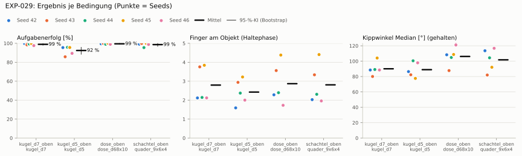
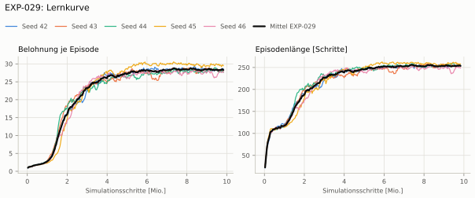
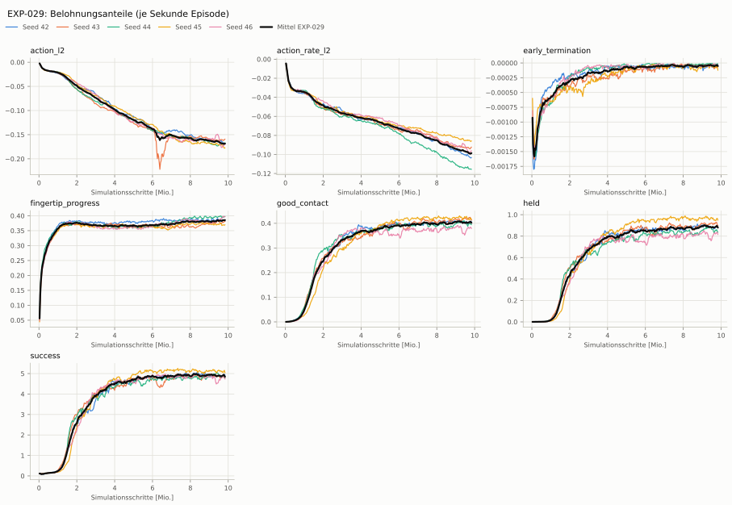
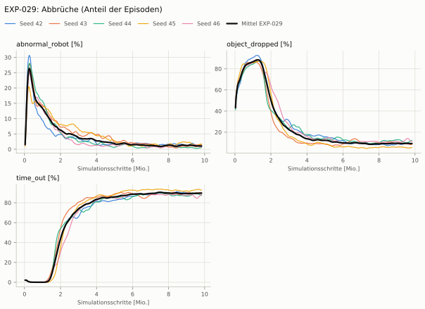
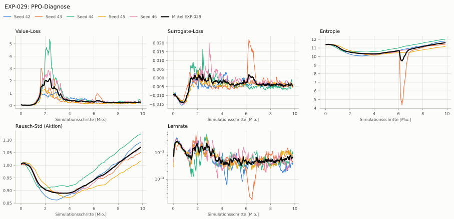

# EXP-029: Spezialist von oben, Rezept EXP-027 (Aktionsraum wie Dexsuite)

**Leistung** 99 % [98–99 %] (erfolgreiche Seeds, IQM über die Objekte; je Objekt Kugel Ø 7 99 % · Kugel Ø 5 96 % · Dose 100 % · Schachtel 99 %) — ggü. EXP-028: P(besser) = 0.25 [0.12–0.40] → gesichert schlechter

**Testobjekte** (nie trainiert, erfolgreiche Seeds, Median): Suppendose (YCB) 100 %

**Zuverlässigkeit** 5/5 Seeds erfolgreich [48–100 %] — EXP-028: 1/1, exakter Fisher-Test p = 1.00 → nicht unterscheidbar (für eine Aussage ≥ 10 Seeds je Experiment)

**Leitplanken** Kippwinkel Median [°]: 90.1 > 25; Unterarm Median [°]: 90 > 10.9; Griffkraft Mittel [N]: 142 > 108; Stall-Anteil [Anteil]: 1 > 0.0504; Unruhe: 0.652 > 0.0108; Unruhe wirksam (Aktion auf ±1 begrenzt): 0.198 > 0.0108; Objektweg Tischebene Ende [mm]: 103 > 42.4 ✗

**Befund** Engpass Kugel Ø 5 (96 %); Kippwinkel 90° (EXP-028: 20°); Unruhe 0.65 (EXP-028: 0.01)

**Urteilsvorschlag** (auswertung-v2): **schlechter, Leitplanke verletzt**

Ergebnisse je Bedingung (eval-v2, Leitplanken, Fehlerarten, Fingernutzung)

#### Bedingung `kugel_d7_oben`

Bedingung `kugel_d7_oben` (Objekt `kugel_d7`, Kippwinkel ≤ None°), Protokoll eval-v2, 5 Seed(s); Spalte EXP-028 unter derselben Anforderung

| Metrik | Mittel | 95-%-KI | IQM | Fehlschlag-Seeds (< 50 %) | EXP-028 (Mittel / IQM) |
|---|---|---|---|---|---|
| aufgabenerfolg | 98.9 % | 98.1 % – 99.6 % | 99.1 % | 0.0 % | 100.0 % / 100.0 % |
| haltequote | 98.9 % | 98.1 % – 99.6 % | 99.1 % | 0.0 % | 100.0 % / 100.0 % |
| Kippwinkel Median [°] | 90.1 | | | | 20 |
| Unterarm Median [°] | 90 | | | | 0.93 |
| Griffkraft Mittel [N] | 142 | | | | 89.7 |
| Kraft > 15 N [Anteil] | 100.0 % | | | | 100.0 % |
| Stall-Anteil [Anteil] | 100.0 % | | | | 0.0 % |
| Absinken [mm] | 0 | | | | 1.12 |
| Unruhe | 0.652 | | | | 0.00901 |
| Unruhe wirksam (Aktion auf ±1 begrenzt) | 0.198 | | | | 0.00901 |
| Objektweg Tischebene Ende [mm] | 103 | | | | 22.4 |

Fehlerarten: startfehler 0.0 %, gefallen 1.0 %, instabil 0.0 %, anforderung_verletzt 0.0 %

**Urteilsvorschlag: schlechter (vorläufig: < 3 Seeds)** (gegenüber EXP-028)
Unterschied Aufgabenerfolg -1.1 Prozentpunkte (95-%-KI -1.9 … -0.4)
- Leitplanke: Kippwinkel Median [°]: 90.1 > 25
- Leitplanke: Unterarm Median [°]: 90 > 10.9
- Leitplanke: Griffkraft Mittel [N]: 142 > 108
- Leitplanke: Stall-Anteil [Anteil]: 1 > 0.0504
- Leitplanke: Unruhe: 0.652 > 0.0108
- Leitplanke: Unruhe wirksam (Aktion auf ±1 begrenzt): 0.198 > 0.0108
- Leitplanke: Objektweg Tischebene Ende [mm]: 103 > 42.4

Je Seed: 99.7 %, 98.4 %, 99.3 %, 99.7 %, 97.6 %

Fingernutzung (Haltephase): im Mittel 2.80 Finger am Objekt; Kontaktanteil je Seed (Daumen, Zeige, Mittel, Ring, klein): 99/63/1/48/0 · 97/82/36/97/63 · 100/58/17/40/0 · 95/98/77/95/19 · 100/0/95/17/0

#### Bedingung `kugel_d5_oben`

Bedingung `kugel_d5_oben` (Objekt `kugel_d5`, Kippwinkel ≤ None°), Protokoll eval-v2, 5 Seed(s); Spalte EXP-028 unter derselben Anforderung

| Metrik | Mittel | 95-%-KI | IQM | Fehlschlag-Seeds (< 50 %) | EXP-028 (Mittel / IQM) |
|---|---|---|---|---|---|
| aufgabenerfolg | 92.4 % | 88.6 % – 95.7 % | 93.7 % | 0.0 % | 89.7 % / 89.7 % |
| haltequote | 92.4 % | 88.3 % – 95.8 % | 93.7 % | 0.0 % | 89.7 % / 89.7 % |
| Kippwinkel Median [°] | 88.9 | | | | 30.3 |
| Unterarm Median [°] | 90 | | | | 0.0517 |
| Griffkraft Mittel [N] | 159 | | | | 95.1 |
| Kraft > 15 N [Anteil] | 100.0 % | | | | 100.0 % |
| Stall-Anteil [Anteil] | 100.0 % | | | | 0.0 % |
| Absinken [mm] | 0 | | | | 0.443 |
| Unruhe | 0.676 | | | | 0.00821 |
| Unruhe wirksam (Aktion auf ±1 begrenzt) | 0.194 | | | | 0.00821 |
| Objektweg Tischebene Ende [mm] | 94.5 | | | | 17.4 |

Fehlerarten: startfehler 0.0 %, gefallen 7.6 %, instabil 0.0 %, anforderung_verletzt 0.0 %

**Urteilsvorschlag: kein messbarer Unterschied (vorläufig: < 3 Seeds)** (gegenüber EXP-028)
Unterschied Aufgabenerfolg +2.7 Prozentpunkte (95-%-KI -1.5 … +6.6)
- Leitplanke: Kippwinkel Median [°]: 88.9 > 35.3
- Leitplanke: Unterarm Median [°]: 90 > 10.1
- Leitplanke: Griffkraft Mittel [N]: 159 > 114
- Leitplanke: Stall-Anteil [Anteil]: 1 > 0.0501
- Leitplanke: Unruhe: 0.676 > 0.00986
- Leitplanke: Unruhe wirksam (Aktion auf ±1 begrenzt): 0.194 > 0.00986
- Leitplanke: Objektweg Tischebene Ende [mm]: 94.5 > 37.4

Je Seed: 95.5 %, 85.8 %, 95.8 %, 95.6 %, 89.4 %

Fingernutzung (Haltephase): im Mittel 2.43 Finger am Objekt; Kontaktanteil je Seed (Daumen, Zeige, Mittel, Ring, klein): 59/65/0/34/1 · 91/35/80/81/8 · 93/79/55/11/0 · 98/44/98/79/3 · 97/0/92/10/0

#### Bedingung `dose_oben`

Bedingung `dose_oben` (Objekt `dose_d68x10`, Kippwinkel ≤ None°), Protokoll eval-v2, 5 Seed(s); Spalte EXP-028 unter derselben Anforderung

| Metrik | Mittel | 95-%-KI | IQM | Fehlschlag-Seeds (< 50 %) | EXP-028 (Mittel / IQM) |
|---|---|---|---|---|---|
| aufgabenerfolg | 99.5 % | 99.0 % – 99.9 % | 99.5 % | 0.0 % | 100.0 % / 100.0 % |
| haltequote | 99.5 % | 99.0 % – 99.9 % | 99.5 % | 0.0 % | 100.0 % / 100.0 % |
| Kippwinkel Median [°] | 106 | | | | 7.81 |
| Unterarm Median [°] | 90 | | | | 0.642 |
| Griffkraft Mittel [N] | 138 | | | | 85.1 |
| Kraft > 15 N [Anteil] | 100.0 % | | | | 99.9 % |
| Stall-Anteil [Anteil] | 100.0 % | | | | 0.0 % |
| Absinken [mm] | 0 | | | | 2.3 |
| Unruhe | 0.665 | | | | 0.00909 |
| Unruhe wirksam (Aktion auf ±1 begrenzt) | 0.193 | | | | 0.00909 |
| Objektweg Tischebene Ende [mm] | 130 | | | | 14.5 |

Fehlerarten: startfehler 0.0 %, gefallen 0.5 %, instabil 0.0 %, anforderung_verletzt 0.0 %

**Urteilsvorschlag: schlechter (vorläufig: < 3 Seeds)** (gegenüber EXP-028)
Unterschied Aufgabenerfolg -0.5 Prozentpunkte (95-%-KI -1.0 … -0.1)
- Leitplanke: Kippwinkel Median [°]: 106 > 12.8
- Leitplanke: Unterarm Median [°]: 90 > 10.6
- Leitplanke: Griffkraft Mittel [N]: 138 > 102
- Leitplanke: Stall-Anteil [Anteil]: 1 > 0.0502
- Leitplanke: Unruhe: 0.665 > 0.0109
- Leitplanke: Unruhe wirksam (Aktion auf ±1 begrenzt): 0.193 > 0.0109
- Leitplanke: Objektweg Tischebene Ende [mm]: 130 > 34.5

Je Seed: 99.5 %, 99.9 %, 99.0 %, 100.0 %, 99.0 %

Fingernutzung (Haltephase): im Mittel 2.87 Finger am Objekt; Kontaktanteil je Seed (Daumen, Zeige, Mittel, Ring, klein): 100/39/1/88/0 · 100/80/7/99/69 · 98/71/37/34/0 · 100/99/99/99/42 · 100/0/62/11/0

#### Bedingung `schachtel_oben`

Bedingung `schachtel_oben` (Objekt `quader_9x6x4`, Kippwinkel ≤ None°), Protokoll eval-v2, 5 Seed(s); Spalte EXP-028 unter derselben Anforderung

| Metrik | Mittel | 95-%-KI | IQM | Fehlschlag-Seeds (< 50 %) | EXP-028 (Mittel / IQM) |
|---|---|---|---|---|---|
| aufgabenerfolg | 98.7 % | 96.9 % – 99.8 % | 99.2 % | 0.0 % | 99.9 % / 99.9 % |
| haltequote | 98.7 % | 97.0 % – 99.8 % | 99.2 % | 0.0 % | 99.9 % / 99.9 % |
| Kippwinkel Median [°] | 102 | | | | 11.3 |
| Unterarm Median [°] | 90 | | | | 0.592 |
| Griffkraft Mittel [N] | 122 | | | | 75.6 |
| Kraft > 15 N [Anteil] | 100.0 % | | | | 99.9 % |
| Stall-Anteil [Anteil] | 100.0 % | | | | 0.1 % |
| Absinken [mm] | 0 | | | | 4.85 |
| Unruhe | 0.626 | | | | 0.00884 |
| Unruhe wirksam (Aktion auf ±1 begrenzt) | 0.174 | | | | 0.00884 |
| Objektweg Tischebene Ende [mm] | 109 | | | | 28.8 |

Fehlerarten: startfehler 0.0 %, gefallen 1.3 %, instabil 0.0 %, anforderung_verletzt 0.0 %

**Urteilsvorschlag: schlechter (vorläufig: < 3 Seeds)** (gegenüber EXP-028)
Unterschied Aufgabenerfolg -1.3 Prozentpunkte (95-%-KI -3.0 … -0.1)
- Leitplanke: Kippwinkel Median [°]: 102 > 16.3
- Leitplanke: Unterarm Median [°]: 90 > 10.6
- Leitplanke: Griffkraft Mittel [N]: 122 > 90.7
- Leitplanke: Stall-Anteil [Anteil]: 1 > 0.0511
- Leitplanke: Unruhe: 0.626 > 0.0106
- Leitplanke: Unruhe wirksam (Aktion auf ±1 begrenzt): 0.174 > 0.0106
- Leitplanke: Objektweg Tischebene Ende [mm]: 109 > 48.8

Je Seed: 99.1 %, 99.9 %, 95.5 %, 100.0 %, 98.8 %

Fingernutzung (Haltephase): im Mittel 2.81 Finger am Objekt; Kontaktanteil je Seed (Daumen, Zeige, Mittel, Ring, klein): 100/97/1/5/0 · 100/96/1/98/39 · 99/60/16/56/1 · 96/100/99/99/47 · 100/0/95/1/0

#### Bedingung `ycb_suppe_oben`

Bedingung `ycb_suppe_oben` (Objekt `ycb_005_suppe`, Kippwinkel ≤ None°), Protokoll eval-v2, 5 Seed(s); Spalte EXP-028 unter derselben Anforderung

| Metrik | Mittel | 95-%-KI | IQM | Fehlschlag-Seeds (< 50 %) | EXP-028 (Mittel / IQM) |
|---|---|---|---|---|---|
| aufgabenerfolg | 99.9 % | 99.8 % – 100.0 % | 99.9 % | 0.0 % | 99.9 % / 99.9 % |
| haltequote | 99.9 % | 99.8 % – 100.0 % | 99.9 % | 0.0 % | 99.9 % / 99.9 % |
| Kippwinkel Median [°] | 103 | | | | 8.54 |
| Unterarm Median [°] | 90 | | | | 0.627 |
| Griffkraft Mittel [N] | 154 | | | | 84.2 |
| Kraft > 15 N [Anteil] | 100.0 % | | | | 100.0 % |
| Stall-Anteil [Anteil] | 100.0 % | | | | 0.0 % |
| Absinken [mm] | 0 | | | | 5.95 |
| Unruhe | 0.623 | | | | 0.00928 |
| Unruhe wirksam (Aktion auf ±1 begrenzt) | 0.177 | | | | 0.00928 |
| Objektweg Tischebene Ende [mm] | 133 | | | | 14.8 |

Fehlerarten: startfehler 0.0 %, gefallen 0.1 %, instabil 0.0 %, anforderung_verletzt 0.0 %

**Urteilsvorschlag: kein messbarer Unterschied (vorläufig: < 3 Seeds)** (gegenüber EXP-028)
Unterschied Aufgabenerfolg +0.0 Prozentpunkte (95-%-KI -0.2 … +0.3)
- Leitplanke: Kippwinkel Median [°]: 103 > 13.5
- Leitplanke: Unterarm Median [°]: 90 > 10.6
- Leitplanke: Griffkraft Mittel [N]: 154 > 101
- Leitplanke: Stall-Anteil [Anteil]: 1 > 0.0501
- Leitplanke: Unruhe: 0.623 > 0.0111
- Leitplanke: Unruhe wirksam (Aktion auf ±1 begrenzt): 0.177 > 0.0111
- Leitplanke: Objektweg Tischebene Ende [mm]: 133 > 34.8

Je Seed: 99.9 %, 100.0 %, 100.0 %, 99.8 %, 99.9 %

Fingernutzung (Haltephase): im Mittel 2.98 Finger am Objekt; Kontaktanteil je Seed (Daumen, Zeige, Mittel, Ring, klein): 100/41/1/90/0 · 100/94/20/97/82 · 95/57/26/49/0 · 100/98/99/99/50 · 99/0/74/19/0

Trainingsverlauf

Seeds dünn, Mittel kräftig, Eltern gestrichelt (nur Abbrüche/PPO — Trainings-Belohnung ist zwischen Experimenten nicht vergleichbar); geglättet, x = Simulationsschritte. Endwerte = Mittel der letzten 10 Iterationen (Belohnungsanteile je Sekunde Episode).

| Größe | Seed 42 | Seed 43 | Seed 44 | Seed 45 | Seed 46 | Mittel |
|---|---|---|---|---|---|---|
| mean_reward | 28.4 | 28.1 | 27.7 | 29.5 | 27.9 | 28.3 |
| action_l2 | -0.167 | -0.16 | -0.168 | -0.175 | -0.175 | -0.169 |
| action_rate_l2 | -0.103 | -0.0929 | -0.115 | -0.0854 | -0.0972 | -0.0987 |
| early_termination | -4.03e-05 | -7.22e-05 | -2.16e-05 | -8.81e-05 | -2.1e-05 | -4.87e-05 |
| fingertip_progress | 0.383 | 0.378 | 0.397 | 0.371 | 0.396 | 0.385 |
| good_contact | 0.406 | 0.417 | 0.395 | 0.418 | 0.384 | 0.404 |
| held | 0.889 | 0.911 | 0.843 | 0.95 | 0.833 | 0.885 |
| success | 4.9 | 4.81 | 4.81 | 5.07 | 4.8 | 4.88 |
| object_dropped | 9.1 % | 8.4 % | 11.6 % | 5.2 % | 12.3 % | 9.3 % |
| mean_noise_std | 1.09 | 1.05 | 1.12 | 1.01 | 1.07 | 1.07 |

Netz, Training und Konfiguration

Actor [256, 128, 64] (elu), 68808 Parameter, 105 Eingänge (Verlauf 5) · Critic [512, 256, 128] · PPO: Lernrate 0.001, Entropie 0.005, 5 Epochen × 4 Mini-Batches, 32 Schritte/Umgebung · 1024 Umgebungen × 300 Iterationen

