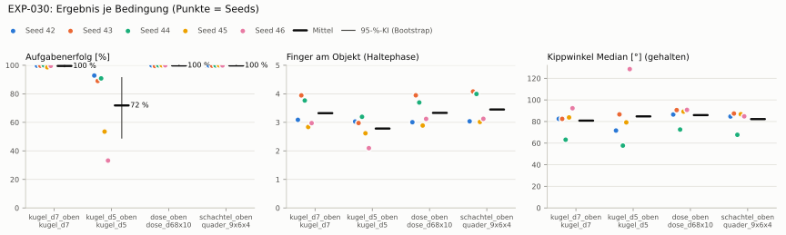
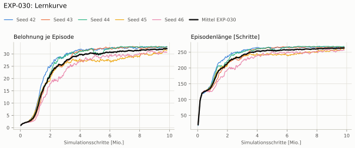
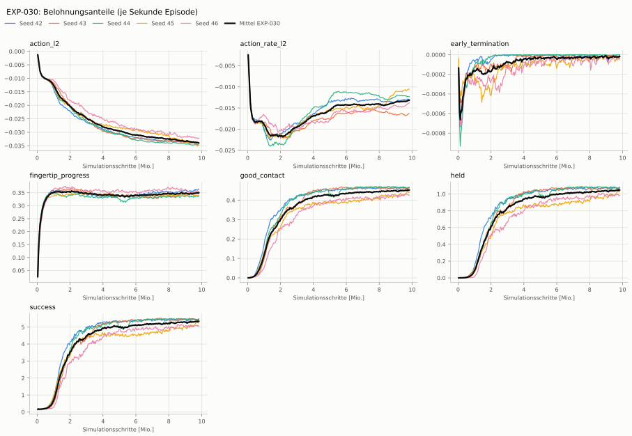
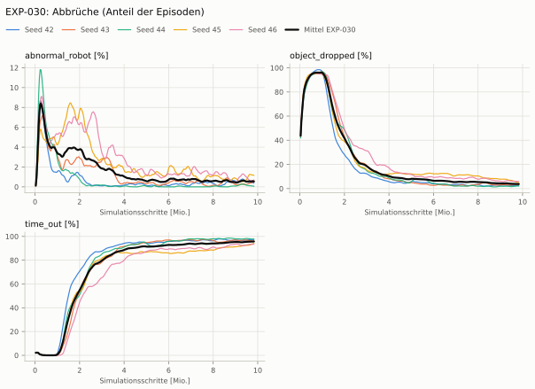
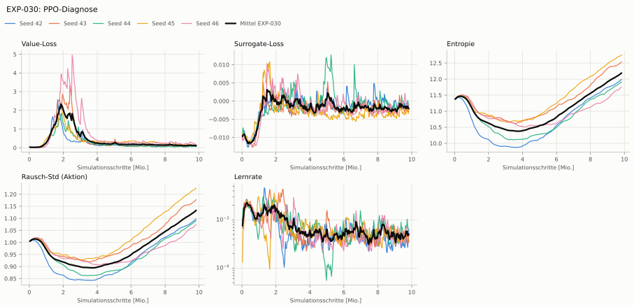

# EXP-030: Spezialist von oben, Rezept EXP-022 (Rückfallebene)

**Leistung** 100 % [99–100 %] (erfolgreiche Seeds, IQM über die Objekte; je Objekt Kugel Ø 7 100 % · Kugel Ø 5 89 % · Dose 100 % · Schachtel 100 %) — ggü. EXP-028: P(besser) = 0.35 [0.23–0.50] → kein Unterschied

**Testobjekte** (nie trainiert, erfolgreiche Seeds, Median): Suppendose (YCB) 100 %

**Zuverlässigkeit** 5/5 Seeds erfolgreich [48–100 %] — EXP-028: 1/1, exakter Fisher-Test p = 1.00 → nicht unterscheidbar (für eine Aussage ≥ 10 Seeds je Experiment)

**Leitplanken** Kippwinkel Median [°]: 80.8 > 25; Unterarm Median [°]: 90 > 10.9; Griffkraft Mittel [N]: 156 > 108; Stall-Anteil [Anteil]: 0.978 > 0.0504; Unruhe: 0.113 > 0.0108; Unruhe wirksam (Aktion auf ±1 begrenzt): 0.113 > 0.0108; Objektweg Tischebene Ende [mm]: 106 > 42.4 ✗

**Befund** Engpass Kugel Ø 5 (89 %); Kippwinkel 81° (EXP-028: 20°); Unruhe 0.11 (EXP-028: 0.01)

**Urteilsvorschlag** (auswertung-v2): **kein Unterschied, Leitplanke verletzt**

**Beste Videos** (Seed 42, 3 Episoden): [Kugel Ø 7](beste_videos/EXP-030_kugel_d7_s42.mp4) · [Kugel Ø 5](beste_videos/EXP-030_kugel_d5_s42.mp4) · [Dose](beste_videos/EXP-030_dose_d68x10_s42.mp4) · [Schachtel](beste_videos/EXP-030_quader_9x6x4_s42.mp4)

Ergebnisse je Bedingung (eval-v2, Leitplanken, Fehlerarten, Fingernutzung)

#### Bedingung `kugel_d7_oben`

Bedingung `kugel_d7_oben` (Objekt `kugel_d7`, Kippwinkel ≤ None°), Protokoll eval-v2, 5 Seed(s); Spalte EXP-028 unter derselben Anforderung

| Metrik | Mittel | 95-%-KI | IQM | Fehlschlag-Seeds (< 50 %) | EXP-028 (Mittel / IQM) |
|---|---|---|---|---|---|
| aufgabenerfolg | 99.5 % | 99.0 % – 99.9 % | 99.7 % | 0.0 % | 100.0 % / 100.0 % |
| haltequote | 99.5 % | 99.0 % – 99.9 % | 99.7 % | 0.0 % | 100.0 % / 100.0 % |
| Kippwinkel Median [°] | 80.8 | | | | 20 |
| Unterarm Median [°] | 90 | | | | 0.93 |
| Griffkraft Mittel [N] | 156 | | | | 89.7 |
| Kraft > 15 N [Anteil] | 100.0 % | | | | 100.0 % |
| Stall-Anteil [Anteil] | 97.8 % | | | | 0.0 % |
| Absinken [mm] | 0.00308 | | | | 1.12 |
| Unruhe | 0.113 | | | | 0.00901 |
| Unruhe wirksam (Aktion auf ±1 begrenzt) | 0.113 | | | | 0.00901 |
| Objektweg Tischebene Ende [mm] | 106 | | | | 22.4 |

Fehlerarten: startfehler 0.0 %, gefallen 0.5 %, instabil 0.0 %, anforderung_verletzt 0.0 %

**Urteilsvorschlag: schlechter (vorläufig: < 3 Seeds)** (gegenüber EXP-028)
Unterschied Aufgabenerfolg -0.5 Prozentpunkte (95-%-KI -1.0 … -0.1)
- Leitplanke: Kippwinkel Median [°]: 80.8 > 25
- Leitplanke: Unterarm Median [°]: 90 > 10.9
- Leitplanke: Griffkraft Mittel [N]: 156 > 108
- Leitplanke: Stall-Anteil [Anteil]: 0.978 > 0.0504
- Leitplanke: Unruhe: 0.113 > 0.0108
- Leitplanke: Unruhe wirksam (Aktion auf ±1 begrenzt): 0.113 > 0.0108
- Leitplanke: Objektweg Tischebene Ende [mm]: 106 > 42.4

Je Seed: 99.7 %, 99.7 %, 100.0 %, 98.6 %, 99.6 %

Fingernutzung (Haltephase): im Mittel 3.32 Finger am Objekt; Kontaktanteil je Seed (Daumen, Zeige, Mittel, Ring, klein): 100/24/99/82/4 · 100/97/88/85/24 · 100/86/100/89/2 · 100/97/11/75/2 · 100/87/0/91/20

#### Bedingung `kugel_d5_oben`

Bedingung `kugel_d5_oben` (Objekt `kugel_d5`, Kippwinkel ≤ None°), Protokoll eval-v2, 5 Seed(s); Spalte EXP-028 unter derselben Anforderung

| Metrik | Mittel | 95-%-KI | IQM | Fehlschlag-Seeds (< 50 %) | EXP-028 (Mittel / IQM) |
|---|---|---|---|---|---|
| aufgabenerfolg | 71.9 % | 49.0 % – 91.3 % | 78.9 % | 20.0 % | 89.7 % / 89.7 % |
| haltequote | 71.9 % | 49.1 % – 91.3 % | 78.9 % | 20.0 % | 89.7 % / 89.7 % |
| Kippwinkel Median [°] | 84.8 | | | | 30.3 |
| Unterarm Median [°] | 90 | | | | 0.0517 |
| Griffkraft Mittel [N] | 164 | | | | 95.1 |
| Kraft > 15 N [Anteil] | 100.0 % | | | | 100.0 % |
| Stall-Anteil [Anteil] | 97.6 % | | | | 0.0 % |
| Absinken [mm] | 0 | | | | 0.443 |
| Unruhe | 0.145 | | | | 0.00821 |
| Unruhe wirksam (Aktion auf ±1 begrenzt) | 0.145 | | | | 0.00821 |
| Objektweg Tischebene Ende [mm] | 93.7 | | | | 17.4 |

Fehlerarten: startfehler 0.0 %, gefallen 27.8 %, instabil 0.3 %, anforderung_verletzt 0.0 %

**Urteilsvorschlag: kein messbarer Unterschied (vorläufig: < 3 Seeds)** (gegenüber EXP-028)
Unterschied Aufgabenerfolg -18.0 Prozentpunkte (95-%-KI -40.0 … +1.8)
- Leitplanke: Kippwinkel Median [°]: 84.8 > 35.3
- Leitplanke: Unterarm Median [°]: 90 > 10.1
- Leitplanke: Griffkraft Mittel [N]: 164 > 114
- Leitplanke: Stall-Anteil [Anteil]: 0.976 > 0.0501
- Leitplanke: Unruhe: 0.145 > 0.00986
- Leitplanke: Unruhe wirksam (Aktion auf ±1 begrenzt): 0.145 > 0.00986
- Leitplanke: Objektweg Tischebene Ende [mm]: 93.7 > 37.4

Je Seed: 92.8 %, 89.0 %, 90.8 %, 53.5 %, 33.2 %

Fingernutzung (Haltephase): im Mittel 2.78 Finger am Objekt; Kontaktanteil je Seed (Daumen, Zeige, Mittel, Ring, klein): 100/67/95/41/1 · 100/49/99/49/1 · 100/79/100/41/0 · 99/91/37/34/0 · 94/15/2/98/1

#### Bedingung `dose_oben`

Bedingung `dose_oben` (Objekt `dose_d68x10`, Kippwinkel ≤ None°), Protokoll eval-v2, 5 Seed(s); Spalte EXP-028 unter derselben Anforderung

| Metrik | Mittel | 95-%-KI | IQM | Fehlschlag-Seeds (< 50 %) | EXP-028 (Mittel / IQM) |
|---|---|---|---|---|---|
| aufgabenerfolg | 99.9 % | 99.7 % – 100.0 % | 100.0 % | 0.0 % | 100.0 % / 100.0 % |
| haltequote | 99.9 % | 99.7 % – 100.0 % | 100.0 % | 0.0 % | 100.0 % / 100.0 % |
| Kippwinkel Median [°] | 85.9 | | | | 7.81 |
| Unterarm Median [°] | 90 | | | | 0.642 |
| Griffkraft Mittel [N] | 138 | | | | 85.1 |
| Kraft > 15 N [Anteil] | 100.0 % | | | | 99.9 % |
| Stall-Anteil [Anteil] | 97.8 % | | | | 0.0 % |
| Absinken [mm] | 0 | | | | 2.3 |
| Unruhe | 0.115 | | | | 0.00909 |
| Unruhe wirksam (Aktion auf ±1 begrenzt) | 0.115 | | | | 0.00909 |
| Objektweg Tischebene Ende [mm] | 136 | | | | 14.5 |

Fehlerarten: startfehler 0.0 %, gefallen 0.1 %, instabil 0.0 %, anforderung_verletzt 0.0 %

**Urteilsvorschlag: kein messbarer Unterschied (vorläufig: < 3 Seeds)** (gegenüber EXP-028)
Unterschied Aufgabenerfolg -0.1 Prozentpunkte (95-%-KI -0.3 … +0.0)
- Leitplanke: Kippwinkel Median [°]: 85.9 > 12.8
- Leitplanke: Unterarm Median [°]: 90 > 10.6
- Leitplanke: Griffkraft Mittel [N]: 138 > 102
- Leitplanke: Stall-Anteil [Anteil]: 0.978 > 0.0502
- Leitplanke: Unruhe: 0.115 > 0.0109
- Leitplanke: Unruhe wirksam (Aktion auf ±1 begrenzt): 0.115 > 0.0109
- Leitplanke: Objektweg Tischebene Ende [mm]: 136 > 34.5

Je Seed: 100.0 %, 99.5 %, 100.0 %, 100.0 %, 100.0 %

Fingernutzung (Haltephase): im Mittel 3.33 Finger am Objekt; Kontaktanteil je Seed (Daumen, Zeige, Mittel, Ring, klein): 100/16/100/85/0 · 100/89/90/95/21 · 100/76/100/94/0 · 100/95/3/91/0 · 100/94/0/99/19

#### Bedingung `schachtel_oben`

Bedingung `schachtel_oben` (Objekt `quader_9x6x4`, Kippwinkel ≤ None°), Protokoll eval-v2, 5 Seed(s); Spalte EXP-028 unter derselben Anforderung

| Metrik | Mittel | 95-%-KI | IQM | Fehlschlag-Seeds (< 50 %) | EXP-028 (Mittel / IQM) |
|---|---|---|---|---|---|
| aufgabenerfolg | 99.9 % | 99.7 % – 100.0 % | 99.9 % | 0.0 % | 99.9 % / 99.9 % |
| haltequote | 99.9 % | 99.7 % – 100.0 % | 99.9 % | 0.0 % | 99.9 % / 99.9 % |
| Kippwinkel Median [°] | 82.3 | | | | 11.3 |
| Unterarm Median [°] | 90 | | | | 0.592 |
| Griffkraft Mittel [N] | 130 | | | | 75.6 |
| Kraft > 15 N [Anteil] | 100.0 % | | | | 99.9 % |
| Stall-Anteil [Anteil] | 97.8 % | | | | 0.1 % |
| Absinken [mm] | 0 | | | | 4.85 |
| Unruhe | 0.114 | | | | 0.00884 |
| Unruhe wirksam (Aktion auf ±1 begrenzt) | 0.114 | | | | 0.00884 |
| Objektweg Tischebene Ende [mm] | 124 | | | | 28.8 |

Fehlerarten: startfehler 0.0 %, gefallen 0.1 %, instabil 0.0 %, anforderung_verletzt 0.0 %

**Urteilsvorschlag: kein messbarer Unterschied (vorläufig: < 3 Seeds)** (gegenüber EXP-028)
Unterschied Aufgabenerfolg -0.0 Prozentpunkte (95-%-KI -0.2 … +0.3)
- Leitplanke: Kippwinkel Median [°]: 82.3 > 16.3
- Leitplanke: Unterarm Median [°]: 90 > 10.6
- Leitplanke: Griffkraft Mittel [N]: 130 > 90.7
- Leitplanke: Stall-Anteil [Anteil]: 0.978 > 0.0511
- Leitplanke: Unruhe: 0.114 > 0.0106
- Leitplanke: Unruhe wirksam (Aktion auf ±1 begrenzt): 0.114 > 0.0106
- Leitplanke: Objektweg Tischebene Ende [mm]: 124 > 48.8

Je Seed: 99.9 %, 99.7 %, 99.9 %, 100.0 %, 99.9 %

Fingernutzung (Haltephase): im Mittel 3.45 Finger am Objekt; Kontaktanteil je Seed (Daumen, Zeige, Mittel, Ring, klein): 100/5/100/97/2 · 100/100/98/98/12 · 100/100/100/98/2 · 100/100/2/98/2 · 100/100/0/99/13

#### Bedingung `ycb_suppe_oben`

Bedingung `ycb_suppe_oben` (Objekt `ycb_005_suppe`, Kippwinkel ≤ None°), Protokoll eval-v2, 5 Seed(s); Spalte EXP-028 unter derselben Anforderung

| Metrik | Mittel | 95-%-KI | IQM | Fehlschlag-Seeds (< 50 %) | EXP-028 (Mittel / IQM) |
|---|---|---|---|---|---|
| aufgabenerfolg | 100.0 % | 100.0 % – 100.0 % | 100.0 % | 0.0 % | 99.9 % / 99.9 % |
| haltequote | 100.0 % | 100.0 % – 100.0 % | 100.0 % | 0.0 % | 99.9 % / 99.9 % |
| Kippwinkel Median [°] | 82.9 | | | | 8.54 |
| Unterarm Median [°] | 90 | | | | 0.627 |
| Griffkraft Mittel [N] | 142 | | | | 84.2 |
| Kraft > 15 N [Anteil] | 100.0 % | | | | 100.0 % |
| Stall-Anteil [Anteil] | 97.7 % | | | | 0.0 % |
| Absinken [mm] | 0 | | | | 5.95 |
| Unruhe | 0.117 | | | | 0.00928 |
| Unruhe wirksam (Aktion auf ±1 begrenzt) | 0.117 | | | | 0.00928 |
| Objektweg Tischebene Ende [mm] | 135 | | | | 14.8 |

Fehlerarten: startfehler 0.0 %, gefallen 0.0 %, instabil 0.0 %, anforderung_verletzt 0.0 %

**Urteilsvorschlag: kein messbarer Unterschied (vorläufig: < 3 Seeds)** (gegenüber EXP-028)
Unterschied Aufgabenerfolg +0.1 Prozentpunkte (95-%-KI +0.0 … +0.3)
- Leitplanke: Kippwinkel Median [°]: 82.9 > 13.5
- Leitplanke: Unterarm Median [°]: 90 > 10.6
- Leitplanke: Griffkraft Mittel [N]: 142 > 101
- Leitplanke: Stall-Anteil [Anteil]: 0.977 > 0.0501
- Leitplanke: Unruhe: 0.117 > 0.0111
- Leitplanke: Unruhe wirksam (Aktion auf ±1 begrenzt): 0.117 > 0.0111
- Leitplanke: Objektweg Tischebene Ende [mm]: 135 > 34.8

Je Seed: 100.0 %, 100.0 %, 100.0 %, 100.0 %, 100.0 %

Fingernutzung (Haltephase): im Mittel 3.31 Finger am Objekt; Kontaktanteil je Seed (Daumen, Zeige, Mittel, Ring, klein): 100/11/100/89/0 · 100/90/85/96/19 · 100/73/100/94/0 · 100/85/4/92/0 · 100/93/0/99/27

Trainingsverlauf

Seeds dünn, Mittel kräftig, Eltern gestrichelt (nur Abbrüche/PPO — Trainings-Belohnung ist zwischen Experimenten nicht vergleichbar); geglättet, x = Simulationsschritte. Endwerte = Mittel der letzten 10 Iterationen (Belohnungsanteile je Sekunde Episode).

| Größe | Seed 42 | Seed 43 | Seed 44 | Seed 45 | Seed 46 | Mittel |
|---|---|---|---|---|---|---|
| mean_reward | 32.8 | 32.8 | 32.8 | 31.6 | 30.8 | 32.2 |
| action_l2 | -0.0339 | -0.0339 | -0.0346 | -0.0348 | -0.0322 | -0.0339 |
| action_rate_l2 | -0.013 | -0.0165 | -0.0123 | -0.0106 | -0.0139 | -0.0133 |
| early_termination | -1.14e-05 | -1.63e-05 | -1.29e-06 | -3.76e-05 | -3.73e-05 | -2.08e-05 |
| fingertip_progress | 0.363 | 0.352 | 0.338 | 0.339 | 0.355 | 0.349 |
| good_contact | 0.463 | 0.462 | 0.465 | 0.442 | 0.429 | 0.452 |
| held | 1.07 | 1.07 | 1.07 | 1.03 | 0.992 | 1.05 |
| success | 5.43 | 5.45 | 5.43 | 5.26 | 5.08 | 5.33 |
| object_dropped | 2.4 % | 3.4 % | 2.1 % | 5.1 % | 5.9 % | 3.8 % |
| mean_noise_std | 1.09 | 1.17 | 1.09 | 1.22 | 1.07 | 1.13 |

Netz, Training und Konfiguration

Actor [256, 128, 64] (elu), 68808 Parameter, 105 Eingänge (Verlauf 5) · Critic [512, 256, 128] · PPO: Lernrate 0.001, Entropie 0.005, 5 Epochen × 4 Mini-Batches, 32 Schritte/Umgebung · 1024 Umgebungen × 300 Iterationen

