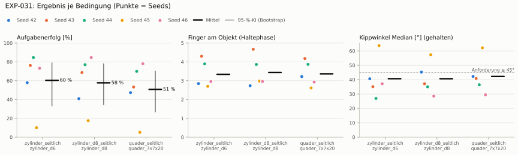
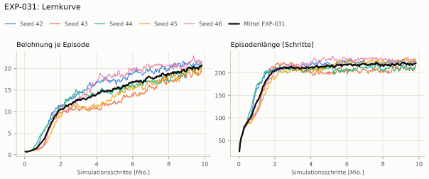
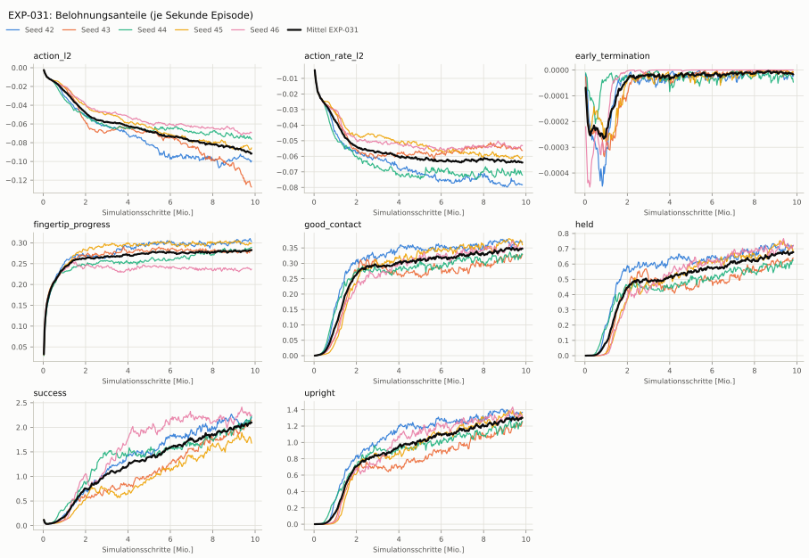
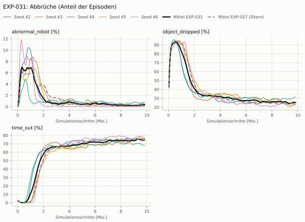
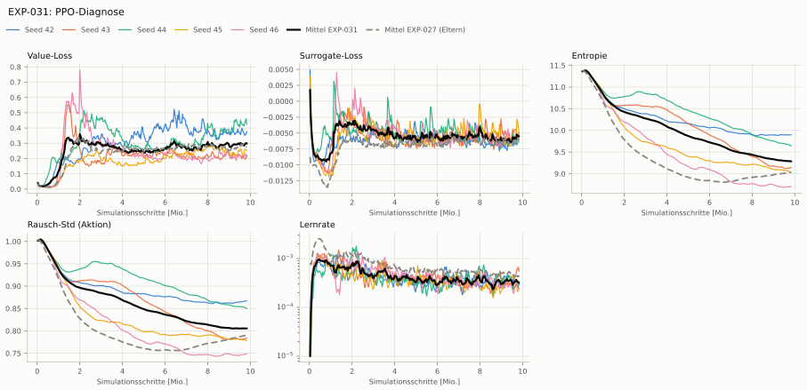

# EXP-031: Großes Netz 512-256-128 wie Dexsuite

**Leistung** 75 % [70–80 %] (erfolgreiche Seeds, IQM über die Objekte; je Objekt Ø 6 cm 76 % · Ø 8 cm 77 % · Quader 70 %) — ggü. EXP-027: P(besser) = 0.28 [0.00–0.56] → kein Unterschied

**Testobjekte** (nie trainiert, erfolgreiche Seeds, Median): Flasche 80 % · Saftpackung 63 % · Cracker (YCB) 74 % · Zucker (YCB) 75 % · Senf (YCB) 70 %

**Zuverlässigkeit** 3/5 Seeds erfolgreich [15–95 %] — EXP-027: 2/5, exakter Fisher-Test p = 1.00 → nicht unterscheidbar (für eine Aussage ≥ 10 Seeds je Experiment)

**Leitplanken** eingehalten

**Befund** ohne Erfolg: Seed 42 (hält, aber gekippt), Seed 45 (hält, aber gekippt); Engpass Quader (70 %); Unruhe 0.86 (EXP-027: 1.68)

**Urteilsvorschlag** (auswertung-v2): **kein Unterschied**

Ergebnisse je Bedingung (eval-v2, Leitplanken, Fehlerarten, Fingernutzung)

#### Bedingung `zylinder_seitlich`

Bedingung `zylinder_seitlich` (Objekt `zylinder_d6`, Kippwinkel ≤ 45°), Protokoll eval-v2, 5 Seed(s); Spalte EXP-027 unter derselben Anforderung

| Metrik | Mittel | 95-%-KI | IQM | Fehlschlag-Seeds (< 50 %) | EXP-027 (Mittel / IQM) |
|---|---|---|---|---|---|
| aufgabenerfolg | 60.4 % | 33.3 % – 79.0 % | 69.5 % | 20.0 % | 55.9 % / 66.0 % |
| haltequote | 92.4 % | 89.3 % – 95.5 % | 92.6 % | 0.0 % | 94.5 % / 94.7 % |
| Kippwinkel Median [°] | 40.7 | | | | 44.4 |
| Unterarm Median [°] | 53 | | | | 50.9 |
| Griffkraft Mittel [N] | 101 | | | | 96.5 |
| Kraft > 15 N [Anteil] | 99.9 % | | | | 99.9 % |
| Stall-Anteil [Anteil] | 99.9 % | | | | 99.8 % |
| Absinken [mm] | 0.107 | | | | 0.00332 |
| Unruhe | 0.863 | | | | 1.68 |
| Unruhe wirksam (Aktion auf ±1 begrenzt) | 0.324 | | | | 0.663 |
| Objektweg Tischebene Ende [mm] | 107 | | | | 99.7 |

Fehlerarten: startfehler 0.0 %, gefallen 7.5 %, instabil 0.0 %, anforderung_verletzt 32.1 %

**Urteilsvorschlag: kein messbarer Unterschied** (gegenüber EXP-027)
Unterschied Aufgabenerfolg +4.2 Prozentpunkte (95-%-KI -21.9 … +40.3)

Je Seed: 57.9 %, 76.2 %, 84.6 %, 10.0 %, 73.2 %

Fingernutzung (Haltephase): im Mittel 3.34 Finger am Objekt; Kontaktanteil je Seed (Daumen, Zeige, Mittel, Ring, klein): 99/7/25/76/77 · 81/94/92/95/68 · 98/93/99/99/0 · 100/0/74/28/68 · 95/99/97/5/0

#### Bedingung `zylinder_d8_seitlich`

Bedingung `zylinder_d8_seitlich` (Objekt `zylinder_d8`, Kippwinkel ≤ 45°), Protokoll eval-v2, 5 Seed(s); Spalte EXP-027 unter derselben Anforderung

| Metrik | Mittel | 95-%-KI | IQM | Fehlschlag-Seeds (< 50 %) | EXP-027 (Mittel / IQM) |
|---|---|---|---|---|---|
| aufgabenerfolg | 57.7 % | 34.6 % – 77.9 % | 62.8 % | 40.0 % | 51.0 % / 55.0 % |
| haltequote | 83.8 % | 80.2 % – 87.6 % | 83.7 % | 0.0 % | 87.6 % / 87.0 % |
| Kippwinkel Median [°] | 40.6 | | | | 43.9 |
| Unterarm Median [°] | 53.8 | | | | 51.8 |
| Griffkraft Mittel [N] | 96.6 | | | | 90.2 |
| Kraft > 15 N [Anteil] | 99.9 % | | | | 99.8 % |
| Stall-Anteil [Anteil] | 100.0 % | | | | 99.8 % |
| Absinken [mm] | 0.0305 | | | | 0 |
| Unruhe | 1.09 | | | | 1.91 |
| Unruhe wirksam (Aktion auf ±1 begrenzt) | 0.475 | | | | 0.81 |
| Objektweg Tischebene Ende [mm] | 120 | | | | 108 |

Fehlerarten: startfehler 0.0 %, gefallen 16.1 %, instabil 0.1 %, anforderung_verletzt 26.1 %

**Urteilsvorschlag: kein messbarer Unterschied** (gegenüber EXP-027)
Unterschied Aufgabenerfolg +6.8 Prozentpunkte (95-%-KI -33.6 … +46.1)

Je Seed: 40.9 %, 68.6 %, 77.0 %, 17.5 %, 84.6 %

Fingernutzung (Haltephase): im Mittel 3.44 Finger am Objekt; Kontaktanteil je Seed (Daumen, Zeige, Mittel, Ring, klein): 99/18/73/26/57 · 98/96/99/95/79 · 99/93/99/95/0 · 100/5/67/33/93 · 100/98/97/0/0

#### Bedingung `quader_seitlich`

Bedingung `quader_seitlich` (Objekt `quader_7x7x20`, Kippwinkel ≤ 45°), Protokoll eval-v2, 5 Seed(s); Spalte EXP-027 unter derselben Anforderung

| Metrik | Mittel | 95-%-KI | IQM | Fehlschlag-Seeds (< 50 %) | EXP-027 (Mittel / IQM) |
|---|---|---|---|---|---|
| aufgabenerfolg | 50.7 % | 26.9 % – 70.0 % | 56.5 % | 40.0 % | 40.9 % / 43.7 % |
| haltequote | 76.6 % | 74.9 % – 78.3 % | 76.8 % | 0.0 % | 76.1 % / 77.0 % |
| Kippwinkel Median [°] | 42.2 | | | | 48 |
| Unterarm Median [°] | 52.6 | | | | 53.5 |
| Griffkraft Mittel [N] | 89.6 | | | | 88.7 |
| Kraft > 15 N [Anteil] | 99.8 % | | | | 99.9 % |
| Stall-Anteil [Anteil] | 99.9 % | | | | 99.8 % |
| Absinken [mm] | 0.0139 | | | | 0 |
| Unruhe | 1.39 | | | | 1.59 |
| Unruhe wirksam (Aktion auf ±1 begrenzt) | 0.611 | | | | 0.651 |
| Objektweg Tischebene Ende [mm] | 109 | | | | 113 |

Fehlerarten: startfehler 0.0 %, gefallen 23.3 %, instabil 0.1 %, anforderung_verletzt 25.9 %

**Urteilsvorschlag: kein messbarer Unterschied** (gegenüber EXP-027)
Unterschied Aufgabenerfolg +10.0 Prozentpunkte (95-%-KI -27.0 … +46.4)

Je Seed: 47.3 %, 53.3 %, 69.9 %, 5.1 %, 78.0 %

Fingernutzung (Haltephase): im Mittel 3.36 Finger am Objekt; Kontaktanteil je Seed (Daumen, Zeige, Mittel, Ring, klein): 100/4/82/58/78 · 99/97/100/93/29 · 100/90/100/98/0 · 100/0/98/3/60 · 100/97/96/0/0

#### Bedingung `flasche_seitlich`

Bedingung `flasche_seitlich` (Objekt `flasche_d7x25`, Kippwinkel ≤ 45°), Protokoll eval-v2, 5 Seed(s); Spalte EXP-027 unter derselben Anforderung

| Metrik | Mittel | 95-%-KI | IQM | Fehlschlag-Seeds (< 50 %) | EXP-027 (Mittel / IQM) |
|---|---|---|---|---|---|
| aufgabenerfolg | 58.7 % | 32.9 % – 81.1 % | 64.2 % | 40.0 % | 50.1 % / 53.6 % |
| haltequote | 84.4 % | 75.9 % – 91.8 % | 86.7 % | 0.0 % | 88.2 % / 87.0 % |
| Kippwinkel Median [°] | 38.5 | | | | 44 |
| Unterarm Median [°] | 54.3 | | | | 52.2 |
| Griffkraft Mittel [N] | 98.7 | | | | 87.5 |
| Kraft > 15 N [Anteil] | 99.9 % | | | | 99.9 % |
| Stall-Anteil [Anteil] | 99.9 % | | | | 99.9 % |
| Absinken [mm] | 0.0462 | | | | 0.0167 |
| Unruhe | 1.01 | | | | 1.93 |
| Unruhe wirksam (Aktion auf ±1 begrenzt) | 0.424 | | | | 0.758 |
| Objektweg Tischebene Ende [mm] | 112 | | | | 104 |

Fehlerarten: startfehler 0.0 %, gefallen 15.6 %, instabil 0.0 %, anforderung_verletzt 25.7 %

**Urteilsvorschlag: kein messbarer Unterschied** (gegenüber EXP-027)
Unterschied Aufgabenerfolg +8.6 Prozentpunkte (95-%-KI -28.3 … +46.2)

Je Seed: 37.9 %, 72.2 %, 79.7 %, 15.7 %, 88.0 %

Fingernutzung (Haltephase): im Mittel 3.38 Finger am Objekt; Kontaktanteil je Seed (Daumen, Zeige, Mittel, Ring, klein): 98/13/41/55/68 · 95/95/98/92/67 · 99/91/99/96/0 · 100/1/79/21/84 · 100/99/98/0/0

#### Bedingung `saftpackung_seitlich`

Bedingung `saftpackung_seitlich` (Objekt `saftpackung_9x6x19`, Kippwinkel ≤ 45°), Protokoll eval-v2, 5 Seed(s); Spalte EXP-027 unter derselben Anforderung

| Metrik | Mittel | 95-%-KI | IQM | Fehlschlag-Seeds (< 50 %) | EXP-027 (Mittel / IQM) |
|---|---|---|---|---|---|
| aufgabenerfolg | 49.7 % | 24.5 % – 72.1 % | 51.4 % | 60.0 % | 45.9 % / 48.8 % |
| haltequote | 84.4 % | 80.0 % – 88.8 % | 84.9 % | 0.0 % | 83.4 % / 86.3 % |
| Kippwinkel Median [°] | 43.9 | | | | 47.3 |
| Unterarm Median [°] | 53.7 | | | | 55.5 |
| Griffkraft Mittel [N] | 89.1 | | | | 93.8 |
| Kraft > 15 N [Anteil] | 99.9 % | | | | 99.9 % |
| Stall-Anteil [Anteil] | 99.9 % | | | | 99.8 % |
| Absinken [mm] | 0.00807 | | | | 0 |
| Unruhe | 1.18 | | | | 1.57 |
| Unruhe wirksam (Aktion auf ±1 begrenzt) | 0.518 | | | | 0.632 |
| Objektweg Tischebene Ende [mm] | 119 | | | | 118 |

Fehlerarten: startfehler 0.0 %, gefallen 15.5 %, instabil 0.1 %, anforderung_verletzt 34.7 %

**Urteilsvorschlag: kein messbarer Unterschied** (gegenüber EXP-027)
Unterschied Aufgabenerfolg +4.2 Prozentpunkte (95-%-KI -34.5 … +45.5)

Je Seed: 46.8 %, 45.8 %, 63.1 %, 4.4 %, 88.4 %

Fingernutzung (Haltephase): im Mittel 3.29 Finger am Objekt; Kontaktanteil je Seed (Daumen, Zeige, Mittel, Ring, klein): 100/7/85/46/58 · 97/98/99/82/45 · 99/93/99/86/0 · 100/0/100/2/51 · 100/100/98/0/0

#### Bedingung `ycb_cracker_seitlich`

Bedingung `ycb_cracker_seitlich` (Objekt `ycb_003_cracker`, Kippwinkel ≤ 45°), Protokoll eval-v2, 5 Seed(s); Spalte EXP-027 unter derselben Anforderung

| Metrik | Mittel | 95-%-KI | IQM | Fehlschlag-Seeds (< 50 %) | EXP-027 (Mittel / IQM) |
|---|---|---|---|---|---|
| aufgabenerfolg | 75.1 % | 71.6 % – 78.9 % | 74.9 % | 0.0 % | 64.9 % / 77.3 % |
| haltequote | 77.1 % | 74.4 % – 80.1 % | 77.2 % | 0.0 % | 79.0 % / 79.9 % |
| Kippwinkel Median [°] | 23.4 | | | | 30 |
| Unterarm Median [°] | 51.2 | | | | 52.2 |
| Griffkraft Mittel [N] | 91.2 | | | | 87.6 |
| Kraft > 15 N [Anteil] | 100.0 % | | | | 100.0 % |
| Stall-Anteil [Anteil] | 99.9 % | | | | 99.9 % |
| Absinken [mm] | 0 | | | | 0 |
| Unruhe | 0.822 | | | | 1.47 |
| Unruhe wirksam (Aktion auf ±1 begrenzt) | 0.331 | | | | 0.575 |
| Objektweg Tischebene Ende [mm] | 137 | | | | 139 |

Fehlerarten: startfehler 0.0 %, gefallen 22.8 %, instabil 0.1 %, anforderung_verletzt 2.0 %

**Urteilsvorschlag: kein messbarer Unterschied** (gegenüber EXP-027)
Unterschied Aufgabenerfolg +9.9 Prozentpunkte (95-%-KI -7.3 … +37.5)

Je Seed: 77.9 %, 74.2 %, 72.7 %, 69.9 %, 81.0 %

Fingernutzung (Haltephase): im Mittel 3.44 Finger am Objekt; Kontaktanteil je Seed (Daumen, Zeige, Mittel, Ring, klein): 100/2/85/55/68 · 100/94/99/99/69 · 100/93/100/100/0 · 100/0/95/10/52 · 100/99/99/0/0

#### Bedingung `ycb_zucker_seitlich`

Bedingung `ycb_zucker_seitlich` (Objekt `ycb_004_zucker`, Kippwinkel ≤ 45°), Protokoll eval-v2, 5 Seed(s); Spalte EXP-027 unter derselben Anforderung

| Metrik | Mittel | 95-%-KI | IQM | Fehlschlag-Seeds (< 50 %) | EXP-027 (Mittel / IQM) |
|---|---|---|---|---|---|
| aufgabenerfolg | 75.4 % | 61.1 % – 89.3 % | 74.1 % | 0.0 % | 75.0 % / 92.4 % |
| haltequote | 79.6 % | 66.1 % – 92.7 % | 80.2 % | 0.0 % | 95.7 % / 95.9 % |
| Kippwinkel Median [°] | 26.7 | | | | 29.9 |
| Unterarm Median [°] | 49.3 | | | | 57.2 |
| Griffkraft Mittel [N] | 107 | | | | 106 |
| Kraft > 15 N [Anteil] | 100.0 % | | | | 100.0 % |
| Stall-Anteil [Anteil] | 100.0 % | | | | 99.7 % |
| Absinken [mm] | 0.00298 | | | | 0.00761 |
| Unruhe | 0.715 | | | | 1.33 |
| Unruhe wirksam (Aktion auf ±1 begrenzt) | 0.228 | | | | 0.602 |
| Objektweg Tischebene Ende [mm] | 111 | | | | 116 |

Fehlerarten: startfehler 0.0 %, gefallen 20.3 %, instabil 0.1 %, anforderung_verletzt 4.2 %

**Urteilsvorschlag: kein messbarer Unterschied** (gegenüber EXP-027)
Unterschied Aufgabenerfolg -0.0 Prozentpunkte (95-%-KI -30.7 … +38.5)

Je Seed: 57.4 %, 74.8 %, 58.1 %, 89.2 %, 97.3 %

Fingernutzung (Haltephase): im Mittel 3.28 Finger am Objekt; Kontaktanteil je Seed (Daumen, Zeige, Mittel, Ring, klein): 100/8/27/93/11 · 92/93/88/72/68 · 100/98/100/97/0 · 100/0/92/8/93 · 100/100/100/0/0

#### Bedingung `ycb_senf_seitlich`

Bedingung `ycb_senf_seitlich` (Objekt `ycb_006_senf`, Kippwinkel ≤ 45°), Protokoll eval-v2, 5 Seed(s); Spalte EXP-027 unter derselben Anforderung

| Metrik | Mittel | 95-%-KI | IQM | Fehlschlag-Seeds (< 50 %) | EXP-027 (Mittel / IQM) |
|---|---|---|---|---|---|
| aufgabenerfolg | 69.5 % | 56.8 % – 83.0 % | 68.7 % | 20.0 % | 72.6 % / 89.1 % |
| haltequote | 75.9 % | 61.2 % – 90.1 % | 78.0 % | 20.0 % | 93.0 % / 93.2 % |
| Kippwinkel Median [°] | 27.5 | | | | 32.9 |
| Unterarm Median [°] | 53.4 | | | | 53.3 |
| Griffkraft Mittel [N] | 100 | | | | 102 |
| Kraft > 15 N [Anteil] | 100.0 % | | | | 100.0 % |
| Stall-Anteil [Anteil] | 100.0 % | | | | 99.7 % |
| Absinken [mm] | 0 | | | | 0.0113 |
| Unruhe | 0.689 | | | | 1.4 |
| Unruhe wirksam (Aktion auf ±1 begrenzt) | 0.236 | | | | 0.596 |
| Objektweg Tischebene Ende [mm] | 116 | | | | 111 |

Fehlerarten: startfehler 0.0 %, gefallen 24.0 %, instabil 0.1 %, anforderung_verletzt 6.4 %

**Urteilsvorschlag: kein messbarer Unterschied** (gegenüber EXP-027)
Unterschied Aufgabenerfolg -3.4 Prozentpunkte (95-%-KI -33.0 … +33.1)

Je Seed: 60.9 %, 69.6 %, 48.5 %, 75.4 %, 93.2 %

Fingernutzung (Haltephase): im Mittel 3.35 Finger am Objekt; Kontaktanteil je Seed (Daumen, Zeige, Mittel, Ring, klein): 99/11/72/55/40 · 99/84/80/79/77 · 100/94/99/99/0 · 100/0/72/28/93 · 100/92/100/0/0

Trainingsverlauf

Seeds dünn, Mittel kräftig, Eltern gestrichelt (nur Abbrüche/PPO — Trainings-Belohnung ist zwischen Experimenten nicht vergleichbar); geglättet, x = Simulationsschritte. Endwerte = Mittel der letzten 10 Iterationen (Belohnungsanteile je Sekunde Episode).

| Größe | Seed 42 | Seed 43 | Seed 44 | Seed 45 | Seed 46 | Mittel |
|---|---|---|---|---|---|---|
| mean_reward | 21.4 | 19.4 | 20.6 | 19.4 | 21.3 | 20.4 |
| action_l2 | -0.0989 | -0.125 | -0.0753 | -0.0854 | -0.0696 | -0.0908 |
| action_rate_l2 | -0.0781 | -0.0553 | -0.0714 | -0.0605 | -0.0538 | -0.0638 |
| early_termination | -2.03e-05 | -1.18e-05 | -3.23e-05 | -1.13e-05 | 0 | -1.51e-05 |
| fingertip_progress | 0.305 | 0.28 | 0.288 | 0.298 | 0.238 | 0.282 |
| good_contact | 0.37 | 0.323 | 0.326 | 0.364 | 0.348 | 0.346 |
| held | 0.72 | 0.629 | 0.614 | 0.695 | 0.713 | 0.674 |
| success | 2.17 | 2.1 | 2.18 | 1.72 | 2.25 | 2.08 |
| upright | 1.36 | 1.23 | 1.24 | 1.32 | 1.32 | 1.29 |
| object_dropped | 23.3 % | 25.7 % | 30.9 % | 23.7 % | 22.8 % | 25.3 % |
| mean_noise_std | 0.867 | 0.782 | 0.852 | 0.779 | 0.748 | 0.805 |

Netz, Training und Konfiguration

Actor [512, 256, 128] (elu), 219528 Parameter, 105 Eingänge (Verlauf 5) · Critic [512, 256, 128] · PPO: Lernrate 0.001, Entropie 0.005, 5 Epochen × 4 Mini-Batches, 32 Schritte/Umgebung · 1024 Umgebungen × 300 Iterationen

Geplante Änderung: Actor 512-256-128 (PibGraspPPORunnerCfg_BoundsGross). Sonst wie EXP-027.

Konfiguration gegenüber EXP-027 (1 Unterschiede):

- `agent.policy.actor_hidden_dims: [256, 128, 64] → [512, 256, 128]`

