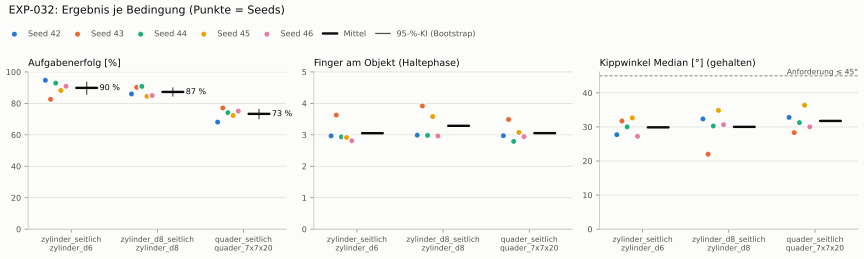
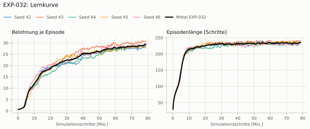
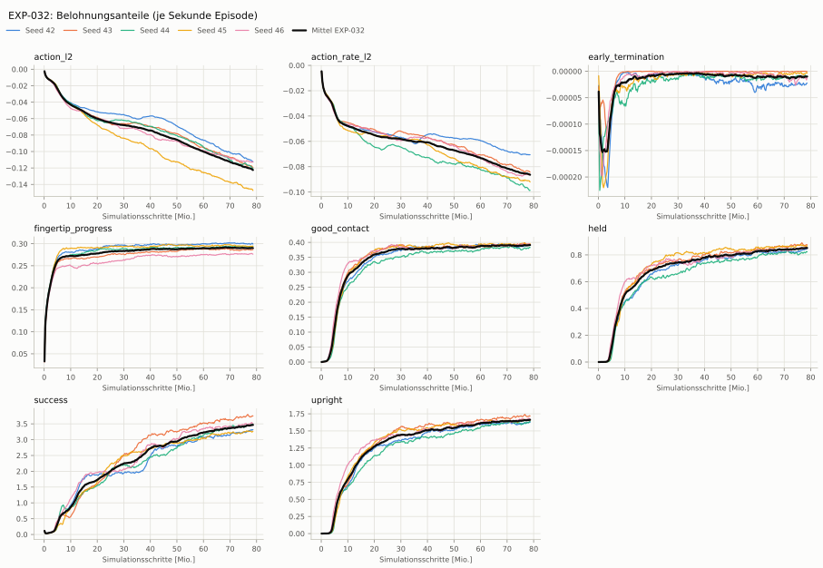
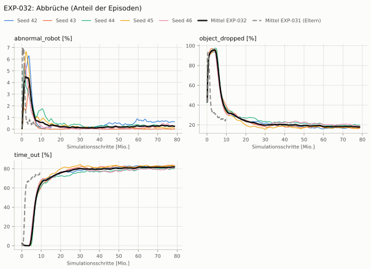
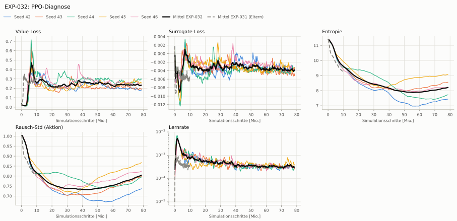

# EXP-032: Großes Netz mit 8-fachem Budget (4096 Umgebungen × 600 Iterationen)

**Leistung** 85 % [82–87 %] (erfolgreiche Seeds, IQM über die Objekte; je Objekt Ø 6 cm 91 % · Ø 8 cm 86 % · Quader 74 %) — ggü. EXP-031: P(besser) = 0.82 [0.62–1.00] → gesichert besser

**Testobjekte** (nie trainiert, erfolgreiche Seeds, Median): Flasche 91 % · Saftpackung 72 % · Cracker (YCB) 80 % · Zucker (YCB) 80 % · Senf (YCB) 81 %

**Zuverlässigkeit** 5/5 Seeds erfolgreich [48–100 %] — EXP-031: 3/5, exakter Fisher-Test p = 0.44 → nicht unterscheidbar (für eine Aussage ≥ 10 Seeds je Experiment)

**Leitplanken** Unruhe: 3.85 > 1.04; Unruhe wirksam (Aktion auf ±1 begrenzt): 1.07 > 0.389 ✗

**Befund** Engpass Quader (74 %); Kippwinkel 30° (EXP-031: 41°); Unruhe 3.85 (EXP-031: 0.86)

**Urteilsvorschlag** (auswertung-v2): **kein Unterschied, Leitplanke verletzt**

Ergebnisse je Bedingung (eval-v2, Leitplanken, Fehlerarten, Fingernutzung)

#### Bedingung `zylinder_seitlich`

Bedingung `zylinder_seitlich` (Objekt `zylinder_d6`, Kippwinkel ≤ 45°), Protokoll eval-v2, 5 Seed(s); Spalte EXP-031 unter derselben Anforderung

| Metrik | Mittel | 95-%-KI | IQM | Fehlschlag-Seeds (< 50 %) | EXP-031 (Mittel / IQM) |
|---|---|---|---|---|---|
| aufgabenerfolg | 89.9 % | 85.9 % – 93.4 % | 90.7 % | 0.0 % | 60.4 % / 69.5 % |
| haltequote | 96.5 % | 95.3 % – 97.4 % | 96.8 % | 0.0 % | 92.4 % / 92.6 % |
| Kippwinkel Median [°] | 29.9 | | | | 40.7 |
| Unterarm Median [°] | 43.1 | | | | 53 |
| Griffkraft Mittel [N] | 97.4 | | | | 101 |
| Kraft > 15 N [Anteil] | 99.9 % | | | | 99.9 % |
| Stall-Anteil [Anteil] | 100.0 % | | | | 99.9 % |
| Absinken [mm] | 0.0122 | | | | 0.107 |
| Unruhe | 3.85 | | | | 0.863 |
| Unruhe wirksam (Aktion auf ±1 begrenzt) | 1.07 | | | | 0.324 |
| Objektweg Tischebene Ende [mm] | 120 | | | | 107 |

Fehlerarten: startfehler 0.0 %, gefallen 3.5 %, instabil 0.0 %, anforderung_verletzt 6.6 %

**Urteilsvorschlag: Leitplanke verletzt** (gegenüber EXP-031)
Unterschied Aufgabenerfolg +29.3 Prozentpunkte (95-%-KI +9.5 … +55.8)
- Leitplanke: Unruhe: 3.85 > 1.04
- Leitplanke: Unruhe wirksam (Aktion auf ±1 begrenzt): 1.07 > 0.389

Je Seed: 94.7 %, 82.5 %, 92.9 %, 88.2 %, 90.9 %

Fingernutzung (Haltephase): im Mittel 3.05 Finger am Objekt; Kontaktanteil je Seed (Daumen, Zeige, Mittel, Ring, klein): 99/97/100/0/0 · 100/80/99/84/0 · 95/98/100/0/1 · 100/68/26/97/0 · 100/82/100/0/0

#### Bedingung `zylinder_d8_seitlich`

Bedingung `zylinder_d8_seitlich` (Objekt `zylinder_d8`, Kippwinkel ≤ 45°), Protokoll eval-v2, 5 Seed(s); Spalte EXP-031 unter derselben Anforderung

| Metrik | Mittel | 95-%-KI | IQM | Fehlschlag-Seeds (< 50 %) | EXP-031 (Mittel / IQM) |
|---|---|---|---|---|---|
| aufgabenerfolg | 87.3 % | 84.8 % – 89.7 % | 87.0 % | 0.0 % | 57.7 % / 62.8 % |
| haltequote | 90.2 % | 88.6 % – 91.7 % | 90.3 % | 0.0 % | 83.8 % / 83.7 % |
| Kippwinkel Median [°] | 30 | | | | 40.6 |
| Unterarm Median [°] | 43.2 | | | | 53.8 |
| Griffkraft Mittel [N] | 103 | | | | 96.6 |
| Kraft > 15 N [Anteil] | 99.9 % | | | | 99.9 % |
| Stall-Anteil [Anteil] | 100.0 % | | | | 100.0 % |
| Absinken [mm] | 0 | | | | 0.0305 |
| Unruhe | 3.66 | | | | 1.09 |
| Unruhe wirksam (Aktion auf ±1 begrenzt) | 1.03 | | | | 0.475 |
| Objektweg Tischebene Ende [mm] | 132 | | | | 120 |

Fehlerarten: startfehler 0.0 %, gefallen 9.7 %, instabil 0.1 %, anforderung_verletzt 2.9 %

**Urteilsvorschlag: Leitplanke verletzt** (gegenüber EXP-031)
Unterschied Aufgabenerfolg +29.3 Prozentpunkte (95-%-KI +10.2 … +51.7)
- Leitplanke: Unruhe: 3.66 > 1.31
- Leitplanke: Unruhe wirksam (Aktion auf ±1 begrenzt): 1.03 > 0.57

Je Seed: 86.0 %, 90.2 %, 90.8 %, 84.5 %, 85.0 %

Fingernutzung (Haltephase): im Mittel 3.29 Finger am Objekt; Kontaktanteil je Seed (Daumen, Zeige, Mittel, Ring, klein): 100/99/100/0/0 · 100/93/99/100/0 · 100/99/100/0/0 · 99/89/71/98/0 · 100/97/100/0/0

#### Bedingung `quader_seitlich`

Bedingung `quader_seitlich` (Objekt `quader_7x7x20`, Kippwinkel ≤ 45°), Protokoll eval-v2, 5 Seed(s); Spalte EXP-031 unter derselben Anforderung

| Metrik | Mittel | 95-%-KI | IQM | Fehlschlag-Seeds (< 50 %) | EXP-031 (Mittel / IQM) |
|---|---|---|---|---|---|
| aufgabenerfolg | 73.3 % | 70.3 % – 76.1 % | 73.9 % | 0.0 % | 50.7 % / 56.5 % |
| haltequote | 78.1 % | 76.0 % – 80.3 % | 77.6 % | 0.0 % | 76.6 % / 76.8 % |
| Kippwinkel Median [°] | 31.8 | | | | 42.2 |
| Unterarm Median [°] | 44.9 | | | | 52.6 |
| Griffkraft Mittel [N] | 90 | | | | 89.6 |
| Kraft > 15 N [Anteil] | 99.9 % | | | | 99.8 % |
| Stall-Anteil [Anteil] | 100.0 % | | | | 99.9 % |
| Absinken [mm] | 0.0105 | | | | 0.0139 |
| Unruhe | 6.23 | | | | 1.39 |
| Unruhe wirksam (Aktion auf ±1 begrenzt) | 1.49 | | | | 0.611 |
| Objektweg Tischebene Ende [mm] | 123 | | | | 109 |

Fehlerarten: startfehler 0.0 %, gefallen 21.9 %, instabil 0.0 %, anforderung_verletzt 4.7 %

**Urteilsvorschlag: Leitplanke verletzt** (gegenüber EXP-031)
Unterschied Aufgabenerfolg +22.3 Prozentpunkte (95-%-KI +4.4 … +45.9)
- Leitplanke: Unruhe: 6.23 > 1.66
- Leitplanke: Unruhe wirksam (Aktion auf ±1 begrenzt): 1.49 > 0.733

Je Seed: 68.1 %, 77.1 %, 74.1 %, 72.3 %, 75.1 %

Fingernutzung (Haltephase): im Mittel 3.05 Finger am Objekt; Kontaktanteil je Seed (Daumen, Zeige, Mittel, Ring, klein): 100/97/100/0/0 · 100/53/97/100/0 · 99/81/99/0/0 · 100/96/15/97/0 · 99/95/100/0/0

#### Bedingung `flasche_seitlich`

Bedingung `flasche_seitlich` (Objekt `flasche_d7x25`, Kippwinkel ≤ 45°), Protokoll eval-v2, 5 Seed(s); Spalte EXP-031 unter derselben Anforderung

| Metrik | Mittel | 95-%-KI | IQM | Fehlschlag-Seeds (< 50 %) | EXP-031 (Mittel / IQM) |
|---|---|---|---|---|---|
| aufgabenerfolg | 89.8 % | 86.3 % – 92.3 % | 91.1 % | 0.0 % | 58.7 % / 64.2 % |
| haltequote | 92.5 % | 91.5 % – 93.5 % | 92.6 % | 0.0 % | 84.4 % / 86.7 % |
| Kippwinkel Median [°] | 27.2 | | | | 38.5 |
| Unterarm Median [°] | 43.9 | | | | 54.3 |
| Griffkraft Mittel [N] | 99.2 | | | | 98.7 |
| Kraft > 15 N [Anteil] | 99.9 % | | | | 99.9 % |
| Stall-Anteil [Anteil] | 100.0 % | | | | 99.9 % |
| Absinken [mm] | 0 | | | | 0.0462 |
| Unruhe | 3.95 | | | | 1.01 |
| Unruhe wirksam (Aktion auf ±1 begrenzt) | 1.15 | | | | 0.424 |
| Objektweg Tischebene Ende [mm] | 123 | | | | 112 |

Fehlerarten: startfehler 0.0 %, gefallen 7.5 %, instabil 0.0 %, anforderung_verletzt 2.8 %

**Urteilsvorschlag: Leitplanke verletzt** (gegenüber EXP-031)
Unterschied Aufgabenerfolg +30.8 Prozentpunkte (95-%-KI +10.2 … +53.9)
- Leitplanke: Unruhe: 3.95 > 1.22
- Leitplanke: Unruhe wirksam (Aktion auf ±1 begrenzt): 1.15 > 0.509

Je Seed: 91.4 %, 92.0 %, 92.5 %, 83.0 %, 89.9 %

Fingernutzung (Haltephase): im Mittel 3.22 Finger am Objekt; Kontaktanteil je Seed (Daumen, Zeige, Mittel, Ring, klein): 100/99/100/0/0 · 100/90/98/98/0 · 100/99/100/0/0 · 100/95/39/96/0 · 100/96/100/0/0

#### Bedingung `saftpackung_seitlich`

Bedingung `saftpackung_seitlich` (Objekt `saftpackung_9x6x19`, Kippwinkel ≤ 45°), Protokoll eval-v2, 5 Seed(s); Spalte EXP-031 unter derselben Anforderung

| Metrik | Mittel | 95-%-KI | IQM | Fehlschlag-Seeds (< 50 %) | EXP-031 (Mittel / IQM) |
|---|---|---|---|---|---|
| aufgabenerfolg | 72.5 % | 67.9 % – 77.4 % | 71.3 % | 0.0 % | 49.7 % / 51.4 % |
| haltequote | 79.9 % | 75.2 % – 84.6 % | 79.0 % | 0.0 % | 84.4 % / 84.9 % |
| Kippwinkel Median [°] | 31.3 | | | | 43.9 |
| Unterarm Median [°] | 46 | | | | 53.7 |
| Griffkraft Mittel [N] | 87.3 | | | | 89.1 |
| Kraft > 15 N [Anteil] | 99.9 % | | | | 99.9 % |
| Stall-Anteil [Anteil] | 100.0 % | | | | 99.9 % |
| Absinken [mm] | 0.000326 | | | | 0.00807 |
| Unruhe | 4.76 | | | | 1.18 |
| Unruhe wirksam (Aktion auf ±1 begrenzt) | 1.28 | | | | 0.518 |
| Objektweg Tischebene Ende [mm] | 129 | | | | 119 |

Fehlerarten: startfehler 0.0 %, gefallen 19.9 %, instabil 0.2 %, anforderung_verletzt 7.5 %

**Urteilsvorschlag: kein messbarer Unterschied** (gegenüber EXP-031)
Unterschied Aufgabenerfolg +22.3 Prozentpunkte (95-%-KI -3.0 … +48.9)
- Leitplanke: Unruhe: 4.76 > 1.41
- Leitplanke: Unruhe wirksam (Aktion auf ±1 begrenzt): 1.28 > 0.621

Je Seed: 67.4 %, 82.0 %, 74.0 %, 72.2 %, 66.7 %

Fingernutzung (Haltephase): im Mittel 2.92 Finger am Objekt; Kontaktanteil je Seed (Daumen, Zeige, Mittel, Ring, klein): 99/96/100/0/0 · 100/25/97/100/0 · 100/57/99/0/0 · 100/95/9/95/0 · 100/87/100/0/0

#### Bedingung `ycb_cracker_seitlich`

Bedingung `ycb_cracker_seitlich` (Objekt `ycb_003_cracker`, Kippwinkel ≤ 45°), Protokoll eval-v2, 5 Seed(s); Spalte EXP-031 unter derselben Anforderung

| Metrik | Mittel | 95-%-KI | IQM | Fehlschlag-Seeds (< 50 %) | EXP-031 (Mittel / IQM) |
|---|---|---|---|---|---|
| aufgabenerfolg | 77.3 % | 70.2 % – 82.0 % | 80.1 % | 0.0 % | 75.1 % / 74.9 % |
| haltequote | 77.4 % | 70.2 % – 82.0 % | 80.2 % | 0.0 % | 77.1 % / 77.2 % |
| Kippwinkel Median [°] | 17.8 | | | | 23.4 |
| Unterarm Median [°] | 44.4 | | | | 51.2 |
| Griffkraft Mittel [N] | 86.9 | | | | 91.2 |
| Kraft > 15 N [Anteil] | 100.0 % | | | | 100.0 % |
| Stall-Anteil [Anteil] | 100.0 % | | | | 99.9 % |
| Absinken [mm] | 0.00993 | | | | 0 |
| Unruhe | 3.08 | | | | 0.822 |
| Unruhe wirksam (Aktion auf ±1 begrenzt) | 0.83 | | | | 0.331 |
| Objektweg Tischebene Ende [mm] | 138 | | | | 137 |

Fehlerarten: startfehler 0.0 %, gefallen 22.5 %, instabil 0.1 %, anforderung_verletzt 0.1 %

**Urteilsvorschlag: kein messbarer Unterschied** (gegenüber EXP-031)
Unterschied Aufgabenerfolg +2.0 Prozentpunkte (95-%-KI -6.5 … +8.4)
- Leitplanke: Unruhe: 3.08 > 0.986
- Leitplanke: Unruhe wirksam (Aktion auf ±1 begrenzt): 0.83 > 0.398

Je Seed: 63.5 %, 81.3 %, 79.0 %, 80.0 %, 82.7 %

Fingernutzung (Haltephase): im Mittel 2.84 Finger am Objekt; Kontaktanteil je Seed (Daumen, Zeige, Mittel, Ring, klein): 100/79/100/0/0 · 100/38/100/100/0 · 100/30/100/0/0 · 100/83/23/100/0 · 100/68/100/0/0

#### Bedingung `ycb_zucker_seitlich`

Bedingung `ycb_zucker_seitlich` (Objekt `ycb_004_zucker`, Kippwinkel ≤ 45°), Protokoll eval-v2, 5 Seed(s); Spalte EXP-031 unter derselben Anforderung

| Metrik | Mittel | 95-%-KI | IQM | Fehlschlag-Seeds (< 50 %) | EXP-031 (Mittel / IQM) |
|---|---|---|---|---|---|
| aufgabenerfolg | 78.7 % | 75.7 % – 81.6 % | 78.9 % | 0.0 % | 75.4 % / 74.1 % |
| haltequote | 79.8 % | 76.2 % – 83.8 % | 79.2 % | 0.0 % | 79.6 % / 80.2 % |
| Kippwinkel Median [°] | 20.1 | | | | 26.7 |
| Unterarm Median [°] | 42.2 | | | | 49.3 |
| Griffkraft Mittel [N] | 97.6 | | | | 107 |
| Kraft > 15 N [Anteil] | 100.0 % | | | | 100.0 % |
| Stall-Anteil [Anteil] | 99.9 % | | | | 100.0 % |
| Absinken [mm] | 0.00703 | | | | 0.00298 |
| Unruhe | 2.13 | | | | 0.715 |
| Unruhe wirksam (Aktion auf ±1 begrenzt) | 0.528 | | | | 0.228 |
| Objektweg Tischebene Ende [mm] | 112 | | | | 111 |

Fehlerarten: startfehler 0.0 %, gefallen 20.1 %, instabil 0.1 %, anforderung_verletzt 1.1 %

**Urteilsvorschlag: kein messbarer Unterschied** (gegenüber EXP-031)
Unterschied Aufgabenerfolg +3.5 Prozentpunkte (95-%-KI -8.9 … +16.0)
- Leitplanke: Unruhe: 2.13 > 0.858
- Leitplanke: Unruhe wirksam (Aktion auf ±1 begrenzt): 0.528 > 0.274

Je Seed: 79.9 %, 74.9 %, 74.9 %, 82.3 %, 81.7 %

Fingernutzung (Haltephase): im Mittel 2.86 Finger am Objekt; Kontaktanteil je Seed (Daumen, Zeige, Mittel, Ring, klein): 100/93/100/0/0 · 100/7/99/100/0 · 100/89/100/0/0 · 100/69/9/69/0 · 100/94/100/0/0

#### Bedingung `ycb_senf_seitlich`

Bedingung `ycb_senf_seitlich` (Objekt `ycb_006_senf`, Kippwinkel ≤ 45°), Protokoll eval-v2, 5 Seed(s); Spalte EXP-031 unter derselben Anforderung

| Metrik | Mittel | 95-%-KI | IQM | Fehlschlag-Seeds (< 50 %) | EXP-031 (Mittel / IQM) |
|---|---|---|---|---|---|
| aufgabenerfolg | 79.6 % | 73.8 % – 85.3 % | 80.2 % | 0.0 % | 69.5 % / 68.7 % |
| haltequote | 80.7 % | 74.5 % – 87.5 % | 80.2 % | 0.0 % | 75.9 % / 78.0 % |
| Kippwinkel Median [°] | 22.3 | | | | 27.5 |
| Unterarm Median [°] | 49.4 | | | | 53.4 |
| Griffkraft Mittel [N] | 94.7 | | | | 100 |
| Kraft > 15 N [Anteil] | 100.0 % | | | | 100.0 % |
| Stall-Anteil [Anteil] | 100.0 % | | | | 100.0 % |
| Absinken [mm] | 0.0212 | | | | 0 |
| Unruhe | 2.25 | | | | 0.689 |
| Unruhe wirksam (Aktion auf ±1 begrenzt) | 0.592 | | | | 0.236 |
| Objektweg Tischebene Ende [mm] | 113 | | | | 116 |

Fehlerarten: startfehler 0.0 %, gefallen 19.0 %, instabil 0.2 %, anforderung_verletzt 1.1 %

**Urteilsvorschlag: kein messbarer Unterschied** (gegenüber EXP-031)
Unterschied Aufgabenerfolg +10.0 Prozentpunkte (95-%-KI -5.2 … +24.6)
- Leitplanke: Unruhe: 2.25 > 0.827
- Leitplanke: Unruhe wirksam (Aktion auf ±1 begrenzt): 0.592 > 0.284

Je Seed: 82.2 %, 68.7 %, 80.9 %, 89.1 %, 77.2 %

Fingernutzung (Haltephase): im Mittel 2.89 Finger am Objekt; Kontaktanteil je Seed (Daumen, Zeige, Mittel, Ring, klein): 100/88/100/0/0 · 100/18/91/100/0 · 100/85/100/0/0 · 100/71/13/90/0 · 100/87/100/0/0

Trainingsverlauf

Seeds dünn, Mittel kräftig, Eltern gestrichelt (nur Abbrüche/PPO — Trainings-Belohnung ist zwischen Experimenten nicht vergleichbar); geglättet, x = Simulationsschritte. Endwerte = Mittel der letzten 10 Iterationen (Belohnungsanteile je Sekunde Episode).

| Größe | Seed 42 | Seed 43 | Seed 44 | Seed 45 | Seed 46 | Mittel |
|---|---|---|---|---|---|---|
| mean_reward | 28.4 | 30.9 | 30.2 | 28.1 | 29.4 | 29.4 |
| action_l2 | -0.113 | -0.119 | -0.121 | -0.147 | -0.113 | -0.122 |
| action_rate_l2 | -0.0707 | -0.0842 | -0.0989 | -0.0918 | -0.0863 | -0.0864 |
| early_termination | -2.19e-05 | -5.03e-07 | -7.75e-06 | -2.87e-06 | -1.41e-05 | -9.42e-06 |
| fingertip_progress | 0.299 | 0.286 | 0.294 | 0.294 | 0.277 | 0.29 |
| good_contact | 0.392 | 0.393 | 0.384 | 0.395 | 0.394 | 0.391 |
| held | 0.848 | 0.874 | 0.825 | 0.866 | 0.852 | 0.853 |
| success | 3.33 | 3.74 | 3.51 | 3.26 | 3.52 | 3.47 |
| upright | 1.63 | 1.72 | 1.64 | 1.66 | 1.68 | 1.66 |
| object_dropped | 17.4 % | 16.7 % | 19.7 % | 17.2 % | 18.7 % | 17.9 % |
| mean_noise_std | 0.737 | 0.799 | 0.795 | 0.868 | 0.824 | 0.805 |

Netz, Training und Konfiguration

Actor [512, 256, 128] (elu), 219528 Parameter, 105 Eingänge (Verlauf 5) · Critic [512, 256, 128] · PPO: Lernrate 0.001, Entropie 0.005, 5 Epochen × 4 Mini-Batches, 32 Schritte/Umgebung · 4096 Umgebungen × 600 Iterationen

Geplante Änderung: 4096 Umgebungen × 600 Iterationen statt 1024 × 300 (Durchsatz 2,8×, experiments/_bench.json). Sonst wie EXP-031.

Konfiguration gegenüber EXP-031 (2 Unterschiede):

- `agent.max_iterations: 300 → 600`
- `env.scene.num_envs: 1024 → 4096`

