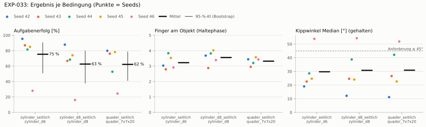
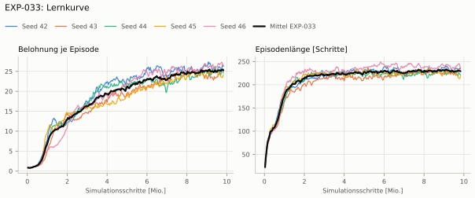
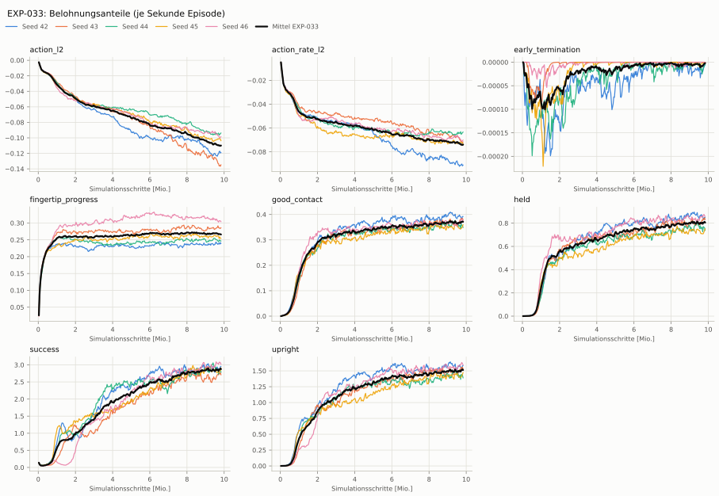
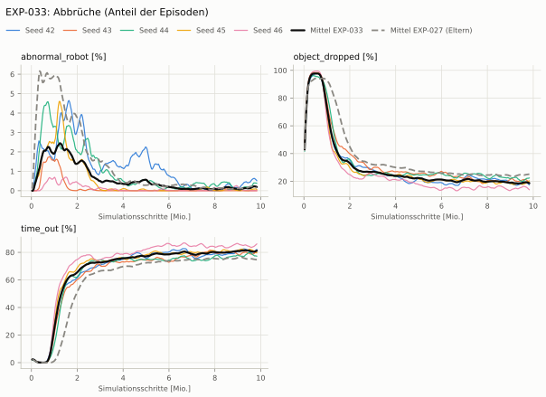
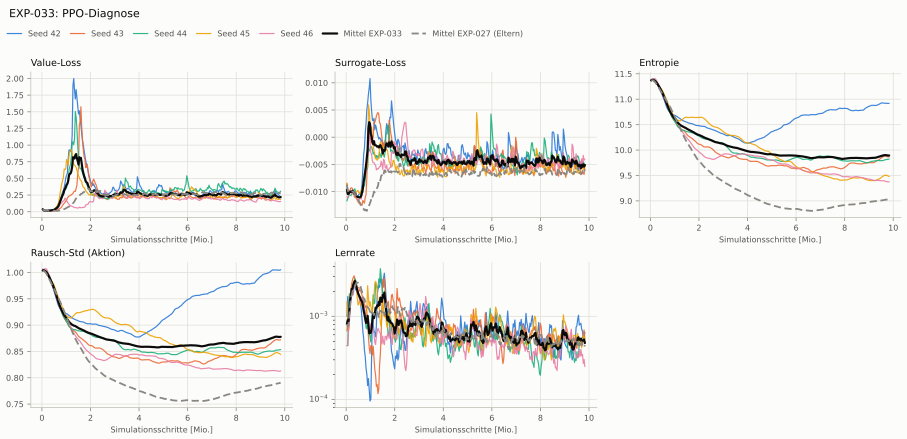

# EXP-033: EXP-027 mit der alten Skala 0,03 für Unterarm und Handgelenk (nur bounds_loss statt Begrenzung)

**Leistung** 79 % [74–84 %] (erfolgreiche Seeds, IQM über die Objekte; je Objekt Ø 6 cm 86 % · Ø 8 cm 71 % · Quader 77 %) — ggü. EXP-027: P(besser) = 0.54 [0.33–0.75] → kein Unterschied

**Testobjekte** (nie trainiert, erfolgreiche Seeds, Median): Flasche 74 % · Saftpackung 83 % · Cracker (YCB) 80 % · Zucker (YCB) 86 % · Senf (YCB) 72 %

**Zuverlässigkeit** 4/5 Seeds erfolgreich [28–99 %] — EXP-027: 2/5, exakter Fisher-Test p = 0.52 → nicht unterscheidbar (für eine Aussage ≥ 10 Seeds je Experiment)

**Leitplanken** Objektweg Tischebene Ende [mm]: 124 > 120 ✗

**Befund** ohne Erfolg: Seed 46 (hält, aber gekippt); Engpass Ø 8 cm (71 %); Kippwinkel 30° (EXP-027: 44°); Unruhe 0.83 (EXP-027: 1.68)

**Urteilsvorschlag** (auswertung-v2): **kein Unterschied, Leitplanke verletzt**

**Beste Videos** (Seed 42, 3 Episoden): [Ø 6 cm](beste_videos/EXP-033_zylinder_d6_s42.mp4) · [Ø 8 cm](beste_videos/EXP-033_zylinder_d8_s42.mp4) · [Quader](beste_videos/EXP-033_quader_7x7x20_s42.mp4)

Ergebnisse je Bedingung (eval-v2, Leitplanken, Fehlerarten, Fingernutzung)

#### Bedingung `zylinder_seitlich`

Bedingung `zylinder_seitlich` (Objekt `zylinder_d6`, Kippwinkel ≤ 45°), Protokoll eval-v2, 5 Seed(s); Spalte EXP-027 unter derselben Anforderung

| Metrik | Mittel | 95-%-KI | IQM | Fehlschlag-Seeds (< 50 %) | EXP-027 (Mittel / IQM) |
|---|---|---|---|---|---|
| aufgabenerfolg | 75.4 % | 51.1 % – 90.4 % | 84.5 % | 20.0 % | 55.9 % / 66.0 % |
| haltequote | 91.8 % | 88.1 % – 95.6 % | 91.8 % | 0.0 % | 94.5 % / 94.7 % |
| Kippwinkel Median [°] | 29.7 | | | | 44.4 |
| Unterarm Median [°] | 34.4 | | | | 50.9 |
| Griffkraft Mittel [N] | 105 | | | | 96.5 |
| Kraft > 15 N [Anteil] | 99.9 % | | | | 99.9 % |
| Stall-Anteil [Anteil] | 99.9 % | | | | 99.8 % |
| Absinken [mm] | 0.00149 | | | | 0.00332 |
| Unruhe | 0.831 | | | | 1.68 |
| Unruhe wirksam (Aktion auf ±1 begrenzt) | 0.421 | | | | 0.663 |
| Objektweg Tischebene Ende [mm] | 124 | | | | 99.7 |

Fehlerarten: startfehler 0.0 %, gefallen 8.2 %, instabil 0.1 %, anforderung_verletzt 16.4 %

**Urteilsvorschlag: kein messbarer Unterschied** (gegenüber EXP-027)
Unterschied Aufgabenerfolg +18.7 Prozentpunkte (95-%-KI -19.8 … +57.5)
- Leitplanke: Objektweg Tischebene Ende [mm]: 124 > 120

Je Seed: 95.4 %, 87.0 %, 81.5 %, 85.0 %, 28.0 %

Fingernutzung (Haltephase): im Mittel 3.22 Finger am Objekt; Kontaktanteil je Seed (Daumen, Zeige, Mittel, Ring, klein): 100/93/99/11/0 · 99/0/0/100/81 · 99/95/99/0/90 · 94/0/100/97/62 · 97/6/0/100/89

#### Bedingung `zylinder_d8_seitlich`

Bedingung `zylinder_d8_seitlich` (Objekt `zylinder_d8`, Kippwinkel ≤ 45°), Protokoll eval-v2, 5 Seed(s); Spalte EXP-027 unter derselben Anforderung

| Metrik | Mittel | 95-%-KI | IQM | Fehlschlag-Seeds (< 50 %) | EXP-027 (Mittel / IQM) |
|---|---|---|---|---|---|
| aufgabenerfolg | 62.6 % | 37.9 % – 79.7 % | 69.6 % | 20.0 % | 51.0 % / 55.0 % |
| haltequote | 82.2 % | 75.4 % – 89.4 % | 81.3 % | 0.0 % | 87.6 % / 87.0 % |
| Kippwinkel Median [°] | 30.8 | | | | 43.9 |
| Unterarm Median [°] | 33.2 | | | | 51.8 |
| Griffkraft Mittel [N] | 106 | | | | 90.2 |
| Kraft > 15 N [Anteil] | 99.9 % | | | | 99.8 % |
| Stall-Anteil [Anteil] | 99.7 % | | | | 99.8 % |
| Absinken [mm] | 0.0454 | | | | 0 |
| Unruhe | 1.21 | | | | 1.91 |
| Unruhe wirksam (Aktion auf ±1 begrenzt) | 0.616 | | | | 0.81 |
| Objektweg Tischebene Ende [mm] | 141 | | | | 108 |

Fehlerarten: startfehler 0.0 %, gefallen 17.7 %, instabil 0.0 %, anforderung_verletzt 19.6 %

**Urteilsvorschlag: kein messbarer Unterschied** (gegenüber EXP-027)
Unterschied Aufgabenerfolg +11.3 Prozentpunkte (95-%-KI -12.0 … +39.9)
- Leitplanke: Objektweg Tischebene Ende [mm]: 141 > 128

Je Seed: 87.8 %, 66.8 %, 68.4 %, 74.1 %, 16.1 %

Fingernutzung (Haltephase): im Mittel 3.56 Finger am Objekt; Kontaktanteil je Seed (Daumen, Zeige, Mittel, Ring, klein): 100/99/99/70/0 · 97/0/0/100/90 · 99/96/100/0/87 · 99/18/100/96/89 · 95/45/0/100/99

#### Bedingung `quader_seitlich`

Bedingung `quader_seitlich` (Objekt `quader_7x7x20`, Kippwinkel ≤ 45°), Protokoll eval-v2, 5 Seed(s); Spalte EXP-027 unter derselben Anforderung

| Metrik | Mittel | 95-%-KI | IQM | Fehlschlag-Seeds (< 50 %) | EXP-027 (Mittel / IQM) |
|---|---|---|---|---|---|
| aufgabenerfolg | 62.3 % | 41.3 % – 78.5 % | 69.7 % | 20.0 % | 40.9 % / 43.7 % |
| haltequote | 78.0 % | 76.3 % – 79.7 % | 77.9 % | 0.0 % | 76.1 % / 77.0 % |
| Kippwinkel Median [°] | 30.9 | | | | 48 |
| Unterarm Median [°] | 35.2 | | | | 53.5 |
| Griffkraft Mittel [N] | 90.2 | | | | 88.7 |
| Kraft > 15 N [Anteil] | 99.9 % | | | | 99.9 % |
| Stall-Anteil [Anteil] | 99.8 % | | | | 99.8 % |
| Absinken [mm] | 0 | | | | 0 |
| Unruhe | 1.57 | | | | 1.59 |
| Unruhe wirksam (Aktion auf ±1 begrenzt) | 0.851 | | | | 0.651 |
| Objektweg Tischebene Ende [mm] | 138 | | | | 113 |

Fehlerarten: startfehler 0.0 %, gefallen 22.0 %, instabil 0.0 %, anforderung_verletzt 15.7 %

**Urteilsvorschlag: kein messbarer Unterschied** (gegenüber EXP-027)
Unterschied Aufgabenerfolg +20.9 Prozentpunkte (95-%-KI -4.7 … +49.6)
- Leitplanke: Unruhe wirksam (Aktion auf ±1 begrenzt): 0.851 > 0.781
- Leitplanke: Objektweg Tischebene Ende [mm]: 138 > 133

Je Seed: 79.9 %, 76.1 %, 52.7 %, 78.3 %, 24.4 %

Fingernutzung (Haltephase): im Mittel 3.32 Finger am Objekt; Kontaktanteil je Seed (Daumen, Zeige, Mittel, Ring, klein): 99/96/98/52/0 · 98/0/0/100/98 · 98/94/100/0/29 · 99/2/100/97/60 · 99/53/0/99/92

#### Bedingung `flasche_seitlich`

Bedingung `flasche_seitlich` (Objekt `flasche_d7x25`, Kippwinkel ≤ 45°), Protokoll eval-v2, 5 Seed(s); Spalte EXP-027 unter derselben Anforderung

| Metrik | Mittel | 95-%-KI | IQM | Fehlschlag-Seeds (< 50 %) | EXP-027 (Mittel / IQM) |
|---|---|---|---|---|---|
| aufgabenerfolg | 61.8 % | 34.2 % – 82.8 % | 69.5 % | 20.0 % | 50.1 % / 53.6 % |
| haltequote | 85.6 % | 79.3 % – 92.2 % | 85.4 % | 0.0 % | 88.2 % / 87.0 % |
| Kippwinkel Median [°] | 31.4 | | | | 44 |
| Unterarm Median [°] | 35.6 | | | | 52.2 |
| Griffkraft Mittel [N] | 104 | | | | 87.5 |
| Kraft > 15 N [Anteil] | 99.9 % | | | | 99.9 % |
| Stall-Anteil [Anteil] | 99.8 % | | | | 99.9 % |
| Absinken [mm] | 0.0149 | | | | 0.0167 |
| Unruhe | 1.28 | | | | 1.93 |
| Unruhe wirksam (Aktion auf ±1 begrenzt) | 0.67 | | | | 0.758 |
| Objektweg Tischebene Ende [mm] | 128 | | | | 104 |

Fehlerarten: startfehler 0.0 %, gefallen 14.4 %, instabil 0.0 %, anforderung_verletzt 23.7 %

**Urteilsvorschlag: kein messbarer Unterschied** (gegenüber EXP-027)
Unterschied Aufgabenerfolg +11.3 Prozentpunkte (95-%-KI -17.9 … +40.4)
- Leitplanke: Objektweg Tischebene Ende [mm]: 128 > 124

Je Seed: 92.3 %, 60.6 %, 68.9 %, 79.3 %, 8.0 %

Fingernutzung (Haltephase): im Mittel 3.38 Finger am Objekt; Kontaktanteil je Seed (Daumen, Zeige, Mittel, Ring, klein): 100/97/99/46/0 · 95/0/0/99/73 · 99/95/99/0/80 · 98/3/99/96/77 · 97/46/0/99/89

#### Bedingung `saftpackung_seitlich`

Bedingung `saftpackung_seitlich` (Objekt `saftpackung_9x6x19`, Kippwinkel ≤ 45°), Protokoll eval-v2, 5 Seed(s); Spalte EXP-027 unter derselben Anforderung

| Metrik | Mittel | 95-%-KI | IQM | Fehlschlag-Seeds (< 50 %) | EXP-027 (Mittel / IQM) |
|---|---|---|---|---|---|
| aufgabenerfolg | 65.8 % | 37.9 % – 85.2 % | 76.1 % | 20.0 % | 45.9 % / 48.8 % |
| haltequote | 83.7 % | 79.5 % – 87.6 % | 84.5 % | 0.0 % | 83.4 % / 86.3 % |
| Kippwinkel Median [°] | 30.8 | | | | 47.3 |
| Unterarm Median [°] | 37.6 | | | | 55.5 |
| Griffkraft Mittel [N] | 91 | | | | 93.8 |
| Kraft > 15 N [Anteil] | 99.9 % | | | | 99.9 % |
| Stall-Anteil [Anteil] | 99.8 % | | | | 99.8 % |
| Absinken [mm] | 0.000256 | | | | 0 |
| Unruhe | 1.11 | | | | 1.57 |
| Unruhe wirksam (Aktion auf ±1 begrenzt) | 0.566 | | | | 0.632 |
| Objektweg Tischebene Ende [mm] | 148 | | | | 118 |

Fehlerarten: startfehler 0.0 %, gefallen 16.3 %, instabil 0.0 %, anforderung_verletzt 17.9 %

**Urteilsvorschlag: kein messbarer Unterschied** (gegenüber EXP-027)
Unterschied Aufgabenerfolg +19.4 Prozentpunkte (95-%-KI -9.5 … +54.0)
- Leitplanke: Objektweg Tischebene Ende [mm]: 148 > 138

Je Seed: 88.7 %, 84.7 %, 61.9 %, 80.4 %, 13.2 %

Fingernutzung (Haltephase): im Mittel 3.28 Finger am Objekt; Kontaktanteil je Seed (Daumen, Zeige, Mittel, Ring, klein): 99/100/99/22/0 · 99/0/0/100/95 · 100/99/99/0/41 · 99/0/100/97/59 · 99/50/0/100/84

#### Bedingung `ycb_cracker_seitlich`

Bedingung `ycb_cracker_seitlich` (Objekt `ycb_003_cracker`, Kippwinkel ≤ 45°), Protokoll eval-v2, 5 Seed(s); Spalte EXP-027 unter derselben Anforderung

| Metrik | Mittel | 95-%-KI | IQM | Fehlschlag-Seeds (< 50 %) | EXP-027 (Mittel / IQM) |
|---|---|---|---|---|---|
| aufgabenerfolg | 79.3 % | 72.8 % – 84.8 % | 81.7 % | 0.0 % | 64.9 % / 77.3 % |
| haltequote | 80.1 % | 74.5 % – 84.9 % | 81.7 % | 0.0 % | 79.0 % / 79.9 % |
| Kippwinkel Median [°] | 22.6 | | | | 30 |
| Unterarm Median [°] | 34.1 | | | | 52.2 |
| Griffkraft Mittel [N] | 95.3 | | | | 87.6 |
| Kraft > 15 N [Anteil] | 100.0 % | | | | 100.0 % |
| Stall-Anteil [Anteil] | 99.8 % | | | | 99.9 % |
| Absinken [mm] | 0.561 | | | | 0 |
| Unruhe | 0.927 | | | | 1.47 |
| Unruhe wirksam (Aktion auf ±1 begrenzt) | 0.462 | | | | 0.575 |
| Objektweg Tischebene Ende [mm] | 170 | | | | 139 |

Fehlerarten: startfehler 0.0 %, gefallen 19.8 %, instabil 0.1 %, anforderung_verletzt 0.8 %

**Urteilsvorschlag: kein messbarer Unterschied** (gegenüber EXP-027)
Unterschied Aufgabenerfolg +14.1 Prozentpunkte (95-%-KI -7.2 … +44.8)
- Leitplanke: Objektweg Tischebene Ende [mm]: 170 > 159

Je Seed: 85.5 %, 84.2 %, 66.9 %, 76.0 %, 84.0 %

Fingernutzung (Haltephase): im Mittel 3.34 Finger am Objekt; Kontaktanteil je Seed (Daumen, Zeige, Mittel, Ring, klein): 100/100/100/0/0 · 100/0/0/100/100 · 99/99/96/0/31 · 99/0/100/100/93 · 100/50/0/100/100

#### Bedingung `ycb_zucker_seitlich`

Bedingung `ycb_zucker_seitlich` (Objekt `ycb_004_zucker`, Kippwinkel ≤ 45°), Protokoll eval-v2, 5 Seed(s); Spalte EXP-027 unter derselben Anforderung

| Metrik | Mittel | 95-%-KI | IQM | Fehlschlag-Seeds (< 50 %) | EXP-027 (Mittel / IQM) |
|---|---|---|---|---|---|
| aufgabenerfolg | 80.9 % | 69.6 % – 92.0 % | 82.1 % | 0.0 % | 75.0 % / 92.4 % |
| haltequote | 85.2 % | 72.1 % – 95.0 % | 89.9 % | 0.0 % | 95.7 % / 95.9 % |
| Kippwinkel Median [°] | 24.1 | | | | 29.9 |
| Unterarm Median [°] | 34.4 | | | | 57.2 |
| Griffkraft Mittel [N] | 103 | | | | 106 |
| Kraft > 15 N [Anteil] | 100.0 % | | | | 100.0 % |
| Stall-Anteil [Anteil] | 99.9 % | | | | 99.7 % |
| Absinken [mm] | 0.279 | | | | 0.00761 |
| Unruhe | 0.47 | | | | 1.33 |
| Unruhe wirksam (Aktion auf ±1 begrenzt) | 0.196 | | | | 0.602 |
| Objektweg Tischebene Ende [mm] | 143 | | | | 116 |

Fehlerarten: startfehler 0.0 %, gefallen 14.8 %, instabil 0.0 %, anforderung_verletzt 4.3 %

**Urteilsvorschlag: kein messbarer Unterschied** (gegenüber EXP-027)
Unterschied Aufgabenerfolg +5.6 Prozentpunkte (95-%-KI -24.6 … +49.4)
- Leitplanke: Objektweg Tischebene Ende [mm]: 143 > 136

Je Seed: 96.9 %, 93.1 %, 78.7 %, 60.0 %, 75.7 %

Fingernutzung (Haltephase): im Mittel 3.22 Finger am Objekt; Kontaktanteil je Seed (Daumen, Zeige, Mittel, Ring, klein): 100/93/100/0/0 · 100/0/0/98/81 · 100/99/92/0/68 · 99/0/100/71/36 · 100/73/0/100/97

#### Bedingung `ycb_senf_seitlich`

Bedingung `ycb_senf_seitlich` (Objekt `ycb_006_senf`, Kippwinkel ≤ 45°), Protokoll eval-v2, 5 Seed(s); Spalte EXP-027 unter derselben Anforderung

| Metrik | Mittel | 95-%-KI | IQM | Fehlschlag-Seeds (< 50 %) | EXP-027 (Mittel / IQM) |
|---|---|---|---|---|---|
| aufgabenerfolg | 66.9 % | 52.0 % – 82.0 % | 64.8 % | 20.0 % | 72.6 % / 89.1 % |
| haltequote | 78.5 % | 63.6 % – 93.2 % | 81.3 % | 0.0 % | 93.0 % / 93.2 % |
| Kippwinkel Median [°] | 26.7 | | | | 32.9 |
| Unterarm Median [°] | 34 | | | | 53.3 |
| Griffkraft Mittel [N] | 100 | | | | 102 |
| Kraft > 15 N [Anteil] | 100.0 % | | | | 100.0 % |
| Stall-Anteil [Anteil] | 99.9 % | | | | 99.7 % |
| Absinken [mm] | 0.736 | | | | 0.0113 |
| Unruhe | 0.611 | | | | 1.4 |
| Unruhe wirksam (Aktion auf ±1 begrenzt) | 0.28 | | | | 0.596 |
| Objektweg Tischebene Ende [mm] | 142 | | | | 111 |

Fehlerarten: startfehler 0.0 %, gefallen 21.5 %, instabil 0.0 %, anforderung_verletzt 11.5 %

**Urteilsvorschlag: kein messbarer Unterschied** (gegenüber EXP-027)
Unterschied Aufgabenerfolg -6.1 Prozentpunkte (95-%-KI -40.0 … +38.9)
- Leitplanke: Objektweg Tischebene Ende [mm]: 142 > 131

Je Seed: 88.9 %, 88.4 %, 52.5 %, 56.2 %, 48.7 %

Fingernutzung (Haltephase): im Mittel 3.18 Finger am Objekt; Kontaktanteil je Seed (Daumen, Zeige, Mittel, Ring, klein): 100/94/100/0/0 · 99/0/0/99/60 · 100/96/93/0/84 · 100/0/98/54/56 · 100/61/0/100/98

Trainingsverlauf

Seeds dünn, Mittel kräftig, Eltern gestrichelt (nur Abbrüche/PPO — Trainings-Belohnung ist zwischen Experimenten nicht vergleichbar); geglättet, x = Simulationsschritte. Endwerte = Mittel der letzten 10 Iterationen (Belohnungsanteile je Sekunde Episode).

| Größe | Seed 42 | Seed 43 | Seed 44 | Seed 45 | Seed 46 | Mittel |
|---|---|---|---|---|---|---|
| mean_reward | 26.3 | 25.1 | 24.6 | 23.9 | 26.9 | 25.4 |
| action_l2 | -0.12 | -0.134 | -0.0942 | -0.102 | -0.0988 | -0.11 |
| action_rate_l2 | -0.0918 | -0.0711 | -0.0636 | -0.0725 | -0.0702 | -0.0738 |
| early_termination | -1.44e-05 | 0 | -1.25e-05 | -1.16e-06 | 0 | -5.61e-06 |
| fingertip_progress | 0.24 | 0.287 | 0.246 | 0.257 | 0.305 | 0.267 |
| good_contact | 0.393 | 0.379 | 0.351 | 0.349 | 0.378 | 0.37 |
| held | 0.857 | 0.829 | 0.747 | 0.725 | 0.868 | 0.805 |
| success | 2.94 | 2.73 | 2.8 | 2.83 | 3.07 | 2.88 |
| upright | 1.58 | 1.53 | 1.4 | 1.43 | 1.61 | 1.51 |
| object_dropped | 18.4 % | 20.2 % | 22.1 % | 19.6 % | 15.0 % | 19.1 % |
| mean_noise_std | 1 | 0.873 | 0.853 | 0.847 | 0.813 | 0.878 |

Netz, Training und Konfiguration

Actor [256, 128, 64] (elu), 68808 Parameter, 105 Eingänge (Verlauf 5) · Critic [512, 256, 128] · PPO: Lernrate 0.001, Entropie 0.005, 5 Epochen × 4 Mini-Batches, 32 Schritte/Umgebung · 1024 Umgebungen × 300 Iterationen

Geplante Änderung: Skala Unterarm/Handgelenk zurück auf 0,03 rad (Finger/Rotator 0,1 wie bisher), sonst wie EXP-027 (bounds_loss 1e-4, Grenze 1,1, keine Begrenzung, kein Filter). Task HeavyMultiProgressBounds-v0 = Env HeavyMultiProgress (EXP-019/022) + Agent PibGraspPPORunnerCfg_Bounds.

Konfiguration gegenüber EXP-027 (4 Unterschiede):

- `env.actions.servos.scale: 0.1 → ∅`
- `env.actions.servos.scale..*_left_(proximal|rotator): ∅ → 0.1`
- `env.actions.servos.scale.forearm_left: ∅ → 0.03`
- `env.actions.servos.scale.wrist_left: ∅ → 0.03`

