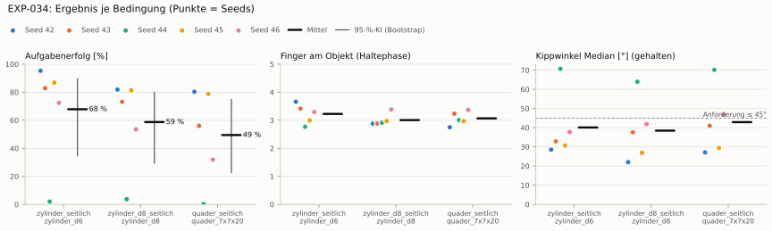
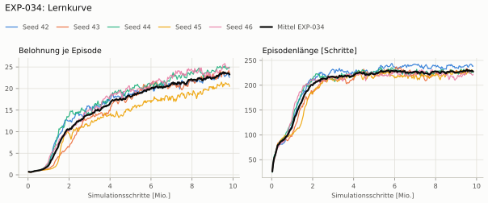
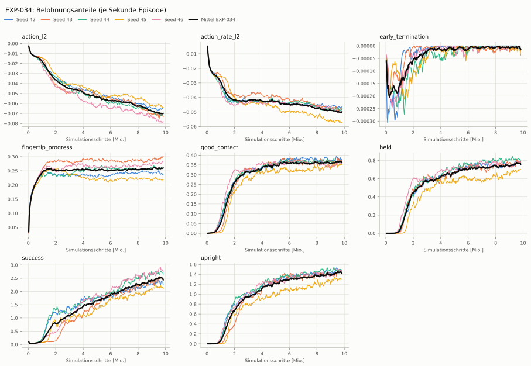
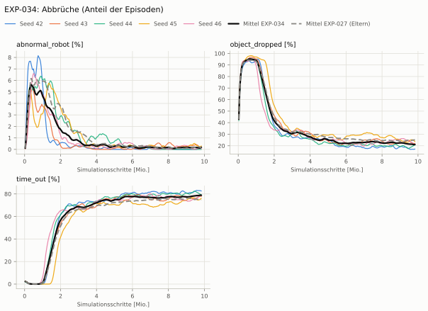
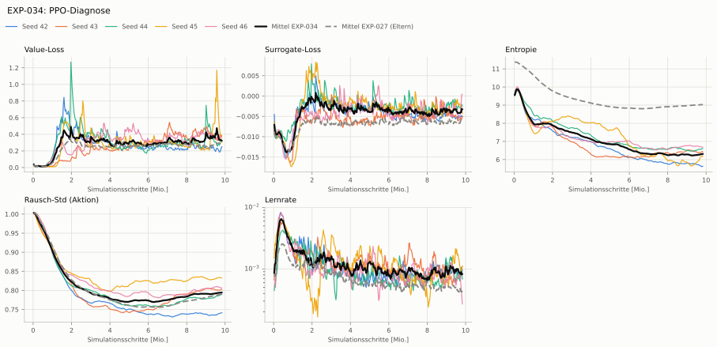

# EXP-034: Unruhe: CAPS-Verlust auf den Mittelwert der Policy (zeitlich + räumlich)

**Leistung** 78 % [67–82 %] (erfolgreiche Seeds, IQM über die Objekte; je Objekt Ø 6 cm 85 % · Ø 8 cm 77 % · Quader 67 %) — ggü. EXP-027: P(besser) = 0.46 [0.17–0.75] → kein Unterschied

**Testobjekte** (nie trainiert, erfolgreiche Seeds, Median): Flasche 68 % · Saftpackung 68 % · Cracker (YCB) 82 % · Zucker (YCB) 90 % · Senf (YCB) 92 %

**Zuverlässigkeit** 4/5 Seeds erfolgreich [28–99 %] — EXP-027: 2/5, exakter Fisher-Test p = 0.52 → nicht unterscheidbar (für eine Aussage ≥ 10 Seeds je Experiment)

**Leitplanken** eingehalten

**Befund** ohne Erfolg: Seed 44 (hält, aber gekippt); Engpass Quader (67 %); Unruhe 0.11 (EXP-027: 1.68)

**Urteilsvorschlag** (auswertung-v2): **kein Unterschied**

**Beste Videos** (Seed 42, 3 Episoden): [Ø 6 cm](beste_videos/EXP-034_zylinder_d6_s42.mp4) · [Ø 8 cm](beste_videos/EXP-034_zylinder_d8_s42.mp4) · [Quader](beste_videos/EXP-034_quader_7x7x20_s42.mp4)

Ergebnisse je Bedingung (eval-v2, Leitplanken, Fehlerarten, Fingernutzung)

#### Bedingung `zylinder_seitlich`

Bedingung `zylinder_seitlich` (Objekt `zylinder_d6`, Kippwinkel ≤ 45°), Protokoll eval-v2, 5 Seed(s); Spalte EXP-027 unter derselben Anforderung

| Metrik | Mittel | 95-%-KI | IQM | Fehlschlag-Seeds (< 50 %) | EXP-027 (Mittel / IQM) |
|---|---|---|---|---|---|
| aufgabenerfolg | 67.9 % | 34.6 % – 89.6 % | 80.9 % | 20.0 % | 55.9 % / 66.0 % |
| haltequote | 93.4 % | 89.4 % – 96.3 % | 94.4 % | 0.0 % | 94.5 % / 94.7 % |
| Kippwinkel Median [°] | 40.1 | | | | 44.4 |
| Unterarm Median [°] | 50.3 | | | | 50.9 |
| Griffkraft Mittel [N] | 84.9 | | | | 96.5 |
| Kraft > 15 N [Anteil] | 100.0 % | | | | 99.9 % |
| Stall-Anteil [Anteil] | 99.6 % | | | | 99.8 % |
| Absinken [mm] | 0.0021 | | | | 0.00332 |
| Unruhe | 0.107 | | | | 1.68 |
| Unruhe wirksam (Aktion auf ±1 begrenzt) | 0.0545 | | | | 0.663 |
| Objektweg Tischebene Ende [mm] | 88.8 | | | | 99.7 |

Fehlerarten: startfehler 0.0 %, gefallen 6.6 %, instabil 0.0 %, anforderung_verletzt 25.5 %

**Urteilsvorschlag: kein messbarer Unterschied** (gegenüber EXP-027)
Unterschied Aufgabenerfolg +11.4 Prozentpunkte (95-%-KI -40.7 … +56.0)

Je Seed: 95.3 %, 82.9 %, 2.0 %, 86.8 %, 72.4 %

Fingernutzung (Haltephase): im Mittel 3.23 Finger am Objekt; Kontaktanteil je Seed (Daumen, Zeige, Mittel, Ring, klein): 100/99/76/92/0 · 100/27/66/70/79 · 100/54/27/0/96 · 96/98/100/4/1 · 99/65/60/8/98

#### Bedingung `zylinder_d8_seitlich`

Bedingung `zylinder_d8_seitlich` (Objekt `zylinder_d8`, Kippwinkel ≤ 45°), Protokoll eval-v2, 5 Seed(s); Spalte EXP-027 unter derselben Anforderung

| Metrik | Mittel | 95-%-KI | IQM | Fehlschlag-Seeds (< 50 %) | EXP-027 (Mittel / IQM) |
|---|---|---|---|---|---|
| aufgabenerfolg | 58.7 % | 29.5 % – 80.0 % | 69.7 % | 20.0 % | 51.0 % / 55.0 % |
| haltequote | 85.2 % | 81.3 % – 89.4 % | 84.7 % | 0.0 % | 87.6 % / 87.0 % |
| Kippwinkel Median [°] | 38.5 | | | | 43.9 |
| Unterarm Median [°] | 50.8 | | | | 51.8 |
| Griffkraft Mittel [N] | 79.6 | | | | 90.2 |
| Kraft > 15 N [Anteil] | 99.9 % | | | | 99.8 % |
| Stall-Anteil [Anteil] | 99.7 % | | | | 99.8 % |
| Absinken [mm] | 5.27e-05 | | | | 0 |
| Unruhe | 0.102 | | | | 1.91 |
| Unruhe wirksam (Aktion auf ±1 begrenzt) | 0.0466 | | | | 0.81 |
| Objektweg Tischebene Ende [mm] | 108 | | | | 108 |

Fehlerarten: startfehler 0.0 %, gefallen 14.7 %, instabil 0.1 %, anforderung_verletzt 26.5 %

**Urteilsvorschlag: kein messbarer Unterschied** (gegenüber EXP-027)
Unterschied Aufgabenerfolg +7.4 Prozentpunkte (95-%-KI -45.7 … +48.9)

Je Seed: 81.9 %, 73.2 %, 3.6 %, 81.3 %, 53.5 %

Fingernutzung (Haltephase): im Mittel 3.01 Finger am Objekt; Kontaktanteil je Seed (Daumen, Zeige, Mittel, Ring, klein): 100/99/86/3/0 · 100/37/36/57/59 · 99/91/3/0/98 · 100/97/100/0/0 · 93/76/75/0/95

#### Bedingung `quader_seitlich`

Bedingung `quader_seitlich` (Objekt `quader_7x7x20`, Kippwinkel ≤ 45°), Protokoll eval-v2, 5 Seed(s); Spalte EXP-027 unter derselben Anforderung

| Metrik | Mittel | 95-%-KI | IQM | Fehlschlag-Seeds (< 50 %) | EXP-027 (Mittel / IQM) |
|---|---|---|---|---|---|
| aufgabenerfolg | 49.5 % | 22.6 % – 74.8 % | 55.6 % | 40.0 % | 40.9 % / 43.7 % |
| haltequote | 80.6 % | 78.7 % – 82.4 % | 81.0 % | 0.0 % | 76.1 % / 77.0 % |
| Kippwinkel Median [°] | 42.9 | | | | 48 |
| Unterarm Median [°] | 50.5 | | | | 53.5 |
| Griffkraft Mittel [N] | 76 | | | | 88.7 |
| Kraft > 15 N [Anteil] | 99.9 % | | | | 99.9 % |
| Stall-Anteil [Anteil] | 99.7 % | | | | 99.8 % |
| Absinken [mm] | 0 | | | | 0 |
| Unruhe | 0.115 | | | | 1.59 |
| Unruhe wirksam (Aktion auf ±1 begrenzt) | 0.0597 | | | | 0.651 |
| Objektweg Tischebene Ende [mm] | 108 | | | | 113 |

Fehlerarten: startfehler 0.0 %, gefallen 19.4 %, instabil 0.0 %, anforderung_verletzt 31.2 %

**Urteilsvorschlag: kein messbarer Unterschied** (gegenüber EXP-027)
Unterschied Aufgabenerfolg +8.2 Prozentpunkte (95-%-KI -35.8 … +40.1)

Je Seed: 80.3 %, 56.0 %, 0.3 %, 78.8 %, 31.9 %

Fingernutzung (Haltephase): im Mittel 3.07 Finger am Objekt; Kontaktanteil je Seed (Daumen, Zeige, Mittel, Ring, klein): 100/91/59/25/0 · 100/55/28/73/68 · 100/87/18/0/96 · 98/98/100/1/0 · 100/72/67/1/97

#### Bedingung `flasche_seitlich`

Bedingung `flasche_seitlich` (Objekt `flasche_d7x25`, Kippwinkel ≤ 45°), Protokoll eval-v2, 5 Seed(s); Spalte EXP-027 unter derselben Anforderung

| Metrik | Mittel | 95-%-KI | IQM | Fehlschlag-Seeds (< 50 %) | EXP-027 (Mittel / IQM) |
|---|---|---|---|---|---|
| aufgabenerfolg | 58.1 % | 28.2 % – 80.1 % | 66.0 % | 20.0 % | 50.1 % / 53.6 % |
| haltequote | 89.4 % | 85.4 % – 92.2 % | 90.7 % | 0.0 % | 88.2 % / 87.0 % |
| Kippwinkel Median [°] | 40.8 | | | | 44 |
| Unterarm Median [°] | 51.1 | | | | 52.2 |
| Griffkraft Mittel [N] | 77.5 | | | | 87.5 |
| Kraft > 15 N [Anteil] | 100.0 % | | | | 99.9 % |
| Stall-Anteil [Anteil] | 99.7 % | | | | 99.9 % |
| Absinken [mm] | 0.00474 | | | | 0.0167 |
| Unruhe | 0.107 | | | | 1.93 |
| Unruhe wirksam (Aktion auf ±1 begrenzt) | 0.0537 | | | | 0.758 |
| Objektweg Tischebene Ende [mm] | 95.2 | | | | 104 |

Fehlerarten: startfehler 0.0 %, gefallen 10.6 %, instabil 0.0 %, anforderung_verletzt 31.3 %

**Urteilsvorschlag: kein messbarer Unterschied** (gegenüber EXP-027)
Unterschied Aufgabenerfolg +7.7 Prozentpunkte (95-%-KI -44.2 … +44.1)

Je Seed: 72.0 %, 62.2 %, 1.7 %, 90.4 %, 64.4 %

Fingernutzung (Haltephase): im Mittel 2.99 Finger am Objekt; Kontaktanteil je Seed (Daumen, Zeige, Mittel, Ring, klein): 100/99/54/38/0 · 99/36/38/60/51 · 100/87/11/0/99 · 100/99/100/0/0 · 99/76/52/1/96

#### Bedingung `saftpackung_seitlich`

Bedingung `saftpackung_seitlich` (Objekt `saftpackung_9x6x19`, Kippwinkel ≤ 45°), Protokoll eval-v2, 5 Seed(s); Spalte EXP-027 unter derselben Anforderung

| Metrik | Mittel | 95-%-KI | IQM | Fehlschlag-Seeds (< 50 %) | EXP-027 (Mittel / IQM) |
|---|---|---|---|---|---|
| aufgabenerfolg | 49.9 % | 18.7 % – 81.4 % | 51.9 % | 60.0 % | 45.9 % / 48.8 % |
| haltequote | 89.1 % | 86.6 % – 91.2 % | 89.5 % | 0.0 % | 83.4 % / 86.3 % |
| Kippwinkel Median [°] | 44.2 | | | | 47.3 |
| Unterarm Median [°] | 52.5 | | | | 55.5 |
| Griffkraft Mittel [N] | 80.9 | | | | 93.8 |
| Kraft > 15 N [Anteil] | 100.0 % | | | | 99.9 % |
| Stall-Anteil [Anteil] | 99.6 % | | | | 99.8 % |
| Absinken [mm] | 0 | | | | 0 |
| Unruhe | 0.119 | | | | 1.57 |
| Unruhe wirksam (Aktion auf ±1 begrenzt) | 0.0651 | | | | 0.632 |
| Objektweg Tischebene Ende [mm] | 108 | | | | 118 |

Fehlerarten: startfehler 0.0 %, gefallen 10.9 %, instabil 0.1 %, anforderung_verletzt 39.2 %

**Urteilsvorschlag: kein messbarer Unterschied** (gegenüber EXP-027)
Unterschied Aufgabenerfolg +3.7 Prozentpunkte (95-%-KI -44.3 … +36.7)

Je Seed: 91.6 %, 49.2 %, 1.0 %, 87.7 %, 19.8 %

Fingernutzung (Haltephase): im Mittel 3.31 Finger am Objekt; Kontaktanteil je Seed (Daumen, Zeige, Mittel, Ring, klein): 100/100/50/83/0 · 100/62/59/71/70 · 100/88/34/0/94 · 98/97/100/3/0 · 100/64/82/4/94

#### Bedingung `ycb_cracker_seitlich`

Bedingung `ycb_cracker_seitlich` (Objekt `ycb_003_cracker`, Kippwinkel ≤ 45°), Protokoll eval-v2, 5 Seed(s); Spalte EXP-027 unter derselben Anforderung

| Metrik | Mittel | 95-%-KI | IQM | Fehlschlag-Seeds (< 50 %) | EXP-027 (Mittel / IQM) |
|---|---|---|---|---|---|
| aufgabenerfolg | 68.8 % | 44.0 % – 83.1 % | 80.0 % | 20.0 % | 64.9 % / 77.3 % |
| haltequote | 80.6 % | 77.7 % – 83.5 % | 80.8 % | 0.0 % | 79.0 % / 79.9 % |
| Kippwinkel Median [°] | 26.2 | | | | 30 |
| Unterarm Median [°] | 51.1 | | | | 52.2 |
| Griffkraft Mittel [N] | 75.1 | | | | 87.6 |
| Kraft > 15 N [Anteil] | 100.0 % | | | | 100.0 % |
| Stall-Anteil [Anteil] | 99.7 % | | | | 99.9 % |
| Absinken [mm] | 0 | | | | 0 |
| Unruhe | 0.119 | | | | 1.47 |
| Unruhe wirksam (Aktion auf ±1 begrenzt) | 0.0633 | | | | 0.575 |
| Objektweg Tischebene Ende [mm] | 139 | | | | 139 |

Fehlerarten: startfehler 0.0 %, gefallen 19.4 %, instabil 0.0 %, anforderung_verletzt 11.8 %

**Urteilsvorschlag: kein messbarer Unterschied** (gegenüber EXP-027)
Unterschied Aufgabenerfolg +3.5 Prozentpunkte (95-%-KI -36.0 … +44.9)

Je Seed: 75.8 %, 83.9 %, 20.4 %, 80.3 %, 83.7 %

Fingernutzung (Haltephase): im Mittel 2.91 Finger am Objekt; Kontaktanteil je Seed (Daumen, Zeige, Mittel, Ring, klein): 100/99/59/18/0 · 100/33/34/81/73 · 100/72/4/0/100 · 100/91/100/0/0 · 100/41/52/0/100

#### Bedingung `ycb_zucker_seitlich`

Bedingung `ycb_zucker_seitlich` (Objekt `ycb_004_zucker`, Kippwinkel ≤ 45°), Protokoll eval-v2, 5 Seed(s); Spalte EXP-027 unter derselben Anforderung

| Metrik | Mittel | 95-%-KI | IQM | Fehlschlag-Seeds (< 50 %) | EXP-027 (Mittel / IQM) |
|---|---|---|---|---|---|
| aufgabenerfolg | 76.8 % | 48.2 % – 94.8 % | 88.3 % | 20.0 % | 75.0 % / 92.4 % |
| haltequote | 96.6 % | 95.3 % – 97.8 % | 96.7 % | 0.0 % | 95.7 % / 95.9 % |
| Kippwinkel Median [°] | 28.8 | | | | 29.9 |
| Unterarm Median [°] | 51.5 | | | | 57.2 |
| Griffkraft Mittel [N] | 80.9 | | | | 106 |
| Kraft > 15 N [Anteil] | 100.0 % | | | | 100.0 % |
| Stall-Anteil [Anteil] | 99.6 % | | | | 99.7 % |
| Absinken [mm] | 0.00801 | | | | 0.00761 |
| Unruhe | 0.0864 | | | | 1.33 |
| Unruhe wirksam (Aktion auf ±1 begrenzt) | 0.0391 | | | | 0.602 |
| Objektweg Tischebene Ende [mm] | 107 | | | | 116 |

Fehlerarten: startfehler 0.0 %, gefallen 3.4 %, instabil 0.0 %, anforderung_verletzt 19.8 %

**Urteilsvorschlag: kein messbarer Unterschied** (gegenüber EXP-027)
Unterschied Aufgabenerfolg +1.4 Prozentpunkte (95-%-KI -45.4 … +49.6)

Je Seed: 98.3 %, 84.7 %, 19.9 %, 94.6 %, 86.3 %

Fingernutzung (Haltephase): im Mittel 3.23 Finger am Objekt; Kontaktanteil je Seed (Daumen, Zeige, Mittel, Ring, klein): 100/100/56/100/0 · 100/51/91/24/27 · 99/83/46/0/99 · 100/100/100/11/0 · 99/44/92/6/88

#### Bedingung `ycb_senf_seitlich`

Bedingung `ycb_senf_seitlich` (Objekt `ycb_006_senf`, Kippwinkel ≤ 45°), Protokoll eval-v2, 5 Seed(s); Spalte EXP-027 unter derselben Anforderung

| Metrik | Mittel | 95-%-KI | IQM | Fehlschlag-Seeds (< 50 %) | EXP-027 (Mittel / IQM) |
|---|---|---|---|---|---|
| aufgabenerfolg | 78.3 % | 50.4 % – 93.0 % | 91.6 % | 20.0 % | 72.6 % / 89.1 % |
| haltequote | 92.5 % | 90.3 % – 94.8 % | 92.5 % | 0.0 % | 93.0 % / 93.2 % |
| Kippwinkel Median [°] | 29.8 | | | | 32.9 |
| Unterarm Median [°] | 52.8 | | | | 53.3 |
| Griffkraft Mittel [N] | 83.1 | | | | 102 |
| Kraft > 15 N [Anteil] | 100.0 % | | | | 100.0 % |
| Stall-Anteil [Anteil] | 99.6 % | | | | 99.7 % |
| Absinken [mm] | 0.004 | | | | 0.0113 |
| Unruhe | 0.101 | | | | 1.4 |
| Unruhe wirksam (Aktion auf ±1 begrenzt) | 0.0509 | | | | 0.596 |
| Objektweg Tischebene Ende [mm] | 108 | | | | 111 |

Fehlerarten: startfehler 0.0 %, gefallen 7.5 %, instabil 0.0 %, anforderung_verletzt 14.2 %

**Urteilsvorschlag: kein messbarer Unterschied** (gegenüber EXP-027)
Unterschied Aufgabenerfolg +5.2 Prozentpunkte (95-%-KI -41.7 … +55.9)

Je Seed: 92.4 %, 93.7 %, 22.7 %, 91.0 %, 91.5 %

Fingernutzung (Haltephase): im Mittel 3.24 Finger am Objekt; Kontaktanteil je Seed (Daumen, Zeige, Mittel, Ring, klein): 100/100/33/100/0 · 99/69/76/38/51 · 98/89/38/0/98 · 100/91/100/1/0 · 99/60/79/3/98

Trainingsverlauf

Seeds dünn, Mittel kräftig, Eltern gestrichelt (nur Abbrüche/PPO — Trainings-Belohnung ist zwischen Experimenten nicht vergleichbar); geglättet, x = Simulationsschritte. Endwerte = Mittel der letzten 10 Iterationen (Belohnungsanteile je Sekunde Episode).

| Größe | Seed 42 | Seed 43 | Seed 44 | Seed 45 | Seed 46 | Mittel |
|---|---|---|---|---|---|---|
| mean_reward | 22.8 | 23.6 | 24.9 | 21 | 24.9 | 23.4 |
| action_l2 | -0.0649 | -0.0723 | -0.071 | -0.0634 | -0.0784 | -0.07 |
| action_rate_l2 | -0.0466 | -0.0479 | -0.0481 | -0.0571 | -0.0501 | -0.05 |
| early_termination | -9.76e-06 | -9.65e-06 | 0 | -2.22e-05 | -2.31e-06 | -8.78e-06 |
| fingertip_progress | 0.237 | 0.298 | 0.261 | 0.218 | 0.28 | 0.259 |
| good_contact | 0.377 | 0.374 | 0.363 | 0.353 | 0.359 | 0.365 |
| held | 0.763 | 0.784 | 0.803 | 0.702 | 0.785 | 0.767 |
| success | 2.3 | 2.48 | 2.71 | 2.15 | 2.81 | 2.49 |
| upright | 1.45 | 1.45 | 1.48 | 1.31 | 1.48 | 1.43 |
| object_dropped | 16.9 % | 21.9 % | 20.3 % | 24.7 % | 21.8 % | 21.1 % |
| mean_noise_std | 0.74 | 0.801 | 0.789 | 0.833 | 0.807 | 0.794 |

Netz, Training und Konfiguration

Actor [256, 128, 64] (elu), 68808 Parameter, 105 Eingänge (Verlauf 5) · Critic [512, 256, 128] · PPO: Lernrate 0.001, Entropie 0.005, 5 Epochen × 4 Mini-Batches, 32 Schritte/Umgebung · 1024 Umgebungen × 300 Iterationen

Geplante Änderung: CAPS-Verlust zusätzlich zu bounds_loss (Agent PibGraspPPORunnerCfg_Caps, rsl_rl_ext.ActorCriticCaps): zeitlich ‖μ(s_t) − μ(s_t+1)‖ (zufällige Paare des Rollouts ohne Episodenende) und räumlich ‖μ(s) − μ(s̄)‖, s̄ ~ N(s, σ) mit σ = Messrauschen der Störbedingung (Gelenkwinkel 0,01 rad, FSR 0,5 N, letzte Aktion 0); λ_T = λ_S = 0,04 (Kurztraining: ≈ 10 % des Actor-Gradienten zu Beginn). Env wie EXP-027 (Task HeavyMultiProgressDexCaps-v0).

Konfiguration gegenüber EXP-027 (5 Unterschiede):

- `agent.policy.caps_lambda_s: ∅ → 0.04`
- `agent.policy.caps_lambda_t: ∅ → 0.04`
- `agent.policy.caps_obs_sigma: ∅ → [[40, 0.01], [25, 0.5], [40, 0.0]]`
- `agent.policy.caps_pairs: ∅ → 4096`
- `agent.policy.class_name: ActorCriticBounds → ActorCriticCaps`

