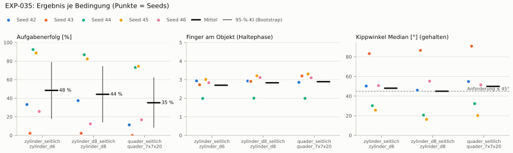
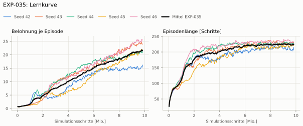
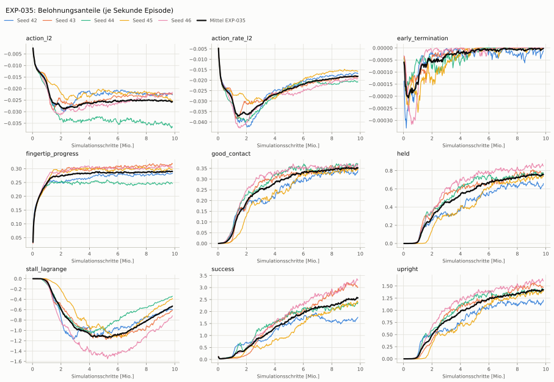
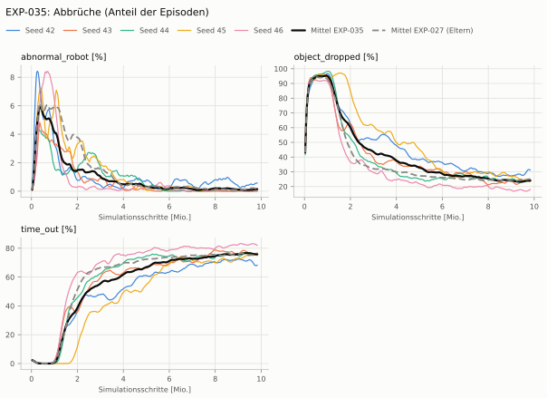
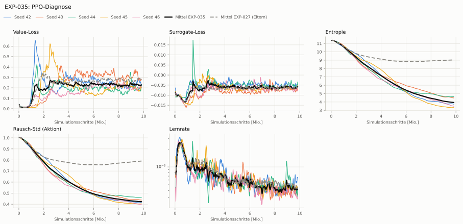

# EXP-035: Servo-Stall: PID-Lagrange auf den Stall-Anteil (Grenze 20 %)

**Leistung** 84 % [81–86 %] (erfolgreiche Seeds, IQM über die Objekte; je Objekt Ø 6 cm 91 % · Ø 8 cm 85 % · Quader 74 %) — ggü. EXP-027: P(besser) = 0.67 [0.33–1.00] → kein Unterschied

**Testobjekte** (nie trainiert, erfolgreiche Seeds, Median): Flasche 81 % · Saftpackung 81 % · Cracker (YCB) 77 % · Zucker (YCB) 81 % · Senf (YCB) 84 %

**Zuverlässigkeit** 2/5 Seeds erfolgreich [5–85 %] — EXP-027: 2/5, exakter Fisher-Test p = 1.00 → nicht unterscheidbar (für eine Aussage ≥ 10 Seeds je Experiment)

**Leitplanken** eingehalten

**Befund** ohne Erfolg: Seed 42 (hält, aber gekippt), Seed 43 (hält, aber gekippt), Seed 46 (hält, aber gekippt); Engpass Quader (74 %); Unruhe 0.38 (EXP-027: 1.68)

**Urteilsvorschlag** (auswertung-v2): **kein Unterschied**

**Beste Videos** (Seed 44, 3 Episoden): [Ø 6 cm](beste_videos/EXP-035_zylinder_d6_s44.mp4) · [Ø 8 cm](beste_videos/EXP-035_zylinder_d8_s44.mp4) · [Quader](beste_videos/EXP-035_quader_7x7x20_s44.mp4)

Ergebnisse je Bedingung (eval-v2, Leitplanken, Fehlerarten, Fingernutzung)

#### Bedingung `zylinder_seitlich`

Bedingung `zylinder_seitlich` (Objekt `zylinder_d6`, Kippwinkel ≤ 45°), Protokoll eval-v2, 5 Seed(s); Spalte EXP-027 unter derselben Anforderung

| Metrik | Mittel | 95-%-KI | IQM | Fehlschlag-Seeds (< 50 %) | EXP-027 (Mittel / IQM) |
|---|---|---|---|---|---|
| aufgabenerfolg | 48.5 % | 18.1 % – 78.7 % | 47.6 % | 60.0 % | 55.9 % / 66.0 % |
| haltequote | 94.0 % | 91.7 % – 95.6 % | 94.5 % | 0.0 % | 94.5 % / 94.7 % |
| Kippwinkel Median [°] | 48 | | | | 44.4 |
| Unterarm Median [°] | 57.4 | | | | 50.9 |
| Griffkraft Mittel [N] | 56.8 | | | | 96.5 |
| Kraft > 15 N [Anteil] | 98.9 % | | | | 99.9 % |
| Stall-Anteil [Anteil] | 70.5 % | | | | 99.8 % |
| Absinken [mm] | 0.0202 | | | | 0.00332 |
| Unruhe | 0.376 | | | | 1.68 |
| Unruhe wirksam (Aktion auf ±1 begrenzt) | 0.262 | | | | 0.663 |
| Objektweg Tischebene Ende [mm] | 113 | | | | 99.7 |

Fehlerarten: startfehler 0.0 %, gefallen 6.0 %, instabil 0.0 %, anforderung_verletzt 45.5 %

**Urteilsvorschlag: kein messbarer Unterschied** (gegenüber EXP-027)
Unterschied Aufgabenerfolg -8.1 Prozentpunkte (95-%-KI -38.8 … +23.7)

Je Seed: 33.2 %, 2.2 %, 92.4 %, 88.7 %, 25.8 %

Fingernutzung (Haltephase): im Mittel 2.70 Finger am Objekt; Kontaktanteil je Seed (Daumen, Zeige, Mittel, Ring, klein): 97/98/97/0/1 · 99/31/38/51/53 · 100/99/0/0/0 · 99/0/98/55/49 · 99/40/74/3/68

#### Bedingung `zylinder_d8_seitlich`

Bedingung `zylinder_d8_seitlich` (Objekt `zylinder_d8`, Kippwinkel ≤ 45°), Protokoll eval-v2, 5 Seed(s); Spalte EXP-027 unter derselben Anforderung

| Metrik | Mittel | 95-%-KI | IQM | Fehlschlag-Seeds (< 50 %) | EXP-027 (Mittel / IQM) |
|---|---|---|---|---|---|
| aufgabenerfolg | 44.2 % | 14.3 % – 74.2 % | 43.4 % | 60.0 % | 51.0 % / 55.0 % |
| haltequote | 86.2 % | 83.7 % – 88.8 % | 86.2 % | 0.0 % | 87.6 % / 87.0 % |
| Kippwinkel Median [°] | 44.9 | | | | 43.9 |
| Unterarm Median [°] | 55.7 | | | | 51.8 |
| Griffkraft Mittel [N] | 54 | | | | 90.2 |
| Kraft > 15 N [Anteil] | 99.5 % | | | | 99.8 % |
| Stall-Anteil [Anteil] | 74.3 % | | | | 99.8 % |
| Absinken [mm] | 0 | | | | 0 |
| Unruhe | 0.392 | | | | 1.91 |
| Unruhe wirksam (Aktion auf ±1 begrenzt) | 0.254 | | | | 0.81 |
| Objektweg Tischebene Ende [mm] | 123 | | | | 108 |

Fehlerarten: startfehler 0.0 %, gefallen 13.8 %, instabil 0.0 %, anforderung_verletzt 42.0 %

**Urteilsvorschlag: kein messbarer Unterschied** (gegenüber EXP-027)
Unterschied Aufgabenerfolg -7.1 Prozentpunkte (95-%-KI -26.4 … +11.3)

Je Seed: 37.4 %, 2.2 %, 86.8 %, 82.3 %, 12.4 %

Fingernutzung (Haltephase): im Mittel 2.83 Finger am Objekt; Kontaktanteil je Seed (Daumen, Zeige, Mittel, Ring, klein): 99/100/94/0/0 · 99/19/58/38/77 · 100/100/0/0/0 · 100/0/100/59/62 · 99/34/83/1/94

#### Bedingung `quader_seitlich`

Bedingung `quader_seitlich` (Objekt `quader_7x7x20`, Kippwinkel ≤ 45°), Protokoll eval-v2, 5 Seed(s); Spalte EXP-027 unter derselben Anforderung

| Metrik | Mittel | 95-%-KI | IQM | Fehlschlag-Seeds (< 50 %) | EXP-027 (Mittel / IQM) |
|---|---|---|---|---|---|
| aufgabenerfolg | 35.1 % | 8.6 % – 62.2 % | 32.0 % | 60.0 % | 40.9 % / 43.7 % |
| haltequote | 76.2 % | 73.6 % – 78.9 % | 76.0 % | 0.0 % | 76.1 % / 77.0 % |
| Kippwinkel Median [°] | 49.9 | | | | 48 |
| Unterarm Median [°] | 57.1 | | | | 53.5 |
| Griffkraft Mittel [N] | 50.9 | | | | 88.7 |
| Kraft > 15 N [Anteil] | 99.6 % | | | | 99.9 % |
| Stall-Anteil [Anteil] | 64.4 % | | | | 99.8 % |
| Absinken [mm] | 0 | | | | 0 |
| Unruhe | 0.369 | | | | 1.59 |
| Unruhe wirksam (Aktion auf ±1 begrenzt) | 0.249 | | | | 0.651 |
| Objektweg Tischebene Ende [mm] | 118 | | | | 113 |

Fehlerarten: startfehler 0.0 %, gefallen 23.8 %, instabil 0.0 %, anforderung_verletzt 41.1 %

**Urteilsvorschlag: kein messbarer Unterschied** (gegenüber EXP-027)
Unterschied Aufgabenerfolg -6.1 Prozentpunkte (95-%-KI -36.7 … +17.9)

Je Seed: 11.3 %, 0.0 %, 73.1 %, 74.4 %, 16.8 %

Fingernutzung (Haltephase): im Mittel 2.89 Finger am Objekt; Kontaktanteil je Seed (Daumen, Zeige, Mittel, Ring, klein): 98/97/90/0/0 · 100/35/94/7/84 · 99/100/0/0/0 · 99/0/100/82/49 · 100/30/92/1/87

#### Bedingung `flasche_seitlich`

Bedingung `flasche_seitlich` (Objekt `flasche_d7x25`, Kippwinkel ≤ 45°), Protokoll eval-v2, 5 Seed(s); Spalte EXP-027 unter derselben Anforderung

| Metrik | Mittel | 95-%-KI | IQM | Fehlschlag-Seeds (< 50 %) | EXP-027 (Mittel / IQM) |
|---|---|---|---|---|---|
| aufgabenerfolg | 50.9 % | 23.3 % – 75.0 % | 56.9 % | 40.0 % | 50.1 % / 53.6 % |
| haltequote | 89.8 % | 87.5 % – 92.2 % | 89.6 % | 0.0 % | 88.2 % / 87.0 % |
| Kippwinkel Median [°] | 43.7 | | | | 44 |
| Unterarm Median [°] | 57 | | | | 52.2 |
| Griffkraft Mittel [N] | 54.6 | | | | 87.5 |
| Kraft > 15 N [Anteil] | 99.8 % | | | | 99.9 % |
| Stall-Anteil [Anteil] | 71.7 % | | | | 99.9 % |
| Absinken [mm] | 0.00921 | | | | 0.0167 |
| Unruhe | 0.362 | | | | 1.93 |
| Unruhe wirksam (Aktion auf ±1 begrenzt) | 0.244 | | | | 0.758 |
| Objektweg Tischebene Ende [mm] | 114 | | | | 104 |

Fehlerarten: startfehler 0.0 %, gefallen 10.2 %, instabil 0.0 %, anforderung_verletzt 38.9 %

**Urteilsvorschlag: kein messbarer Unterschied** (gegenüber EXP-027)
Unterschied Aufgabenerfolg +0.6 Prozentpunkte (95-%-KI -9.5 … +15.1)

Je Seed: 57.2 %, 0.2 %, 78.1 %, 83.9 %, 35.1 %

Fingernutzung (Haltephase): im Mittel 2.76 Finger am Objekt; Kontaktanteil je Seed (Daumen, Zeige, Mittel, Ring, klein): 99/100/91/0/0 · 100/25/35/54/62 · 100/100/0/0/0 · 99/0/100/68/46 · 100/33/90/1/80

#### Bedingung `saftpackung_seitlich`

Bedingung `saftpackung_seitlich` (Objekt `saftpackung_9x6x19`, Kippwinkel ≤ 45°), Protokoll eval-v2, 5 Seed(s); Spalte EXP-027 unter derselben Anforderung

| Metrik | Mittel | 95-%-KI | IQM | Fehlschlag-Seeds (< 50 %) | EXP-027 (Mittel / IQM) |
|---|---|---|---|---|---|
| aufgabenerfolg | 41.3 % | 13.7 % – 69.8 % | 38.6 % | 60.0 % | 45.9 % / 48.8 % |
| haltequote | 81.7 % | 75.0 % – 87.4 % | 83.2 % | 0.0 % | 83.4 % / 86.3 % |
| Kippwinkel Median [°] | 48.9 | | | | 47.3 |
| Unterarm Median [°] | 57.9 | | | | 55.5 |
| Griffkraft Mittel [N] | 50.6 | | | | 93.8 |
| Kraft > 15 N [Anteil] | 99.3 % | | | | 99.9 % |
| Stall-Anteil [Anteil] | 61.3 % | | | | 99.8 % |
| Absinken [mm] | 0.00184 | | | | 0 |
| Unruhe | 0.341 | | | | 1.57 |
| Unruhe wirksam (Aktion auf ±1 begrenzt) | 0.233 | | | | 0.632 |
| Objektweg Tischebene Ende [mm] | 125 | | | | 118 |

Fehlerarten: startfehler 0.0 %, gefallen 18.3 %, instabil 0.0 %, anforderung_verletzt 40.4 %

**Urteilsvorschlag: kein messbarer Unterschied** (gegenüber EXP-027)
Unterschied Aufgabenerfolg -4.9 Prozentpunkte (95-%-KI -28.3 … +11.9)

Je Seed: 17.2 %, 1.9 %, 84.3 %, 78.0 %, 25.0 %

Fingernutzung (Haltephase): im Mittel 2.86 Finger am Objekt; Kontaktanteil je Seed (Daumen, Zeige, Mittel, Ring, klein): 95/97/89/0/2 · 100/54/90/14/78 · 100/100/0/0/0 · 100/0/99/88/39 · 100/38/89/5/55

#### Bedingung `ycb_cracker_seitlich`

Bedingung `ycb_cracker_seitlich` (Objekt `ycb_003_cracker`, Kippwinkel ≤ 45°), Protokoll eval-v2, 5 Seed(s); Spalte EXP-027 unter derselben Anforderung

| Metrik | Mittel | 95-%-KI | IQM | Fehlschlag-Seeds (< 50 %) | EXP-027 (Mittel / IQM) |
|---|---|---|---|---|---|
| aufgabenerfolg | 65.4 % | 47.6 % – 76.6 % | 72.5 % | 20.0 % | 64.9 % / 77.3 % |
| haltequote | 74.5 % | 71.8 % – 77.4 % | 74.3 % | 0.0 % | 79.0 % / 79.9 % |
| Kippwinkel Median [°] | 26.8 | | | | 30 |
| Unterarm Median [°] | 56.4 | | | | 52.2 |
| Griffkraft Mittel [N] | 55.6 | | | | 87.6 |
| Kraft > 15 N [Anteil] | 100.0 % | | | | 100.0 % |
| Stall-Anteil [Anteil] | 66.7 % | | | | 99.9 % |
| Absinken [mm] | 0 | | | | 0 |
| Unruhe | 0.28 | | | | 1.47 |
| Unruhe wirksam (Aktion auf ±1 begrenzt) | 0.17 | | | | 0.575 |
| Objektweg Tischebene Ende [mm] | 153 | | | | 139 |

Fehlerarten: startfehler 0.0 %, gefallen 25.5 %, instabil 0.0 %, anforderung_verletzt 9.1 %

**Urteilsvorschlag: kein messbarer Unterschied** (gegenüber EXP-027)
Unterschied Aufgabenerfolg +0.3 Prozentpunkte (95-%-KI -6.5 … +10.5)

Je Seed: 69.5 %, 30.3 %, 79.4 %, 74.7 %, 73.2 %

Fingernutzung (Haltephase): im Mittel 2.89 Finger am Objekt; Kontaktanteil je Seed (Daumen, Zeige, Mittel, Ring, klein): 100/100/99/0/0 · 100/17/83/34/74 · 100/100/0/0/0 · 100/0/100/89/88 · 100/7/56/2/97

#### Bedingung `ycb_zucker_seitlich`

Bedingung `ycb_zucker_seitlich` (Objekt `ycb_004_zucker`, Kippwinkel ≤ 45°), Protokoll eval-v2, 5 Seed(s); Spalte EXP-027 unter derselben Anforderung

| Metrik | Mittel | 95-%-KI | IQM | Fehlschlag-Seeds (< 50 %) | EXP-027 (Mittel / IQM) |
|---|---|---|---|---|---|
| aufgabenerfolg | 75.2 % | 51.0 % – 93.1 % | 84.6 % | 20.0 % | 75.0 % / 92.4 % |
| haltequote | 88.6 % | 78.7 % – 95.0 % | 92.7 % | 0.0 % | 95.7 % / 95.9 % |
| Kippwinkel Median [°] | 27.3 | | | | 29.9 |
| Unterarm Median [°] | 58.9 | | | | 57.2 |
| Griffkraft Mittel [N] | 56.5 | | | | 106 |
| Kraft > 15 N [Anteil] | 89.9 % | | | | 100.0 % |
| Stall-Anteil [Anteil] | 60.9 % | | | | 99.7 % |
| Absinken [mm] | 0.402 | | | | 0.00761 |
| Unruhe | 0.248 | | | | 1.33 |
| Unruhe wirksam (Aktion auf ±1 begrenzt) | 0.151 | | | | 0.602 |
| Objektweg Tischebene Ende [mm] | 131 | | | | 116 |

Fehlerarten: startfehler 0.0 %, gefallen 11.4 %, instabil 0.0 %, anforderung_verletzt 13.4 %

**Urteilsvorschlag: kein messbarer Unterschied** (gegenüber EXP-027)
Unterschied Aufgabenerfolg +0.2 Prozentpunkte (95-%-KI -15.8 … +16.2)

Je Seed: 89.6 %, 29.1 %, 93.4 %, 69.1 %, 94.7 %

Fingernutzung (Haltephase): im Mittel 2.68 Finger am Objekt; Kontaktanteil je Seed (Daumen, Zeige, Mittel, Ring, klein): 99/100/100/0/0 · 97/44/33/55/21 · 100/100/0/0/0 · 99/0/99/49/60 · 99/36/76/23/48

#### Bedingung `ycb_senf_seitlich`

Bedingung `ycb_senf_seitlich` (Objekt `ycb_006_senf`, Kippwinkel ≤ 45°), Protokoll eval-v2, 5 Seed(s); Spalte EXP-027 unter derselben Anforderung

| Metrik | Mittel | 95-%-KI | IQM | Fehlschlag-Seeds (< 50 %) | EXP-027 (Mittel / IQM) |
|---|---|---|---|---|---|
| aufgabenerfolg | 73.3 % | 48.4 % – 91.1 % | 82.5 % | 20.0 % | 72.6 % / 89.1 % |
| haltequote | 89.0 % | 79.8 % – 95.7 % | 92.3 % | 0.0 % | 93.0 % / 93.2 % |
| Kippwinkel Median [°] | 29.5 | | | | 32.9 |
| Unterarm Median [°] | 59.1 | | | | 53.3 |
| Griffkraft Mittel [N] | 57.8 | | | | 102 |
| Kraft > 15 N [Anteil] | 96.6 % | | | | 100.0 % |
| Stall-Anteil [Anteil] | 63.9 % | | | | 99.7 % |
| Absinken [mm] | 0.0554 | | | | 0.0113 |
| Unruhe | 0.27 | | | | 1.4 |
| Unruhe wirksam (Aktion auf ±1 begrenzt) | 0.17 | | | | 0.596 |
| Objektweg Tischebene Ende [mm] | 130 | | | | 111 |

Fehlerarten: startfehler 0.0 %, gefallen 11.0 %, instabil 0.0 %, anforderung_verletzt 15.7 %

**Urteilsvorschlag: kein messbarer Unterschied** (gegenüber EXP-027)
Unterschied Aufgabenerfolg +0.7 Prozentpunkte (95-%-KI -10.7 … +12.8)

Je Seed: 86.8 %, 24.3 %, 96.1 %, 71.4 %, 88.0 %

Fingernutzung (Haltephase): im Mittel 2.81 Finger am Objekt; Kontaktanteil je Seed (Daumen, Zeige, Mittel, Ring, klein): 100/98/100/0/1 · 99/49/67/40/58 · 100/100/0/0/0 · 100/0/98/51/54 · 95/32/73/13/76

Trainingsverlauf

Seeds dünn, Mittel kräftig, Eltern gestrichelt (nur Abbrüche/PPO — Trainings-Belohnung ist zwischen Experimenten nicht vergleichbar); geglättet, x = Simulationsschritte. Endwerte = Mittel der letzten 10 Iterationen (Belohnungsanteile je Sekunde Episode).

| Größe | Seed 42 | Seed 43 | Seed 44 | Seed 45 | Seed 46 | Mittel |
|---|---|---|---|---|---|---|
| mean_reward | 15.6 | 24.2 | 21 | 21.7 | 25.1 | 21.5 |
| action_l2 | -0.0223 | -0.0223 | -0.0362 | -0.0251 | -0.0217 | -0.0255 |
| action_rate_l2 | -0.0167 | -0.0185 | -0.0206 | -0.0156 | -0.019 | -0.0181 |
| early_termination | -2.19e-05 | -1.93e-06 | 0 | -2.31e-06 | 0 | -5.23e-06 |
| fingertip_progress | 0.282 | 0.316 | 0.247 | 0.3 | 0.307 | 0.29 |
| good_contact | 0.332 | 0.349 | 0.367 | 0.346 | 0.359 | 0.35 |
| held | 0.634 | 0.778 | 0.762 | 0.733 | 0.848 | 0.751 |
| stall_lagrange | -0.595 | -0.63 | -0.344 | -0.396 | -0.737 | -0.54 |
| success | 1.7 | 3.08 | 2.31 | 2.38 | 3.26 | 2.55 |
| upright | 1.17 | 1.49 | 1.41 | 1.39 | 1.6 | 1.41 |
| object_dropped | 30.9 % | 23.6 % | 24.3 % | 24.1 % | 17.4 % | 24.1 % |
| mean_noise_std | 0.417 | 0.438 | 0.462 | 0.403 | 0.397 | 0.423 |

Netz, Training und Konfiguration

Actor [256, 128, 64] (elu), 68808 Parameter, 105 Eingänge (Verlauf 5) · Critic [512, 256, 128] · PPO: Lernrate 0.001, Entropie 0.005, 5 Epochen × 4 Mini-Batches, 32 Schritte/Umgebung · 1024 Umgebungen × 300 Iterationen

Geplante Änderung: Belohnungsterm mdp.StallLagrange: −λ·c_t mit c_t = Anteil der 7 Servos (ohne Handgelenk) mit |τ| ≥ 80 % Stall, λ ≥ 0 per PID je Rollout auf J_c ≤ 0,2 (K_P 10, K_I 1, K_D 5, EMA 0,5, λ ≤ 100; env_cfg.STALL_LAGRANGE), λ und J_c im TensorBoard (Lagrange/…). Agent wie EXP-027 (Task HeavyMultiProgressDexLagrange-v0).

Konfiguration gegenüber EXP-027 (11 Unterschiede):

- `env.rewards.stall_lagrange.func: ∅ → pib_grasp.mdp:StallLagrange`
- `env.rewards.stall_lagrange.params.ema: ∅ → 0.5`
- `env.rewards.stall_lagrange.params.fraction: ∅ → 0.8`
- `env.rewards.stall_lagrange.params.joint_names: ∅ → ['forearm_left', 'thumb_left_rotator', 'thumb_left_proximal', 'index_left_proximal', 'middle_left_proximal', 'ring_left_proximal', 'pinky_left_proximal']`
- `env.rewards.stall_lagrange.params.k_d: ∅ → 5.0`
- `env.rewards.stall_lagrange.params.k_i: ∅ → 1.0`
- `env.rewards.stall_lagrange.params.k_p: ∅ → 10.0`
- `env.rewards.stall_lagrange.params.lambda_max: ∅ → 100.0`
- `env.rewards.stall_lagrange.params.limit: ∅ → 0.2`
- `env.rewards.stall_lagrange.params.steps_per_update: ∅ → 32`
- `env.rewards.stall_lagrange.weight: ∅ → -1.0`

