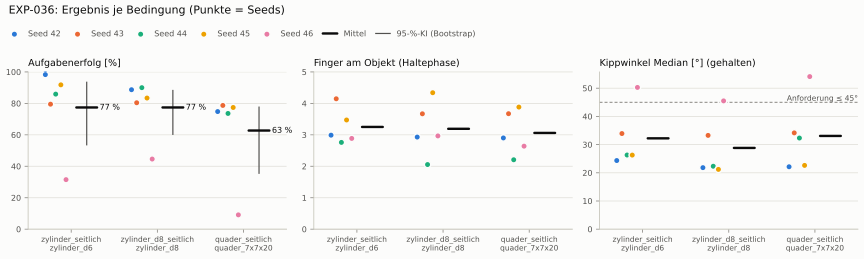
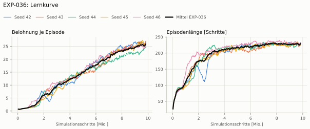
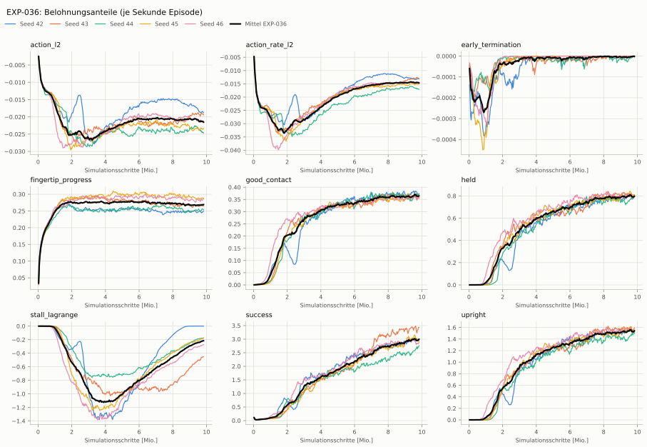
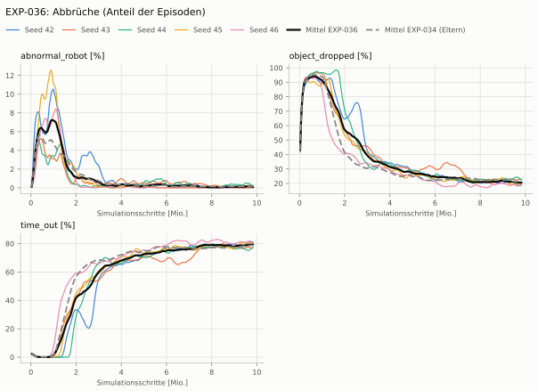
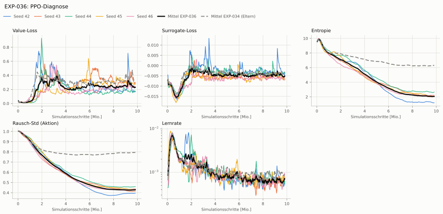

# EXP-036: CAPS + PID-Lagrange auf den Stall-Anteil

**Leistung** 83 % [80–86 %] (erfolgreiche Seeds, IQM über die Objekte; je Objekt Ø 6 cm 89 % · Ø 8 cm 86 % · Quader 76 %) — ggü. EXP-034: P(besser) = 0.67 [0.42–0.88] → kein Unterschied

**Testobjekte** (nie trainiert, erfolgreiche Seeds, Median): Flasche 80 % · Saftpackung 78 % · Cracker (YCB) 74 % · Zucker (YCB) 82 % · Senf (YCB) 78 %

**Zuverlässigkeit** 4/5 Seeds erfolgreich [28–99 %] — EXP-034: 4/5, exakter Fisher-Test p = 1.00 → nicht unterscheidbar (für eine Aussage ≥ 10 Seeds je Experiment)

**Leitplanken** eingehalten

**Befund** ohne Erfolg: Seed 46 (hält, aber gekippt); Engpass Quader (76 %); Unruhe 0.06 (EXP-034: 0.11)

**Urteilsvorschlag** (auswertung-v2): **kein Unterschied**

**Beste Videos** (Seed 42, 3 Episoden): [Ø 6 cm](beste_videos/EXP-036_zylinder_d6_s42.mp4) · [Ø 8 cm](beste_videos/EXP-036_zylinder_d8_s42.mp4) · [Quader](beste_videos/EXP-036_quader_7x7x20_s42.mp4) · [Cracker (YCB)](beste_videos/EXP-036_ycb_003_cracker_s42.mp4) · [Zucker (YCB)](beste_videos/EXP-036_ycb_004_zucker_s42.mp4) · [Senf (YCB)](beste_videos/EXP-036_ycb_006_senf_s42.mp4)

Ergebnisse je Bedingung (eval-v2, Leitplanken, Fehlerarten, Fingernutzung)

#### Bedingung `zylinder_seitlich`

Bedingung `zylinder_seitlich` (Objekt `zylinder_d6`, Kippwinkel ≤ 45°), Protokoll eval-v2, 5 Seed(s); Spalte EXP-034 unter derselben Anforderung

| Metrik | Mittel | 95-%-KI | IQM | Fehlschlag-Seeds (< 50 %) | EXP-034 (Mittel / IQM) |
|---|---|---|---|---|---|
| aufgabenerfolg | 77.4 % | 53.7 % – 93.4 % | 85.8 % | 20.0 % | 67.9 % / 80.9 % |
| haltequote | 93.7 % | 90.0 % – 96.7 % | 94.3 % | 0.0 % | 93.4 % / 94.4 % |
| Kippwinkel Median [°] | 32.2 | | | | 40.1 |
| Unterarm Median [°] | 45.7 | | | | 50.3 |
| Griffkraft Mittel [N] | 62.5 | | | | 84.9 |
| Kraft > 15 N [Anteil] | 99.9 % | | | | 100.0 % |
| Stall-Anteil [Anteil] | 66.1 % | | | | 99.6 % |
| Absinken [mm] | 0.00238 | | | | 0.0021 |
| Unruhe | 0.0637 | | | | 0.107 |
| Unruhe wirksam (Aktion auf ±1 begrenzt) | 0.0365 | | | | 0.0545 |
| Objektweg Tischebene Ende [mm] | 95 | | | | 88.8 |

Fehlerarten: startfehler 0.0 %, gefallen 6.3 %, instabil 0.0 %, anforderung_verletzt 16.3 %

**Urteilsvorschlag: kein messbarer Unterschied** (gegenüber EXP-034)
Unterschied Aufgabenerfolg +9.3 Prozentpunkte (95-%-KI -23.7 … +50.3)

Je Seed: 98.3 %, 79.5 %, 85.9 %, 91.8 %, 31.5 %

Fingernutzung (Haltephase): im Mittel 3.25 Finger am Objekt; Kontaktanteil je Seed (Daumen, Zeige, Mittel, Ring, klein): 99/100/100/0/0 · 100/92/59/81/83 · 96/100/2/74/4 · 100/66/82/0/99 · 100/67/20/9/93

#### Bedingung `zylinder_d8_seitlich`

Bedingung `zylinder_d8_seitlich` (Objekt `zylinder_d8`, Kippwinkel ≤ 45°), Protokoll eval-v2, 5 Seed(s); Spalte EXP-034 unter derselben Anforderung

| Metrik | Mittel | 95-%-KI | IQM | Fehlschlag-Seeds (< 50 %) | EXP-034 (Mittel / IQM) |
|---|---|---|---|---|---|
| aufgabenerfolg | 77.4 % | 60.3 % – 88.2 % | 84.1 % | 20.0 % | 58.7 % / 69.7 % |
| haltequote | 88.3 % | 84.8 % – 92.1 % | 87.9 % | 0.0 % | 85.2 % / 84.7 % |
| Kippwinkel Median [°] | 28.8 | | | | 38.5 |
| Unterarm Median [°] | 43.6 | | | | 50.8 |
| Griffkraft Mittel [N] | 51.6 | | | | 79.6 |
| Kraft > 15 N [Anteil] | 99.7 % | | | | 99.9 % |
| Stall-Anteil [Anteil] | 56.3 % | | | | 99.7 % |
| Absinken [mm] | 0 | | | | 5.27e-05 |
| Unruhe | 0.0635 | | | | 0.102 |
| Unruhe wirksam (Aktion auf ±1 begrenzt) | 0.0366 | | | | 0.0466 |
| Objektweg Tischebene Ende [mm] | 95 | | | | 108 |

Fehlerarten: startfehler 0.0 %, gefallen 11.7 %, instabil 0.0 %, anforderung_verletzt 10.9 %

**Urteilsvorschlag: kein messbarer Unterschied** (gegenüber EXP-034)
Unterschied Aufgabenerfolg +18.7 Prozentpunkte (95-%-KI -2.8 … +53.6)

Je Seed: 88.7 %, 80.4 %, 90.0 %, 83.4 %, 44.6 %

Fingernutzung (Haltephase): im Mittel 3.19 Finger am Objekt; Kontaktanteil je Seed (Daumen, Zeige, Mittel, Ring, klein): 100/100/93/0/0 · 100/76/9/94/87 · 100/100/0/5/0 · 100/90/98/47/99 · 100/85/7/5/100

#### Bedingung `quader_seitlich`

Bedingung `quader_seitlich` (Objekt `quader_7x7x20`, Kippwinkel ≤ 45°), Protokoll eval-v2, 5 Seed(s); Spalte EXP-034 unter derselben Anforderung

| Metrik | Mittel | 95-%-KI | IQM | Fehlschlag-Seeds (< 50 %) | EXP-034 (Mittel / IQM) |
|---|---|---|---|---|---|
| aufgabenerfolg | 62.7 % | 35.6 % – 77.6 % | 75.2 % | 20.0 % | 49.5 % / 55.6 % |
| haltequote | 77.4 % | 75.3 % – 79.7 % | 77.4 % | 0.0 % | 80.6 % / 81.0 % |
| Kippwinkel Median [°] | 33.1 | | | | 42.9 |
| Unterarm Median [°] | 43.8 | | | | 50.5 |
| Griffkraft Mittel [N] | 50.3 | | | | 76 |
| Kraft > 15 N [Anteil] | 99.6 % | | | | 99.9 % |
| Stall-Anteil [Anteil] | 54.2 % | | | | 99.7 % |
| Absinken [mm] | 0 | | | | 0 |
| Unruhe | 0.0646 | | | | 0.115 |
| Unruhe wirksam (Aktion auf ±1 begrenzt) | 0.0376 | | | | 0.0597 |
| Objektweg Tischebene Ende [mm] | 97.1 | | | | 108 |

Fehlerarten: startfehler 0.0 %, gefallen 22.6 %, instabil 0.0 %, anforderung_verletzt 14.7 %

**Urteilsvorschlag: kein messbarer Unterschied** (gegenüber EXP-034)
Unterschied Aufgabenerfolg +13.0 Prozentpunkte (95-%-KI -12.4 … +43.1)

Je Seed: 74.8 %, 78.7 %, 73.6 %, 77.4 %, 9.1 %

Fingernutzung (Haltephase): im Mittel 3.06 Finger am Objekt; Kontaktanteil je Seed (Daumen, Zeige, Mittel, Ring, klein): 100/99/92/0/0 · 100/74/14/84/96 · 97/100/1/21/2 · 100/82/96/12/98 · 100/62/4/1/98

#### Bedingung `flasche_seitlich`

Bedingung `flasche_seitlich` (Objekt `flasche_d7x25`, Kippwinkel ≤ 45°), Protokoll eval-v2, 5 Seed(s); Spalte EXP-034 unter derselben Anforderung

| Metrik | Mittel | 95-%-KI | IQM | Fehlschlag-Seeds (< 50 %) | EXP-034 (Mittel / IQM) |
|---|---|---|---|---|---|
| aufgabenerfolg | 69.1 % | 42.2 % – 87.1 % | 77.8 % | 20.0 % | 58.1 % / 66.0 % |
| haltequote | 93.5 % | 91.6 % – 95.4 % | 93.8 % | 0.0 % | 89.4 % / 90.7 % |
| Kippwinkel Median [°] | 33.1 | | | | 40.8 |
| Unterarm Median [°] | 44.7 | | | | 51.1 |
| Griffkraft Mittel [N] | 55.4 | | | | 77.5 |
| Kraft > 15 N [Anteil] | 99.9 % | | | | 100.0 % |
| Stall-Anteil [Anteil] | 57.6 % | | | | 99.7 % |
| Absinken [mm] | 0 | | | | 0.00474 |
| Unruhe | 0.0638 | | | | 0.107 |
| Unruhe wirksam (Aktion auf ±1 begrenzt) | 0.0368 | | | | 0.0537 |
| Objektweg Tischebene Ende [mm] | 95.5 | | | | 95.2 |

Fehlerarten: startfehler 0.0 %, gefallen 6.5 %, instabil 0.0 %, anforderung_verletzt 24.4 %

**Urteilsvorschlag: kein messbarer Unterschied** (gegenüber EXP-034)
Unterschied Aufgabenerfolg +10.8 Prozentpunkte (95-%-KI -22.0 … +45.1)

Je Seed: 94.5 %, 81.6 %, 73.3 %, 78.4 %, 17.9 %

Fingernutzung (Haltephase): im Mittel 3.18 Finger am Objekt; Kontaktanteil je Seed (Daumen, Zeige, Mittel, Ring, klein): 100/100/99/0/0 · 100/94/39/83/90 · 100/100/0/34/0 · 100/75/94/9/87 · 100/83/12/2/92

#### Bedingung `saftpackung_seitlich`

Bedingung `saftpackung_seitlich` (Objekt `saftpackung_9x6x19`, Kippwinkel ≤ 45°), Protokoll eval-v2, 5 Seed(s); Spalte EXP-034 unter derselben Anforderung

| Metrik | Mittel | 95-%-KI | IQM | Fehlschlag-Seeds (< 50 %) | EXP-034 (Mittel / IQM) |
|---|---|---|---|---|---|
| aufgabenerfolg | 66.2 % | 42.9 % – 80.2 % | 76.2 % | 20.0 % | 49.9 % / 51.9 % |
| haltequote | 83.4 % | 78.8 % – 88.5 % | 83.2 % | 0.0 % | 89.1 % / 89.5 % |
| Kippwinkel Median [°] | 35.2 | | | | 44.2 |
| Unterarm Median [°] | 46.4 | | | | 52.5 |
| Griffkraft Mittel [N] | 55.9 | | | | 80.9 |
| Kraft > 15 N [Anteil] | 99.6 % | | | | 100.0 % |
| Stall-Anteil [Anteil] | 64.4 % | | | | 99.6 % |
| Absinken [mm] | 0.0116 | | | | 0 |
| Unruhe | 0.0643 | | | | 0.119 |
| Unruhe wirksam (Aktion auf ±1 begrenzt) | 0.0373 | | | | 0.0651 |
| Objektweg Tischebene Ende [mm] | 107 | | | | 108 |

Fehlerarten: startfehler 0.0 %, gefallen 16.6 %, instabil 0.0 %, anforderung_verletzt 17.2 %

**Urteilsvorschlag: kein messbarer Unterschied** (gegenüber EXP-034)
Unterschied Aufgabenerfolg +16.2 Prozentpunkte (95-%-KI -8.6 … +43.0)

Je Seed: 76.2 %, 80.5 %, 71.8 %, 81.9 %, 20.7 %

Fingernutzung (Haltephase): im Mittel 3.25 Finger am Objekt; Kontaktanteil je Seed (Daumen, Zeige, Mittel, Ring, klein): 100/100/100/0/0 · 100/75/21/90/86 · 89/100/2/73/11 · 100/84/100/0/94 · 100/94/9/2/95

#### Bedingung `ycb_cracker_seitlich`

Bedingung `ycb_cracker_seitlich` (Objekt `ycb_003_cracker`, Kippwinkel ≤ 45°), Protokoll eval-v2, 5 Seed(s); Spalte EXP-034 unter derselben Anforderung

| Metrik | Mittel | 95-%-KI | IQM | Fehlschlag-Seeds (< 50 %) | EXP-034 (Mittel / IQM) |
|---|---|---|---|---|---|
| aufgabenerfolg | 76.2 % | 72.9 % – 80.3 % | 75.1 % | 0.0 % | 68.8 % / 80.0 % |
| haltequote | 77.4 % | 73.2 % – 81.4 % | 76.7 % | 0.0 % | 80.6 % / 80.8 % |
| Kippwinkel Median [°] | 22.7 | | | | 26.2 |
| Unterarm Median [°] | 43.8 | | | | 51.1 |
| Griffkraft Mittel [N] | 54 | | | | 75.1 |
| Kraft > 15 N [Anteil] | 99.9 % | | | | 100.0 % |
| Stall-Anteil [Anteil] | 62.5 % | | | | 99.7 % |
| Absinken [mm] | 0.0011 | | | | 0 |
| Unruhe | 0.0648 | | | | 0.119 |
| Unruhe wirksam (Aktion auf ±1 begrenzt) | 0.037 | | | | 0.0633 |
| Objektweg Tischebene Ende [mm] | 128 | | | | 139 |

Fehlerarten: startfehler 0.0 %, gefallen 22.6 %, instabil 0.0 %, anforderung_verletzt 1.1 %

**Urteilsvorschlag: kein messbarer Unterschied** (gegenüber EXP-034)
Unterschied Aufgabenerfolg +7.4 Prozentpunkte (95-%-KI -6.8 … +30.2)

Je Seed: 72.5 %, 76.2 %, 72.7 %, 83.8 %, 76.0 %

Fingernutzung (Haltephase): im Mittel 3.07 Finger am Objekt; Kontaktanteil je Seed (Daumen, Zeige, Mittel, Ring, klein): 100/99/99/0/0 · 100/50/9/92/92 · 97/100/2/43/2 · 100/56/83/8/100 · 100/85/11/8/96

#### Bedingung `ycb_zucker_seitlich`

Bedingung `ycb_zucker_seitlich` (Objekt `ycb_004_zucker`, Kippwinkel ≤ 45°), Protokoll eval-v2, 5 Seed(s); Spalte EXP-034 unter derselben Anforderung

| Metrik | Mittel | 95-%-KI | IQM | Fehlschlag-Seeds (< 50 %) | EXP-034 (Mittel / IQM) |
|---|---|---|---|---|---|
| aufgabenerfolg | 82.7 % | 75.9 % – 88.4 % | 84.2 % | 0.0 % | 76.8 % / 88.3 % |
| haltequote | 87.5 % | 78.5 % – 95.9 % | 89.2 % | 0.0 % | 96.6 % / 96.7 % |
| Kippwinkel Median [°] | 25.2 | | | | 28.8 |
| Unterarm Median [°] | 46 | | | | 51.5 |
| Griffkraft Mittel [N] | 64.8 | | | | 80.9 |
| Kraft > 15 N [Anteil] | 99.6 % | | | | 100.0 % |
| Stall-Anteil [Anteil] | 75.9 % | | | | 99.6 % |
| Absinken [mm] | 0.095 | | | | 0.00801 |
| Unruhe | 0.0643 | | | | 0.0864 |
| Unruhe wirksam (Aktion auf ±1 begrenzt) | 0.0351 | | | | 0.0391 |
| Objektweg Tischebene Ende [mm] | 115 | | | | 107 |

Fehlerarten: startfehler 0.0 %, gefallen 12.5 %, instabil 0.0 %, anforderung_verletzt 4.8 %

**Urteilsvorschlag: kein messbarer Unterschied** (gegenüber EXP-034)
Unterschied Aufgabenerfolg +6.0 Prozentpunkte (95-%-KI -15.9 … +35.5)

Je Seed: 88.2 %, 82.8 %, 82.1 %, 69.9 %, 90.4 %

Fingernutzung (Haltephase): im Mittel 3.32 Finger am Objekt; Kontaktanteil je Seed (Daumen, Zeige, Mittel, Ring, klein): 100/100/100/0/0 · 100/81/58/94/30 · 89/100/5/99/11 · 98/60/92/1/89 · 100/91/60/6/94

#### Bedingung `ycb_senf_seitlich`

Bedingung `ycb_senf_seitlich` (Objekt `ycb_006_senf`, Kippwinkel ≤ 45°), Protokoll eval-v2, 5 Seed(s); Spalte EXP-034 unter derselben Anforderung

| Metrik | Mittel | 95-%-KI | IQM | Fehlschlag-Seeds (< 50 %) | EXP-034 (Mittel / IQM) |
|---|---|---|---|---|---|
| aufgabenerfolg | 80.4 % | 74.8 % – 87.1 % | 79.3 % | 0.0 % | 78.3 % / 91.6 % |
| haltequote | 85.1 % | 76.6 % – 94.0 % | 84.6 % | 0.0 % | 92.5 % / 92.5 % |
| Kippwinkel Median [°] | 27 | | | | 29.8 |
| Unterarm Median [°] | 46.1 | | | | 52.8 |
| Griffkraft Mittel [N] | 62.3 | | | | 83.1 |
| Kraft > 15 N [Anteil] | 97.0 % | | | | 100.0 % |
| Stall-Anteil [Anteil] | 73.0 % | | | | 99.6 % |
| Absinken [mm] | 0.0802 | | | | 0.004 |
| Unruhe | 0.0637 | | | | 0.101 |
| Unruhe wirksam (Aktion auf ±1 begrenzt) | 0.0353 | | | | 0.0509 |
| Objektweg Tischebene Ende [mm] | 111 | | | | 108 |

Fehlerarten: startfehler 0.0 %, gefallen 14.9 %, instabil 0.0 %, anforderung_verletzt 4.7 %

**Urteilsvorschlag: kein messbarer Unterschied** (gegenüber EXP-034)
Unterschied Aufgabenerfolg +2.3 Prozentpunkte (95-%-KI -15.9 … +29.7)

Je Seed: 81.8 %, 78.3 %, 78.0 %, 71.6 %, 92.3 %

Fingernutzung (Haltephase): im Mittel 3.35 Finger am Objekt; Kontaktanteil je Seed (Daumen, Zeige, Mittel, Ring, klein): 100/98/100/0/0 · 100/93/85/91/61 · 100/100/0/100/0 · 100/60/86/2/87 · 100/92/10/14/98

Trainingsverlauf

Seeds dünn, Mittel kräftig, Eltern gestrichelt (nur Abbrüche/PPO — Trainings-Belohnung ist zwischen Experimenten nicht vergleichbar); geglättet, x = Simulationsschritte. Endwerte = Mittel der letzten 10 Iterationen (Belohnungsanteile je Sekunde Episode).

| Größe | Seed 42 | Seed 43 | Seed 44 | Seed 45 | Seed 46 | Mittel |
|---|---|---|---|---|---|---|
| mean_reward | 26 | 26.5 | 24.3 | 26.3 | 24.7 | 25.6 |
| action_l2 | -0.0188 | -0.0194 | -0.0245 | -0.0235 | -0.0212 | -0.0215 |
| action_rate_l2 | -0.0132 | -0.0129 | -0.017 | -0.0152 | -0.0148 | -0.0146 |
| early_termination | 0 | -3.86e-06 | -3.58e-06 | 0 | 0 | -1.49e-06 |
| fingertip_progress | 0.248 | 0.269 | 0.253 | 0.288 | 0.284 | 0.268 |
| good_contact | 0.375 | 0.363 | 0.371 | 0.364 | 0.357 | 0.366 |
| held | 0.789 | 0.808 | 0.789 | 0.812 | 0.795 | 0.799 |
| stall_lagrange | 0 | -0.466 | -0.179 | -0.184 | -0.282 | -0.222 |
| success | 2.96 | 3.42 | 2.71 | 3 | 2.84 | 2.99 |
| upright | 1.54 | 1.58 | 1.5 | 1.56 | 1.54 | 1.54 |
| object_dropped | 18.7 % | 22.7 % | 23.3 % | 19.6 % | 18.9 % | 20.6 % |
| mean_noise_std | 0.395 | 0.415 | 0.459 | 0.437 | 0.435 | 0.428 |

Netz, Training und Konfiguration

Actor [256, 128, 64] (elu), 68808 Parameter, 105 Eingänge (Verlauf 5) · Critic [512, 256, 128] · PPO: Lernrate 0.001, Entropie 0.005, 5 Epochen × 4 Mini-Batches, 32 Schritte/Umgebung · 1024 Umgebungen × 300 Iterationen

Geplante Änderung: PID-Lagrange auf den Stall-Anteil wie EXP-035 zusätzlich zu CAPS (Task HeavyMultiProgressDexCapsLagrange-v0).

Konfiguration gegenüber EXP-034 (11 Unterschiede):

- `env.rewards.stall_lagrange.func: ∅ → pib_grasp.mdp:StallLagrange`
- `env.rewards.stall_lagrange.params.ema: ∅ → 0.5`
- `env.rewards.stall_lagrange.params.fraction: ∅ → 0.8`
- `env.rewards.stall_lagrange.params.joint_names: ∅ → ['forearm_left', 'thumb_left_rotator', 'thumb_left_proximal', 'index_left_proximal', 'middle_left_proximal', 'ring_left_proximal', 'pinky_left_proximal']`
- `env.rewards.stall_lagrange.params.k_d: ∅ → 5.0`
- `env.rewards.stall_lagrange.params.k_i: ∅ → 1.0`
- `env.rewards.stall_lagrange.params.k_p: ∅ → 10.0`
- `env.rewards.stall_lagrange.params.lambda_max: ∅ → 100.0`
- `env.rewards.stall_lagrange.params.limit: ∅ → 0.2`
- `env.rewards.stall_lagrange.params.steps_per_update: ∅ → 32`
- `env.rewards.stall_lagrange.weight: ∅ → -1.0`

