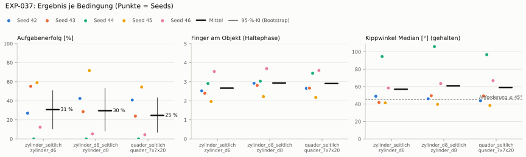
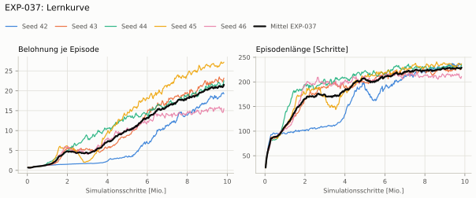
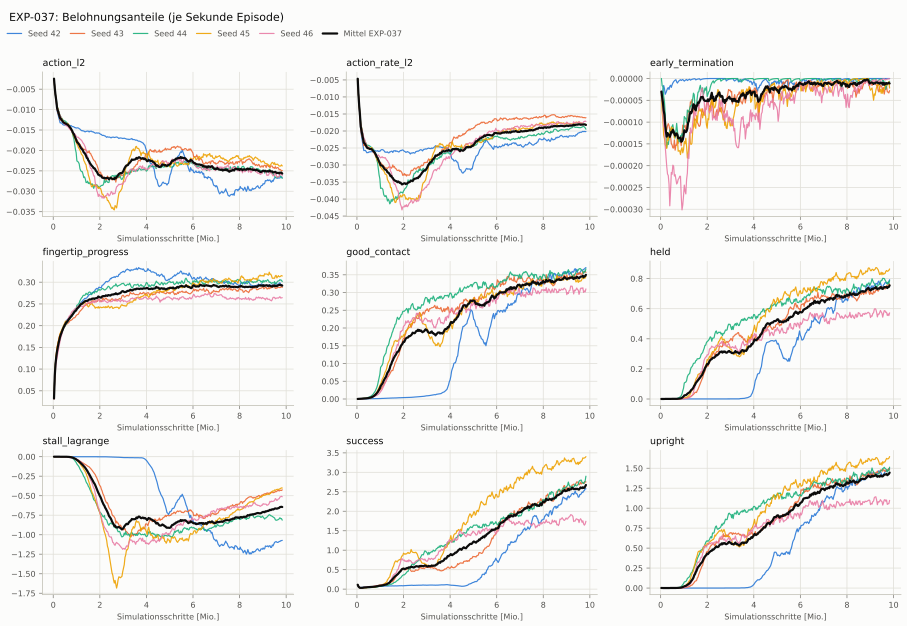
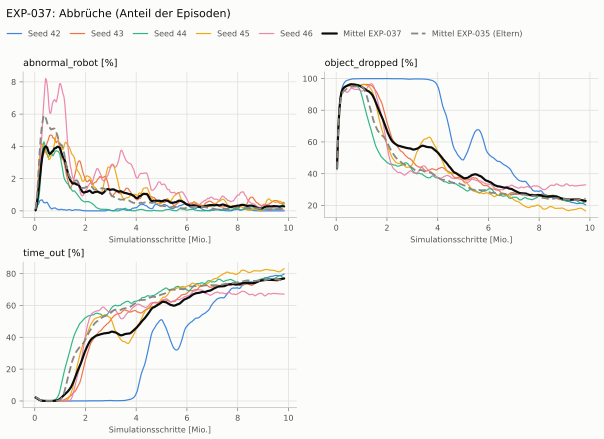
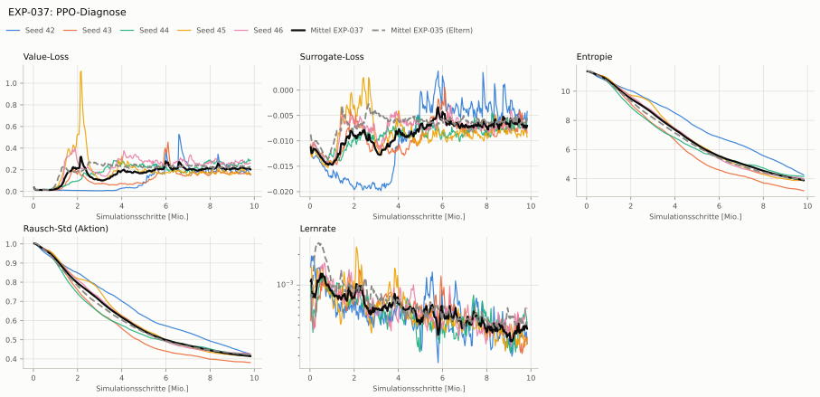

# EXP-037: Servo-Last als Beobachtung (zu PID-Lagrange)

**Leistung** 60 % [58–62 %] (erfolgreiche Seeds, IQM über die Objekte; je Objekt Ø 6 cm 59 % · Ø 8 cm 72 % · Quader 54 %) — ggü. EXP-035: P(besser) = 0.00 [0.00–0.00] → gesichert schlechter

**Testobjekte** (nie trainiert, erfolgreiche Seeds, Median): Flasche 62 % · Saftpackung 45 % · Cracker (YCB) 70 % · Zucker (YCB) 96 % · Senf (YCB) 94 %

**Zuverlässigkeit** 1/5 Seeds erfolgreich [1–72 %] — EXP-035: 2/5, exakter Fisher-Test p = 1.00 → nicht unterscheidbar (für eine Aussage ≥ 10 Seeds je Experiment)

**Leitplanken** Kippwinkel Median [°]: 57 > 53; Stall-Anteil [Anteil]: 0.847 > 0.755; Unruhe: 0.476 > 0.451 ✗

**Befund** ohne Erfolg: Seed 42 (hält, aber gekippt), Seed 43 (hält, aber gekippt), Seed 44 (hält, aber gekippt), Seed 46 (hält, aber gekippt); Engpass Quader (54 %); Unruhe 0.48 (EXP-035: 0.38)

**Urteilsvorschlag** (auswertung-v2): **schlechter, Leitplanke verletzt**

**Beste Videos** (Seed 45, 3 Episoden): [Ø 6 cm](beste_videos/EXP-037_zylinder_d6_s45.mp4) · [Ø 8 cm](beste_videos/EXP-037_zylinder_d8_s45.mp4) · [Quader](beste_videos/EXP-037_quader_7x7x20_s45.mp4)

Ergebnisse je Bedingung (eval-v2, Leitplanken, Fehlerarten, Fingernutzung)

#### Bedingung `zylinder_seitlich`

Bedingung `zylinder_seitlich` (Objekt `zylinder_d6`, Kippwinkel ≤ 45°), Protokoll eval-v2, 5 Seed(s); Spalte EXP-035 unter derselben Anforderung

| Metrik | Mittel | 95-%-KI | IQM | Fehlschlag-Seeds (< 50 %) | EXP-035 (Mittel / IQM) |
|---|---|---|---|---|---|
| aufgabenerfolg | 30.7 % | 10.6 % – 50.5 % | 31.1 % | 60.0 % | 48.5 % / 47.6 % |
| haltequote | 94.5 % | 92.4 % – 96.5 % | 94.5 % | 0.0 % | 94.0 % / 94.5 % |
| Kippwinkel Median [°] | 57 | | | | 48 |
| Unterarm Median [°] | 52 | | | | 57.4 |
| Griffkraft Mittel [N] | 61.2 | | | | 56.8 |
| Kraft > 15 N [Anteil] | 98.8 % | | | | 98.9 % |
| Stall-Anteil [Anteil] | 84.7 % | | | | 70.5 % |
| Absinken [mm] | 0.00628 | | | | 0.0202 |
| Unruhe | 0.476 | | | | 0.376 |
| Unruhe wirksam (Aktion auf ±1 begrenzt) | 0.302 | | | | 0.262 |
| Objektweg Tischebene Ende [mm] | 127 | | | | 113 |

Fehlerarten: startfehler 0.0 %, gefallen 5.4 %, instabil 0.0 %, anforderung_verletzt 63.8 %

**Urteilsvorschlag: kein messbarer Unterschied** (gegenüber EXP-035)
Unterschied Aufgabenerfolg -18.0 Prozentpunkte (95-%-KI -60.7 … +23.2)
- Leitplanke: Kippwinkel Median [°]: 57 > 53
- Leitplanke: Stall-Anteil [Anteil]: 0.847 > 0.755
- Leitplanke: Unruhe: 0.476 > 0.451

Je Seed: 27.0 %, 55.2 %, 0.0 %, 59.0 %, 12.3 %

Fingernutzung (Haltephase): im Mittel 2.66 Finger am Objekt; Kontaktanteil je Seed (Daumen, Zeige, Mittel, Ring, klein): 100/42/100/2/9 · 100/5/49/84/1 · 99/58/91/7/36 · 99/0/97/0/0 · 92/99/89/69/4

#### Bedingung `zylinder_d8_seitlich`

Bedingung `zylinder_d8_seitlich` (Objekt `zylinder_d8`, Kippwinkel ≤ 45°), Protokoll eval-v2, 5 Seed(s); Spalte EXP-035 unter derselben Anforderung

| Metrik | Mittel | 95-%-KI | IQM | Fehlschlag-Seeds (< 50 %) | EXP-035 (Mittel / IQM) |
|---|---|---|---|---|---|
| aufgabenerfolg | 29.6 % | 8.4 % – 52.9 % | 25.8 % | 80.0 % | 44.2 % / 43.4 % |
| haltequote | 85.4 % | 79.3 % – 91.1 % | 86.2 % | 0.0 % | 86.2 % / 86.2 % |
| Kippwinkel Median [°] | 61 | | | | 44.9 |
| Unterarm Median [°] | 55 | | | | 55.7 |
| Griffkraft Mittel [N] | 60.9 | | | | 54 |
| Kraft > 15 N [Anteil] | 99.2 % | | | | 99.5 % |
| Stall-Anteil [Anteil] | 85.6 % | | | | 74.3 % |
| Absinken [mm] | 0.014 | | | | 0 |
| Unruhe | 0.577 | | | | 0.392 |
| Unruhe wirksam (Aktion auf ±1 begrenzt) | 0.371 | | | | 0.254 |
| Objektweg Tischebene Ende [mm] | 139 | | | | 123 |

Fehlerarten: startfehler 0.0 %, gefallen 14.5 %, instabil 0.1 %, anforderung_verletzt 55.8 %

**Urteilsvorschlag: kein messbarer Unterschied** (gegenüber EXP-035)
Unterschied Aufgabenerfolg -14.7 Prozentpunkte (95-%-KI -53.0 … +12.5)
- Leitplanke: Kippwinkel Median [°]: 61 > 49.9
- Leitplanke: Stall-Anteil [Anteil]: 0.856 > 0.793
- Leitplanke: Unruhe: 0.577 > 0.47
- Leitplanke: Unruhe wirksam (Aktion auf ±1 begrenzt): 0.371 > 0.305

Je Seed: 42.4 %, 28.6 %, 0.0 %, 71.7 %, 5.3 %

Fingernutzung (Haltephase): im Mittel 2.93 Finger am Objekt; Kontaktanteil je Seed (Daumen, Zeige, Mittel, Ring, klein): 100/74/100/4/13 · 100/14/87/75/5 · 97/67/82/10/47 · 100/22/100/0/0 · 100/100/91/79/0

#### Bedingung `quader_seitlich`

Bedingung `quader_seitlich` (Objekt `quader_7x7x20`, Kippwinkel ≤ 45°), Protokoll eval-v2, 5 Seed(s); Spalte EXP-035 unter derselben Anforderung

| Metrik | Mittel | 95-%-KI | IQM | Fehlschlag-Seeds (< 50 %) | EXP-035 (Mittel / IQM) |
|---|---|---|---|---|---|
| aufgabenerfolg | 24.7 % | 7.1 % – 43.2 % | 23.1 % | 80.0 % | 35.1 % / 32.0 % |
| haltequote | 75.8 % | 73.8 % – 77.8 % | 75.8 % | 0.0 % | 76.2 % / 76.0 % |
| Kippwinkel Median [°] | 59.1 | | | | 49.9 |
| Unterarm Median [°] | 55 | | | | 57.1 |
| Griffkraft Mittel [N] | 53.7 | | | | 50.9 |
| Kraft > 15 N [Anteil] | 99.5 % | | | | 99.6 % |
| Stall-Anteil [Anteil] | 85.0 % | | | | 64.4 % |
| Absinken [mm] | 0 | | | | 0 |
| Unruhe | 0.615 | | | | 0.369 |
| Unruhe wirksam (Aktion auf ±1 begrenzt) | 0.413 | | | | 0.249 |
| Objektweg Tischebene Ende [mm] | 137 | | | | 118 |

Fehlerarten: startfehler 0.0 %, gefallen 24.0 %, instabil 0.2 %, anforderung_verletzt 51.1 %

**Urteilsvorschlag: kein messbarer Unterschied** (gegenüber EXP-035)
Unterschied Aufgabenerfolg -10.4 Prozentpunkte (95-%-KI -42.1 … +18.9)
- Leitplanke: Kippwinkel Median [°]: 59.1 > 54.9
- Leitplanke: Stall-Anteil [Anteil]: 0.85 > 0.694
- Leitplanke: Unruhe: 0.615 > 0.443
- Leitplanke: Unruhe wirksam (Aktion auf ±1 begrenzt): 0.413 > 0.298

Je Seed: 40.8 %, 23.9 %, 0.0 %, 54.4 %, 4.4 %

Fingernutzung (Haltephase): im Mittel 2.91 Finger am Objekt; Kontaktanteil je Seed (Daumen, Zeige, Mittel, Ring, klein): 100/47/100/1/18 · 100/15/97/50/5 · 100/83/92/11/58 · 100/19/99/0/0 · 95/99/89/71/4

#### Bedingung `flasche_seitlich`

Bedingung `flasche_seitlich` (Objekt `flasche_d7x25`, Kippwinkel ≤ 45°), Protokoll eval-v2, 5 Seed(s); Spalte EXP-035 unter derselben Anforderung

| Metrik | Mittel | 95-%-KI | IQM | Fehlschlag-Seeds (< 50 %) | EXP-035 (Mittel / IQM) |
|---|---|---|---|---|---|
| aufgabenerfolg | 32.2 % | 6.4 % – 58.4 % | 29.0 % | 60.0 % | 50.9 % / 56.9 % |
| haltequote | 89.7 % | 87.3 % – 92.7 % | 88.9 % | 0.0 % | 89.8 % / 89.6 % |
| Kippwinkel Median [°] | 62.4 | | | | 43.7 |
| Unterarm Median [°] | 54.4 | | | | 57 |
| Griffkraft Mittel [N] | 59.3 | | | | 54.6 |
| Kraft > 15 N [Anteil] | 99.6 % | | | | 99.8 % |
| Stall-Anteil [Anteil] | 86.7 % | | | | 71.7 % |
| Absinken [mm] | 0 | | | | 0.00921 |
| Unruhe | 0.551 | | | | 0.362 |
| Unruhe wirksam (Aktion auf ±1 begrenzt) | 0.357 | | | | 0.244 |
| Objektweg Tischebene Ende [mm] | 125 | | | | 114 |

Fehlerarten: startfehler 0.0 %, gefallen 10.3 %, instabil 0.0 %, anforderung_verletzt 57.5 %

**Urteilsvorschlag: kein messbarer Unterschied** (gegenüber EXP-035)
Unterschied Aufgabenerfolg -18.9 Prozentpunkte (95-%-KI -49.7 … +10.3)
- Leitplanke: Kippwinkel Median [°]: 62.4 > 48.7
- Leitplanke: Stall-Anteil [Anteil]: 0.867 > 0.767
- Leitplanke: Unruhe: 0.551 > 0.435
- Leitplanke: Unruhe wirksam (Aktion auf ±1 begrenzt): 0.357 > 0.293

Je Seed: 71.9 %, 22.9 %, 0.0 %, 62.4 %, 3.6 %

Fingernutzung (Haltephase): im Mittel 2.76 Finger am Objekt; Kontaktanteil je Seed (Daumen, Zeige, Mittel, Ring, klein): 100/55/100/1/11 · 100/8/88/64/1 · 100/85/93/2/51 · 99/6/98/0/0 · 99/100/64/53/0

#### Bedingung `saftpackung_seitlich`

Bedingung `saftpackung_seitlich` (Objekt `saftpackung_9x6x19`, Kippwinkel ≤ 45°), Protokoll eval-v2, 5 Seed(s); Spalte EXP-035 unter derselben Anforderung

| Metrik | Mittel | 95-%-KI | IQM | Fehlschlag-Seeds (< 50 %) | EXP-035 (Mittel / IQM) |
|---|---|---|---|---|---|
| aufgabenerfolg | 31.7 % | 13.1 % – 49.7 % | 34.2 % | 80.0 % | 41.3 % / 38.6 % |
| haltequote | 83.9 % | 80.5 % – 87.2 % | 84.1 % | 0.0 % | 81.7 % / 83.2 % |
| Kippwinkel Median [°] | 56.9 | | | | 48.9 |
| Unterarm Median [°] | 55.9 | | | | 57.9 |
| Griffkraft Mittel [N] | 53.5 | | | | 50.6 |
| Kraft > 15 N [Anteil] | 99.3 % | | | | 99.3 % |
| Stall-Anteil [Anteil] | 79.9 % | | | | 61.3 % |
| Absinken [mm] | 0.00142 | | | | 0.00184 |
| Unruhe | 0.596 | | | | 0.341 |
| Unruhe wirksam (Aktion auf ±1 begrenzt) | 0.397 | | | | 0.233 |
| Objektweg Tischebene Ende [mm] | 147 | | | | 125 |

Fehlerarten: startfehler 0.0 %, gefallen 16.0 %, instabil 0.1 %, anforderung_verletzt 52.2 %

**Urteilsvorschlag: kein messbarer Unterschied** (gegenüber EXP-035)
Unterschied Aufgabenerfolg -9.5 Prozentpunkte (95-%-KI -49.7 … +29.9)
- Leitplanke: Kippwinkel Median [°]: 56.9 > 53.9
- Leitplanke: Stall-Anteil [Anteil]: 0.799 > 0.663
- Leitplanke: Unruhe: 0.596 > 0.409
- Leitplanke: Unruhe wirksam (Aktion auf ±1 begrenzt): 0.397 > 0.279
- Leitplanke: Objektweg Tischebene Ende [mm]: 147 > 145

Je Seed: 58.4 %, 41.3 %, 0.0 %, 45.1 %, 13.9 %

Fingernutzung (Haltephase): im Mittel 2.86 Finger am Objekt; Kontaktanteil je Seed (Daumen, Zeige, Mittel, Ring, klein): 100/65/100/0/11 · 100/20/92/52/5 · 100/89/88/5/42 · 100/17/100/0/0 · 92/100/85/57/11

#### Bedingung `ycb_cracker_seitlich`

Bedingung `ycb_cracker_seitlich` (Objekt `ycb_003_cracker`, Kippwinkel ≤ 45°), Protokoll eval-v2, 5 Seed(s); Spalte EXP-035 unter derselben Anforderung

| Metrik | Mittel | 95-%-KI | IQM | Fehlschlag-Seeds (< 50 %) | EXP-035 (Mittel / IQM) |
|---|---|---|---|---|---|
| aufgabenerfolg | 61.1 % | 41.2 % – 78.5 % | 66.4 % | 40.0 % | 65.4 % / 72.5 % |
| haltequote | 76.7 % | 72.4 % – 80.7 % | 77.2 % | 0.0 % | 74.5 % / 74.3 % |
| Kippwinkel Median [°] | 32.5 | | | | 26.8 |
| Unterarm Median [°] | 55.1 | | | | 56.4 |
| Griffkraft Mittel [N] | 57.3 | | | | 55.6 |
| Kraft > 15 N [Anteil] | 100.0 % | | | | 100.0 % |
| Stall-Anteil [Anteil] | 84.6 % | | | | 66.7 % |
| Absinken [mm] | 0 | | | | 0 |
| Unruhe | 0.618 | | | | 0.28 |
| Unruhe wirksam (Aktion auf ±1 begrenzt) | 0.416 | | | | 0.17 |
| Objektweg Tischebene Ende [mm] | 176 | | | | 153 |

Fehlerarten: startfehler 0.0 %, gefallen 23.1 %, instabil 0.2 %, anforderung_verletzt 15.6 %

**Urteilsvorschlag: kein messbarer Unterschied** (gegenüber EXP-035)
Unterschied Aufgabenerfolg -4.6 Prozentpunkte (95-%-KI -33.7 … +25.4)
- Leitplanke: Kippwinkel Median [°]: 32.5 > 31.8
- Leitplanke: Stall-Anteil [Anteil]: 0.846 > 0.717
- Leitplanke: Unruhe: 0.618 > 0.336
- Leitplanke: Unruhe wirksam (Aktion auf ±1 begrenzt): 0.416 > 0.204
- Leitplanke: Objektweg Tischebene Ende [mm]: 176 > 173

Je Seed: 81.1 %, 81.8 %, 25.6 %, 69.6 %, 47.3 %

Fingernutzung (Haltephase): im Mittel 2.95 Finger am Objekt; Kontaktanteil je Seed (Daumen, Zeige, Mittel, Ring, klein): 100/76/100/1/9 · 100/19/76/56/11 · 100/79/95/14/44 · 100/23/100/0/0 · 98/99/94/82/0

#### Bedingung `ycb_zucker_seitlich`

Bedingung `ycb_zucker_seitlich` (Objekt `ycb_004_zucker`, Kippwinkel ≤ 45°), Protokoll eval-v2, 5 Seed(s); Spalte EXP-035 unter derselben Anforderung

| Metrik | Mittel | 95-%-KI | IQM | Fehlschlag-Seeds (< 50 %) | EXP-035 (Mittel / IQM) |
|---|---|---|---|---|---|
| aufgabenerfolg | 77.9 % | 45.7 % – 97.2 % | 92.4 % | 20.0 % | 75.2 % / 84.6 % |
| haltequote | 96.8 % | 95.1 % – 98.2 % | 97.4 % | 0.0 % | 88.6 % / 92.7 % |
| Kippwinkel Median [°] | 34.4 | | | | 27.3 |
| Unterarm Median [°] | 53.8 | | | | 58.9 |
| Griffkraft Mittel [N] | 61 | | | | 56.5 |
| Kraft > 15 N [Anteil] | 99.7 % | | | | 89.9 % |
| Stall-Anteil [Anteil] | 78.4 % | | | | 60.9 % |
| Absinken [mm] | 0.0074 | | | | 0.402 |
| Unruhe | 0.516 | | | | 0.248 |
| Unruhe wirksam (Aktion auf ±1 begrenzt) | 0.337 | | | | 0.151 |
| Objektweg Tischebene Ende [mm] | 143 | | | | 131 |

Fehlerarten: startfehler 0.0 %, gefallen 3.1 %, instabil 0.1 %, anforderung_verletzt 18.9 %

**Urteilsvorschlag: kein messbarer Unterschied** (gegenüber EXP-035)
Unterschied Aufgabenerfolg +2.2 Prozentpunkte (95-%-KI -43.8 … +42.6)
- Leitplanke: Kippwinkel Median [°]: 34.4 > 32.3
- Leitplanke: Kraft > 15 N [Anteil]: 0.997 > 0.949
- Leitplanke: Stall-Anteil [Anteil]: 0.784 > 0.659
- Leitplanke: Unruhe: 0.516 > 0.298
- Leitplanke: Unruhe wirksam (Aktion auf ±1 begrenzt): 0.337 > 0.181

Je Seed: 98.0 %, 97.5 %, 15.2 %, 95.6 %, 83.1 %

Fingernutzung (Haltephase): im Mittel 2.86 Finger am Objekt; Kontaktanteil je Seed (Daumen, Zeige, Mittel, Ring, klein): 100/57/100/7/4 · 100/12/83/69/2 · 100/86/99/6/41 · 100/8/100/0/1 · 97/98/90/68/1

#### Bedingung `ycb_senf_seitlich`

Bedingung `ycb_senf_seitlich` (Objekt `ycb_006_senf`, Kippwinkel ≤ 45°), Protokoll eval-v2, 5 Seed(s); Spalte EXP-035 unter derselben Anforderung

| Metrik | Mittel | 95-%-KI | IQM | Fehlschlag-Seeds (< 50 %) | EXP-035 (Mittel / IQM) |
|---|---|---|---|---|---|
| aufgabenerfolg | 66.5 % | 33.9 % – 95.6 % | 75.8 % | 40.0 % | 73.3 % / 82.5 % |
| haltequote | 94.5 % | 90.7 % – 97.5 % | 95.4 % | 0.0 % | 89.0 % / 92.3 % |
| Kippwinkel Median [°] | 36.8 | | | | 29.5 |
| Unterarm Median [°] | 54.2 | | | | 59.1 |
| Griffkraft Mittel [N] | 61.1 | | | | 57.8 |
| Kraft > 15 N [Anteil] | 99.7 % | | | | 96.6 % |
| Stall-Anteil [Anteil] | 82.5 % | | | | 63.9 % |
| Absinken [mm] | 0.0241 | | | | 0.0554 |
| Unruhe | 0.551 | | | | 0.27 |
| Unruhe wirksam (Aktion auf ±1 begrenzt) | 0.363 | | | | 0.17 |
| Objektweg Tischebene Ende [mm] | 138 | | | | 130 |

Fehlerarten: startfehler 0.0 %, gefallen 5.5 %, instabil 0.0 %, anforderung_verletzt 28.0 %

**Urteilsvorschlag: kein messbarer Unterschied** (gegenüber EXP-035)
Unterschied Aufgabenerfolg -7.5 Prozentpunkte (95-%-KI -54.5 … +38.4)
- Leitplanke: Kippwinkel Median [°]: 36.8 > 34.5
- Leitplanke: Stall-Anteil [Anteil]: 0.825 > 0.689
- Leitplanke: Unruhe: 0.551 > 0.324
- Leitplanke: Unruhe wirksam (Aktion auf ±1 begrenzt): 0.363 > 0.204

Je Seed: 98.3 %, 92.6 %, 12.6 %, 94.4 %, 34.7 %

Fingernutzung (Haltephase): im Mittel 2.92 Finger am Objekt; Kontaktanteil je Seed (Daumen, Zeige, Mittel, Ring, klein): 100/90/100/10/1 · 100/24/89/50/10 · 99/37/97/24/43 · 100/18/100/0/0 · 99/98/93/75/0

Trainingsverlauf

Seeds dünn, Mittel kräftig, Eltern gestrichelt (nur Abbrüche/PPO — Trainings-Belohnung ist zwischen Experimenten nicht vergleichbar); geglättet, x = Simulationsschritte. Endwerte = Mittel der letzten 10 Iterationen (Belohnungsanteile je Sekunde Episode).

| Größe | Seed 42 | Seed 43 | Seed 44 | Seed 45 | Seed 46 | Mittel |
|---|---|---|---|---|---|---|
| mean_reward | 19.2 | 23 | 21.9 | 27.1 | 15.3 | 21.3 |
| action_l2 | -0.0266 | -0.0247 | -0.0267 | -0.0238 | -0.0261 | -0.0256 |
| action_rate_l2 | -0.0202 | -0.016 | -0.0191 | -0.0181 | -0.0173 | -0.0181 |
| early_termination | 0 | -2.95e-05 | -1.27e-05 | -1.74e-05 | -1.05e-06 | -1.21e-05 |
| fingertip_progress | 0.295 | 0.287 | 0.302 | 0.315 | 0.264 | 0.293 |
| good_contact | 0.367 | 0.356 | 0.364 | 0.342 | 0.307 | 0.347 |
| held | 0.783 | 0.748 | 0.784 | 0.855 | 0.569 | 0.748 |
| stall_lagrange | -1.08 | -0.429 | -0.81 | -0.409 | -0.521 | -0.65 |
| success | 2.54 | 2.73 | 2.83 | 3.37 | 1.72 | 2.64 |
| upright | 1.48 | 1.47 | 1.5 | 1.63 | 1.08 | 1.43 |
| object_dropped | 20.8 % | 22.7 % | 21.9 % | 17.3 % | 32.8 % | 23.1 % |
| mean_noise_std | 0.428 | 0.381 | 0.423 | 0.418 | 0.426 | 0.415 |

Netz, Training und Konfiguration

Actor [256, 128, 64] (elu), 79048 Parameter, 145 Eingänge (Verlauf 5) · Critic [512, 256, 128] · PPO: Lernrate 0.001, Entropie 0.005, 5 Epochen × 4 Mini-Batches, 32 Schritte/Umgebung · 1024 Umgebungen × 300 Iterationen

Geplante Änderung: Beobachtung servo_load = |τ|/Stall je Servo (8, wie „Present Load“), Verlauf 5, Rauschen σ 0,05, als letzte Größe (Policy-Eingang 105 → 145; env_cfg.add_servo_load_obs, Bewertung mit --servo_last). Task HeavyMultiProgressDexLagrangeLoad-v0.

Konfiguration gegenüber EXP-035 (12 Unterschiede):

- `env.observations.policy.enable_corruption: False → True`
- `env.observations.policy.servo_load.clip: ∅ → None`
- `env.observations.policy.servo_load.flatten_history_dim: ∅ → True`
- `env.observations.policy.servo_load.func: ∅ → pib_grasp.mdp:servo_load`
- `env.observations.policy.servo_load.history_length: ∅ → 0`
- `env.observations.policy.servo_load.modifiers: ∅ → None`
- `env.observations.policy.servo_load.noise.func: ∅ → isaaclab.utils.noise.noise_model:gaussian_noise`
- `env.observations.policy.servo_load.noise.mean: ∅ → 0.0`
- `env.observations.policy.servo_load.noise.operation: ∅ → add`
- `env.observations.policy.servo_load.noise.std: ∅ → 0.05`
- `env.observations.policy.servo_load.params.joint_names: ∅ → ['forearm_left', 'wrist_left', 'thumb_left_rotator', 'thumb_left_proximal', 'index_left_proximal', 'middle_left_proximal', 'ring_left_proximal', 'pinky_left_proximal']`
- `env.observations.policy.servo_load.scale: ∅ → None`

