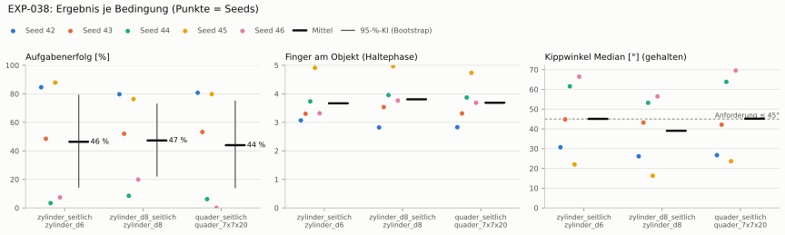
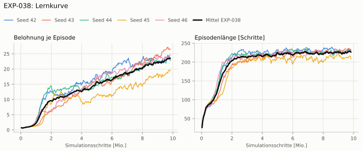
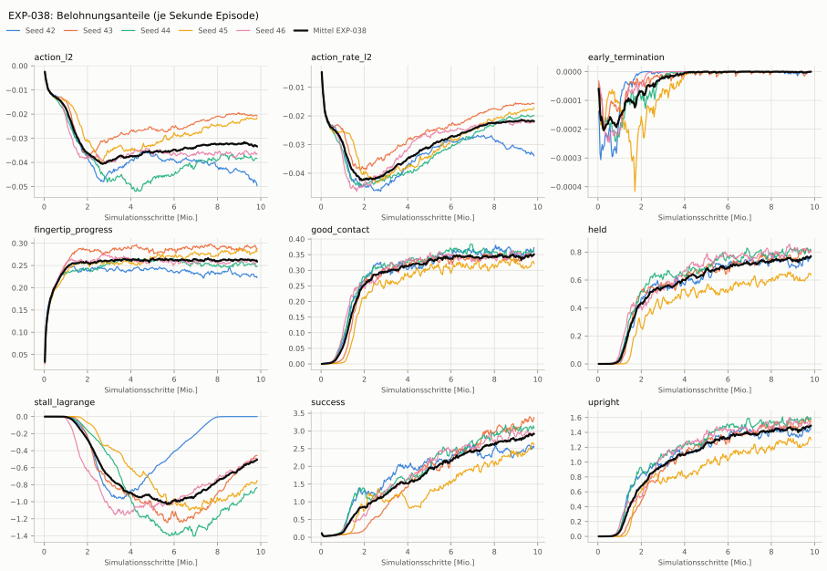
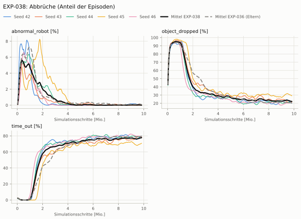
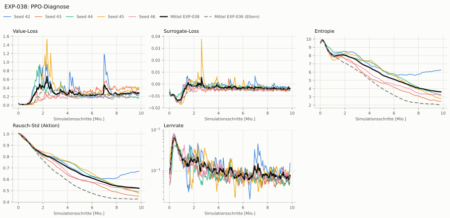

# EXP-038: Stall-Kosten wie am echten Servo (8 Servos inkl. Handgelenk, kein Drücken am Anschlag)

**Leistung** 75 % [57–81 %] (erfolgreiche Seeds, IQM über die Objekte; je Objekt Ø 6 cm 85 % · Ø 8 cm 76 % · Quader 80 %) — ggü. EXP-036: P(besser) = 0.31 [0.08–0.50] → kein Unterschied

**Testobjekte** (nie trainiert, erfolgreiche Seeds, Median): Flasche 72 % · Saftpackung 74 % · Cracker (YCB) 74 % · Zucker (YCB) 63 % · Senf (YCB) 55 %

**Zuverlässigkeit** 3/5 Seeds erfolgreich [15–95 %] — EXP-036: 4/5, exakter Fisher-Test p = 1.00 → nicht unterscheidbar (für eine Aussage ≥ 10 Seeds je Experiment)

**Leitplanken** Kippwinkel Median [°]: 45.1 > 37.2; Unterarm Median [°]: 57.1 > 55.7; Stall-Anteil [Anteil]: 0.891 > 0.711 ✗

**Befund** ohne Erfolg: Seed 44 (hält, aber gekippt), Seed 46 (hält, aber gekippt); Engpass Ø 8 cm (76 %); Kippwinkel 45° (EXP-036: 32°)

**Urteilsvorschlag** (auswertung-v2): **kein Unterschied, Leitplanke verletzt**

**Beste Videos** (Seed 42, 3 Episoden): [Ø 6 cm](beste_videos/EXP-038_zylinder_d6_s42.mp4) · [Ø 8 cm](beste_videos/EXP-038_zylinder_d8_s42.mp4) · [Quader](beste_videos/EXP-038_quader_7x7x20_s42.mp4)

Ergebnisse je Bedingung (eval-v2, Leitplanken, Fehlerarten, Fingernutzung)

#### Bedingung `zylinder_seitlich`

Bedingung `zylinder_seitlich` (Objekt `zylinder_d6`, Kippwinkel ≤ 45°), Protokoll eval-v2, 5 Seed(s); Spalte EXP-036 unter derselben Anforderung

| Metrik | Mittel | 95-%-KI | IQM | Fehlschlag-Seeds (< 50 %) | EXP-036 (Mittel / IQM) |
|---|---|---|---|---|---|
| aufgabenerfolg | 46.4 % | 14.6 % – 78.9 % | 47.0 % | 60.0 % | 77.4 % / 85.8 % |
| haltequote | 94.5 % | 91.6 % – 97.3 % | 95.1 % | 0.0 % | 93.7 % / 94.3 % |
| Kippwinkel Median [°] | 45.1 | | | | 32.2 |
| Unterarm Median [°] | 57.1 | | | | 45.7 |
| Griffkraft Mittel [N] | 65.7 | | | | 62.5 |
| Kraft > 15 N [Anteil] | 100.0 % | | | | 99.9 % |
| Stall-Anteil [Anteil] | 89.1 % | | | | 66.1 % |
| Absinken [mm] | 0.000835 | | | | 0.00238 |
| Unruhe | 0.0566 | | | | 0.0637 |
| Unruhe wirksam (Aktion auf ±1 begrenzt) | 0.0358 | | | | 0.0365 |
| Objektweg Tischebene Ende [mm] | 114 | | | | 95 |

Fehlerarten: startfehler 0.0 %, gefallen 5.5 %, instabil 0.0 %, anforderung_verletzt 48.2 %

**Urteilsvorschlag: schlechter** (gegenüber EXP-036)
Unterschied Aufgabenerfolg -31.1 Prozentpunkte (95-%-KI -57.4 … -11.3)
- Leitplanke: Kippwinkel Median [°]: 45.1 > 37.2
- Leitplanke: Unterarm Median [°]: 57.1 > 55.7
- Leitplanke: Stall-Anteil [Anteil]: 0.891 > 0.711

Je Seed: 84.6 %, 48.5 %, 3.4 %, 87.9 %, 7.4 %

Fingernutzung (Haltephase): im Mittel 3.67 Finger am Objekt; Kontaktanteil je Seed (Daumen, Zeige, Mittel, Ring, klein): 97/99/73/35/3 · 100/66/31/87/45 · 100/84/100/0/89 · 98/95/100/99/99 · 100/53/84/0/95

#### Bedingung `zylinder_d8_seitlich`

Bedingung `zylinder_d8_seitlich` (Objekt `zylinder_d8`, Kippwinkel ≤ 45°), Protokoll eval-v2, 5 Seed(s); Spalte EXP-036 unter derselben Anforderung

| Metrik | Mittel | 95-%-KI | IQM | Fehlschlag-Seeds (< 50 %) | EXP-036 (Mittel / IQM) |
|---|---|---|---|---|---|
| aufgabenerfolg | 47.3 % | 22.4 % – 72.8 % | 49.7 % | 40.0 % | 77.4 % / 84.1 % |
| haltequote | 87.7 % | 81.9 % – 92.2 % | 89.7 % | 0.0 % | 88.3 % / 87.9 % |
| Kippwinkel Median [°] | 39.1 | | | | 28.8 |
| Unterarm Median [°] | 53.7 | | | | 43.6 |
| Griffkraft Mittel [N] | 61.3 | | | | 51.6 |
| Kraft > 15 N [Anteil] | 99.7 % | | | | 99.7 % |
| Stall-Anteil [Anteil] | 88.2 % | | | | 56.3 % |
| Absinken [mm] | 0 | | | | 0 |
| Unruhe | 0.0558 | | | | 0.0635 |
| Unruhe wirksam (Aktion auf ±1 begrenzt) | 0.0357 | | | | 0.0366 |
| Objektweg Tischebene Ende [mm] | 120 | | | | 95 |

Fehlerarten: startfehler 0.0 %, gefallen 12.3 %, instabil 0.0 %, anforderung_verletzt 40.5 %

**Urteilsvorschlag: schlechter** (gegenüber EXP-036)
Unterschied Aufgabenerfolg -30.2 Prozentpunkte (95-%-KI -56.2 … -11.1)
- Leitplanke: Kippwinkel Median [°]: 39.1 > 33.8
- Leitplanke: Unterarm Median [°]: 53.7 > 53.6
- Leitplanke: Stall-Anteil [Anteil]: 0.882 > 0.613
- Leitplanke: Objektweg Tischebene Ende [mm]: 120 > 115

Je Seed: 79.7 %, 52.0 %, 8.5 %, 76.3 %, 19.7 %

Fingernutzung (Haltephase): im Mittel 3.81 Finger am Objekt; Kontaktanteil je Seed (Daumen, Zeige, Mittel, Ring, klein): 100/99/82/1/0 · 99/66/15/85/88 · 100/97/100/0/99 · 100/98/100/100/100 · 100/91/86/0/99

#### Bedingung `quader_seitlich`

Bedingung `quader_seitlich` (Objekt `quader_7x7x20`, Kippwinkel ≤ 45°), Protokoll eval-v2, 5 Seed(s); Spalte EXP-036 unter derselben Anforderung

| Metrik | Mittel | 95-%-KI | IQM | Fehlschlag-Seeds (< 50 %) | EXP-036 (Mittel / IQM) |
|---|---|---|---|---|---|
| aufgabenerfolg | 44.0 % | 14.2 % – 74.9 % | 47.1 % | 40.0 % | 62.7 % / 75.2 % |
| haltequote | 80.2 % | 77.7 % – 83.2 % | 79.3 % | 0.0 % | 77.4 % / 77.4 % |
| Kippwinkel Median [°] | 45.2 | | | | 33.1 |
| Unterarm Median [°] | 54.3 | | | | 43.8 |
| Griffkraft Mittel [N] | 57.7 | | | | 50.3 |
| Kraft > 15 N [Anteil] | 99.7 % | | | | 99.6 % |
| Stall-Anteil [Anteil] | 87.5 % | | | | 54.2 % |
| Absinken [mm] | 0.00105 | | | | 0 |
| Unruhe | 0.0674 | | | | 0.0646 |
| Unruhe wirksam (Aktion auf ±1 begrenzt) | 0.0462 | | | | 0.0376 |
| Objektweg Tischebene Ende [mm] | 120 | | | | 97.1 |

Fehlerarten: startfehler 0.0 %, gefallen 19.8 %, instabil 0.0 %, anforderung_verletzt 36.2 %

**Urteilsvorschlag: kein messbarer Unterschied** (gegenüber EXP-036)
Unterschied Aufgabenerfolg -18.7 Prozentpunkte (95-%-KI -42.9 … +1.6)
- Leitplanke: Kippwinkel Median [°]: 45.2 > 38.1
- Leitplanke: Unterarm Median [°]: 54.3 > 53.8
- Leitplanke: Stall-Anteil [Anteil]: 0.875 > 0.592
- Leitplanke: Unruhe wirksam (Aktion auf ±1 begrenzt): 0.0462 > 0.0451
- Leitplanke: Objektweg Tischebene Ende [mm]: 120 > 117

Je Seed: 80.7 %, 53.2 %, 6.2 %, 79.8 %, 0.1 %

Fingernutzung (Haltephase): im Mittel 3.69 Finger am Objekt; Kontaktanteil je Seed (Daumen, Zeige, Mittel, Ring, klein): 98/98/85/0/1 · 100/51/13/86/82 · 100/88/100/0/99 · 90/98/100/99/86 · 100/81/96/0/92

#### Bedingung `flasche_seitlich`

Bedingung `flasche_seitlich` (Objekt `flasche_d7x25`, Kippwinkel ≤ 45°), Protokoll eval-v2, 5 Seed(s); Spalte EXP-036 unter derselben Anforderung

| Metrik | Mittel | 95-%-KI | IQM | Fehlschlag-Seeds (< 50 %) | EXP-036 (Mittel / IQM) |
|---|---|---|---|---|---|
| aufgabenerfolg | 38.6 % | 12.9 % – 65.5 % | 38.2 % | 60.0 % | 69.1 % / 77.8 % |
| haltequote | 83.4 % | 76.2 % – 90.8 % | 82.2 % | 0.0 % | 93.5 % / 93.8 % |
| Kippwinkel Median [°] | 45.9 | | | | 33.1 |
| Unterarm Median [°] | 55.4 | | | | 44.7 |
| Griffkraft Mittel [N] | 61.4 | | | | 55.4 |
| Kraft > 15 N [Anteil] | 100.0 % | | | | 99.9 % |
| Stall-Anteil [Anteil] | 87.8 % | | | | 57.6 % |
| Absinken [mm] | 0.0142 | | | | 0 |
| Unruhe | 0.0564 | | | | 0.0638 |
| Unruhe wirksam (Aktion auf ±1 begrenzt) | 0.0358 | | | | 0.0368 |
| Objektweg Tischebene Ende [mm] | 116 | | | | 95.5 |

Fehlerarten: startfehler 0.0 %, gefallen 16.6 %, instabil 0.0 %, anforderung_verletzt 44.8 %

**Urteilsvorschlag: schlechter** (gegenüber EXP-036)
Unterschied Aufgabenerfolg -30.5 Prozentpunkte (95-%-KI -53.3 … -8.9)
- Leitplanke: Kippwinkel Median [°]: 45.9 > 38.1
- Leitplanke: Unterarm Median [°]: 55.4 > 54.7
- Leitplanke: Stall-Anteil [Anteil]: 0.878 > 0.626

Je Seed: 71.8 %, 33.0 %, 1.4 %, 74.9 %, 11.6 %

Fingernutzung (Haltephase): im Mittel 3.72 Finger am Objekt; Kontaktanteil je Seed (Daumen, Zeige, Mittel, Ring, klein): 100/99/91/2/0 · 100/84/25/77/62 · 100/95/98/0/66 · 99/96/100/100/100 · 100/75/92/0/97

#### Bedingung `saftpackung_seitlich`

Bedingung `saftpackung_seitlich` (Objekt `saftpackung_9x6x19`, Kippwinkel ≤ 45°), Protokoll eval-v2, 5 Seed(s); Spalte EXP-036 unter derselben Anforderung

| Metrik | Mittel | 95-%-KI | IQM | Fehlschlag-Seeds (< 50 %) | EXP-036 (Mittel / IQM) |
|---|---|---|---|---|---|
| aufgabenerfolg | 44.5 % | 15.9 % – 74.8 % | 43.9 % | 60.0 % | 66.2 % / 76.2 % |
| haltequote | 87.5 % | 82.9 % – 91.1 % | 89.2 % | 0.0 % | 83.4 % / 83.2 % |
| Kippwinkel Median [°] | 46.4 | | | | 35.2 |
| Unterarm Median [°] | 55.9 | | | | 46.4 |
| Griffkraft Mittel [N] | 59.4 | | | | 55.9 |
| Kraft > 15 N [Anteil] | 99.9 % | | | | 99.6 % |
| Stall-Anteil [Anteil] | 88.5 % | | | | 64.4 % |
| Absinken [mm] | 0 | | | | 0.0116 |
| Unruhe | 0.0612 | | | | 0.0643 |
| Unruhe wirksam (Aktion auf ±1 begrenzt) | 0.0404 | | | | 0.0373 |
| Objektweg Tischebene Ende [mm] | 129 | | | | 107 |

Fehlerarten: startfehler 0.0 %, gefallen 12.5 %, instabil 0.0 %, anforderung_verletzt 43.0 %

**Urteilsvorschlag: kein messbarer Unterschied** (gegenüber EXP-036)
Unterschied Aufgabenerfolg -21.6 Prozentpunkte (95-%-KI -42.2 … +0.0)
- Leitplanke: Kippwinkel Median [°]: 46.4 > 40.2
- Leitplanke: Stall-Anteil [Anteil]: 0.885 > 0.694
- Leitplanke: Objektweg Tischebene Ende [mm]: 129 > 127

Je Seed: 90.3 %, 44.0 %, 13.0 %, 74.5 %, 0.8 %

Fingernutzung (Haltephase): im Mittel 3.64 Finger am Objekt; Kontaktanteil je Seed (Daumen, Zeige, Mittel, Ring, klein): 91/100/83/16/9 · 100/48/21/86/67 · 100/99/99/0/98 · 94/98/100/99/89 · 100/62/97/0/62

#### Bedingung `ycb_cracker_seitlich`

Bedingung `ycb_cracker_seitlich` (Objekt `ycb_003_cracker`, Kippwinkel ≤ 45°), Protokoll eval-v2, 5 Seed(s); Spalte EXP-036 unter derselben Anforderung

| Metrik | Mittel | 95-%-KI | IQM | Fehlschlag-Seeds (< 50 %) | EXP-036 (Mittel / IQM) |
|---|---|---|---|---|---|
| aufgabenerfolg | 45.6 % | 21.9 % – 68.8 % | 47.5 % | 60.0 % | 76.2 % / 75.1 % |
| haltequote | 78.5 % | 75.7 % – 81.0 % | 79.0 % | 0.0 % | 77.4 % / 76.7 % |
| Kippwinkel Median [°] | 34.1 | | | | 22.7 |
| Unterarm Median [°] | 53.5 | | | | 43.8 |
| Griffkraft Mittel [N] | 60 | | | | 54 |
| Kraft > 15 N [Anteil] | 100.0 % | | | | 99.9 % |
| Stall-Anteil [Anteil] | 85.9 % | | | | 62.5 % |
| Absinken [mm] | 0 | | | | 0.0011 |
| Unruhe | 0.0577 | | | | 0.0648 |
| Unruhe wirksam (Aktion auf ±1 begrenzt) | 0.0369 | | | | 0.037 |
| Objektweg Tischebene Ende [mm] | 153 | | | | 128 |

Fehlerarten: startfehler 0.0 %, gefallen 21.5 %, instabil 0.0 %, anforderung_verletzt 32.9 %

**Urteilsvorschlag: schlechter** (gegenüber EXP-036)
Unterschied Aufgabenerfolg -30.8 Prozentpunkte (95-%-KI -53.5 … -8.1)
- Leitplanke: Kippwinkel Median [°]: 34.1 > 27.7
- Leitplanke: Stall-Anteil [Anteil]: 0.859 > 0.675
- Leitplanke: Objektweg Tischebene Ende [mm]: 153 > 148

Je Seed: 78.5 %, 40.5 %, 30.7 %, 73.6 %, 4.5 %

Fingernutzung (Haltephase): im Mittel 3.73 Finger am Objekt; Kontaktanteil je Seed (Daumen, Zeige, Mittel, Ring, klein): 100/98/99/2/0 · 100/29/3/98/88 · 100/100/100/0/100 · 100/78/100/100/100 · 100/80/90/0/100

#### Bedingung `ycb_zucker_seitlich`

Bedingung `ycb_zucker_seitlich` (Objekt `ycb_004_zucker`, Kippwinkel ≤ 45°), Protokoll eval-v2, 5 Seed(s); Spalte EXP-036 unter derselben Anforderung

| Metrik | Mittel | 95-%-KI | IQM | Fehlschlag-Seeds (< 50 %) | EXP-036 (Mittel / IQM) |
|---|---|---|---|---|---|
| aufgabenerfolg | 54.1 % | 31.4 % – 76.8 % | 51.1 % | 40.0 % | 82.7 % / 84.2 % |
| haltequote | 91.0 % | 76.9 % – 98.4 % | 97.7 % | 0.0 % | 87.5 % / 89.2 % |
| Kippwinkel Median [°] | 34.4 | | | | 25.2 |
| Unterarm Median [°] | 57.1 | | | | 46 |
| Griffkraft Mittel [N] | 65.4 | | | | 64.8 |
| Kraft > 15 N [Anteil] | 99.7 % | | | | 99.6 % |
| Stall-Anteil [Anteil] | 87.2 % | | | | 75.9 % |
| Absinken [mm] | 0.0303 | | | | 0.095 |
| Unruhe | 0.0538 | | | | 0.0643 |
| Unruhe wirksam (Aktion auf ±1 begrenzt) | 0.0335 | | | | 0.0351 |
| Objektweg Tischebene Ende [mm] | 130 | | | | 115 |

Fehlerarten: startfehler 0.0 %, gefallen 9.0 %, instabil 0.0 %, anforderung_verletzt 36.9 %

**Urteilsvorschlag: schlechter** (gegenüber EXP-036)
Unterschied Aufgabenerfolg -28.8 Prozentpunkte (95-%-KI -53.3 … -3.5)
- Leitplanke: Kippwinkel Median [°]: 34.4 > 30.2
- Leitplanke: Unterarm Median [°]: 57.1 > 56
- Leitplanke: Stall-Anteil [Anteil]: 0.872 > 0.809

Je Seed: 97.8 %, 61.4 %, 23.0 %, 63.0 %, 25.2 %

Fingernutzung (Haltephase): im Mittel 3.43 Finger am Objekt; Kontaktanteil je Seed (Daumen, Zeige, Mittel, Ring, klein): 100/100/88/97/1 · 100/41/13/95/0 · 100/17/100/0/95 · 99/73/100/76/100 · 100/58/88/0/77

#### Bedingung `ycb_senf_seitlich`

Bedingung `ycb_senf_seitlich` (Objekt `ycb_006_senf`, Kippwinkel ≤ 45°), Protokoll eval-v2, 5 Seed(s); Spalte EXP-036 unter derselben Anforderung

| Metrik | Mittel | 95-%-KI | IQM | Fehlschlag-Seeds (< 50 %) | EXP-036 (Mittel / IQM) |
|---|---|---|---|---|---|
| aufgabenerfolg | 42.9 % | 14.6 % – 71.1 % | 40.1 % | 40.0 % | 80.4 % / 79.3 % |
| haltequote | 87.3 % | 71.0 % – 96.8 % | 94.5 % | 0.0 % | 85.1 % / 84.6 % |
| Kippwinkel Median [°] | 38.3 | | | | 27 |
| Unterarm Median [°] | 57.7 | | | | 46.1 |
| Griffkraft Mittel [N] | 64.8 | | | | 62.3 |
| Kraft > 15 N [Anteil] | 99.9 % | | | | 97.0 % |
| Stall-Anteil [Anteil] | 88.1 % | | | | 73.0 % |
| Absinken [mm] | 0.00687 | | | | 0.0802 |
| Unruhe | 0.0538 | | | | 0.0637 |
| Unruhe wirksam (Aktion auf ±1 begrenzt) | 0.0335 | | | | 0.0353 |
| Objektweg Tischebene Ende [mm] | 127 | | | | 111 |

Fehlerarten: startfehler 0.0 %, gefallen 12.7 %, instabil 0.0 %, anforderung_verletzt 44.5 %

**Urteilsvorschlag: schlechter** (gegenüber EXP-036)
Unterschied Aufgabenerfolg -37.8 Prozentpunkte (95-%-KI -69.7 … -6.3)
- Leitplanke: Kippwinkel Median [°]: 38.3 > 32
- Leitplanke: Unterarm Median [°]: 57.7 > 56.1
- Leitplanke: Stall-Anteil [Anteil]: 0.881 > 0.78

Je Seed: 96.3 %, 52.0 %, 8.8 %, 55.3 %, 1.8 %

Fingernutzung (Haltephase): im Mittel 3.66 Finger am Objekt; Kontaktanteil je Seed (Daumen, Zeige, Mittel, Ring, klein): 100/98/92/97/0 · 100/52/29/86/12 · 100/75/100/0/99 · 100/57/99/90/100 · 100/77/72/0/96

Trainingsverlauf

Seeds dünn, Mittel kräftig, Eltern gestrichelt (nur Abbrüche/PPO — Trainings-Belohnung ist zwischen Experimenten nicht vergleichbar); geglättet, x = Simulationsschritte. Endwerte = Mittel der letzten 10 Iterationen (Belohnungsanteile je Sekunde Episode).

| Größe | Seed 42 | Seed 43 | Seed 44 | Seed 45 | Seed 46 | Mittel |
|---|---|---|---|---|---|---|
| mean_reward | 24 | 26.7 | 23.1 | 19.3 | 24.2 | 23.5 |
| action_l2 | -0.0486 | -0.0206 | -0.0385 | -0.0219 | -0.0363 | -0.0332 |
| action_rate_l2 | -0.0334 | -0.0157 | -0.02 | -0.0175 | -0.0223 | -0.0218 |
| early_termination | -2.31e-06 | -1.65e-06 | 0 | 0 | 0 | -7.94e-07 |
| fingertip_progress | 0.226 | 0.29 | 0.25 | 0.281 | 0.255 | 0.261 |
| good_contact | 0.365 | 0.348 | 0.36 | 0.32 | 0.35 | 0.348 |
| held | 0.761 | 0.807 | 0.811 | 0.634 | 0.808 | 0.764 |
| stall_lagrange | 0 | -0.463 | -0.853 | -0.767 | -0.492 | -0.515 |
| success | 2.56 | 3.34 | 3.07 | 2.61 | 2.93 | 2.9 |
| upright | 1.44 | 1.56 | 1.58 | 1.29 | 1.52 | 1.48 |
| object_dropped | 20.8 % | 21.0 % | 20.7 % | 29.7 % | 20.4 % | 22.5 % |
| mean_noise_std | 0.67 | 0.452 | 0.489 | 0.479 | 0.519 | 0.522 |

Netz, Training und Konfiguration

Actor [256, 128, 64] (elu), 68808 Parameter, 105 Eingänge (Verlauf 5) · Critic [512, 256, 128] · PPO: Lernrate 0.001, Entropie 0.005, 5 Epochen × 4 Mini-Batches, 32 Schritte/Umgebung · 1024 Umgebungen × 300 Iterationen

Geplante Änderung: Stall-Kosten wie am echten Servo: 8 Servos inkl. Handgelenk (Stall-Moment über das Pleuel), kein Stall ≤ 1° vor der Gelenkgrenze in Momentrichtung (Task HeavyMultiProgressDexCapsLagrangeReal-v0).

Konfiguration gegenüber EXP-036 (3 Unterschiede):

- `env.rewards.stall_lagrange.params.firmware_limits: ∅ → True`
- `env.rewards.stall_lagrange.params.joint_names: ['forearm_left', 'thumb_left_rotator', 'thumb_left_proximal', 'index_left_proximal', 'middle_left_proximal', 'ring_left_proximal', 'pinky_left_proximal'] → ['forearm_left', 'wrist_left', 'thumb_left_rotator', 'thumb_left_proximal', 'index_left_proximal', 'middle_left_proximal', 'ring_left_proximal', 'pinky_left_proximal']`
- `env.rewards.stall_lagrange.params.limit_tol_deg: ∅ → 1.0`

