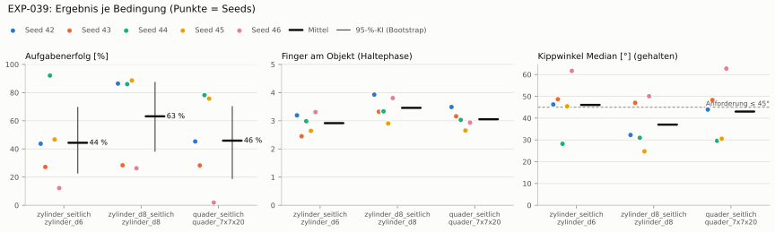
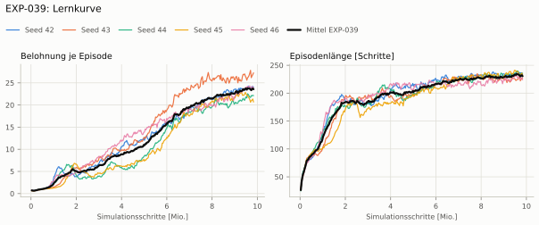
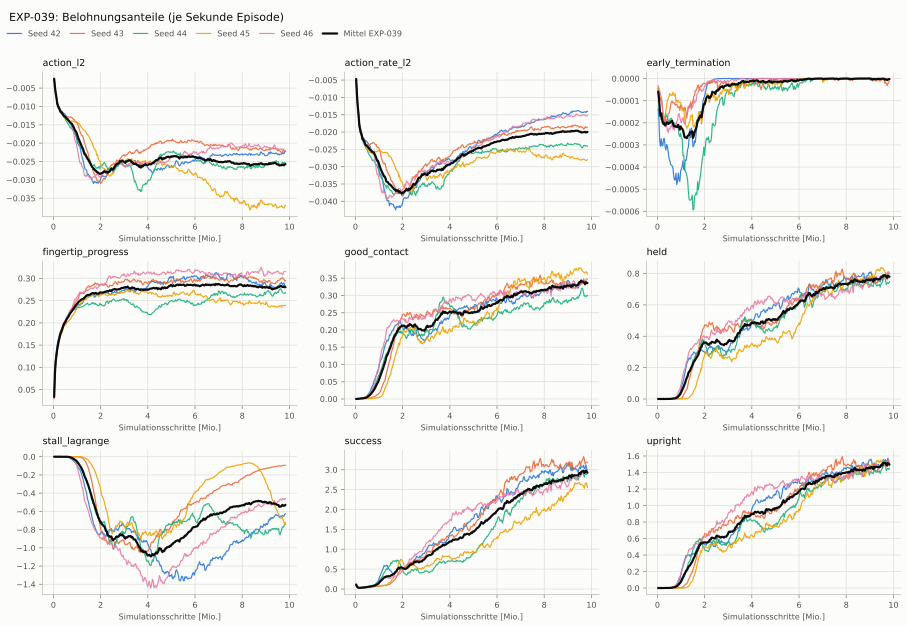
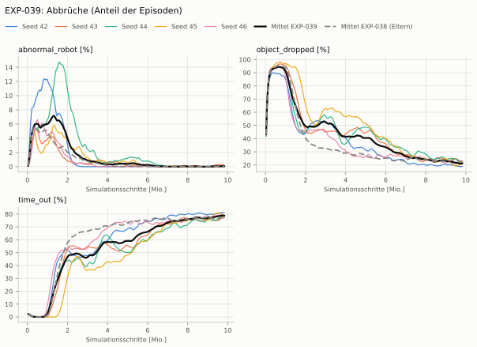
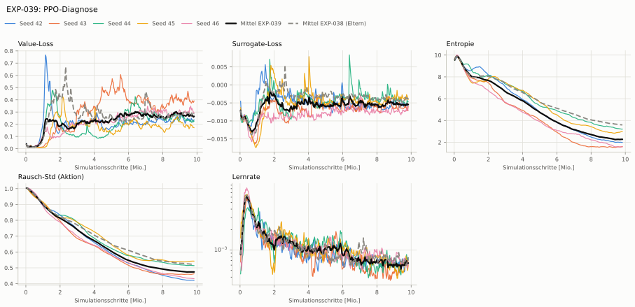

# EXP-039: Stall-Grenze je Servo (8 λ, jeder Servo ≤ 20 %)

**Leistung** 75 % [59–86 %] (erfolgreiche Seeds, IQM über die Objekte; je Objekt Ø 6 cm 47 % · Ø 8 cm 86 % · Quader 76 %) — ggü. EXP-038: P(besser) = 0.52 [0.33–0.78] → kein Unterschied

**Testobjekte** (nie trainiert, erfolgreiche Seeds, Median): Flasche 54 % · Saftpackung 86 % · Cracker (YCB) 81 % · Zucker (YCB) 92 % · Senf (YCB) 92 %

**Zuverlässigkeit** 3/5 Seeds erfolgreich [15–95 %] — EXP-038: 3/5, exakter Fisher-Test p = 1.00 → nicht unterscheidbar (für eine Aussage ≥ 10 Seeds je Experiment)

**Leitplanken** eingehalten

**Befund** ohne Erfolg: Seed 43 (hält, aber gekippt), Seed 46 (hält, aber gekippt); Engpass Ø 6 cm (47 %)

**Urteilsvorschlag** (auswertung-v2): **kein Unterschied**

**Beste Videos** (Seed 44, 3 Episoden): [Ø 6 cm](beste_videos/EXP-039_zylinder_d6_s44.mp4) · [Ø 8 cm](beste_videos/EXP-039_zylinder_d8_s44.mp4) · [Quader](beste_videos/EXP-039_quader_7x7x20_s44.mp4)

Ergebnisse je Bedingung (eval-v2, Leitplanken, Fehlerarten, Fingernutzung)

#### Bedingung `zylinder_seitlich`

Bedingung `zylinder_seitlich` (Objekt `zylinder_d6`, Kippwinkel ≤ 45°), Protokoll eval-v2, 5 Seed(s); Spalte EXP-038 unter derselben Anforderung

| Metrik | Mittel | 95-%-KI | IQM | Fehlschlag-Seeds (< 50 %) | EXP-038 (Mittel / IQM) |
|---|---|---|---|---|---|
| aufgabenerfolg | 44.4 % | 22.9 % – 69.5 % | 39.6 % | 80.0 % | 46.4 % / 47.0 % |
| haltequote | 94.1 % | 90.8 % – 97.0 % | 94.6 % | 0.0 % | 94.5 % / 95.1 % |
| Kippwinkel Median [°] | 46.1 | | | | 45.1 |
| Unterarm Median [°] | 52.4 | | | | 57.1 |
| Griffkraft Mittel [N] | 57.1 | | | | 65.7 |
| Kraft > 15 N [Anteil] | 88.7 % | | | | 100.0 % |
| Stall-Anteil [Anteil] | 57.4 % | | | | 89.1 % |
| Absinken [mm] | 0.00595 | | | | 0.000835 |
| Unruhe | 0.0543 | | | | 0.0566 |
| Unruhe wirksam (Aktion auf ±1 begrenzt) | 0.0391 | | | | 0.0358 |
| Objektweg Tischebene Ende [mm] | 132 | | | | 114 |

Fehlerarten: startfehler 0.0 %, gefallen 5.9 %, instabil 0.1 %, anforderung_verletzt 49.7 %

**Urteilsvorschlag: kein messbarer Unterschied** (gegenüber EXP-038)
Unterschied Aufgabenerfolg -1.8 Prozentpunkte (95-%-KI -37.3 … +45.8)

Je Seed: 43.6 %, 27.2 %, 92.1 %, 46.7 %, 12.2 %

Fingernutzung (Haltephase): im Mittel 2.92 Finger am Objekt; Kontaktanteil je Seed (Daumen, Zeige, Mittel, Ring, klein): 96/36/61/60/67 · 99/39/8/53/45 · 100/15/84/1/99 · 99/65/100/0/0 · 99/46/99/28/58

#### Bedingung `zylinder_d8_seitlich`

Bedingung `zylinder_d8_seitlich` (Objekt `zylinder_d8`, Kippwinkel ≤ 45°), Protokoll eval-v2, 5 Seed(s); Spalte EXP-038 unter derselben Anforderung

| Metrik | Mittel | 95-%-KI | IQM | Fehlschlag-Seeds (< 50 %) | EXP-038 (Mittel / IQM) |
|---|---|---|---|---|---|
| aufgabenerfolg | 63.1 % | 38.5 % – 87.3 % | 68.8 % | 40.0 % | 47.3 % / 49.7 % |
| haltequote | 88.1 % | 83.0 % – 92.1 % | 89.9 % | 0.0 % | 87.7 % / 89.7 % |
| Kippwinkel Median [°] | 37 | | | | 39.1 |
| Unterarm Median [°] | 44.2 | | | | 53.7 |
| Griffkraft Mittel [N] | 51.6 | | | | 61.3 |
| Kraft > 15 N [Anteil] | 78.6 % | | | | 99.7 % |
| Stall-Anteil [Anteil] | 48.4 % | | | | 88.2 % |
| Absinken [mm] | 0.0127 | | | | 0 |
| Unruhe | 0.0534 | | | | 0.0558 |
| Unruhe wirksam (Aktion auf ±1 begrenzt) | 0.0386 | | | | 0.0357 |
| Objektweg Tischebene Ende [mm] | 129 | | | | 120 |

Fehlerarten: startfehler 0.0 %, gefallen 11.9 %, instabil 0.0 %, anforderung_verletzt 25.0 %

**Urteilsvorschlag: kein messbarer Unterschied** (gegenüber EXP-038)
Unterschied Aufgabenerfolg +16.0 Prozentpunkte (95-%-KI -9.7 … +49.5)

Je Seed: 86.4 %, 28.4 %, 86.0 %, 88.6 %, 26.2 %

Fingernutzung (Haltephase): im Mittel 3.46 Finger am Objekt; Kontaktanteil je Seed (Daumen, Zeige, Mittel, Ring, klein): 99/92/99/5/97 · 98/67/18/69/80 · 100/75/59/0/100 · 100/96/94/0/0 · 100/92/97/28/65

#### Bedingung `quader_seitlich`

Bedingung `quader_seitlich` (Objekt `quader_7x7x20`, Kippwinkel ≤ 45°), Protokoll eval-v2, 5 Seed(s); Spalte EXP-038 unter derselben Anforderung

| Metrik | Mittel | 95-%-KI | IQM | Fehlschlag-Seeds (< 50 %) | EXP-038 (Mittel / IQM) |
|---|---|---|---|---|---|
| aufgabenerfolg | 45.9 % | 19.0 % – 70.0 % | 49.3 % | 60.0 % | 44.0 % / 47.1 % |
| haltequote | 79.2 % | 77.6 % – 80.8 % | 79.0 % | 0.0 % | 80.2 % / 79.3 % |
| Kippwinkel Median [°] | 43 | | | | 45.2 |
| Unterarm Median [°] | 46.7 | | | | 54.3 |
| Griffkraft Mittel [N] | 44.3 | | | | 57.7 |
| Kraft > 15 N [Anteil] | 87.4 % | | | | 99.7 % |
| Stall-Anteil [Anteil] | 44.2 % | | | | 87.5 % |
| Absinken [mm] | 6.18e-05 | | | | 0.00105 |
| Unruhe | 0.0552 | | | | 0.0674 |
| Unruhe wirksam (Aktion auf ±1 begrenzt) | 0.0409 | | | | 0.0462 |
| Objektweg Tischebene Ende [mm] | 142 | | | | 120 |

Fehlerarten: startfehler 0.0 %, gefallen 20.8 %, instabil 0.0 %, anforderung_verletzt 33.3 %

**Urteilsvorschlag: kein messbarer Unterschied** (gegenüber EXP-038)
Unterschied Aufgabenerfolg +1.9 Prozentpunkte (95-%-KI -25.3 … +37.9)
- Leitplanke: Objektweg Tischebene Ende [mm]: 142 > 140

Je Seed: 45.3 %, 28.3 %, 78.2 %, 75.7 %, 1.9 %

Fingernutzung (Haltephase): im Mittel 3.05 Finger am Objekt; Kontaktanteil je Seed (Daumen, Zeige, Mittel, Ring, klein): 100/78/99/8/64 · 100/34/6/93/83 · 100/84/20/0/99 · 100/68/97/0/0 · 100/66/99/4/25

#### Bedingung `flasche_seitlich`

Bedingung `flasche_seitlich` (Objekt `flasche_d7x25`, Kippwinkel ≤ 45°), Protokoll eval-v2, 5 Seed(s); Spalte EXP-038 unter derselben Anforderung

| Metrik | Mittel | 95-%-KI | IQM | Fehlschlag-Seeds (< 50 %) | EXP-038 (Mittel / IQM) |
|---|---|---|---|---|---|
| aufgabenerfolg | 44.3 % | 26.3 % – 65.7 % | 38.4 % | 60.0 % | 38.6 % / 38.2 % |
| haltequote | 84.4 % | 72.2 % – 92.4 % | 89.9 % | 0.0 % | 83.4 % / 82.2 % |
| Kippwinkel Median [°] | 43.3 | | | | 45.9 |
| Unterarm Median [°] | 48.1 | | | | 55.4 |
| Griffkraft Mittel [N] | 53 | | | | 61.4 |
| Kraft > 15 N [Anteil] | 86.4 % | | | | 100.0 % |
| Stall-Anteil [Anteil] | 48.5 % | | | | 87.8 % |
| Absinken [mm] | 0.00167 | | | | 0.0142 |
| Unruhe | 0.054 | | | | 0.0564 |
| Unruhe wirksam (Aktion auf ±1 begrenzt) | 0.039 | | | | 0.0358 |
| Objektweg Tischebene Ende [mm] | 131 | | | | 116 |

Fehlerarten: startfehler 0.0 %, gefallen 15.6 %, instabil 0.0 %, anforderung_verletzt 40.1 %

**Urteilsvorschlag: kein messbarer Unterschied** (gegenüber EXP-038)
Unterschied Aufgabenerfolg +5.8 Prozentpunkte (95-%-KI -24.5 … +45.5)

Je Seed: 37.1 %, 21.7 %, 83.9 %, 54.0 %, 24.6 %

Fingernutzung (Haltephase): im Mittel 3.12 Finger am Objekt; Kontaktanteil je Seed (Daumen, Zeige, Mittel, Ring, klein): 100/87/97/7/54 · 100/61/1/82/50 · 100/53/50/0/100 · 100/60/99/0/0 · 100/71/99/21/70

#### Bedingung `saftpackung_seitlich`

Bedingung `saftpackung_seitlich` (Objekt `saftpackung_9x6x19`, Kippwinkel ≤ 45°), Protokoll eval-v2, 5 Seed(s); Spalte EXP-038 unter derselben Anforderung

| Metrik | Mittel | 95-%-KI | IQM | Fehlschlag-Seeds (< 50 %) | EXP-038 (Mittel / IQM) |
|---|---|---|---|---|---|
| aufgabenerfolg | 45.9 % | 13.3 % – 77.4 % | 45.9 % | 60.0 % | 44.5 % / 43.9 % |
| haltequote | 85.3 % | 80.4 % – 89.9 % | 85.6 % | 0.0 % | 87.5 % / 89.2 % |
| Kippwinkel Median [°] | 44.7 | | | | 46.4 |
| Unterarm Median [°] | 50 | | | | 55.9 |
| Griffkraft Mittel [N] | 47.2 | | | | 59.4 |
| Kraft > 15 N [Anteil] | 90.9 % | | | | 99.9 % |
| Stall-Anteil [Anteil] | 47.3 % | | | | 88.5 % |
| Absinken [mm] | 0.0013 | | | | 0 |
| Unruhe | 0.0546 | | | | 0.0612 |
| Unruhe wirksam (Aktion auf ±1 begrenzt) | 0.0399 | | | | 0.0404 |
| Objektweg Tischebene Ende [mm] | 154 | | | | 129 |

Fehlerarten: startfehler 0.0 %, gefallen 14.7 %, instabil 0.0 %, anforderung_verletzt 39.4 %

**Urteilsvorschlag: kein messbarer Unterschied** (gegenüber EXP-038)
Unterschied Aufgabenerfolg +1.4 Prozentpunkte (95-%-KI -32.8 … +39.1)
- Leitplanke: Objektweg Tischebene Ende [mm]: 154 > 149

Je Seed: 42.1 %, 11.1 %, 89.0 %, 85.9 %, 1.6 %

Fingernutzung (Haltephase): im Mittel 3.07 Finger am Objekt; Kontaktanteil je Seed (Daumen, Zeige, Mittel, Ring, klein): 100/66/88/33/80 · 100/16/0/98/73 · 100/57/43/1/99 · 100/78/100/0/0 · 100/65/100/6/34

#### Bedingung `ycb_cracker_seitlich`

Bedingung `ycb_cracker_seitlich` (Objekt `ycb_003_cracker`, Kippwinkel ≤ 45°), Protokoll eval-v2, 5 Seed(s); Spalte EXP-038 unter derselben Anforderung

| Metrik | Mittel | 95-%-KI | IQM | Fehlschlag-Seeds (< 50 %) | EXP-038 (Mittel / IQM) |
|---|---|---|---|---|---|
| aufgabenerfolg | 65.0 % | 45.4 % – 80.3 % | 72.3 % | 20.0 % | 45.6 % / 47.5 % |
| haltequote | 76.6 % | 72.6 % – 80.2 % | 77.0 % | 0.0 % | 78.5 % / 79.0 % |
| Kippwinkel Median [°] | 29.7 | | | | 34.1 |
| Unterarm Median [°] | 47.4 | | | | 53.5 |
| Griffkraft Mittel [N] | 55.3 | | | | 60 |
| Kraft > 15 N [Anteil] | 91.2 % | | | | 100.0 % |
| Stall-Anteil [Anteil] | 59.0 % | | | | 85.9 % |
| Absinken [mm] | 0 | | | | 0 |
| Unruhe | 0.0534 | | | | 0.0577 |
| Unruhe wirksam (Aktion auf ±1 begrenzt) | 0.0393 | | | | 0.0369 |
| Objektweg Tischebene Ende [mm] | 173 | | | | 153 |

Fehlerarten: startfehler 0.0 %, gefallen 23.4 %, instabil 0.0 %, anforderung_verletzt 11.5 %

**Urteilsvorschlag: kein messbarer Unterschied** (gegenüber EXP-038)
Unterschied Aufgabenerfolg +19.8 Prozentpunkte (95-%-KI -1.7 … +41.1)
- Leitplanke: Objektweg Tischebene Ende [mm]: 173 > 173

Je Seed: 80.9 %, 29.4 %, 77.9 %, 80.6 %, 56.4 %

Fingernutzung (Haltephase): im Mittel 3.25 Finger am Objekt; Kontaktanteil je Seed (Daumen, Zeige, Mittel, Ring, klein): 100/40/94/57/78 · 100/9/0/100/69 · 100/76/23/1/99 · 100/97/94/0/0 · 100/66/81/51/87

#### Bedingung `ycb_zucker_seitlich`

Bedingung `ycb_zucker_seitlich` (Objekt `ycb_004_zucker`, Kippwinkel ≤ 45°), Protokoll eval-v2, 5 Seed(s); Spalte EXP-038 unter derselben Anforderung

| Metrik | Mittel | 95-%-KI | IQM | Fehlschlag-Seeds (< 50 %) | EXP-038 (Mittel / IQM) |
|---|---|---|---|---|---|
| aufgabenerfolg | 59.1 % | 27.2 % – 91.3 % | 64.7 % | 40.0 % | 54.1 % / 51.1 % |
| haltequote | 81.7 % | 57.9 % – 97.1 % | 91.1 % | 20.0 % | 91.0 % / 97.7 % |
| Kippwinkel Median [°] | 36.3 | | | | 34.4 |
| Unterarm Median [°] | 53.6 | | | | 57.1 |
| Griffkraft Mittel [N] | 47 | | | | 65.4 |
| Kraft > 15 N [Anteil] | 89.6 % | | | | 99.7 % |
| Stall-Anteil [Anteil] | 59.5 % | | | | 87.2 % |
| Absinken [mm] | 0.133 | | | | 0.0303 |
| Unruhe | 0.0508 | | | | 0.0538 |
| Unruhe wirksam (Aktion auf ±1 begrenzt) | 0.0361 | | | | 0.0335 |
| Objektweg Tischebene Ende [mm] | 157 | | | | 130 |

Fehlerarten: startfehler 0.0 %, gefallen 18.3 %, instabil 0.0 %, anforderung_verletzt 22.6 %

**Urteilsvorschlag: kein messbarer Unterschied** (gegenüber EXP-038)
Unterschied Aufgabenerfolg +5.0 Prozentpunkte (95-%-KI -25.7 … +37.0)
- Leitplanke: Objektweg Tischebene Ende [mm]: 157 > 150

Je Seed: 91.9 %, 11.2 %, 81.1 %, 95.6 %, 15.5 %

Fingernutzung (Haltephase): im Mittel 2.61 Finger am Objekt; Kontaktanteil je Seed (Daumen, Zeige, Mittel, Ring, klein): 100/14/48/49/85 · 100/14/4/98/5 · 100/11/96/0/98 · 100/84/100/0/0 · 100/0/100/0/0

#### Bedingung `ycb_senf_seitlich`

Bedingung `ycb_senf_seitlich` (Objekt `ycb_006_senf`, Kippwinkel ≤ 45°), Protokoll eval-v2, 5 Seed(s); Spalte EXP-038 unter derselben Anforderung

| Metrik | Mittel | 95-%-KI | IQM | Fehlschlag-Seeds (< 50 %) | EXP-038 (Mittel / IQM) |
|---|---|---|---|---|---|
| aufgabenerfolg | 61.6 % | 31.2 % – 91.7 % | 68.5 % | 40.0 % | 42.9 % / 40.1 % |
| haltequote | 85.7 % | 75.8 % – 94.2 % | 87.3 % | 0.0 % | 87.3 % / 94.5 % |
| Kippwinkel Median [°] | 37.5 | | | | 38.3 |
| Unterarm Median [°] | 53.4 | | | | 57.7 |
| Griffkraft Mittel [N] | 54.1 | | | | 64.8 |
| Kraft > 15 N [Anteil] | 95.3 % | | | | 99.9 % |
| Stall-Anteil [Anteil] | 63.4 % | | | | 88.1 % |
| Absinken [mm] | 0.0163 | | | | 0.00687 |
| Unruhe | 0.0537 | | | | 0.0538 |
| Unruhe wirksam (Aktion auf ±1 begrenzt) | 0.0382 | | | | 0.0335 |
| Objektweg Tischebene Ende [mm] | 154 | | | | 127 |

Fehlerarten: startfehler 0.0 %, gefallen 14.3 %, instabil 0.0 %, anforderung_verletzt 24.1 %

**Urteilsvorschlag: kein messbarer Unterschied** (gegenüber EXP-038)
Unterschied Aufgabenerfolg +18.9 Prozentpunkte (95-%-KI -11.3 … +54.7)
- Leitplanke: Objektweg Tischebene Ende [mm]: 154 > 147

Je Seed: 94.0 %, 20.5 %, 92.1 %, 86.7 %, 14.9 %

Fingernutzung (Haltephase): im Mittel 2.86 Finger am Objekt; Kontaktanteil je Seed (Daumen, Zeige, Mittel, Ring, klein): 98/8/31/79/99 · 99/53/20/61/28 · 100/10/87/2/99 · 100/90/100/0/0 · 100/41/79/6/41

Trainingsverlauf

Seeds dünn, Mittel kräftig, Eltern gestrichelt (nur Abbrüche/PPO — Trainings-Belohnung ist zwischen Experimenten nicht vergleichbar); geglättet, x = Simulationsschritte. Endwerte = Mittel der letzten 10 Iterationen (Belohnungsanteile je Sekunde Episode).

| Größe | Seed 42 | Seed 43 | Seed 44 | Seed 45 | Seed 46 | Mittel |
|---|---|---|---|---|---|---|
| mean_reward | 24 | 26.9 | 22.1 | 20.9 | 23.9 | 23.6 |
| action_l2 | -0.0226 | -0.0222 | -0.0256 | -0.0372 | -0.0219 | -0.0259 |
| action_rate_l2 | -0.0142 | -0.0187 | -0.0242 | -0.028 | -0.0152 | -0.0201 |
| early_termination | 0 | -1.71e-05 | 0 | 0 | -1.45e-06 | -3.71e-06 |
| fingertip_progress | 0.287 | 0.298 | 0.27 | 0.239 | 0.312 | 0.281 |
| good_contact | 0.337 | 0.336 | 0.306 | 0.366 | 0.342 | 0.337 |
| held | 0.785 | 0.775 | 0.756 | 0.803 | 0.794 | 0.783 |
| stall_lagrange | -0.644 | -0.0964 | -0.776 | -0.712 | -0.462 | -0.538 |
| success | 3.04 | 3.2 | 2.92 | 2.59 | 2.98 | 2.95 |
| upright | 1.54 | 1.5 | 1.47 | 1.49 | 1.52 | 1.51 |
| object_dropped | 18.9 % | 23.1 % | 21.7 % | 20.5 % | 21.8 % | 21.2 % |
| mean_noise_std | 0.421 | 0.461 | 0.515 | 0.543 | 0.432 | 0.474 |

Netz, Training und Konfiguration

Actor [256, 128, 64] (elu), 68808 Parameter, 105 Eingänge (Verlauf 5) · Critic [512, 256, 128] · PPO: Lernrate 0.001, Entropie 0.005, 5 Epochen × 4 Mini-Batches, 32 Schritte/Umgebung · 1024 Umgebungen × 300 Iterationen

Geplante Änderung: Ein λ je Servo (8) statt eines λ auf den Mittelwert; jeder Servo ≤ 20 %, Strafe (1/8)·Σ λ_i·c_i (Task HeavyMultiProgressDexCapsLagrangeJeServo-v0).

Konfiguration gegenüber EXP-038 (1 Unterschiede):

- `env.rewards.stall_lagrange.params.per_joint: ∅ → True`

