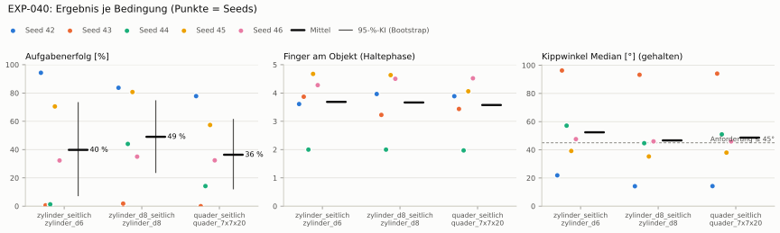
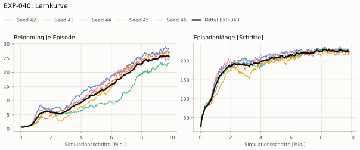
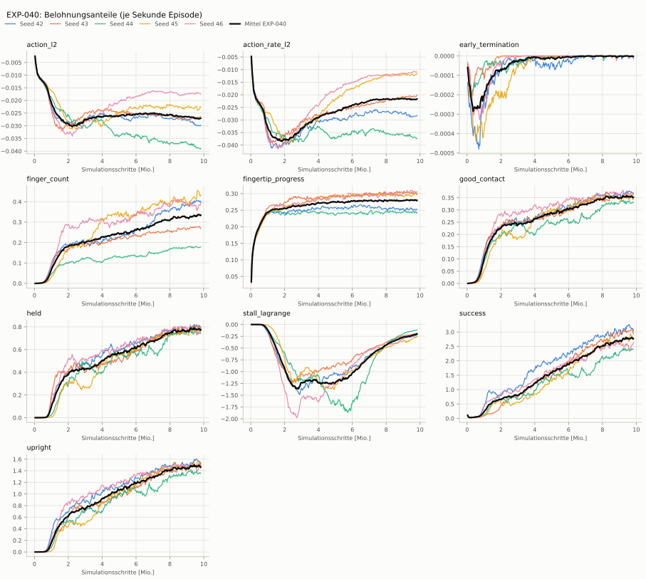
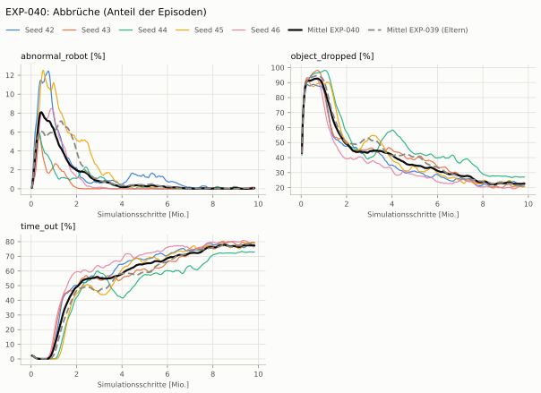
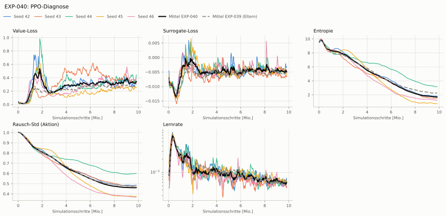

# EXP-040: Grenze je Servo + Belohnung nach Fingerzahl

**Leistung** 79 % [70–85 %] (erfolgreiche Seeds, IQM über die Objekte; je Objekt Ø 6 cm 82 % · Ø 8 cm 82 % · Quader 68 %) — ggü. EXP-039: P(besser) = 0.44 [0.22–0.67] → kein Unterschied

**Testobjekte** (nie trainiert, erfolgreiche Seeds, Median): Flasche 89 % · Saftpackung 64 % · Cracker (YCB) 72 % · Zucker (YCB) 77 % · Senf (YCB) 76 %

**Zuverlässigkeit** 2/5 Seeds erfolgreich [5–85 %] — EXP-039: 3/5, exakter Fisher-Test p = 1.00 → nicht unterscheidbar (für eine Aussage ≥ 10 Seeds je Experiment)

**Leitplanken** Kippwinkel Median [°]: 52.4 > 51.1 ✗

**Befund** ohne Erfolg: Seed 43 (hält, aber gekippt), Seed 44 (hält, aber gekippt), Seed 46 (hält, aber gekippt); Engpass Quader (68 %); Finger am Objekt 3.7 (EXP-039: 2.9)

**Urteilsvorschlag** (auswertung-v2): **kein Unterschied, Leitplanke verletzt**

**Beste Videos** (Seed 42, 3 Episoden): [Ø 6 cm](beste_videos/EXP-040_zylinder_d6_s42.mp4) · [Ø 8 cm](beste_videos/EXP-040_zylinder_d8_s42.mp4) · [Quader](beste_videos/EXP-040_quader_7x7x20_s42.mp4)

Ergebnisse je Bedingung (eval-v2, Leitplanken, Fehlerarten, Fingernutzung)

#### Bedingung `zylinder_seitlich`

Bedingung `zylinder_seitlich` (Objekt `zylinder_d6`, Kippwinkel ≤ 45°), Protokoll eval-v2, 5 Seed(s); Spalte EXP-039 unter derselben Anforderung

| Metrik | Mittel | 95-%-KI | IQM | Fehlschlag-Seeds (< 50 %) | EXP-039 (Mittel / IQM) |
|---|---|---|---|---|---|
| aufgabenerfolg | 39.8 % | 7.4 % – 73.2 % | 34.5 % | 60.0 % | 44.4 % / 39.6 % |
| haltequote | 93.8 % | 90.5 % – 96.2 % | 94.8 % | 0.0 % | 94.1 % / 94.6 % |
| Kippwinkel Median [°] | 52.4 | | | | 46.1 |
| Unterarm Median [°] | 53.2 | | | | 52.4 |
| Griffkraft Mittel [N] | 58.2 | | | | 57.1 |
| Kraft > 15 N [Anteil] | 83.9 % | | | | 88.7 % |
| Stall-Anteil [Anteil] | 57.0 % | | | | 57.4 % |
| Absinken [mm] | 0.00463 | | | | 0.00595 |
| Unruhe | 0.0573 | | | | 0.0543 |
| Unruhe wirksam (Aktion auf ±1 begrenzt) | 0.0363 | | | | 0.0391 |
| Objektweg Tischebene Ende [mm] | 121 | | | | 132 |

Fehlerarten: startfehler 0.0 %, gefallen 6.2 %, instabil 0.0 %, anforderung_verletzt 54.0 %

**Urteilsvorschlag: kein messbarer Unterschied** (gegenüber EXP-039)
Unterschied Aufgabenerfolg -4.3 Prozentpunkte (95-%-KI -46.8 … +34.1)
- Leitplanke: Kippwinkel Median [°]: 52.4 > 51.1

Je Seed: 94.3 %, 0.6 %, 1.3 %, 70.5 %, 32.3 %

Fingernutzung (Haltephase): im Mittel 3.69 Finger am Objekt; Kontaktanteil je Seed (Daumen, Zeige, Mittel, Ring, klein): 100/82/83/97/0 · 99/67/81/67/72 · 100/100/0/0/0 · 99/91/96/91/90 · 100/52/89/97/90

#### Bedingung `zylinder_d8_seitlich`

Bedingung `zylinder_d8_seitlich` (Objekt `zylinder_d8`, Kippwinkel ≤ 45°), Protokoll eval-v2, 5 Seed(s); Spalte EXP-039 unter derselben Anforderung

| Metrik | Mittel | 95-%-KI | IQM | Fehlschlag-Seeds (< 50 %) | EXP-039 (Mittel / IQM) |
|---|---|---|---|---|---|
| aufgabenerfolg | 49.0 % | 23.8 % – 74.5 % | 52.3 % | 60.0 % | 63.1 % / 68.8 % |
| haltequote | 83.7 % | 81.2 % – 86.2 % | 83.5 % | 0.0 % | 88.1 % / 89.9 % |
| Kippwinkel Median [°] | 46.7 | | | | 37 |
| Unterarm Median [°] | 51.9 | | | | 44.2 |
| Griffkraft Mittel [N] | 50.8 | | | | 51.6 |
| Kraft > 15 N [Anteil] | 74.1 % | | | | 78.6 % |
| Stall-Anteil [Anteil] | 58.7 % | | | | 48.4 % |
| Absinken [mm] | 0.0123 | | | | 0.0127 |
| Unruhe | 0.0585 | | | | 0.0534 |
| Unruhe wirksam (Aktion auf ±1 begrenzt) | 0.0375 | | | | 0.0386 |
| Objektweg Tischebene Ende [mm] | 128 | | | | 129 |

Fehlerarten: startfehler 0.0 %, gefallen 16.3 %, instabil 0.0 %, anforderung_verletzt 34.6 %

**Urteilsvorschlag: kein messbarer Unterschied** (gegenüber EXP-039)
Unterschied Aufgabenerfolg -13.9 Prozentpunkte (95-%-KI -28.9 … +1.1)
- Leitplanke: Kippwinkel Median [°]: 46.7 > 42
- Leitplanke: Stall-Anteil [Anteil]: 0.587 > 0.534

Je Seed: 83.7 %, 1.8 %, 44.0 %, 80.7 %, 35.0 %

Fingernutzung (Haltephase): im Mittel 3.67 Finger am Objekt; Kontaktanteil je Seed (Daumen, Zeige, Mittel, Ring, klein): 100/99/99/99/0 · 97/43/65/44/73 · 100/100/0/0/0 · 100/99/100/98/67 · 99/89/75/92/95

#### Bedingung `quader_seitlich`

Bedingung `quader_seitlich` (Objekt `quader_7x7x20`, Kippwinkel ≤ 45°), Protokoll eval-v2, 5 Seed(s); Spalte EXP-039 unter derselben Anforderung

| Metrik | Mittel | 95-%-KI | IQM | Fehlschlag-Seeds (< 50 %) | EXP-039 (Mittel / IQM) |
|---|---|---|---|---|---|
| aufgabenerfolg | 36.4 % | 12.3 % – 61.3 % | 34.4 % | 60.0 % | 45.9 % / 49.3 % |
| haltequote | 76.6 % | 74.0 % – 79.3 % | 76.7 % | 0.0 % | 79.2 % / 79.0 % |
| Kippwinkel Median [°] | 48.6 | | | | 43 |
| Unterarm Median [°] | 51.6 | | | | 46.7 |
| Griffkraft Mittel [N] | 45 | | | | 44.3 |
| Kraft > 15 N [Anteil] | 68.2 % | | | | 87.4 % |
| Stall-Anteil [Anteil] | 50.0 % | | | | 44.2 % |
| Absinken [mm] | 0 | | | | 6.18e-05 |
| Unruhe | 0.057 | | | | 0.0552 |
| Unruhe wirksam (Aktion auf ±1 begrenzt) | 0.0365 | | | | 0.0409 |
| Objektweg Tischebene Ende [mm] | 126 | | | | 142 |

Fehlerarten: startfehler 0.0 %, gefallen 23.4 %, instabil 0.0 %, anforderung_verletzt 40.2 %

**Urteilsvorschlag: kein messbarer Unterschied** (gegenüber EXP-039)
Unterschied Aufgabenerfolg -9.1 Prozentpunkte (95-%-KI -38.4 … +21.5)
- Leitplanke: Kippwinkel Median [°]: 48.6 > 48
- Leitplanke: Stall-Anteil [Anteil]: 0.5 > 0.492

Je Seed: 77.8 %, 0.0 %, 14.2 %, 57.4 %, 32.4 %

Fingernutzung (Haltephase): im Mittel 3.58 Finger am Objekt; Kontaktanteil je Seed (Daumen, Zeige, Mittel, Ring, klein): 100/93/99/97/0 · 100/38/66/42/97 · 100/98/0/0/0 · 98/83/100/47/78 · 100/98/68/93/94

#### Bedingung `flasche_seitlich`

Bedingung `flasche_seitlich` (Objekt `flasche_d7x25`, Kippwinkel ≤ 45°), Protokoll eval-v2, 5 Seed(s); Spalte EXP-039 unter derselben Anforderung

| Metrik | Mittel | 95-%-KI | IQM | Fehlschlag-Seeds (< 50 %) | EXP-039 (Mittel / IQM) |
|---|---|---|---|---|---|
| aufgabenerfolg | 47.9 % | 12.5 % – 83.7 % | 49.9 % | 40.0 % | 44.3 % / 38.4 % |
| haltequote | 85.1 % | 79.3 % – 90.7 % | 85.9 % | 0.0 % | 84.4 % / 89.9 % |
| Kippwinkel Median [°] | 55.1 | | | | 43.3 |
| Unterarm Median [°] | 51.9 | | | | 48.1 |
| Griffkraft Mittel [N] | 51.6 | | | | 53 |
| Kraft > 15 N [Anteil] | 78.4 % | | | | 86.4 % |
| Stall-Anteil [Anteil] | 53.0 % | | | | 48.5 % |
| Absinken [mm] | 0.00571 | | | | 0.00167 |
| Unruhe | 0.0597 | | | | 0.054 |
| Unruhe wirksam (Aktion auf ±1 begrenzt) | 0.0385 | | | | 0.039 |
| Objektweg Tischebene Ende [mm] | 125 | | | | 131 |

Fehlerarten: startfehler 0.0 %, gefallen 14.9 %, instabil 0.0 %, anforderung_verletzt 37.2 %

**Urteilsvorschlag: kein messbarer Unterschied** (gegenüber EXP-039)
Unterschied Aufgabenerfolg +4.0 Prozentpunkte (95-%-KI -37.7 … +42.8)
- Leitplanke: Kippwinkel Median [°]: 55.1 > 48.3

Je Seed: 92.5 %, 0.6 %, 0.7 %, 86.3 %, 59.5 %

Fingernutzung (Haltephase): im Mittel 3.67 Finger am Objekt; Kontaktanteil je Seed (Daumen, Zeige, Mittel, Ring, klein): 100/96/97/98/0 · 100/46/56/42/84 · 95/98/0/0/0 · 100/95/100/96/94 · 100/75/83/91/89

#### Bedingung `saftpackung_seitlich`

Bedingung `saftpackung_seitlich` (Objekt `saftpackung_9x6x19`, Kippwinkel ≤ 45°), Protokoll eval-v2, 5 Seed(s); Spalte EXP-039 unter derselben Anforderung

| Metrik | Mittel | 95-%-KI | IQM | Fehlschlag-Seeds (< 50 %) | EXP-039 (Mittel / IQM) |
|---|---|---|---|---|---|
| aufgabenerfolg | 31.5 % | 7.2 % – 58.3 % | 25.9 % | 80.0 % | 45.9 % / 45.9 % |
| haltequote | 81.4 % | 77.7 % – 85.6 % | 80.4 % | 0.0 % | 85.3 % / 85.6 % |
| Kippwinkel Median [°] | 52 | | | | 44.7 |
| Unterarm Median [°] | 53.8 | | | | 50 |
| Griffkraft Mittel [N] | 45.5 | | | | 47.2 |
| Kraft > 15 N [Anteil] | 78.8 % | | | | 90.9 % |
| Stall-Anteil [Anteil] | 49.5 % | | | | 47.3 % |
| Absinken [mm] | 0.0125 | | | | 0.0013 |
| Unruhe | 0.0573 | | | | 0.0546 |
| Unruhe wirksam (Aktion auf ±1 begrenzt) | 0.0366 | | | | 0.0399 |
| Objektweg Tischebene Ende [mm] | 139 | | | | 154 |

Fehlerarten: startfehler 0.0 %, gefallen 18.6 %, instabil 0.0 %, anforderung_verletzt 49.8 %

**Urteilsvorschlag: kein messbarer Unterschied** (gegenüber EXP-039)
Unterschied Aufgabenerfolg -14.0 Prozentpunkte (95-%-KI -52.0 … +22.8)
- Leitplanke: Kippwinkel Median [°]: 52 > 49.7

Je Seed: 79.8 %, 0.0 %, 4.2 %, 47.6 %, 25.9 %

Fingernutzung (Haltephase): im Mittel 3.50 Finger am Objekt; Kontaktanteil je Seed (Daumen, Zeige, Mittel, Ring, klein): 100/99/99/96/0 · 99/13/75/15/98 · 97/99/0/0/0 · 95/96/99/67/62 · 100/97/72/97/76

#### Bedingung `ycb_cracker_seitlich`

Bedingung `ycb_cracker_seitlich` (Objekt `ycb_003_cracker`, Kippwinkel ≤ 45°), Protokoll eval-v2, 5 Seed(s); Spalte EXP-039 unter derselben Anforderung

| Metrik | Mittel | 95-%-KI | IQM | Fehlschlag-Seeds (< 50 %) | EXP-039 (Mittel / IQM) |
|---|---|---|---|---|---|
| aufgabenerfolg | 50.1 % | 22.9 % – 72.8 % | 59.0 % | 40.0 % | 65.0 % / 72.3 % |
| haltequote | 76.1 % | 71.3 % – 80.7 % | 76.4 % | 0.0 % | 76.6 % / 77.0 % |
| Kippwinkel Median [°] | 33.7 | | | | 29.7 |
| Unterarm Median [°] | 47.9 | | | | 47.4 |
| Griffkraft Mittel [N] | 51.8 | | | | 55.3 |
| Kraft > 15 N [Anteil] | 88.0 % | | | | 91.2 % |
| Stall-Anteil [Anteil] | 56.1 % | | | | 59.0 % |
| Absinken [mm] | 0.0538 | | | | 0 |
| Unruhe | 0.0536 | | | | 0.0534 |
| Unruhe wirksam (Aktion auf ±1 begrenzt) | 0.034 | | | | 0.0393 |
| Objektweg Tischebene Ende [mm] | 164 | | | | 173 |

Fehlerarten: startfehler 0.0 %, gefallen 23.9 %, instabil 0.0 %, anforderung_verletzt 26.0 %

**Urteilsvorschlag: kein messbarer Unterschied** (gegenüber EXP-039)
Unterschied Aufgabenerfolg -14.7 Prozentpunkte (95-%-KI -31.2 … +3.7)

Je Seed: 75.6 %, 1.1 %, 33.4 %, 68.4 %, 72.0 %

Fingernutzung (Haltephase): im Mittel 3.74 Finger am Objekt; Kontaktanteil je Seed (Daumen, Zeige, Mittel, Ring, klein): 100/99/100/100/0 · 100/70/93/72/93 · 98/100/0/0/0 · 100/82/100/75/100 · 99/64/39/85/99

#### Bedingung `ycb_zucker_seitlich`

Bedingung `ycb_zucker_seitlich` (Objekt `ycb_004_zucker`, Kippwinkel ≤ 45°), Protokoll eval-v2, 5 Seed(s); Spalte EXP-039 unter derselben Anforderung

| Metrik | Mittel | 95-%-KI | IQM | Fehlschlag-Seeds (< 50 %) | EXP-039 (Mittel / IQM) |
|---|---|---|---|---|---|
| aufgabenerfolg | 46.7 % | 17.1 % – 76.0 % | 53.7 % | 40.0 % | 59.1 % / 64.7 % |
| haltequote | 85.1 % | 76.4 % – 93.7 % | 85.0 % | 0.0 % | 81.7 % / 91.1 % |
| Kippwinkel Median [°] | 38.3 | | | | 36.3 |
| Unterarm Median [°] | 53.4 | | | | 53.6 |
| Griffkraft Mittel [N] | 58.3 | | | | 47 |
| Kraft > 15 N [Anteil] | 95.7 % | | | | 89.6 % |
| Stall-Anteil [Anteil] | 65.8 % | | | | 59.5 % |
| Absinken [mm] | 0.0058 | | | | 0.133 |
| Unruhe | 0.0536 | | | | 0.0508 |
| Unruhe wirksam (Aktion auf ±1 begrenzt) | 0.0337 | | | | 0.0361 |
| Objektweg Tischebene Ende [mm] | 141 | | | | 157 |

Fehlerarten: startfehler 0.0 %, gefallen 14.9 %, instabil 0.0 %, anforderung_verletzt 38.4 %

**Urteilsvorschlag: kein messbarer Unterschied** (gegenüber EXP-039)
Unterschied Aufgabenerfolg -12.0 Prozentpunkte (95-%-KI -52.3 … +29.0)
- Leitplanke: Griffkraft Mittel [N]: 58.3 > 56.4
- Leitplanke: Kraft > 15 N [Anteil]: 0.957 > 0.946
- Leitplanke: Stall-Anteil [Anteil]: 0.658 > 0.645

Je Seed: 78.6 %, 6.7 %, 0.1 %, 75.1 %, 72.8 %

Fingernutzung (Haltephase): im Mittel 3.50 Finger am Objekt; Kontaktanteil je Seed (Daumen, Zeige, Mittel, Ring, klein): 100/55/53/99/0 · 99/28/87/52/89 · 99/100/0/0/0 · 100/66/96/91/100 · 100/62/87/88/99

#### Bedingung `ycb_senf_seitlich`

Bedingung `ycb_senf_seitlich` (Objekt `ycb_006_senf`, Kippwinkel ≤ 45°), Protokoll eval-v2, 5 Seed(s); Spalte EXP-039 unter derselben Anforderung

| Metrik | Mittel | 95-%-KI | IQM | Fehlschlag-Seeds (< 50 %) | EXP-039 (Mittel / IQM) |
|---|---|---|---|---|---|
| aufgabenerfolg | 45.6 % | 16.8 % – 74.7 % | 51.1 % | 40.0 % | 61.6 % / 68.5 % |
| haltequote | 83.8 % | 74.7 % – 92.6 % | 84.7 % | 0.0 % | 85.7 % / 87.3 % |
| Kippwinkel Median [°] | 39 | | | | 37.5 |
| Unterarm Median [°] | 51.8 | | | | 53.4 |
| Griffkraft Mittel [N] | 57.1 | | | | 54.1 |
| Kraft > 15 N [Anteil] | 94.9 % | | | | 95.3 % |
| Stall-Anteil [Anteil] | 65.8 % | | | | 63.4 % |
| Absinken [mm] | 0.0951 | | | | 0.0163 |
| Unruhe | 0.0528 | | | | 0.0537 |
| Unruhe wirksam (Aktion auf ±1 begrenzt) | 0.0334 | | | | 0.0382 |
| Objektweg Tischebene Ende [mm] | 138 | | | | 154 |

Fehlerarten: startfehler 0.0 %, gefallen 16.2 %, instabil 0.0 %, anforderung_verletzt 38.2 %

**Urteilsvorschlag: kein messbarer Unterschied** (gegenüber EXP-039)
Unterschied Aufgabenerfolg -15.7 Prozentpunkte (95-%-KI -59.7 … +26.8)

Je Seed: 79.3 %, 5.3 %, 1.7 %, 72.2 %, 69.6 %

Fingernutzung (Haltephase): im Mittel 3.57 Finger am Objekt; Kontaktanteil je Seed (Daumen, Zeige, Mittel, Ring, klein): 100/61/61/100/0 · 100/83/83/67/85 · 99/100/0/0/0 · 100/52/97/82/100 · 100/53/85/83/94

Trainingsverlauf

Seeds dünn, Mittel kräftig, Eltern gestrichelt (nur Abbrüche/PPO — Trainings-Belohnung ist zwischen Experimenten nicht vergleichbar); geglättet, x = Simulationsschritte. Endwerte = Mittel der letzten 10 Iterationen (Belohnungsanteile je Sekunde Episode).

| Größe | Seed 42 | Seed 43 | Seed 44 | Seed 45 | Seed 46 | Mittel |
|---|---|---|---|---|---|---|
| mean_reward | 27.9 | 26.8 | 22.7 | 26 | 24.7 | 25.6 |
| action_l2 | -0.0299 | -0.0265 | -0.039 | -0.0231 | -0.0172 | -0.0272 |
| action_rate_l2 | -0.0284 | -0.0204 | -0.0372 | -0.012 | -0.0109 | -0.0218 |
| early_termination | -6.48e-06 | 0 | -1.93e-06 | 0 | -6.17e-06 | -2.92e-06 |
| finger_count | 0.403 | 0.275 | 0.178 | 0.44 | 0.381 | 0.335 |
| fingertip_progress | 0.252 | 0.3 | 0.244 | 0.3 | 0.305 | 0.28 |
| good_contact | 0.371 | 0.349 | 0.331 | 0.355 | 0.362 | 0.353 |
| held | 0.8 | 0.796 | 0.748 | 0.776 | 0.766 | 0.777 |
| stall_lagrange | -0.236 | -0.195 | -0.119 | -0.267 | -0.212 | -0.206 |
| success | 3.12 | 3.03 | 2.41 | 2.82 | 2.52 | 2.78 |
| upright | 1.56 | 1.49 | 1.36 | 1.52 | 1.46 | 1.48 |
| object_dropped | 21.1 % | 20.7 % | 27.0 % | 20.9 % | 23.0 % | 22.6 % |
| mean_noise_std | 0.485 | 0.475 | 0.6 | 0.375 | 0.367 | 0.46 |

Netz, Training und Konfiguration

Actor [256, 128, 64] (elu), 68808 Parameter, 105 Eingänge (Verlauf 5) · Critic [512, 256, 128] · PPO: Lernrate 0.001, Entropie 0.005, 5 Epochen × 4 Mini-Batches, 32 Schritte/Umgebung · 1024 Umgebungen × 300 Iterationen

Geplante Änderung: Zusätzlich Belohnung nach Zahl der Finger am Objekt bei Daumenkontakt (Term aus EXP-005/026, Gewicht 1,0; Task HeavyMultiProgressDexCapsLagrangeJeServoFinger-v0).

Konfiguration gegenüber EXP-039 (3 Unterschiede):

- `env.rewards.finger_count.func: ∅ → pib_grasp.mdp:fingers_in_contact`
- `env.rewards.finger_count.params.threshold: ∅ → 1.0`
- `env.rewards.finger_count.weight: ∅ → 1.0`

