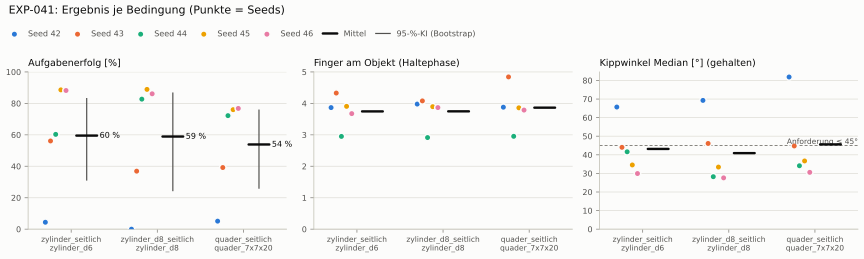
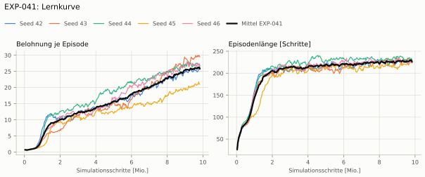
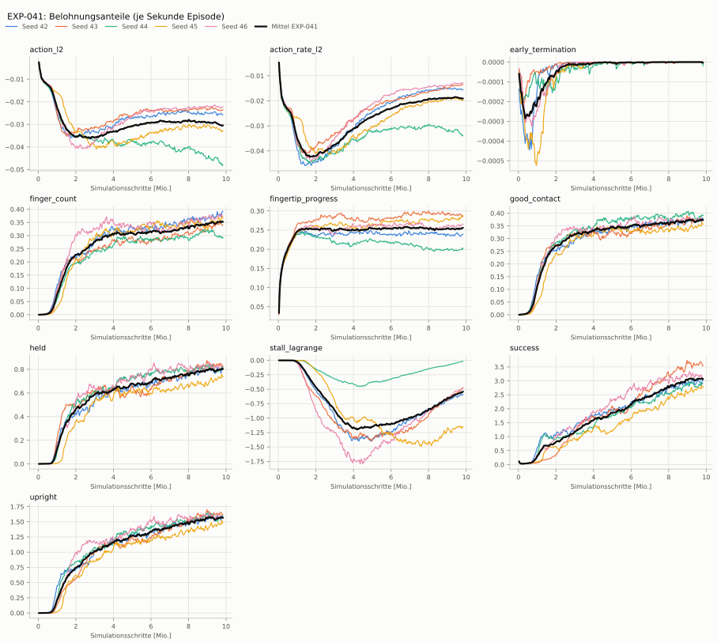
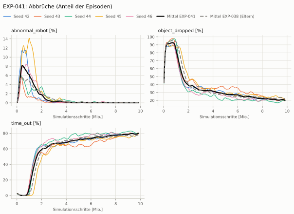
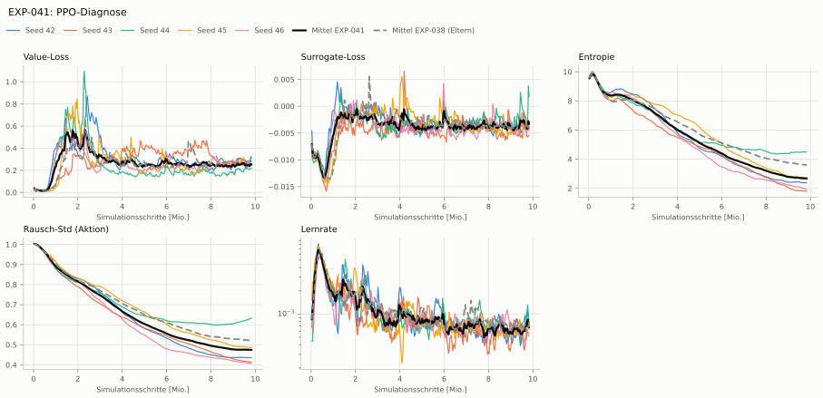

# EXP-041: Kontrolle: Stall wie real + Fingerzahl, ohne Grenze je Servo

**Leistung** 82 % [75–86 %] (erfolgreiche Seeds, IQM über die Objekte; je Objekt Ø 6 cm 88 % · Ø 8 cm 86 % · Quader 76 %) — ggü. EXP-038: P(besser) = 0.70 [0.44–0.93] → kein Unterschied

**Testobjekte** (nie trainiert, erfolgreiche Seeds, Median): Flasche 89 % · Saftpackung 80 % · Cracker (YCB) 77 % · Zucker (YCB) 86 % · Senf (YCB) 76 %

**Zuverlässigkeit** 3/5 Seeds erfolgreich [15–95 %] — EXP-038: 3/5, exakter Fisher-Test p = 1.00 → nicht unterscheidbar (für eine Aussage ≥ 10 Seeds je Experiment)

**Leitplanken** eingehalten

**Befund** ohne Erfolg: Seed 42 (hält, aber gekippt), Seed 43 (hält, aber gekippt); Engpass Quader (76 %)

**Urteilsvorschlag** (auswertung-v2): **kein Unterschied**

**Beste Videos** (Seed 45, 3 Episoden): [Ø 6 cm](beste_videos/EXP-041_zylinder_d6_s45.mp4) · [Ø 8 cm](beste_videos/EXP-041_zylinder_d8_s45.mp4) · [Quader](beste_videos/EXP-041_quader_7x7x20_s45.mp4)

Ergebnisse je Bedingung (eval-v2, Leitplanken, Fehlerarten, Fingernutzung)

#### Bedingung `zylinder_seitlich`

Bedingung `zylinder_seitlich` (Objekt `zylinder_d6`, Kippwinkel ≤ 45°), Protokoll eval-v2, 5 Seed(s); Spalte EXP-038 unter derselben Anforderung

| Metrik | Mittel | 95-%-KI | IQM | Fehlschlag-Seeds (< 50 %) | EXP-038 (Mittel / IQM) |
|---|---|---|---|---|---|
| aufgabenerfolg | 59.5 % | 31.3 % – 83.0 % | 67.4 % | 20.0 % | 46.4 % / 47.0 % |
| haltequote | 95.4 % | 93.9 % – 96.7 % | 95.7 % | 0.0 % | 94.5 % / 95.1 % |
| Kippwinkel Median [°] | 43.2 | | | | 45.1 |
| Unterarm Median [°] | 60.2 | | | | 57.1 |
| Griffkraft Mittel [N] | 73.1 | | | | 65.7 |
| Kraft > 15 N [Anteil] | 99.3 % | | | | 100.0 % |
| Stall-Anteil [Anteil] | 80.6 % | | | | 89.1 % |
| Absinken [mm] | 0 | | | | 0.000835 |
| Unruhe | 0.0615 | | | | 0.0566 |
| Unruhe wirksam (Aktion auf ±1 begrenzt) | 0.0372 | | | | 0.0358 |
| Objektweg Tischebene Ende [mm] | 116 | | | | 114 |

Fehlerarten: startfehler 0.0 %, gefallen 4.6 %, instabil 0.0 %, anforderung_verletzt 35.9 %

**Urteilsvorschlag: kein messbarer Unterschied** (gegenüber EXP-038)
Unterschied Aufgabenerfolg +13.3 Prozentpunkte (95-%-KI -34.8 … +56.9)

Je Seed: 4.4 %, 56.0 %, 60.3 %, 88.6 %, 88.2 %

Fingernutzung (Haltephase): im Mittel 3.74 Finger am Objekt; Kontaktanteil je Seed (Daumen, Zeige, Mittel, Ring, klein): 100/83/100/98/6 · 99/93/64/98/79 · 100/100/96/0/0 · 100/93/99/0/98 · 100/80/92/4/91

#### Bedingung `zylinder_d8_seitlich`

Bedingung `zylinder_d8_seitlich` (Objekt `zylinder_d8`, Kippwinkel ≤ 45°), Protokoll eval-v2, 5 Seed(s); Spalte EXP-038 unter derselben Anforderung

| Metrik | Mittel | 95-%-KI | IQM | Fehlschlag-Seeds (< 50 %) | EXP-038 (Mittel / IQM) |
|---|---|---|---|---|---|
| aufgabenerfolg | 58.9 % | 24.5 % – 86.6 % | 70.0 % | 40.0 % | 47.3 % / 49.7 % |
| haltequote | 89.0 % | 87.5 % – 90.5 % | 89.1 % | 0.0 % | 87.7 % / 89.7 % |
| Kippwinkel Median [°] | 40.9 | | | | 39.1 |
| Unterarm Median [°] | 56.7 | | | | 53.7 |
| Griffkraft Mittel [N] | 66.9 | | | | 61.3 |
| Kraft > 15 N [Anteil] | 99.3 % | | | | 99.7 % |
| Stall-Anteil [Anteil] | 74.0 % | | | | 88.2 % |
| Absinken [mm] | 0 | | | | 0 |
| Unruhe | 0.0619 | | | | 0.0558 |
| Unruhe wirksam (Aktion auf ±1 begrenzt) | 0.0377 | | | | 0.0357 |
| Objektweg Tischebene Ende [mm] | 123 | | | | 120 |

Fehlerarten: startfehler 0.0 %, gefallen 11.0 %, instabil 0.0 %, anforderung_verletzt 30.1 %

**Urteilsvorschlag: kein messbarer Unterschied** (gegenüber EXP-038)
Unterschied Aufgabenerfolg +11.7 Prozentpunkte (95-%-KI -37.8 … +57.7)

Je Seed: 0.0 %, 36.9 %, 82.7 %, 88.9 %, 86.1 %

Fingernutzung (Haltephase): im Mittel 3.75 Finger am Objekt; Kontaktanteil je Seed (Daumen, Zeige, Mittel, Ring, klein): 100/98/100/100/0 · 99/91/26/96/95 · 100/100/91/0/0 · 100/90/100/0/100 · 100/94/95/0/98

#### Bedingung `quader_seitlich`

Bedingung `quader_seitlich` (Objekt `quader_7x7x20`, Kippwinkel ≤ 45°), Protokoll eval-v2, 5 Seed(s); Spalte EXP-038 unter derselben Anforderung

| Metrik | Mittel | 95-%-KI | IQM | Fehlschlag-Seeds (< 50 %) | EXP-038 (Mittel / IQM) |
|---|---|---|---|---|---|
| aufgabenerfolg | 53.9 % | 26.1 % – 75.7 % | 63.4 % | 40.0 % | 44.0 % / 47.1 % |
| haltequote | 77.4 % | 75.9 % – 78.9 % | 77.2 % | 0.0 % | 80.2 % / 79.3 % |
| Kippwinkel Median [°] | 45.6 | | | | 45.2 |
| Unterarm Median [°] | 57.3 | | | | 54.3 |
| Griffkraft Mittel [N] | 61.7 | | | | 57.7 |
| Kraft > 15 N [Anteil] | 97.9 % | | | | 99.7 % |
| Stall-Anteil [Anteil] | 73.3 % | | | | 87.5 % |
| Absinken [mm] | 0 | | | | 0.00105 |
| Unruhe | 0.0695 | | | | 0.0674 |
| Unruhe wirksam (Aktion auf ±1 begrenzt) | 0.0454 | | | | 0.0462 |
| Objektweg Tischebene Ende [mm] | 120 | | | | 120 |

Fehlerarten: startfehler 0.0 %, gefallen 22.6 %, instabil 0.0 %, anforderung_verletzt 23.5 %

**Urteilsvorschlag: kein messbarer Unterschied** (gegenüber EXP-038)
Unterschied Aufgabenerfolg +10.1 Prozentpunkte (95-%-KI -36.4 … +56.2)

Je Seed: 5.1 %, 39.2 %, 72.2 %, 76.0 %, 76.8 %

Fingernutzung (Haltephase): im Mittel 3.86 Finger am Objekt; Kontaktanteil je Seed (Daumen, Zeige, Mittel, Ring, klein): 99/90/100/99/0 · 100/99/86/100/99 · 99/100/96/0/0 · 95/95/100/0/96 · 100/80/100/0/99

#### Bedingung `flasche_seitlich`

Bedingung `flasche_seitlich` (Objekt `flasche_d7x25`, Kippwinkel ≤ 45°), Protokoll eval-v2, 5 Seed(s); Spalte EXP-038 unter derselben Anforderung

| Metrik | Mittel | 95-%-KI | IQM | Fehlschlag-Seeds (< 50 %) | EXP-038 (Mittel / IQM) |
|---|---|---|---|---|---|
| aufgabenerfolg | 59.7 % | 25.2 % – 87.9 % | 70.8 % | 40.0 % | 38.6 % / 38.2 % |
| haltequote | 91.2 % | 89.6 % – 92.7 % | 91.1 % | 0.0 % | 83.4 % / 82.2 % |
| Kippwinkel Median [°] | 44.3 | | | | 45.9 |
| Unterarm Median [°] | 58.9 | | | | 55.4 |
| Griffkraft Mittel [N] | 70.9 | | | | 61.4 |
| Kraft > 15 N [Anteil] | 99.7 % | | | | 100.0 % |
| Stall-Anteil [Anteil] | 77.9 % | | | | 87.8 % |
| Absinken [mm] | 0 | | | | 0.0142 |
| Unruhe | 0.0625 | | | | 0.0564 |
| Unruhe wirksam (Aktion auf ±1 begrenzt) | 0.0382 | | | | 0.0358 |
| Objektweg Tischebene Ende [mm] | 120 | | | | 116 |

Fehlerarten: startfehler 0.0 %, gefallen 8.8 %, instabil 0.0 %, anforderung_verletzt 31.5 %

**Urteilsvorschlag: kein messbarer Unterschied** (gegenüber EXP-038)
Unterschied Aufgabenerfolg +21.2 Prozentpunkte (95-%-KI -26.4 … +66.2)

Je Seed: 0.4 %, 36.6 %, 83.0 %, 88.8 %, 89.5 %

Fingernutzung (Haltephase): im Mittel 3.66 Finger am Objekt; Kontaktanteil je Seed (Daumen, Zeige, Mittel, Ring, klein): 100/97/82/67/0 · 100/93/29/99/97 · 100/100/98/0/0 · 99/92/100/0/99 · 100/90/92/0/98

#### Bedingung `saftpackung_seitlich`

Bedingung `saftpackung_seitlich` (Objekt `saftpackung_9x6x19`, Kippwinkel ≤ 45°), Protokoll eval-v2, 5 Seed(s); Spalte EXP-038 unter derselben Anforderung

| Metrik | Mittel | 95-%-KI | IQM | Fehlschlag-Seeds (< 50 %) | EXP-038 (Mittel / IQM) |
|---|---|---|---|---|---|
| aufgabenerfolg | 60.5 % | 32.8 % – 79.9 % | 71.1 % | 20.0 % | 44.5 % / 43.9 % |
| haltequote | 87.3 % | 85.0 % – 89.3 % | 87.6 % | 0.0 % | 87.5 % / 89.2 % |
| Kippwinkel Median [°] | 45.2 | | | | 46.4 |
| Unterarm Median [°] | 58.7 | | | | 55.9 |
| Griffkraft Mittel [N] | 65.7 | | | | 59.4 |
| Kraft > 15 N [Anteil] | 98.9 % | | | | 99.9 % |
| Stall-Anteil [Anteil] | 79.2 % | | | | 88.5 % |
| Absinken [mm] | 0 | | | | 0 |
| Unruhe | 0.0665 | | | | 0.0612 |
| Unruhe wirksam (Aktion auf ±1 begrenzt) | 0.0421 | | | | 0.0404 |
| Objektweg Tischebene Ende [mm] | 132 | | | | 129 |

Fehlerarten: startfehler 0.0 %, gefallen 12.7 %, instabil 0.0 %, anforderung_verletzt 26.8 %

**Urteilsvorschlag: kein messbarer Unterschied** (gegenüber EXP-038)
Unterschied Aufgabenerfolg +16.0 Prozentpunkte (95-%-KI -33.3 … +59.3)

Je Seed: 8.8 %, 56.3 %, 75.1 %, 81.6 %, 80.4 %

Fingernutzung (Haltephase): im Mittel 3.92 Finger am Objekt; Kontaktanteil je Seed (Daumen, Zeige, Mittel, Ring, klein): 100/99/100/98/0 · 100/96/84/100/99 · 99/100/99/0/0 · 98/95/99/0/99 · 100/99/100/0/99

#### Bedingung `ycb_cracker_seitlich`

Bedingung `ycb_cracker_seitlich` (Objekt `ycb_003_cracker`, Kippwinkel ≤ 45°), Protokoll eval-v2, 5 Seed(s); Spalte EXP-038 unter derselben Anforderung

| Metrik | Mittel | 95-%-KI | IQM | Fehlschlag-Seeds (< 50 %) | EXP-038 (Mittel / IQM) |
|---|---|---|---|---|---|
| aufgabenerfolg | 60.9 % | 30.6 % – 77.9 % | 75.3 % | 20.0 % | 45.6 % / 47.5 % |
| haltequote | 76.5 % | 74.7 % – 78.1 % | 76.7 % | 0.0 % | 78.5 % / 79.0 % |
| Kippwinkel Median [°] | 32.9 | | | | 34.1 |
| Unterarm Median [°] | 57.7 | | | | 53.5 |
| Griffkraft Mittel [N] | 66.6 | | | | 60 |
| Kraft > 15 N [Anteil] | 99.4 % | | | | 100.0 % |
| Stall-Anteil [Anteil] | 82.3 % | | | | 85.9 % |
| Absinken [mm] | 0 | | | | 0 |
| Unruhe | 0.0614 | | | | 0.0577 |
| Unruhe wirksam (Aktion auf ±1 begrenzt) | 0.0376 | | | | 0.0369 |
| Objektweg Tischebene Ende [mm] | 154 | | | | 153 |

Fehlerarten: startfehler 0.0 %, gefallen 23.5 %, instabil 0.0 %, anforderung_verletzt 15.5 %

**Urteilsvorschlag: kein messbarer Unterschied** (gegenüber EXP-038)
Unterschied Aufgabenerfolg +15.3 Prozentpunkte (95-%-KI -31.4 … +54.4)

Je Seed: 0.8 %, 71.3 %, 78.5 %, 77.0 %, 77.0 %

Fingernutzung (Haltephase): im Mittel 3.64 Finger am Objekt; Kontaktanteil je Seed (Daumen, Zeige, Mittel, Ring, klein): 100/99/100/100/0 · 100/71/67/99/100 · 100/100/100/0/0 · 100/51/71/0/100 · 100/75/88/0/100

#### Bedingung `ycb_zucker_seitlich`

Bedingung `ycb_zucker_seitlich` (Objekt `ycb_004_zucker`, Kippwinkel ≤ 45°), Protokoll eval-v2, 5 Seed(s); Spalte EXP-038 unter derselben Anforderung

| Metrik | Mittel | 95-%-KI | IQM | Fehlschlag-Seeds (< 50 %) | EXP-038 (Mittel / IQM) |
|---|---|---|---|---|---|
| aufgabenerfolg | 75.9 % | 54.5 % – 93.4 % | 82.2 % | 20.0 % | 54.1 % / 51.1 % |
| haltequote | 87.8 % | 75.4 % – 96.5 % | 92.4 % | 0.0 % | 91.0 % / 97.7 % |
| Kippwinkel Median [°] | 30.2 | | | | 34.4 |
| Unterarm Median [°] | 59.5 | | | | 57.1 |
| Griffkraft Mittel [N] | 71 | | | | 65.4 |
| Kraft > 15 N [Anteil] | 99.7 % | | | | 99.7 % |
| Stall-Anteil [Anteil] | 83.9 % | | | | 87.2 % |
| Absinken [mm] | 0 | | | | 0.0303 |
| Unruhe | 0.0588 | | | | 0.0538 |
| Unruhe wirksam (Aktion auf ±1 begrenzt) | 0.0357 | | | | 0.0335 |
| Objektweg Tischebene Ende [mm] | 128 | | | | 130 |

Fehlerarten: startfehler 0.0 %, gefallen 12.2 %, instabil 0.0 %, anforderung_verletzt 11.9 %

**Urteilsvorschlag: kein messbarer Unterschied** (gegenüber EXP-038)
Unterschied Aufgabenerfolg +21.8 Prozentpunkte (95-%-KI -22.6 … +58.7)

Je Seed: 37.7 %, 95.0 %, 96.0 %, 65.1 %, 85.5 %

Fingernutzung (Haltephase): im Mittel 3.50 Finger am Objekt; Kontaktanteil je Seed (Daumen, Zeige, Mittel, Ring, klein): 100/98/100/100/0 · 100/98/9/99/61 · 100/100/98/0/0 · 100/59/86/0/100 · 100/59/98/0/86

#### Bedingung `ycb_senf_seitlich`

Bedingung `ycb_senf_seitlich` (Objekt `ycb_006_senf`, Kippwinkel ≤ 45°), Protokoll eval-v2, 5 Seed(s); Spalte EXP-038 unter derselben Anforderung

| Metrik | Mittel | 95-%-KI | IQM | Fehlschlag-Seeds (< 50 %) | EXP-038 (Mittel / IQM) |
|---|---|---|---|---|---|
| aufgabenerfolg | 63.7 % | 35.3 % – 85.0 % | 73.7 % | 20.0 % | 42.9 % / 40.1 % |
| haltequote | 80.9 % | 68.3 % – 90.8 % | 84.3 % | 0.0 % | 87.3 % / 94.5 % |
| Kippwinkel Median [°] | 33 | | | | 38.3 |
| Unterarm Median [°] | 59.9 | | | | 57.7 |
| Griffkraft Mittel [N] | 69.7 | | | | 64.8 |
| Kraft > 15 N [Anteil] | 99.1 % | | | | 99.9 % |
| Stall-Anteil [Anteil] | 83.1 % | | | | 88.1 % |
| Absinken [mm] | 0.0386 | | | | 0.00687 |
| Unruhe | 0.0579 | | | | 0.0538 |
| Unruhe wirksam (Aktion auf ±1 begrenzt) | 0.0348 | | | | 0.0335 |
| Objektweg Tischebene Ende [mm] | 128 | | | | 127 |

Fehlerarten: startfehler 0.0 %, gefallen 19.1 %, instabil 0.0 %, anforderung_verletzt 17.3 %

**Urteilsvorschlag: kein messbarer Unterschied** (gegenüber EXP-038)
Unterschied Aufgabenerfolg +20.8 Prozentpunkte (95-%-KI -35.9 … +67.2)

Je Seed: 9.1 %, 88.5 %, 86.8 %, 58.3 %, 75.5 %

Fingernutzung (Haltephase): im Mittel 3.58 Finger am Objekt; Kontaktanteil je Seed (Daumen, Zeige, Mittel, Ring, klein): 100/93/99/99/0 · 100/96/52/98/41 · 100/100/100/0/0 · 100/71/81/0/100 · 100/67/92/1/99

Trainingsverlauf

Seeds dünn, Mittel kräftig, Eltern gestrichelt (nur Abbrüche/PPO — Trainings-Belohnung ist zwischen Experimenten nicht vergleichbar); geglättet, x = Simulationsschritte. Endwerte = Mittel der letzten 10 Iterationen (Belohnungsanteile je Sekunde Episode).

| Größe | Seed 42 | Seed 43 | Seed 44 | Seed 45 | Seed 46 | Mittel |
|---|---|---|---|---|---|---|
| mean_reward | 25.4 | 29.7 | 27.2 | 21.2 | 26.9 | 26.1 |
| action_l2 | -0.0256 | -0.0237 | -0.0476 | -0.0328 | -0.0224 | -0.0304 |
| action_rate_l2 | -0.0155 | -0.0136 | -0.0335 | -0.0196 | -0.013 | -0.019 |
| early_termination | 0 | 0 | -7.72e-06 | 0 | 0 | -1.54e-06 |
| finger_count | 0.385 | 0.342 | 0.293 | 0.368 | 0.377 | 0.353 |
| fingertip_progress | 0.236 | 0.288 | 0.2 | 0.284 | 0.264 | 0.255 |
| good_contact | 0.375 | 0.372 | 0.388 | 0.357 | 0.375 | 0.373 |
| held | 0.805 | 0.836 | 0.808 | 0.74 | 0.817 | 0.801 |
| stall_lagrange | -0.598 | -0.497 | -0.0204 | -1.15 | -0.493 | -0.552 |
| success | 2.99 | 3.59 | 2.9 | 2.78 | 3.12 | 3.08 |
| upright | 1.58 | 1.63 | 1.58 | 1.48 | 1.57 | 1.57 |
| object_dropped | 20.5 % | 19.8 % | 20.0 % | 21.9 % | 21.2 % | 20.7 % |
| mean_noise_std | 0.436 | 0.415 | 0.63 | 0.487 | 0.408 | 0.475 |

Netz, Training und Konfiguration

Actor [256, 128, 64] (elu), 68808 Parameter, 105 Eingänge (Verlauf 5) · Critic [512, 256, 128] · PPO: Lernrate 0.001, Entropie 0.005, 5 Epochen × 4 Mini-Batches, 32 Schritte/Umgebung · 1024 Umgebungen × 300 Iterationen

Geplante Änderung: Zusätzlich Belohnung nach Fingerzahl wie EXP-040, aber ohne Grenze je Servo (Task HeavyMultiProgressDexCapsLagrangeRealFinger-v0).

Konfiguration gegenüber EXP-038 (3 Unterschiede):

- `env.rewards.finger_count.func: ∅ → pib_grasp.mdp:fingers_in_contact`
- `env.rewards.finger_count.params.threshold: ∅ → 1.0`
- `env.rewards.finger_count.weight: ∅ → 1.0`

